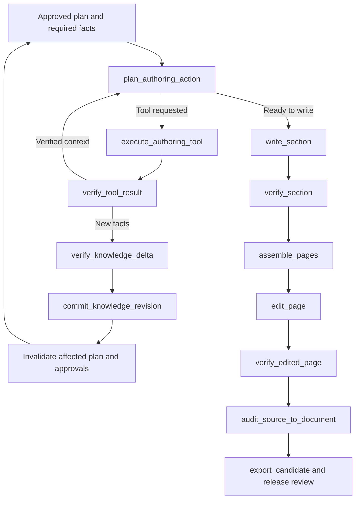

# Task IV Development Plan for Documentation Generation

Plan for agent IV. Agent III works on [code analysis](development-plan-task-3-code-analysis.md) in parallel. Task IV must produce readable documentation that explains product behavior and its documented rationale while preserving every potentially relevant piece of information from the selected original source. Style improvements must retain evidence, conditions, exceptions, and uncertainty.

Baseline inspected on 2026-10-12: the active `src/docgen_graph` package, HEAD `7a7dd7c1b2d6f759fe13c0de4eb00924d752aa3b`, with current working changes. No ID was supplied for the “last run,” so its symptoms are not attributed to a particular run. The initial stage will compare the supplied or explicitly selected baseline against the current code. This plan is not an implementation report.

## 1. Which observations still apply

| Observation | Current state and evidence | Remaining work |
| --- | --- | --- |
| Humanization and rewriting | `ContentUnit`, shared paragraphs for multiple obligations, `write_section`, `edit_page`, and a separate change audit already exist. | Develop readable narrative and source-backed explanations; do not build a second editing path. |
| Preserving evidence after rewriting | Exact passages, mappings, quotes, offsets, and checks for changes outside mappings already exist. Task I improved source links. | Preserve these through tool use, section splitting, and renumbering; validate every new fact and causal relationship. |
| Every relevant source detail | Extraction and verification read the sources, but deterministic coverage primarily requires evidence IDs to be present. | Add explicit information aspects and an independent source→graph→text audit. A single fact must not “cover” a table containing multiple facts. |
| All nodes used, but not all facts discovered | The plan allocates all extracted groups. The historical furniture report describes an omitted qualifier despite complete obligation mapping. | Separate discovery completeness from graph utilization. Do not merely change the used-node counter. |
| Agentic content construction | The model receives prepared packets and returns JSON; `GeminiModel.call` has no tool-calling loop. | Add a bounded, resumable loop for evidence discovery and repairs. |
| Mermaid | `DiagramSpec`, a deterministic renderer, node and edge evidence, and element auditing already exist. | Expose them as an authoring tool; preserve checks on diagram semantics. |
| Attachments | PNG/JPEG/SVG freezing, validation, and document placement are supported. General text-attachment extraction is absent. | Extend supported types and explicit processing records; do not rewrite image handling. |
| Template and numbering | `compile_requirements` recognizes H2/H3, order, tables, and callouts. Heading placeholders become optional style requirements. There is no explicit numbering contract for generated subsections. | Add template structure with numbering and stable identifiers, including dynamic slots. |
| The word “Plan” in the title | The prompt prohibits `Documentation Plan`; the validator rejects `documentation plan` and `planning artifact`. It does not block every variant. | Reproduce the symptom and implement a rule that recognizes a working-artifact title without banning valid product names. |
| Repetition | Canonical ownership, limits on repeated introductions, and an identical-paragraph detector exist. The detector skips tables and short paragraphs. | Also measure semantic repetition while preserving necessary local conditions and scope differences. |

Basis: [quality.py](../src/docgen_graph/quality.py), [workflow.py](../src/docgen_graph/workflow.py), [contracts.py](../src/docgen_graph/contracts.py), [model.py](../src/docgen_graph/model.py), [assets.py](../src/docgen_graph/assets.py), [quality report](new-approach/documentation-quality-implementation-report.md). The historical 512/512 result measured the use of extracted obligations, not extraction completeness; the report describes a later correction to restore omitted customer acceptance of a substitution.

## 2. Collaboration with agent III

The [ownership table and C0 contract in plan III](development-plan-task-3-code-analysis.md#4-division-of-work-between-agents) apply. Agent IV is the sole owner of `workflow.py`, `stages.py`, `cli.py`, `model.py`, `quality.py`, `source_links.py`, `assets.py`, and `README.md`. New IV modules: `authoring/`, `source_coverage.py`, `attachments.py`, and `documentation_contracts.py`. Agent III maintains the base contracts, ingestion, graph, configuration, storage, budget, and dependencies.

IV does not directly edit `knowledge.py`, `ingestion.py`, `contracts.py`, `config.py`, `.env.example`, or the lockfile. It supplies III with required fields, options, hooks, and test cases. III does not edit the workflow: it supplies code-analysis functions for registration. This division also applies to integration fixes.

Parallel work can begin immediately: IV develops the template, humanization, document coverage, and tests without code input. After the small C0 commit from III, it uses an `EvidenceService` test double, then replaces it with the real service. Codex/Auggie unavailability does not block documentation-authoring work.

Completeness responsibilities are split as follows: III owns the code inventory and information discovery; IV owns extraction and auditing of original documents/attachments and final source→graph→text coverage. III owns shared persistence of `FactRecord`, `SourceCoverageItem`, and graph versions. Document classification uses the same taxonomy as code; categories must not become filters that remove facts.

## 3. Complete information from source to text

### 3.1 Three separate checks

1. **Source inventory:** every selected page, block, table, procedure, and attachment has a stable locator and status. Accounting for files does not mean accounting for their information.
2. **Knowledge discovery:** every relevant source aspect is represented by facts, a duplicate retaining provenance, or an unresolved issue. Assessment also starts from the source, independently of the extracted fact list.
3. **Final document:** every mandatory fact and qualifier has an exact location in prose, a table, a diagram, or a readable appendix. Every new assertion in the text has verifiable evidence.

Do not use top-k retrieval or the number of utilized nodes to establish completeness. Coverage checks must traverse the entire selected inventory in packets with a cursor; retrieval is an additional tool for finding context.

### 3.2 Aspects and independent checks

Extend extraction with the C0 `SourceCoverageItem`: obligation, condition, exception, numerical boundary with its unit, role, step order, effect, relationship, explicit unknown, or example carrying new information. Preserve cell-to-header relationships in tables, order in procedures, and separate qualifiers in long sentences. Do not turn every punctuation mark into a new atom; a unit must correspond to verifiable information.

The `inventory_source_aspects` stage reads the original without seeing the extractor's response. The `audit_source_coverage` stage compares the original, aspect inventory, and facts, identifying exact uncovered ranges and distorted qualifiers. This prevents the audit from assuming that the fact list is complete. The same model may still miss information; measure results against a separate, manually verifiable oracle and tests that deliberately remove information.

Discrepancies trigger extraction repair only for the affected packet, renewed verification, and a new graph revision. A fact discovered only during writing must follow the same path; it must not be added solely to Markdown.

### 3.3 Completeness policy

The default objective of this task is to retain all potentially relevant information within the explicitly selected scope. `relevance` determines placement, not permission to omit. Details may move to an appendix within the bundle, but must remain readable and covered by checks. A link to an unprocessed source alone does not mean the document preserves its information.

A duplicate must point to the retained representation and all original sources. Boilerplate may be excluded with a specific reason. A relevant unresolved fact, conflict, missing attachment, or exhausted repair limit prevents full-completeness status.

The current autopilot can exclude material after failed extraction and finish as `complete_with_exclusions`. Preserve the ability to produce a diagnostic bundle with exclusions, but do not treat that status as passing the full-information-preservation requirement. Do not relabel failed coverage as non-substantive text. In manual mode, use `interrupt()`; in autopilot, after bounded repairs, finish as `incomplete` when relevant information remains unresolved. Do not automatically ask a human in a mode intended to run without interaction.

The final report separates block coverage, aspect coverage, qualifier coverage, facts placed in the text, unsupported assertions, conflicts, exclusions, and attachments lacking interpretation. Counts have explicit denominators and source revisions.

## 4. Humanization that preserves meaning

Extend the existing content plan: one section is the primary home for explaining a topic; other sections use short cross-references. Combine related facts into paragraphs and present variants with different conditions in tables. Do not force a shorter document at the expense of content.

Each part should answer the reader's questions: what they can do, when behavior occurs, what prerequisites apply, what the result is, and what exceptions exist. Weave in the “Why” as a documented purpose or supported causal relationship. Two adjacent facts do not establish causation. When no rationale is available, preserve a clear account of behavior; do not add “for security,” “to improve performance,” or “for compliance” without a source.

Test example, not new product knowledge: if a source states that the user must accept a proposed substitute and that the system cannot reduce dimensions on its own, a faithful rewrite combines both facts. Simply saying “the system proposes a substitute” loses the acceptance condition, while “the system protects the customer from a poor choice” adds an unsupported rationale.

Extend `edit_page` with clearly defined editorial tasks while retaining bounded changes and current mappings. Major reorganization must be split into verifiable steps, with affected facts audited again. Do not remove the current mapping limit merely because it restricts stylistic freedom; expanding scope requires an explicit context budget and evidence-preservation regression tests.

Post-edit checks cover roles, negation, quantifiers, numbers and units, modality, time, scope, conditions, exceptions, and relationships expressed through “because,” “therefore,” and “in order to.” Every changed relationship requires its own support. An exact quote is a necessary locator check, but does not by itself establish that the source entails the sentence.

## 5. Authoring agent and tool calls

The authoring agent uses only Gemini `gemini-3.8-flash`. The Codex/Auggie exception applies to the code-analysis service from task III. `GeminiModel` remains the shared location for model handling, usage logging, cost reservations, and retries. Do not add a Gemini client inside each tool.

### 5.1 Tools

| Tool | Output and constraints |
| --- | --- |
| `search_original_sources` | Original document passages or processed attachment passages with hashes and locators. No result does not justify claiming that the source lacks something. |
| `search_knowledge_graph` | Facts, qualifiers, relations, and conflicts for an explicit revision. Mandatory facts are independent of result ranking. |
| `search_code` | Delegates a question to III's `EvidenceService`. Returns evidence or an explicit unavailable status; it does not replace analysis of the entire code scope. |
| `read_evidence` | The full original range with defined context when a search hit is too short. |
| `build_mermaid` | Accepts a `DiagramSpec`, validates structure, and generates permitted Mermaid syntax. Returns element mappings and semantic-audit requirements; it does not “approve” its own content. |
| `verify_content` | Deterministic checks and a separate independent-audit request: `supported`, `unsupported`, or `unresolved`, with specific gaps and sources. An `accepted=true` flag alone cannot bypass validators. |
| `list_attachments` / `read_attachment` | A file register and frozen text/structure, or an explicit unsupported status. Does not execute code or macros or fetch arbitrary URLs. |

Input/output declarations are versioned and described in English. These are small executable tools, not skills requiring human operation. The suggestion of “skills for finding sources” is implemented through verifiable evidence search and reading; a separate skill package is not required for the application to work.

### 5.2 Flow and persistence

Each operational box corresponds to a separate LangGraph node and artifact write. Revalidating the plan after discovering new facts must pass the existing gates normally; it must not automatically restore an old approval. Action planning, tool execution, and result verification must not be hidden in one long SDK loop.

Calls may originate during page planning, section writing, or repairs, but use one shared toolset. Do not introduce a separate multi-agent architecture merely to label the author as “thinking.” State records the current action's objective, unresolved questions, selected tool, arguments, result, and a brief decision rationale. It does not require exposing the model's private reasoning.

The [Gemini function-calling documentation](https://ai.google.dev/gemini-api/docs/function-calling) describes function declarations, tool responses, and signature handling for thinking models. During implementation, check compatibility with the pinned `google-genai` and current `generate_content`; do not migrate the entire application to a different endpoint merely because documentation examples have changed.

Persist serializable messages needed to continue, call identifiers, and opaque protocol data required by the SDK. LangGraph controls tool execution; disable implicit automatic client loops. Every turn and independent audit passes through shared accounting.

Define limits for turns, requests, time, result bytes, and cost. Repeating an identical query without gaining knowledge must stop with an explicit gap. Do not truncate results without a cursor or `truncated` status. A missing SDK does not block a document that requires no code; missing essential code evidence blocks an evidence-backed release.

Checkpoint state stores artifact references, not open SDK clients. Retain SQLite and a stable `thread_id`; use `interrupt()` and `Command(resume=...)` for feedback. Extend the runtime signature recursively to include the new `authoring/` and `code_analysis/` packages, prompts, schemas, tools, and configuration — the current `implementation_signature()` hashes only Python files directly inside the package directory.

## 6. Attachments as first-class sources

Initial implementation scope: existing images plus local TXT/MD, text PDFs, DOCX, and CSV/XLSX. Keep adapters small and versioned; add dependencies through agent III. Supporting a type means preserving its required content, not merely recognizing its extension.

The manifest records the hash, original name/path, MIME/format, referencing document and location, extraction result, parser version, and limitations. PDFs require page numbers and ranges; DOCX requires paragraph/table/cell locations; spreadsheets require sheet names and cells, formulas, and available cached values. Complex tables, annotations, or elements that cannot be read faithfully must remain visible as limitations rather than disappear silently.

Attachment content enters the same aspect inventory and graph. Its text must not be cited as though it were part of the parent Markdown document. Different references to identical bytes retain separate provenance; export deduplicates the file.

Do not interpret image pixels with a model: the baseline plan's policy remains in force. A scanned PDF or image containing required knowledge needs a source-attributed transcription or human explanation through LangGraph review. Without that explanation, coverage does not pass. Alt text may support accessibility, but does not replace evidence of image content. Do not add OCR or vision as an implicit workaround for this rule.

A missing, corrupted, password-protected, or unsupported attachment remains in the register. Do not automatically fetch resources from arbitrary links; handle explicitly supplied files. The existing HTML source-page map continues to serve link verification only, not discovery of additional facts.

Collaboration: IV supplies parsers and the attachment register; III integrates them with central snapshotting and evidence normalization. IV adds locators to export/citations. Do not duplicate I/O outside `ArtifactStore` and shared ingestion.

## 7. Template, numbering, and title

### 7.1 Structural template contract

Extend the existing compiler into a tree of headings and slots: stable `section_id`, parent, level, fixed title or placeholder, required/optional status, order, numbering pattern, repeated-slot cardinality, and content requirements. Use a Markdown parser to distinguish a heading from an example inside fenced code; do not derive the hierarchy from a single H2/H3 regex.

A section's identifier remains stable when its title or numbering changes. Current mechanisms use title text as a key — migration to `section_id` must include fact allocation, mappings, visuals, cross-references, and approvals. Fixed headings retain wording and order; placeholders expand into concrete headings according to their parent's rule.

If the template requires `3.1`, `3.2`, subsequent generated subsections under that parent receive `3.3`, and so on; one level below, use `3.2.1`. The renderer computes numbering after the structure is established; the model does not invent it in free text. Distinguish headings, numbered procedure steps, and numbers in product names. Do not renumber quotations or code examples.

Removing an optional section updates numbering according to an explicit template policy. Do not automatically change fixed numbers specified by the user; an inconsistent template raises a requirement conflict. Do not arbitrarily add numbering to an unnumbered template. Checks also cover generated subsections, the table of contents, unique anchors, and cross-references after export.

### 7.2 Document title

Separate the working planning artifact's title from `document_title`. Prefer a concrete title supplied in the template or brief; fill a product-name placeholder using the sources. Record the supplied title and its provenance in the plan, then check them again before export.

The fix must not ban the word `Plan`: “Pricing Plan” or “Disaster Recovery Plan” may be valid topic names. Test invalid `Documentation Plan`, working titles such as `Plan for ...`, and their Polish equivalents, as well as legitimate names containing that word. Resolve ambiguity using the document's purpose and the user's explicit title. Internal class names such as `PagePlanDraft` do not need to change.

## 8. Reducing repetition

Retain canonical ownership and current information grouping. Extend analysis to repeated rules in tables, paraphrases shared between the summary and details, and repeated introductions from later writing units. The detector identifies candidates; it does not automatically delete similar sentences.

Before merging, compare scope, role, conditions, exceptions, source status, and version. Two similar rules for different regions or roles are not redundant repetition. A necessary condition may be repeated at the point of a user decision; a short summary with a link to the full explanation is not the same as a second full definition.

Measure identical paragraphs, redundant explanations, and merge correctness separately. Target zero unjustified repetitions in the annotated set and zero lost variants. Word count is diagnostic, not the overriding criterion. Every deduplication repair rechecks sources, mappings, and local citations.

## 9. Implementation stages for agent IV

| Stage | Scope | Acceptance condition |
| --- | --- | --- |
| IV0 Baseline and regressions | Restore the environment, select and record the baseline ID and hashes, and prepare cases for omitted qualifiers, numbering, titles, and repetition. | Every observation has a confirmed/partially resolved/not reproduced status and an example. Any missing run identification is explicit. |
| IV1 Source coverage | Aspect inventory, independent audit, bounded repairs, and completeness policy; integration of III's contracts. | A test deliberately removing one condition from a block containing multiple facts is rejected despite 100% fact utilization. |
| IV2 Template and narrative | Heading tree, stable IDs, numbering, title, expanded reader requirements, and source-only rationales. | Generated sections satisfy the structural contract and preserve all qualifiers. |
| IV3 Authoring tools | Explicit Gemini function calling, dispatch, logs, limits, checkpoints, and result validation. | The author can find missing evidence, build a diagram, and reject unsupported content, including after a restart. |
| IV4 Attachments | Text adapters, consistent provenance, manifests, and locators; images retain the current policy. | Knowledge from a supported attachment reaches the graph and publication; unsupported content remains visible. |
| IV5 Editing and final audit | Expanded repetition checks, source→document auditing, and locator/export recomputation. | Improved style does not weaken coverage, evidence, or template fidelity. |
| IV6 Integration with III | Real evidence service, registration of code nodes, shared CLI, modes, and restart. | Both tasks work together, including docs-only runs and explicit code-backend unavailability. |

Do not renumber existing `step1`–`step27`. Append new stages with new stable numbers and record execution order in the manifest. An artifact number need not equal its position in the graph. Preserve task I's layout and links, especially existing candidate bundles.

After a fact, diagram, attachment, or template changes, recompute dependent hashes and invalidate approval. Do not treat older checkpoints as compatible merely by adding default fields. Historical data remains inspectable; a new runtime requires a compatible schema or a new run.

## 10. Evaluation and acceptance criteria

### 10.1 Source set independent of the generator

Use the existing small quality fixtures, furniture corpus, and quick investment fixture. Add separate annotations covering multiple facts in one block, nested conditions, exceptions in another table cell, procedure order, conflicting versions, unknown values, and attachments. For code, use III's output and Java/Angular fixture.

The current investment oracle has `human_reviewed=false`; do not turn a test of agreement with that oracle into a claim of human acceptance. Prepare expected facts and reader questions before inspecting the new generation. Keep some cases held out and do not provide their answers to the authoring tools.

### 10.2 Required regression cases

- All obligations are mapped, but a source qualifier was omitted: the source audit detects the problem and blocks a complete release.
- Humanization removes “only,” changes “may” to “must,” loses a unit, or adds a cause: the audit rejects the change. Also test a new assertion without a mapping.
- A tool discovers a new fact: separate verification, a new graph revision, invalidation of the appropriate approvals, and content reallocation are required.
- Numbering 3.1/3.2, an additional section 3.3, level 3.2.1, an omitted optional slot, an unnumbered template, and an invalid template. Anchors still work after export.
- A working title containing “Plan” is repaired; a valid product title containing the word remains.
- Repetition in paragraphs and tables is reduced; similar rules with different conditions are not merged without preserving those differences.
- Mermaid has evidence for every material edge, condition, and description; an unsupported edge fails even if both endpoints have evidence. Check with the actual Mermaid parser and visually inspect an example.
- A text attachment has correct locators; scans, missing files, corruption, and incomplete extraction are explicit. Byte-identical attachments deduplicate the resource while preserving provenance.
- `manual` and `autopilot`: full completeness cannot be granted by automatically excluding an unresolved fact. The review gate remains at the appropriate stage.
- Restarts between tool planning, results, auditing, editing, and export preserve accepted artifacts. A change to a module in a new subpackage invalidates the cache.
- Task I regressions: short links, offsets, HTML-only locator verification, fallbacks, and bundle and manifest hashes remain correct.

### 10.3 Metrics and acceptance

Within the annotated scope, require preservation of all expected facts and qualifiers, zero unsupported additions, zero incorrect locators, zero incorrectly merged variants, full compliance with the required template, and zero unjustified repetitions under the recorded rubric. A sample does not guarantee completeness of the entire unannotated corpus.

Assess readability through answers to predefined questions and human scores from 1 to 5 for clarity, structure, and findability; the proposed threshold is at least 4/5 in each dimension. Model assessment is supplementary and does not replace human acceptance. Record retained facts, not merely a preference for shorter text.

Time and cost comparisons require identical snapshots, template, brief, model configuration, and cache policy. Separate a fresh run from a resumed run that reuses a previously paid-for graph. Report tool turns, retries, repairs, tokens, and code-backend usage; do not impose an unsupported guarantee of improved speed.

## 11. Budget and checks actually performed

Both tasks share cumulative usage accounting. Preserve the existing ledger, record actual provider usage and retries, and use current pricing and currency conversion for API charges. Runtime spending limits are optional configuration.

No paid generation was performed during this analysis. The attempt to run `test_documentation_quality.py` and `test_evidence_and_retrieval.py` stopped at the `PIL` and `defusedxml` imports; the budget CLI also failed to load because of a dependency. Budget values were read separately, directly from SQLite in read-only mode. Historical tests and evaluations provide regression material, not newly verified results.

Full product acceptance later requires a live function-calling test, verification of both SDK integrations, and a readability assessment. If those trials remain unavailable, the implementation report must distinguish “completed offline,” “confirmed live,” and “unverified.”

## 12. Handoff and sources

Agent IV delivers an implementation report with a matrix of observations and their current status, source-coverage results, before/after examples, test results, costs, and limitations. As integration owner, it runs the shared `tests/test_task34_integration.py` tests and checks a document using evidence from both backends in contract tests.

Shared C0/C1/C2/C3 milestones and ownership rules are described in [plan III](development-plan-task-3-code-analysis.md). Do not finish the task with prompt changes alone; acceptance requires checks of contracts, execution, artifacts, and output quality.

- [Baseline completeness and provenance requirements](development-plan.md).
- [Earlier quality-improvement plan](new-approach/documentation-quality-implementation-plan.md) and [implementation report](new-approach/documentation-quality-implementation-report.md).
- [Task I report](development-plan-task-1-implementation-report.md), [template](../data/template.md), [fixture and oracle limitations](../data/test_data_2_reference/README.md).
- [Function calling with the Gemini API](https://ai.google.dev/gemini-api/docs/function-calling), Google, accessed 2026-10-12.
- [Persistence](https://docs.langchain.com/oss/python/langgraph/persistence), LangChain, accessed 2026-10-12.
