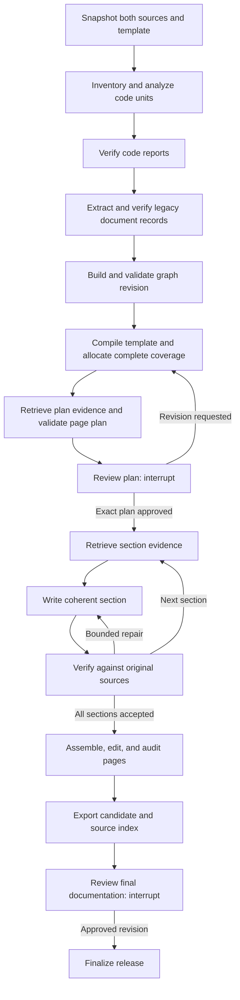

# Development Plan: Documentation from Code and Legacy Sources with Graph Retrieval

Date: 2026-10-11

Status: proposed independent design. This deliverable defines the work; it does not implement or validate the new pipeline. The directory split is in place. Performance and quality targets below remain acceptance targets.

## 1. Outcome and scope

Build a new local Python pipeline that analyzes source code into concise, evidence-backed reports, combines those reports with legacy documentation in a persistent knowledge graph, and uses graph retrieval to prepare and write documentation from a user-supplied template. A human must approve the exact page plan before any documentation drafting starts.

The graph helps discover and connect evidence. Original source snapshots remain the authority for citations, and a separate coverage ledger accounts for all selected information. Neither a concise report nor a top-k retrieval result is a substitute for source completeness.

The first release produces a Markdown documentation page or a connected set of Markdown pages, with a source index and separate audit artifacts. Here, a "page plan" means the structure and content of the documentation, including documentation intended for a website. Building or hosting a website, a graphical editor, and automatic deployment are outside this release.

The implementation is independent of `old-approach`: use a new package, contracts, prompts, tests, dependencies, indexes, and LangGraph checkpoints. Historical findings inform design and evaluation; old knowledge bundles or runnable old code are never prerequisites.

### Inputs and outputs

| Input | Required handling |
| --- | --- |
| Legacy documentation | Selected UTF-8 Markdown files or directories; preserve heading paths, paragraphs, lists, tables, examples, links, versions, and assets. Other document formats require an explicit later adapter. |
| Source code | A local repository or selected local files, including relevant configuration, migrations, tests, and dependency manifests. Freeze selected bytes; record the commit when available and whether the working tree differs. Do not execute the target application. |
| User template | Snapshot the complete Markdown template. Extract required headings, section purposes, ordering, tables, diagrams, conditional sections, and style instructions. Template examples are layout guidance, never product evidence. |
| Optional brief | Audience, intended use, scope, source/version applicability, desired single-page or multi-page delivery, and editorial preferences. Omitted product facts remain unknown. |

Required outputs are a code analysis report, a versioned graph bundle, a reviewable page plan, the approved-plan record, generated Markdown, original-source citations, coverage/discrepancy reports, and a reproducible run manifest. Software UI, prompts, contracts, and documentation in this implementation use English.

## 2. Lessons that change this design

The following are historical observations, not newly reproduced benchmarks. Prior reference sets were not fully user-reviewed, large runs used deterministic stubs, and two-million-token end-to-end capacity was not established.

| Observed lesson | Evidence | New design response |
| --- | --- | --- |
| A model verifier missed an omitted qualification in the nominal 32k extraction experiment. | [Phase 1 implementation report](../implementation-report.md). | Preserve original sources, detailed coverage, and held-out semantic checks independently of summaries. |
| Short excerpts caused supported statements to be rejected; scope/version omissions also escaped verification. | [Phase 2 implementation report](../implementation-report-phase-2.md). | Resolve enclosing source context and explicit qualifiers; carry scope, version, and modality on assertions and relationships. |
| The 500k structural experiment made 24,218 knowledge calls, including 24,090 comparisons; broad all-pairs reconciliation remained expensive. | [Phase 2 capacity measurements](../implementation-report-phase-2.md#capacity-measurements). | Build deterministic code relationships and targeted semantic links. Bound candidate work, record gaps, and measure graph degree and comparison growth. |
| A small example needed 79 planning responses for 31 obligations and 32 writing jobs; generation added 72 paid requests. | [Phase 2 report](../implementation-report-phase-2.md), [phase 3 report](../implementation-report-phase-3.md). | Write coherent sections from bounded evidence packets. A fact record is not automatically a separate writing job. |
| Correct link and allocation checks coexisted with false unknowns and an unsupported diagram. | [Phase 3 source review](../implementation-report-phase-3.md#recorded-live-outcome). | Check what each citation actually supports; test absence claims against original context and verify diagram statements. |
| A shorter editorial candidate passed a model review but invented mechanisms, strengthened guarantees, and lost qualifications. | [Editorial implementation report](../implementation-report-editorial.md). | Require source verification after editing and independent human assessment of both accuracy and readability. |

The [revitalization document](../development-plan-revitalization.md) is a separate proposal for changing the old implementation. Its proposed concurrency and speed improvements are not measured capabilities inherited by this design.

## 3. Architecture decisions

### A. Separate evidence, derived knowledge, and reader output

Maintain three distinct layers:

1. **Original evidence:** immutable code and documentation snapshots with stable source locations.
2. **Derived knowledge:** code reports, documented assertions, entities, relationships, conflicts, and coverage records. Every accepted factual record resolves back to original evidence.
3. **Reader output:** an approved page plan and verified prose with local citations to original evidence.

An AI report is searchable and useful for planning, but it is not an original source. A code claim must ultimately cite code; a claim about a legacy requirement must cite that document. A comparison between intended and implemented behavior must cite both. Do not force two citations onto a claim supported by only one source type.

### B. Use a small persistent graph retrieval implementation

For the local first release, use SQLite tables for typed nodes, assertions, edges, provenance, and indexes, with FTS5 for lexical seed retrieval. Follow seeds through stored graph relationships and resolve the resulting evidence. SQLite documents FTS5 as its full-text search module; verify that the bundled runtime supports it at startup. [SQLite FTS5 documentation](https://www.sqlite.org/fts5.html).

This is a project-specific graph RAG design, not a commitment to the Microsoft GraphRAG package or its complete indexing pipeline. Microsoft's local-search design provides a useful reference for combining graph context and original text. The exact schema and retrieval policy below are our recommendations. [GraphRAG local search](https://microsoft.github.io/graphrag/query/local_search/).

The MVP does not use dense embeddings or a separate reranker model. All model calls, including query expansion and verification, must use Gemini `gemini-3.8-flash`; silently introducing an embedding model would violate that constraint. Start with exact identifiers, normalized aliases, full-text search, and actual graph traversal. Evaluate lexical mismatch explicitly. Any future embedding addition requires a separate model-policy decision and evaluation.

Keep graph storage separate from the LangGraph checkpoint database. A graph stores domain relationships; LangGraph stores execution progress. The local SQLite choice avoids another service for a single operator. Adopt a graph server only if measured query, concurrency, or scale requirements justify it.

### C. Make coverage independent of retrieval

Every selected document block and code unit receives a disposition. All in-scope information obligations must be allocated to a planned section and later to an actual supported passage, table row, or diagram statement. Retrieval supplements those mandatory allocations; it never decides which allocated facts survive.

The default scope is all substantive information in the selected sources. The template can organize that information but cannot filter ingestion. Use supplemental sections or appendices when needed. A deliberate scope exclusion is visible in the plan and requires a reason; it cannot silently erase conditions or exceptions attached to an included fact.

### D. Preserve authority distinctions

Code describes what a particular snapshot appears to implement. Legacy documentation may describe requirements, intent, history, or observed behavior. Neither is automatically more authoritative for every question. Static analysis does not establish deployed configuration, runtime reachability, or production guarantees. Tests describe asserted expectations unless execution evidence is separately supplied.

Keep disagreements visible. The human may choose an applicability rule or explicitly document the discrepancy; both original assertions remain preserved. If a decision changes intended behavior, it is attributed reviewer input, not retroactively treated as source evidence.

## 4. Repository and runtime boundaries

The repository layout after this planning task is:

```text
doc-gen/
  AGENTS.md
  README.md
  .ai/
    development-plan.md
    implementation-report*.md
    new-approach/
      development-plan.md
  old-approach/
    README.md
    pyproject.toml
    uv.lock
    .env.example
    src/docgen/
    tests/
    scripts/
    evaluation/
  new-approach/
    README.md
  data/
    legacy-insurance/
    template.md
  research/
  .env
  .docgen/
```

Root `.env` and `.docgen` are ignored local state from the old implementation. Preserve their locations, immutable artifacts, historical implementation snapshots, checkpoints, and spending ledger. Old commands run from the repository root using `uv run --project old-approach`; the move does not require rewriting checkpoint contents. Existing historical plans stay at their paths, including the original provenance requirements.

The repository-root `data/` directory contains source inputs and templates shared by both approaches. Keep one copy of shared input fixtures there; do not create separate `old-approach/data/` or `new-approach/data/` directories. Each approach snapshots the selected inputs independently and keeps generated reports, graph indexes, checkpoints, caches, and evaluation results outside shared input data.

During implementation, create `new-approach/pyproject.toml`, its own lockfile and environment, `src/docgen_graph/`, `tests/`, `evaluation/`, and a placeholder-only `.env.example`. Keep ignored new artifacts under `new-approach/.docgen/`. Resolve configurable paths against the selected environment file's directory, not an accidental working directory. With a `new-approach/.env` file, the shared input directory is `../data`; repository-root CLI examples use `data/`.

Organize modules around configuration, model access, logging, artifact I/O, budget accounting, ingestion, code analysis, graph indexing/retrieval, planning, review, writing, verification, and CLI orchestration. Keep node functions small and dependencies explicit. Introduce modules as their responsibilities are implemented; avoid a speculative plugin framework. Do not add explanatory code comments or docstrings.

No imports, symlinks, dependency references, prompt loading, or fixture reads from `old-approach` are allowed in the new runtime or tests. Both may read shared input fixtures from the repository-root `data/`; approach-specific fixtures stay with their own tests. Fresh fixtures may restate historical failure scenarios. The cumulative development-spending ledger, discussed in section 12, is also shared. Input sharing and accounting do not create a shared pipeline state or code dependency.

## 5. Source ingestion and concise code analysis

### Source inventory

Snapshot exactly the selected files. Record normalized repository-relative paths, byte hashes, encoding, line mapping, source kind, selection manifest, and optional Git commit. A dirty working tree requires its own snapshot digest; a commit link alone is insufficient. Detect changed files during collection and retry or stop before sealing the snapshot.

Exclude secrets, virtual environments, build output, vendor trees, generated artifacts, and the pipeline's own runtime directories using a recorded selection policy. Inventory exclusions with reasons and inspect relevant configuration without including credentials. Reject path traversal and implicit traversal through links outside selected roots. Missing or unsupported inputs remain visible.

Documentation normalization must preserve table headers with rows, list nesting, procedure order, examples, headings, and cross-references. Inventory images and diagrams for human explanation; do not send them for model-based interpretation. Attribute any reviewer explanation separately from the original asset.

### Code analysis units and reports

Choose units by component, module, or coherent symbol group. Include module initialization, decorators, class invariants, schemas, routes, SQL, templates, and deployment configuration where they affect behavior; functions alone are not a complete inventory. Use deterministic parsing to inventory symbols, imports, definitions, configuration keys, and resolvable call/dependency references. Start with a Python AST adapter for the reference fixture. M0 must inventory the actual target's languages; a TypeScript/JavaScript or other required adapter must pass its own fixtures before claiming language-specific analysis for that target. Generic text analysis may preserve exact spans but must report structural limitations, not invent resolved calls.

Analyze every included unit with bounded context from enclosing code, relevant definitions, callers/callees, configuration, and tests. Code comments and test expectations retain distinct source roles. Do not infer that an import proves a runtime dependency is used, that a possible call always occurs, or that a test assertion proves production behavior.

Each unit produces:

- A concise report explaining purpose, public behavior, main flow, dependencies, configuration, error handling, side effects, and known uncertainty. An initial 150–300-word target guides readability, not truncation.
- Structured detail records for distinct behaviors, conditions, exceptions, constants that affect behavior, input/output contracts, permissions, state changes, and limitations, each with exact evidence spans and source role.
- A coverage map from every owned code region to its records or explicit disposition; cross-unit relationships retain both endpoints and their supporting spans.
- Verification findings and unresolved dependencies. A verifier receives original context rather than only the report it is checking.

The aggregate `code-analysis.md` provides a short component map and links to unit reports. `code-analysis.jsonl` preserves details and provenance. Compact prose may omit low-level syntax; the factual inventory may not omit substantive behavior. Avoid one model request per line or per fact: analyze coherent units and pack compatible details in one response.

A copied source snapshot alone does not prove semantic preservation. Track structural accounting separately from semantic retention on annotated examples. Large units split at meaningful boundaries with preserved headers, ownership, and dependency context; incomplete output never counts as a complete report.

## 6. Knowledge graph and data contracts

All contracts are new, versioned, and validated. Use stable IDs derived from source revision and logical location; an unchanged human-readable symbol name is not sufficient identity across repositories or versions.

| Record | Minimum fields and invariant |
| --- | --- |
| `SourceSnapshot` | Source kind, selection, revision, optional repository commit, dirty flag, file hashes, parser version, excluded-input register. Original bytes are immutable. |
| `EvidenceSpan` | Snapshot ID, path, content hash, start/end line and optional columns; documentation heading/table coordinates or code symbol. Excerpt must match the frozen original. |
| `AnalysisUnit` | Owned spans, context spans, language, component, parser capability, report reference, detail IDs, verification revision. Context reuse never creates new source ownership. |
| `Entity` | Type, name, aliases, namespace, scope, version, evidence, identity status. Ambiguous identities remain distinct. |
| `Assertion` | Subject, predicate, object/value, statement, scope, version, modality, conditions, exceptions, source role, evidence IDs, derivation, validation state. |
| `Relationship` | Typed endpoints, supporting evidence/assertions, applicable scope/version, extraction method, resolution state. An inferred candidate cannot masquerade as a verified fact. |
| `CoverageItem` | Source region, substantive obligations, disposition, reason, canonical plan target, final output mapping, revision. Duplicate dispositions point to the retained equivalent and preserve all source references. |
| `RetrievalPacket` | Query/section, graph revision, seed matches, traversed edges, selected assertions, mandatory evidence, full context references, conflicts, missing context, limits reached, retrieval-policy version. |
| `DocumentationPlan` | Source/graph/template/brief revisions, page tree, section briefs, allocations, queries, required evidence, unknowns, discrepancies, exclusions, estimated work, plan hash. |
| `ReviewDecision` | Decision ID, reviewer, action, rationale, issue/plan ID, exact reviewed hash, timestamp, input revisions. Approval of one revision cannot authorize a different revision. |
| `DocumentationRevision` | Approved plan hash, pages, statement-to-evidence map, coverage map, validations, decisions, output hashes, status. |

Useful node types are `Component`, `Symbol`, `Configuration`, `Concept`, `Behavior`, `Requirement`, `Assertion`, `SourceSpan`, and `Report`. Use a small controlled vocabulary for edges: `CONTAINS`, `DEFINES`, `IMPORTS`, `CALLS`, `READS_CONFIG`, `DESCRIBES`, `IMPLEMENTS`, `DEPENDS_ON`, `QUALIFIES`, `CONTRADICTS`, and `SUPPORTED_BY`. Dynamic or uncertain links remain explicitly possible, not deterministic.

Build code-derived records from validated analysis; build legacy-document records from complete normalized blocks. Preserve raw code-span and documentation-block search alongside report/assertion search, so a summary omission remains discoverable. Link the two domains through scoped identifiers, aliases, explicit references, and bounded model-assisted candidate matching.

Use deterministic identity first. Semantic similarity alone cannot merge entities. Compare candidate assertions in matching entity/predicate/scope groups and through relevant dependency links. Record the candidate policy, unperformed comparisons, and saturated groups. A bounded graph does not prove all conflicts in the corpus were detected. Unexamined candidates that affect an included claim remain a blocking completeness gap.

Coverage dispositions are `represented`, `duplicate_of`, `excluded_with_reason`, or `unresolved`. Every substantive represented item has explicit obligations. Boilerplate exclusions cannot hide distinct behavior; unsupported file/language exclusions affecting the requested scope require review. `unresolved` blocks acceptance of the affected scope. Final source accounting and final obligation coverage are separate checks.

Build graph revisions through idempotent database transactions keyed by work-item IDs. Check foreign keys, valid evidence, dangling nodes, alias collisions, contradictory scope, and coverage before publishing a read-only revision. The published manifest pins graph schema, data hash, parser versions, prompts, model, and indexing policy. A partially built graph cannot serve an accepted planning run.

## 7. Retrieval that preserves qualifications

Each planning or writing retrieval request follows the same inspectable process:

1. Resolve the section's mandatory allocated obligations and known identifiers before ranking any optional results.
2. Find seeds using exact symbols, aliases, source paths, and FTS queries over reports, assertions, original documentation blocks, and original code spans. A bounded Gemini query-expansion step may propose alternate terms when necessary; it never supplies facts.
3. Traverse typed relationships from those seeds. Start with a measured two-hop default for optional exploration, with explicit node, edge, and token limits. Follow evidence and required qualifier/conflict links to closure even when they cross that optional hop limit.
4. Retrieve normal behavior together with conditions, exceptions, error paths, permissions, configuration, version boundaries, and known code/document disagreements.
5. Resolve original source spans with enough enclosing context: complete conditions and function blocks, referenced constants, table headers, surrounding definitions, and explicit cross-file dependencies.
6. Deduplicate repeated evidence while preserving ownership and all provenance. Persist the packet, traversal trace, and missing-context report before writing.

The packet is the union of mandatory allocations, their evidence/qualification closure, and relevant optional graph discoveries. Mandatory material is never dropped to meet top-k or token bounds. Split work into coherent sections when closure exceeds the request budget. An overflow queue remains visible and resumable; exhausting a traversal limit is not evidence of completeness.

Planning must inspect the complete component/entity inventory and coverage ledger in bounded partitions, including isolated nodes that have no popular search terms. Retrieve representative evidence for every proposed section and verify all allocations before review. Whole-corpus planning cannot rely only on a global summary.

Writing retrieves from the frozen graph revision approved with the plan. Additional context may explain an existing allocation; it may not silently add product scope, reinterpret authority, or change mandatory facts. A newly discovered contradiction or required obligation routes back to a revised plan and approval. Ordinary read-only retrieval does not mutate graph knowledge.

"Not retrieved" is not "not specified." Before an absence statement, search the relevant identifiers and aliases, inspect allocated and dependency evidence, and record the bounded search scope. Prefer "The selected sources do not establish X" when supported by that review; do not claim repository-wide absence from a partial search.

## 8. LangGraph workflow, persistence, and human review

Use a sequential graph for accepted stage transitions, with a persistent SQLite checkpointer and a stable `thread_id` per run revision. Keep large records in immutable artifacts and put references, cursors, counters, and revisions in state. LangGraph distinguishes checkpointed execution state from separately stored application data. [LangGraph persistence](https://docs.langchain.com/oss/python/langgraph/persistence).



The diagram groups work for readability. Implement each named stage below as its own LangGraph node, including separate generation and verification checkpoints:

| Node | Output and transition |
| --- | --- |
| `snapshot_inputs` | Immutable source selections, code/doc/template/brief revisions and run signature. |
| `inventory_sources` | Complete source-region inventory, parser capabilities, exclusions, asset issues, bounded work queues. |
| `analyze_code_unit` | One durable unit report and detail draft. |
| `verify_code_unit` | Original-source checks; repair the current unit within limit, or advance to the next unit. |
| `extract_document_batch` | Structured legacy assertions and coverage without template filtering. |
| `verify_document_batch` | Source checks; repair or advance, preserving table and procedure context. |
| `link_graph_batch` | Deterministic links and bounded semantic-link candidates with provenance. |
| `verify_graph_batch` | Validate edge support and identity; inspect conflicts; continue batch loop. |
| `finalize_graph` | Complete coverage report and immutable, queryable graph revision. |
| `compile_template` | Validated template contract and explicit ambiguous requirements. |
| `draft_page_plan` | Reader-oriented page/section tree and initial inventory-to-section allocation, processing bounded inventory partitions when necessary. |
| `retrieve_plan_evidence` | Persisted evidence packets and uncovered-item queue for each section. |
| `validate_page_plan` | Template, allocation, source, link, and independent semantic checks; bounded repairs return to planning. |
| `review_plan` | Unconditional human interrupt with the complete plan and evidence previews, even when automated checks are clean. |
| `retrieve_section_evidence` | Read-only graph retrieval and full evidence closure for one approved section. |
| `write_section` | Draft with locally traceable factual statements and coverage mapping. |
| `verify_section` | Mechanical and separate Gemini source checks; bounded repair or next section. |
| `assemble_pages` | Approved hierarchy, anchors, navigation, detail pages first and overview summaries afterward. |
| `edit_page` | A bounded readability revision with original evidence and approved structure. |
| `verify_edited_page` | Recheck semantics, citations, qualifications, diagrams, template and coverage; never inherit the draft's verification automatically. |
| `audit_documentation` | Whole-output source accounting, canonical coverage, cross-page consistency, and presentation checks in bounded partitions. |
| `export_candidate` | Immutable reader files, source index, audit metadata, and `ready_for_review` status. |
| `review_release` | Human review of exact output revision; corrections return through relevant verification nodes. |
| `finalize_release` | Record approved release manifest without overwriting the candidate or previous releases. |
| `review_issues` | Shared issue-specific interrupt for blocking source ambiguity, missing evidence, or exhausted content repair; route back to the producing stage. |

One bounded item completes per node visit where repeated work needs its own checkpoint. Avoid an uncheckpointed loop of hundreds of requests inside a node. Start with one worker per thread and no concurrent stage acceptance. Use synchronous checkpoint durability at acceptance boundaries and a durable response cache for completed paid work.

Automatic schema/content repair is limited to two attempts per affected work item; one additional editorial repair is enough before review. Technical retries have a separate bounded counter and backoff. Split truncated responses and oversized requests rather than treating them as successful. Persist technical and budget stops without relabeling them as content disputes.

Human decisions use `interrupt()` and `Command(resume=...)` with the same thread. The review node must contain no expensive model call or non-idempotent write before its interrupt, because resuming restarts that node. Validate the resumed payload and keep stale or malformed decisions from advancing. [LangGraph interrupts](https://docs.langchain.com/oss/python/langgraph/interrupts).

Save artifacts atomically before checkpointing their references. Use content-addressed objects and idempotent graph writes so replay after a crash is safe. Persist paid responses before acceptance; a crash between provider completion and durable storage leaves uncertain usage charged conservatively. Do not promise exactly-once provider execution.

State includes run/input signatures, source/graph/template/plan revisions, current item IDs, queue cursors, artifact references, open issues, repair counts, approval references, and status. Inspect history without modifying it. A changed source, prompt, parser, schema, model configuration, retrieval policy, or approved scope creates a new derived run revision; compatible immutable artifacts may be reused, but stale approval cannot carry forward.

## 9. Template-driven plan and approval contract

Plan for the reader's questions and workflows, not for the shape of internal records. Every page brief contains title, path, purpose, audience, section order, canonical topics, required facts, supporting sources, relevant exceptions/conflicts, requested tables/diagrams, links, and bounded writing units. Distinguish page boundaries from model-request boundaries.

The template contract distinguishes mandatory structure, conditional sections, style guidance, and illustrative sample content. If a required section lacks evidence, plan an explicitly limited section or present a decision; never fill it with plausible product behavior. If the template cannot accommodate the selected information, propose supplementary sections or pages in the review package.

Before review, require complete source dispositions, canonical allocation for every included obligation, valid evidence for factual section briefs, zero unresolved material authority conflicts, feasible writing packets, and valid template coverage. A discrepancy is resolved for writing only when a recorded reviewer decision establishes source applicability or explicitly authorizes presenting both versions with their scope and evidence; both original assertions remain preserved.

The review package contains `documentation-plan.md`, `page-briefs/`, source previews from both inputs, a template mapping, proposed exclusions, unresolved questions, work/cost estimates, and the exact plan hash. It must be readable without understanding JSON identifiers. A clean run still stops here.

Supported decisions are `approve_plan`, `request_changes`, `reject_plan`, and issue-specific applicability decisions. Record reviewer, rationale, plan hash, graph revision, source revisions, template hash, and brief revision. A change request returns to planning, preserves the earlier draft, reruns checks, and asks for approval of the new revision. A rejection ends the run without drafting.

The writer's entry guard requires a valid approval matching all frozen dependencies. No CLI flag, successful audit, empty issue list, or model-generated review may bypass it. Changing a heading hierarchy, factual scope, source authority, graph revision, or mandatory allocation invalidates approval. Editorial changes within the approved scope are still verified and are presented at final review.

## 10. Writing, exact citations, and export

The writer is a bounded agent with read-only retrieval and evidence-resolution tools, not arbitrary shell or repository-write access. Limit retrieval rounds and token use per section. If evidence remains insufficient, return a structured gap for review or replanning instead of inventing content.

Write complete explanations with conditions beside the claims they qualify. Use tables for real comparisons and Mermaid only for evidenced flows. Maintain readable citation labels such as `[Code C12]` and `[Legacy D7]`, with exact locations in the source index. Keep hashes, obligation IDs, retrieval traces, and process jargon in audit files.

Every material factual statement, table row, and diagram transition maps to one or more verified original spans. Use paragraph-level grouped citations only when their supported claims are unambiguous. A source link existing somewhere on the page is insufficient. Check exact quotes mechanically; check paraphrases for support, modality, conditions, scope, and absence of stronger guarantees.

Example citation contract, using illustrative identifiers rather than claims about this repository:

| Reader statement | Required evidence |
| --- | --- |
| "The handler retries only transient failures." | A frozen code span containing both the retry logic and its condition, plus referenced classification logic when necessary. |
| "The legacy procedure requires manual approval." | The exact document heading and lines specifying that requirement. |
| "The implementation permits a path the legacy procedure disallows." | Both the code path and the conflicting document rule, with applicability and reviewer disposition. |

For code, store repository identity, commit if applicable, snapshot hash, path, symbol, and line range. For documents, store document revision, snapshot hash, path, heading, line range, and table coordinates where relevant. Generate local Markdown evidence pages with stable anchors and verbatim excerpts; optionally add immutable repository permalinks for committed matching bytes. Never cite a moving branch as the sole authority.

Export a self-contained evidence bundle for cited selected sources so the deliverable's links survive being copied away from the execution workspace. Include only approved source material, keep code excerpts as quoted source text, and preserve hashes and location metadata. Reader pages link to a concise source index; machine audit metadata stays separate. Verify all links against the exported bundle before acceptance.

The verifier performs deterministic schema/reference/hash/coverage checks followed by a separate Gemini source audit. Review raw source context for lost exceptions, false unknowns, inferred mechanisms, authority collapse, and overstated guarantees. The same model's clean audit is useful evidence, not proof of accuracy. This plan proposes final human release review in addition to the user's explicitly required approval before writing.

Output statuses distinguish `awaiting_plan_review`, `plan_approved`, `generating`, `ready_for_review`, `awaiting_issue_review`, `complete`, and `rejected`. Technical failures retain the latest resumable stage and error. Only exact final-release approval changes a validated candidate to `complete`; approval cannot waive broken provenance or unsupported facts.

## 11. Artifacts and user interaction

The following are proposed commands, not commands implemented by this planning task:

| Command | Intended behavior |
| --- | --- |
| `docgen-graph run --docs PATH --code PATH --template PATH --thread-id ID` | Snapshot inputs, build graph, and prepare a plan; stop at mandatory plan review. |
| `docgen-graph status --thread-id ID` | Show current stage, revisions, completed/remaining work, pending review, and artifact paths. |
| `docgen-graph history --thread-id ID` | Inspect checkpoint history and artifact revisions. |
| `docgen-graph resume --thread-id ID --decisions PATH` | Validate a decision and pass it through `Command(resume=...)`; approved plan resumes into generation. |
| `docgen-graph resume --thread-id ID` | Continue a technical interruption; cannot bypass pending human review. |
| `docgen-graph inspect-evidence --thread-id ID --citation ID` | Resolve a reader citation to its original spans and derivation. |
| `docgen-graph budget` | Report the shared charged, reserved, and remaining development allowance without model calls. |

Use an optional CLI review form to create the same typed decision payload; it must call the same resume mechanism. Do not implement another pause flag or a separate mutable approval database.

Artifacts under the new workspace include `snapshots/`, `objects/`, `graphs/<revision>/`, `runs/<thread-id>/`, `checkpoints.sqlite`, and `cache/`. Each run exports code reports, graph manifest, coverage/discrepancy reports, plan/reviews, documentation, source evidence, and audit metadata. The graph database and artifact files are rebuildable from pinned source and derived-record revisions; checkpoints alone are not the knowledge store.

## 12. Model policy, cost control, and observability

Use the Gemini API with `gemini-3.8-flash` for every model call. Reject any other configured `GEMINI_MODEL`; do not fall back to another model for extraction, query expansion, writing, or verification. Pin tested SDK and LangGraph versions in the new lockfile during M0. Check endpoint capabilities before designing response schemas around them.

Read secrets and runtime configuration from `.env`; commit only placeholder configuration. Centralize clients, timeouts, retries, structured logging, request limits, artifact I/O, and cost accounting. Reuse immutable clients where helpful and keep mutable run state in checkpoints/artifacts. Logs include run/stage/item/revision IDs, elapsed time, tokens, retries, retrieval sizes, and cost; never API keys or secret-bearing source text.

The development ceiling is **PLN 200 cumulatively across both approaches**, including previous runs, repairs, and failures. The default shared ledger is the existing repository-root `.docgen/budget.sqlite`. Do not infer a remaining allowance from a historical report or create a new empty ledger because the codebase moved. No paid Gemini requests are needed to prepare this plan.

Implement a small independent, schema-compatible accounting adapter against a versioned external accounting contract. Preserve existing `charges` records and their charged/reserved/uncertain semantics; document compatibility and test against a synthetic ledger shaped like the historical one. Prohibit destructive migrations and reclaiming another run's outstanding reservations. Use atomic reservations compatible with the old client so concurrent clients cannot spend the same remaining funds. A missing configured shared ledger or incompatible schema blocks live development requests until reconciled; it must not silently reset the budget. Resolve and record its absolute path.

Before a live experiment, verify the applicable official model prices, billing categories, and fresh USD/PLN conversion. Store sources, verification time, effective dates, and expiry. Use Google's [Gemini API pricing](https://ai.google.dev/gemini-api/docs/pricing) and the [NBP exchange-rate API](https://api.nbp.pl/en.html). Do not freeze today's prices into implementation assumptions.

Reserve conservatively for the complete request, output/thinking allowance, and billing headroom, with provision for planned retries. Reconcile using recorded usage, retaining reservations or conservative charges for uncertain provider completion. Admit an experiment only when its bounded request/retry plan fits the remaining allowance; reserve each call transactionally as well. Budget exhaustion is a resumable stop, never permission to exceed PLN 200.

Measure calls and cost separately for analysis, document extraction, graph linking, planning, writing, repairs, and verification. Report cached versus fresh work, latency versus human waiting, and structural fixtures versus paid semantic experiments. Defer parallelism until serial cost and quality are understood.

## 13. Delivery milestones

| Milestone | Deliverable | Exit evidence |
| --- | --- | --- |
| M0 — Foundations and evaluation contract | Independent package/configuration, selected target languages, versioned contracts, artifact store, persistent graph skeleton, shared-budget adapter, annotated fresh dual-source fixtures and template. | Offline startup; model allowlist; ledger continuity/reservation tests; reviewed evaluation rubric; initial restart test. No old package dependency. |
| M1 — Source inventory and code reports | Immutable dual-source snapshots, parser adapter, bounded code analysis and verification, concise report plus detailed coverage. | Every input has a disposition; exact source locations; branch/exception/configuration fixtures preserve qualifications; unsupported languages/assets visible. |
| M2 — Graph indexing and retrieval | Legacy extraction, typed graph, evidence resolver, scoped identity, discrepancy handling, FTS and graph traversal, frozen graph revisions. | Multi-hop retrieval finds evidence missed by lexical seeds alone; no invented edges; qualifier closure and overflow tests pass; complete inventory survives indexing. |
| M3 — Template plan and mandatory review | Template contract, complete allocations, reader-oriented page briefs, evidence previews, plan validation, approval interrupt and revision handling. | Clean run cannot draft before human approval; restart resumes pending review; stale approval and template injection are rejected; requested revision returns for approval. |
| M4 — Writing and verification | Bounded section agent, original-source citations, source entailment checks, coherent assembly, editing with revalidation, discrepancy-aware prose. | Every canonical obligation maps to supported output; historical false-unknown/guarantee regressions fail before acceptance; tables/diagrams retain their evidence. |
| M5 — Portable release and recovery | Evidence bundle, final human review, immutable publication, history/evidence CLI, failure recovery. | Copy export to another directory and resolve links; kill/restart at key boundaries; no lost accepted work or duplicated accounting; final review binds exact output. |
| M6 — Measured evaluation | Labeled retrieval/semantic evaluation, lexical-only ablation, affordable live small run, local scale ladder, implementation report. | Publish quality, cost, request growth, runtime, review effort, and explicit unvalidated targets. Stop paid work when the existing allowance cannot fund it. |

Each milestone should leave inspectable artifacts and working restart behavior. Implement M1 through final review as a narrow vertical slice before adding multiple language adapters or scale optimizations. Do not spend the budget validating large indexing runs before a small approved-plan-to-documentation example works.

## 14. Validation and acceptance criteria

Prepare new dual-source fixtures: agreeing code/docs; conflicting requirement and implementation; cross-file behavior; conditions outside the initial retrieved chunk; table qualifiers; same-name symbols in different scopes; explicit and false unknowns; incomplete code reports; unreachable/dynamic code; template examples that resemble facts; and unsupported assets/languages. Include a held-out set with human-reviewed expected facts and evidence.

| Dimension | Acceptance target |
| --- | --- |
| Independence | New install and deterministic tests succeed with old implementation unavailable, using shared source inputs and templates from the repository-root `data/`. The configured shared budget ledger is an additional operational prerequisite for paid development requests. |
| Source accounting | 100% of selected files/regions have valid dispositions; all included substantive obligations have canonical plan and final-output mappings; no unresolved required content at completion. |
| Semantic retention | On the reviewed labeled set, preserve 100% of annotated facts, conditions, exceptions, modality, and scope; zero unsupported additions or incorrect entity merges. Report sample size and limits. |
| Retrieval recall | For each labeled question, record evidence recall before traversal, after traversal, and after mandatory closure. Target at least 95% gold-span recall in the first assembled packet, before corrective retrieval. Before writing, require complete evidence for every allocated obligation and all critical conditions/conflicts; repair or block missing mandatory evidence. |
| Graph value | Compare FTS-only and FTS-plus-graph retrieval on the same questions, context budget, and model. Require improvement on the cross-file/multi-hop subset without worsening critical qualifier coverage. Report tokens and latency alongside quality. |
| Evidence integrity | All citation IDs resolve to exact frozen spans; no report-only factual citations; every material output assertion has supporting evidence; unsupported claim rate is zero on the reviewed set. |
| Approval | Zero writing calls before valid human plan approval; rejection stops; changed sources/graph/template/scope invalidate approval; final approval cannot waive failed factual checks. |
| Reader quality | Human rubric at least 4/5 for coherence, findability, clarity, repetition control, and template usefulness. Reader questions require accurate answers with their material qualifications. |
| Resume | Fault injection around each stage, response persistence, graph transaction, review, and publication preserves accepted work; stale decisions fail; uncertain provider usage remains accounted for. |
| Scale | Run local deterministic 100k, 500k, and then 2m combined-source-token fixtures, measuring actual nodes/edges, degree, queries, calls, RAM, disk, and context sizes. Initial acceptance bounds: 1.5 GB peak RAM and 10 GB artifact growth; any incomplete run is labeled incomplete. |
| Cost | Charged plus reserved spending stays within the original PLN 200 ceiling across both codebases. Publish the current ledger snapshot with live results, not an estimated fresh allowance. |

The retrieval target above measures relevant original spans, not just entity names. Also report evidence precision, irrelevant context tokens, conflict recall, entity-linking errors, truncation/overflow rate, citation entailment, and writer recovery attempts. A relevant passage can be retrieved without adequately supporting the wording eventually written.

Measure graph degree and candidate comparisons for dense shared entities; no universal linear-runtime claim is justified. Page splits and request bounds must not discard source tails. Large structural runs validate storage/orchestration, not live semantic quality. A passing labeled sample does not establish complete semantic preservation of arbitrary code or documents.

Run deterministic checks before paid tests. Start with one small end-to-end run containing both source types and actual plan approval, then one bounded retrieval/quality comparison if affordable. Compare request counts with a newly recorded equivalent-scope baseline; historical single-source counts alone cannot establish a speedup. Report any unavailable live or large-corpus acceptance evidence explicitly.

## 15. Risks and completion definition

| Risk | Required response |
| --- | --- |
| Concise code analysis loses details. | Keep detailed records and region coverage; retrieve original context; evaluate branch and exception retention independently of prose length. |
| Rich sidecars recreate excessive extraction cost. | Batch coherent units, use deterministic structure, avoid one request per fact, and measure calls per unit before expanding the corpus. |
| Lexical seeds miss semantic matches. | Scoped aliases, bounded query expansion, complete planning inventory, mandatory allocations, and measured retrieval recall; do not introduce an unauthorized embedding model. |
| Graph paths amplify an unsupported inference. | Evidence on assertions and edges, candidate/verified separation, no transitive factual inference merely from reachability, and source checks at writing time. |
| Code/document disagreement is hidden. | Preserve separate source roles and versions; require applicability decisions or explicit dual-source discrepancy treatment. |
| Same-model verification misses errors. | Deterministic integrity checks, reviewed held-out examples, targeted regressions, and human content review. |
| A source or template contains instructions aimed at the agent. | Treat source content as data; honor only the template's authorized structural role; prevent tools, secrets, or unrelated files from entering the writer context. |
| Changed inputs make an approval stale. | Freeze revisions and dependency signatures; derive a new plan and reapprove affected scope. |
| Dense graphs exceed request or storage limits. | Partition and persist queues; show saturation and incomplete work; never silently prune required qualifiers or obligations. |
| Development funds run out before live acceptance. | Preserve checkpoints, complete offline validation, and report the live milestone as open. |

The new approach is complete when a user can supply code, legacy documentation, and a template; inspect concise code analysis; approve a concrete page plan; receive coherent documentation with exact original-source citations; inspect discrepancies and coverage; and restart any interrupted stage without losing accepted work or resetting spending. The implementation report must distinguish delivered behavior, measured results, human acceptance, and remaining limits.

## Sources

Local evidence is linked at the claims it supports above. External references were accessed on 2026-10-11:

- LangChain, [LangGraph persistence](https://docs.langchain.com/oss/python/langgraph/persistence): checkpoint and application-data responsibilities.
- LangChain, [LangGraph interrupts](https://docs.langchain.com/oss/python/langgraph/interrupts): human review and resume semantics.
- Microsoft, [GraphRAG local search](https://microsoft.github.io/graphrag/query/local_search/): graph-plus-text retrieval reference.
- SQLite, [FTS5 extension](https://www.sqlite.org/fts5.html): lexical indexing capability.
- Google, [Gemini API pricing](https://ai.google.dev/gemini-api/docs/pricing): authoritative pricing to refresh before live experiments.
- Narodowy Bank Polski, [NBP Web API](https://api.nbp.pl/en.html): dated exchange-rate observations for cost reservations.
