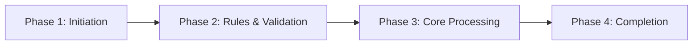

# [Epic Key]: [Epic Title]

> **Template Instruction:** This document is the single, self-contained Epic Documentation Page. No subpages are ever generated; every topic is covered in this one document, and no section may link to or reference a subpage. Sections 1-4 are the orienting, executive-level part: high-level capabilities, business scope, actors, domain concepts, and overall workflow. Section 5 holds all granular detail on the same page: client prerequisites, UI previews, and detailed business rules. Do not describe or reproduce SQL, pseudocode, JSON or other schemas, API contracts, code, database mappings, deployment or infrastructure configuration, algorithm implementation, protocols, field-level models, or similar technical topics anywhere in the page. Business-admin-managed values, limits, permissions, decision tables, validation matrices, and domain formulas may be summarized in Sections 1-4 when they explain a business decision; full catalogues belong in Section 5. Keep GUI details out of Sections 1-4; each core functionality may have at most one preview image there, while all other visual detail belongs in Section 5.2.

---

### Humanizing Rules

* **Shift to user action.** Describe what the user experiences, not how the system runs code.
* **Strip code identifiers.** Replace raw variables, rules, requirement codes, and ticket numbers with descriptive phrasing.
* **Break up run-on logic.** Turn nested conditions into short, sequential steps.
* **Weave the why into the what.** State the purpose together with the behavior only when the source supports that purpose. Do not invent a business rationale from implementation details.
* **Keep every relevant business fact.** Wording changes; business conditions, exceptions, numbers, units, timing, permissions, and uncertainty never do. Retain purely technical findings in the evidence and coverage records with an explicit out-of-scope reason; do not put them into reader-facing prose merely to satisfy fact coverage.

Worked examples (specification style, then humanized):

- Specification: "Requirement BR23_01 configuration initializes the default allocation strategy to Branch 21 with 100% of the premium."
  Humanized: "Unless the user picks another option, the premium is split using the Branch 21 strategy, and the full 100% goes to it. [Legacy 01]"
- Specification: "The system displays the allocation matrix when the age range is the last range only."
  Humanized: "Users see the allocation matrix only when they choose the last age range. [Legacy 02]"

> **Business Behavior Contract — applies to the entire generated page:**
> - Describe what the system enables, requires, permits, rejects, preserves, or produces for a business participant. Code is a source of evidence about behavior, not an outline for the documentation.
> - Never expose class, function, method, variable, repository, or internal service names; annotations; call sequences; implementation exceptions; stack traces; transaction mechanics; HTTP status codes; or code snippets in business sections. This includes Section 3 Core Functionalities, Section 4 process diagrams, and Section 5 detailed references.
> - Describe a failure by its supported business condition, effect on the user or process, and available recovery action. Include an error identifier or message only when it is explicitly part of the business vocabulary or a documented user-facing interaction. Do not translate every technical exception into a supposed business rule.
> - Name an external provider only when its business responsibility or process boundary matters. Do not list internal services or their method calls. Business diagrams show actors, decisions, phases, and outcomes, never implementation call graphs.
> - Preserve meaningful business values and terms even when they also occur in code. Explain their business meaning when supported. Hide code symbols, requirement IDs, and ticket numbers in evidence metadata unless the template explicitly requests those identifiers.
> - A value found in code is not evidence that a client can configure it. Section 5.1 requires explicit evidence of a client-managed business dependency; do not turn hardcoded constants into configuration instructions or invent the impact of missing configuration.
> - Technical implementation content is allowed only if a future template explicitly introduces a dedicated technical section and defines its scope. This template has no such section. A technical target audience does not create an exception.
> - Keep business uncertainty visible: distinguish current behavior, planned capabilities, unsupported scenarios, and unresolved business questions. Keep uncertainty about uninspected implementation internals in the audit records unless it creates a source-backed business limitation.

Risk Profiling authoring examples:

- Describe the supported consent requirement and the fact that marketing consent alone does not permit submission. Do not name the method that checks consent or the exception it throws.
- Explain that a repeated submission with the same answers returns the existing result. Do not describe repository lookups or internal key-claiming calls.
- Explain that a failed reassessment preserves the previous unexpired profile until its original expiry. Do not describe persistence operations or transaction annotations.
- Explain a retry and its supported business circumstances without exposing exception class names. Do not broaden a narrowly supported retry condition to every failure.

> **Precise Evidence and Citation Contract:**
> - Every substantive claim must remain traceable to the smallest sufficient original passage. A citation must identify an exact quotation or bounded line range in a frozen source revision, not merely a file containing potentially relevant information. For code, point to the condition or branch that supports the business behavior; retain any additional context required to interpret it correctly.
> - Use compact numbered references or short meaningful labels. A citation opens or highlights the supporting excerpt directly. Keep file paths, revision identifiers, line ranges, source quotations, and producer metadata in the evidence detail rather than repeating them in the narrative.
> - When consecutive sentences in one paragraph are all supported by the same precise excerpt, place one reference at the end of that supported passage. Do not repeat the same reference after every sentence. Apply the same rule to a coherent list item or table cell.
> - Do not deduplicate by filename. Different claims supported by different passages in the same file need distinct excerpt targets. When a paragraph combines sources or support changes within it, place references at the corresponding clause or sentence group, or split the paragraph. Never imply that one excerpt supports unrelated claims.
> - Presentation-level grouping must preserve the exact claim-to-evidence mappings in the audit records. Every grouped reference must still resolve each supported claim to its original passage. Reducing visible citation noise must never reduce provenance or coverage.
> - Preserve separate exact targets when both code and a legacy document support or disagree about a claim. Do not replace precise references with a repeated whole-file link, a paragraph-wide highlight without justification, or a general Sources list.
> - If precise support cannot be located, mark the claim unresolved in the verification workflow. Do not invent a line range, quote, anchor, or provenance record. An unresolved claim must not be presented as a verified fact.
> - Evidence details may expose original technical source excerpts for inspection; they are supporting audit artifacts, not implementation explanations in the business page or additional documentation subpages. Keep local frozen evidence available when an original source URL cannot be opened.
> - The citation labels in worked examples are placeholders only. Replace them with precise excerpt links and group them according to these rules in generated output.

> **Visual Presentation Contract — every image and diagram:**
> - Place each visual in its own HTML table with exactly two rows and one column. The first row contains the Markdown image attachment or Mermaid diagram. The second row contains a centered, bold, descriptive business title.
> - Apply this layout to screenshots, mockups, previews, photographs, and all generated diagrams, including the main process diagram in Section 4.1. Do not leave a visual as a standalone image or Mermaid block outside this wrapper.
> - Give images meaningful alternative text. Keep captions in business language and do not invent details absent from the source. A diagram's nodes, decisions, and relationships must remain individually traceable in the audit records.
> - Put any concise grouped visual reference immediately after the table, outside its two rows. Do not add a third source row or repeat the same citation in the visual, caption, and surrounding sentences.
> - Preserve relative asset paths and valid Mermaid syntax. The publication renderer must process Markdown images and Mermaid inside the HTML cells; verify the rendered result rather than assuming that every Markdown renderer supports this nesting. Blank lines around the embedded Markdown are intentional.
> - These examples specify formatting only. Replace placeholders with source-backed content and omit instructional text from the generated page.

Image layout:

```html
<table>
  <tr>
    <td>


</td>
  </tr>
  <tr>
    <td style="text-align: center;">
      <strong>Descriptive business title</strong>
    </td>
  </tr>
</table>
```

Diagram layout:

````html
<table>
  <tr>
    <td>


</td>
  </tr>
  <tr>
    <td style="text-align: center;">
      <strong>Descriptive business process title</strong>
    </td>
  </tr>
</table>
````

> **Final Acceptance Check:** Preserve the numbered template hierarchy and the single-page structure. Confirm that Core Functionalities and all other business sections contain no implementation narration, every material business qualifier remains represented, each visible citation resolves to precise support without redundant repetition, and every visual renders in the required two-row table. Template instructions, authoring contracts, placeholders, and worked examples are instructions to the generator, not content to reproduce in the final document. Use the actual epic title; do not add "Plan" to a documentation title.

---

## 1. Executive Summary

> **Authoring Contract:**
> - **In Scope:** High-level, source-grounded summary of the epic's core business problem, primary target outcome, key business objectives, and bounded scope.
> - **Out of Scope:** Specific sub-module implementation, technical artifacts, UI visual layouts, screens, controls, configuration settings, and implementation-level detail.
> - **Target Reader:** Product Owners, Executive Leadership, Business Stakeholders.

* **Problem Statement:** Source-backed problem or operational inefficiency this epic solves.
* **Key Objective & Target Outcome:** Source-backed primary business goals and measurable success criteria.
* **Bounded Scope:** High-level summary of capabilities explicitly included and excluded in this epic.
* **Preview image:** At most one source-backed preview for the core functionality; do not describe the interface shown.

---

## 2. Business Context & Scope

> **Authoring Contract:**
> - **In Scope:** Identification of human actors, external systems, key domain terminology, and foundational business concepts required to understand the epic.
> - **Out of Scope:** Technical API signatures, parameter formats, database column mappings, client onboarding checklists (refer to Section 5.1).

### 2.1 Process Participants
* **[Actor / Role 1]:** Source-backed human role or organizational unit initiating, approving, or interacting with the workflow.
* **[Actor / Role 2]:** Source-backed role responsible for reviewing inputs, processing actions, or receiving outputs.
* **[System / External Service]:** Source-backed automated system or integration point responsible for state persistence or notifications.

### 2.2 Domain Dictionary
* **[Domain Term 1]:** Source-backed clear, non-technical definition of a core business concept or domain entity.
* **[Domain Term 2]:** Source-backed definition of an industry-specific acronym or operational state.

> **Cross-Reference:** Client business prerequisites are documented in Section 5.1. Route detailed business-rule catalogues to the matching section in Section 5.3 onward. Do not route technical artifacts, schemas, database mappings, or implementation details anywhere.

---

## 3. Core Functionalities & Feature Breakdown

> **Template Instruction:** This section is dynamic and extensible (`allow_dynamic_children = True`). Create one `3.X` subsection for every major Source-backed capability or sub-module identified in the corpus. Each `3.X` section must correspond directly to a business-detail section in Section 5 (`5.3` through `5.N`) on this same page. GUI details belong only in Section 5.2.

> **Authoring Contract:**
> - **In Scope:** Capability-level summary of sub-module capabilities, intended users, high-level business rules, and overall functional impact.
> - **Out of Scope:** Implementation steps, technical artifacts, explicit API or data payloads, and UI details. Place visual detail only in Section 5.2.

### 3.1 [Sub-Module 1 Name]
* **Primary Capabilities:** Source-backed high-level capabilities provided by this sub-module.
* **Target Users:** Source-backed roles using or reviewing this capability.
* **High-Level Business Rules:** Source-backed authorization concepts, validation rules, and operational constraints.
* **Functional Impact:** Source-backed state updates, record creations, or downstream triggers.

> **Preview image:** At most one source-backed preview displayed as a simple showcase of the described functionality. Do not describe its screen or controls.
> **Detail Cross-Reference:** Source-backed business rules, workflows, and boundary behavior are documented in the corresponding section of Section 5 on this page.

### 3.2 [Sub-Module 2 Name]
* **Primary Capabilities:** Source-backed high-level capabilities provided by this sub-module.
* **Target Users:** Source-backed roles using or reviewing this capability.
* **High-Level Business Rules:** Source-backed authorization concepts, validation rules, and operational constraints.
* **Functional Impact:** Source-backed state updates, record creations, or downstream triggers.

> **Preview image:** At most one source-backed preview displayed as a simple showcase of the described functionality. Do not describe its screen or controls.
> **Detail Cross-Reference:** Source-backed business rules, workflows, and boundary behavior are documented in the corresponding section of Section 5 on this page.

### 3.N [Sub-Module N Name]
* **Primary Capabilities:** Source-backed high-level capabilities provided by this sub-module.
* **Target Users:** Source-backed roles using or reviewing this capability.
* **High-Level Business Rules:** Source-backed authorization concepts, validation rules, and operational constraints.
* **Functional Impact:** Source-backed state updates, record creations, or downstream triggers.

> **Preview image:** At most one source-backed preview displayed as a simple showcase of the described functionality. Do not describe its screen or controls.

---

## 4. End-to-End Process Overview

> **Template Instruction:** This section has exactly two direct parts: `4.1 Main Process Overview` and `4.2 Key Subprocesses`. Both are fixed leaves in the heading tree. Subprocess rows are structured records owned by 4.2 and are rendered by Python; do not create `4.2.1`, `4.2.2`, or other heading children.

> **Authoring Contract:**
> - **In Scope:** Source grounded initiator, major business phases, important business decisions, participants, outcomes, and a compact catalog of independently useful subprocesses.
> - **Out of Scope:** UI messages, button behavior, database names or entities, full status machines, payloads, technical parameters, detailed exception handling, form-by-form descriptions, API methods, technical sequences, and implementation steps.

### 4.1 Main Process Overview

<table>
  <tr>
    <td>



</td>
  </tr>
  <tr>
    <td style="text-align: center;">
      <strong>[Source-backed business process title]</strong>
    </td>
  </tr>
</table>

1. **[Phase 1 Title]:** Source-backed initiator and entry condition.
2. **[Phase 2 Title]:** Source-backed major business phase and decision point.
3. **[Phase 3 Title]:** Source-backed offer, proposal, or processing phase when present.
4. **[Phase 4 Title]:** Source-backed plan issuing or completion result when present.
5. **[Phase 5 Title]:** Source-backed final outcome only when the corpus supports a fifth phase.

---

### 4.2 Key Subprocesses

> **Template Instruction:** This is a compact, Python-owned catalog. Each planned record has a stable source-backed identity, reader-facing title, one-sentence business purpose, participants, business result, citations, and enough source-backed material to be understood without any additional page. Include an exceptional subprocess only when it has an independent business goal and sufficient evidence. Do not add heading children or narrative detail here.

---

## 5. Detailed Business Reference

> **Template Instruction:** This section holds all granular detail on this same page. It is organized into fixed sections `5.1` and `5.2` followed by dynamic sections `5.3` through `5.N`. Never create, link to, or mention subpages.

> **Goal:** Keep Sections 1-4 high-level and place extensive source-backed business rules, workflows, and edge cases here. Preserve business-admin-managed parameters, defaults, limits, permissions, decision tables, validation matrices, configurable values, and domain formulas when they express business decisions. Do not create or describe SQL, pseudocode, schemas, API contracts, code, database mappings, deployment or infrastructure configuration, algorithms, protocols, field-level models, or similar technical topics on any page.

---

### 5.1 Client Implementation Prerequisites & Deliverables

* **Referenced Main Section:** Section 3 Core Functionalities & Feature Breakdown
* **Target Audience:** Implementation Engineers, Business Analysts, Product Managers, System Integrators, Client Configuration Owners

> **Authoring Contract:**
> * **Role:** This mandatory section is the single source of truth for exactly what the client must configure, define, or deliver inside the system before each Section 3 functionality can operate.
> * **Required Structure:** Organize content by Section 3 core functionality/process, one subsection per functionality (or closely related functionality group) that has a client-configurable dependency; name the functionality it enables in each subsection heading. Skip a functionality only when the corpus shows no client-configurable dependency for it.
> * **Per-Functionality Content:** For each functionality, extract every source-backed configuration item the client must set up in the system: business parameter or default value, threshold or limit, validation or decision rule, controlled vocabulary or dictionary entry, document or communication template, permission or role assignment, and business-tunable calculation formula. State the exact configured value or rule from the source, why the functionality cannot operate correctly without it, and the concrete consequence (blocked process, fallback default, error, incorrect calculation) when it is missing or incomplete.
> * **Out of Scope:** Deployment settings, infrastructure, internal service configuration, code, schemas, integrations, and algorithm implementation.
> * **Formatting Requirement:** Use one Markdown table per functionality with columns Configuration Item, Required Value / Business Rule, Required or Optional, and Impact if Missing.
> * **Closing Section:** End with a consolidated readiness checklist grouped by functionality.

---

### 5.2 UI Mockups & View Directory

* **Referenced Main Section:** Section 3 Core Functionalities & Feature Breakdown
* **Target Audience:** Frontend Engineers, UI/UX Designers, Business Analysts, Stakeholders

> **Authoring Contract:**
> * **Role:** This mandatory section acts as the central repository for all visual representations on the page.
> * **Guideline:** Sections 1-4 should not be cluttered with UI screens; they focus on the "what" and "why" and include at most one preview per core functionality. This section holds the visual "how".
> * **In Scope:** Inventory of user interfaces, screen layouts, mockups, modal dialogs, component state transitions, and user interaction paths grouped logically.
> * **Visual Layout:** Every visual uses the two-row, one-column HTML table defined in the Visual Presentation Contract: visual above, centered bold business title below. Group precise evidence references immediately after the table.

---

### 5.N [Dynamic Section Title]

* **Referenced Main Section:** [Any relevant section from Sections 1-4]
* **Target Audience:** Business Analysts, Software Engineers, QA Engineers, Domain Experts

> **Authoring Contract:**
> * **Role:** To hold extensive source-backed business detail that would otherwise prevent Sections 1-4 from being concise. Add as many of these sections (`5.3` onward) as needed during the planning phase, one per Section 3 functionality.
> * **In Scope:** Business rules, decision tables, user-facing edge cases, business process steps, responsibilities, outcomes, and domain-specific workflows.
> * **Out of Scope:** SQL, pseudocode, schemas, API contracts, code, database mappings, deployment or infrastructure configuration, algorithm implementation, protocols, field-level models, and other implementation detail. Domain rules expressed as configuration or formulas remain in scope when source-backed.
> * **Formatting Requirement:** Structure complex business processes using step-by-step lists, high-level business flows, or detailed business tables. Explicitly define supported happy paths and exception flows.
