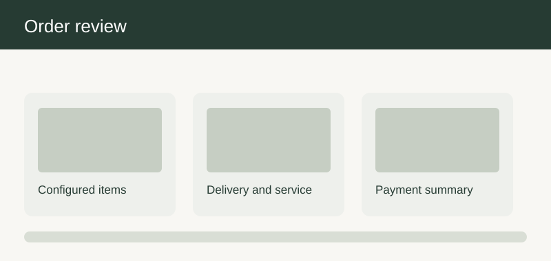

# Checkout and fulfilment

| ID | User story | Preliminary product solution | Implementation solution | Mockup and behavior |
| --- | --- | --- | --- | --- |
| CHECKOUTANDFULFILMENT-01-1 | As a home shopper, I want the system to review a furniture basket before checkout when comparing options for a first purchase, so that I can make a confident choice without a specialist present. | Preliminary product solution: The basket groups configured products, accessories, samples, and services with readable names and chosen options. Each line retains its room association and the estimate status shown during selection. The first-time journey uses short explanations, a visible summary, and a clear path back to the previous choice. The current basket summary choice and its next action remain visible. The flow explains how this choice affects the summary and which review remains open. If a saved configuration is no longer orderable, the basket asks for a choice instead of silently replacing it. | Implementation solution: Commerce operations own line-item presentation and catalog operations own option validity. The customer-facing record keeps the chosen option and its stated uncertainty together. The handoff keeps the decision date, conditions, and open questions together. Acceptance reconciles a kitchen plan and separate furniture item with the basket summary. Acceptance includes the home shopper path and the stated exception. |  Mockup note: the visual groups the main decision, a current-state summary, and the next action; the basket summary controls update the summary immediately and expose any limitation next to the affected choice. |
| CHECKOUTANDFULFILMENT-01-2 | As an interior designer, I want the system to review a furniture basket before checkout when preparing a proposal for a client, so that I can explain the tradeoffs and preserve the client's decisions. | Preliminary product solution: The basket groups configured products, accessories, samples, and services with readable names and chosen options. Each line retains its room association and the estimate status shown during selection. The professional journey permits a concise comparison view and records the reason a proposed option was chosen. The current basket summary choice and its next action remain visible. The flow explains how this choice affects the summary and which review remains open. If a saved configuration is no longer orderable, the basket asks for a choice instead of silently replacing it. | Implementation solution: Commerce operations own line-item presentation and catalog operations own option validity. The handoff distinguishes a designer suggestion from a customer-approved decision. The handoff keeps the decision date, conditions, and open questions together. Acceptance reconciles a kitchen plan and separate furniture item with the basket summary. Acceptance includes the interior designer path and the stated exception. |  |
| CHECKOUTANDFULFILMENT-01-3 | As a returning customer, I want the system to review a furniture basket before checkout when revisiting a saved project after several weeks, so that I can see what changed before making a new commitment. | Preliminary product solution: The basket groups configured products, accessories, samples, and services with readable names and chosen options. Each line retains its room association and the estimate status shown during selection. The return journey identifies changed prices, assortment, or timing beside the previously saved choice. The current basket summary choice and its next action remain visible. The flow explains how this choice affects the summary and which review remains open. If a saved configuration is no longer orderable, the basket asks for a choice instead of silently replacing it. | Implementation solution: Commerce operations own line-item presentation and catalog operations own option validity. The saved record preserves the prior version while asking the customer to accept material changes. The handoff keeps the decision date, conditions, and open questions together. Acceptance reconciles a kitchen plan and separate furniture item with the basket summary. Acceptance includes the returning customer path and the stated exception. |  |
| CHECKOUTANDFULFILMENT-02-1 | As a home shopper, I want the system to confirm custom options before paying when comparing options for a first purchase, so that I can make a confident choice without a specialist present. | Preliminary product solution: The checkout presents dimensions, materials, finish, hardware, and any personalized details in a focused review step. The customer must be able to return to the configuration and see what changed before continuing. The first-time journey uses short explanations, a visible summary, and a clear path back to the previous choice. The current configuration review choice and its next action remain visible. The flow explains how this choice affects the summary and which review remains open. An unverified measurement cannot be implied to be professionally confirmed. | Implementation solution: Customer experience owns confirmation wording and order operations own the review record. The customer-facing record keeps the chosen option and its stated uncertainty together. The handoff keeps the decision date, conditions, and open questions together. A sample order demonstrates an explicit confirmation of each made-to-order choice. Acceptance includes the home shopper path and the stated exception. |  |
| CHECKOUTANDFULFILMENT-02-2 | As an interior designer, I want the system to confirm custom options before paying when preparing a proposal for a client, so that I can explain the tradeoffs and preserve the client's decisions. | Preliminary product solution: The checkout presents dimensions, materials, finish, hardware, and any personalized details in a focused review step. The customer must be able to return to the configuration and see what changed before continuing. The professional journey permits a concise comparison view and records the reason a proposed option was chosen. The current configuration review choice and its next action remain visible. The flow explains how this choice affects the summary and which review remains open. An unverified measurement cannot be implied to be professionally confirmed. | Implementation solution: Customer experience owns confirmation wording and order operations own the review record. The handoff distinguishes a designer suggestion from a customer-approved decision. The handoff keeps the decision date, conditions, and open questions together. A sample order demonstrates an explicit confirmation of each made-to-order choice. Acceptance includes the interior designer path and the stated exception. |  |
| CHECKOUTANDFULFILMENT-02-3 | As a returning customer, I want the system to confirm custom options before paying when revisiting a saved project after several weeks, so that I can see what changed before making a new commitment. | Preliminary product solution: The checkout presents dimensions, materials, finish, hardware, and any personalized details in a focused review step. The customer must be able to return to the configuration and see what changed before continuing. The return journey identifies changed prices, assortment, or timing beside the previously saved choice. The current configuration review choice and its next action remain visible. The flow explains how this choice affects the summary and which review remains open. An unverified measurement cannot be implied to be professionally confirmed. | Implementation solution: Customer experience owns confirmation wording and order operations own the review record. The saved record preserves the prior version while asking the customer to accept material changes. The handoff keeps the decision date, conditions, and open questions together. A sample order demonstrates an explicit confirmation of each made-to-order choice. Acceptance includes the returning customer path and the stated exception. |  |
| CHECKOUTANDFULFILMENT-03-1 | As a home shopper, I want the system to check delivery options for my address when comparing options for a first purchase, so that I can make a confident choice without a specialist present. | Preliminary product solution: Address entry shows whether standard delivery, room-of-choice delivery, or installation may be available for the region. The delivery summary identifies access information needed later, such as floor, lift, and parking details. The first-time journey uses short explanations, a visible summary, and a clear path back to the previous choice. The current delivery address choice and its next action remain visible. The flow explains how this choice affects the summary and which review remains open. Availability inferred from a postal area remains provisional until the complete address is checked. | Implementation solution: Regional logistics owns coverage and service operations owns access questions. The customer-facing record keeps the chosen option and its stated uncertainty together. The handoff keeps the decision date, conditions, and open questions together. Acceptance compares two addresses with different service availability. Acceptance includes the home shopper path and the stated exception. |  |
| CHECKOUTANDFULFILMENT-03-2 | As an interior designer, I want the system to check delivery options for my address when preparing a proposal for a client, so that I can explain the tradeoffs and preserve the client's decisions. | Preliminary product solution: Address entry shows whether standard delivery, room-of-choice delivery, or installation may be available for the region. The delivery summary identifies access information needed later, such as floor, lift, and parking details. The professional journey permits a concise comparison view and records the reason a proposed option was chosen. The current delivery address choice and its next action remain visible. The flow explains how this choice affects the summary and which review remains open. Availability inferred from a postal area remains provisional until the complete address is checked. | Implementation solution: Regional logistics owns coverage and service operations owns access questions. The handoff distinguishes a designer suggestion from a customer-approved decision. The handoff keeps the decision date, conditions, and open questions together. Acceptance compares two addresses with different service availability. Acceptance includes the interior designer path and the stated exception. |  |
| CHECKOUTANDFULFILMENT-03-3 | As a returning customer, I want the system to check delivery options for my address when revisiting a saved project after several weeks, so that I can see what changed before making a new commitment. | Preliminary product solution: Address entry shows whether standard delivery, room-of-choice delivery, or installation may be available for the region. The delivery summary identifies access information needed later, such as floor, lift, and parking details. The return journey identifies changed prices, assortment, or timing beside the previously saved choice. The current delivery address choice and its next action remain visible. The flow explains how this choice affects the summary and which review remains open. Availability inferred from a postal area remains provisional until the complete address is checked. | Implementation solution: Regional logistics owns coverage and service operations owns access questions. The saved record preserves the prior version while asking the customer to accept material changes. The handoff keeps the decision date, conditions, and open questions together. Acceptance compares two addresses with different service availability. Acceptance includes the returning customer path and the stated exception. |  |
| CHECKOUTANDFULFILMENT-04-1 | As a home shopper, I want the system to choose an understandable delivery window when comparing options for a first purchase, so that I can make a confident choice without a specialist present. | Preliminary product solution: The customer sees a range of feasible delivery windows tied to the slowest required item and selected service. If items can arrive separately, the interface explains the tradeoff and any fee difference. The first-time journey uses short explanations, a visible summary, and a clear path back to the previous choice. The current delivery scheduling choice and its next action remain visible. The flow explains how this choice affects the summary and which review remains open. A tentative supplier date is not offered as a confirmed appointment. | Implementation solution: Fulfilment planners supply capacity and customer support handles rescheduling. The customer-facing record keeps the chosen option and its stated uncertainty together. The handoff keeps the decision date, conditions, and open questions together. A scheduling review checks mixed ready-stock and made-to-order baskets. Acceptance includes the home shopper path and the stated exception. |  |
| CHECKOUTANDFULFILMENT-04-2 | As an interior designer, I want the system to choose an understandable delivery window when preparing a proposal for a client, so that I can explain the tradeoffs and preserve the client's decisions. | Preliminary product solution: The customer sees a range of feasible delivery windows tied to the slowest required item and selected service. If items can arrive separately, the interface explains the tradeoff and any fee difference. The professional journey permits a concise comparison view and records the reason a proposed option was chosen. The current delivery scheduling choice and its next action remain visible. The flow explains how this choice affects the summary and which review remains open. A tentative supplier date is not offered as a confirmed appointment. | Implementation solution: Fulfilment planners supply capacity and customer support handles rescheduling. The handoff distinguishes a designer suggestion from a customer-approved decision. The handoff keeps the decision date, conditions, and open questions together. A scheduling review checks mixed ready-stock and made-to-order baskets. Acceptance includes the interior designer path and the stated exception. |  |
| CHECKOUTANDFULFILMENT-04-3 | As a returning customer, I want the system to choose an understandable delivery window when revisiting a saved project after several weeks, so that I can see what changed before making a new commitment. | Preliminary product solution: The customer sees a range of feasible delivery windows tied to the slowest required item and selected service. If items can arrive separately, the interface explains the tradeoff and any fee difference. The return journey identifies changed prices, assortment, or timing beside the previously saved choice. The current delivery scheduling choice and its next action remain visible. The flow explains how this choice affects the summary and which review remains open. A tentative supplier date is not offered as a confirmed appointment. | Implementation solution: Fulfilment planners supply capacity and customer support handles rescheduling. The saved record preserves the prior version while asking the customer to accept material changes. The handoff keeps the decision date, conditions, and open questions together. A scheduling review checks mixed ready-stock and made-to-order baskets. Acceptance includes the returning customer path and the stated exception. |  |
| CHECKOUTANDFULFILMENT-05-1 | As a home shopper, I want the system to decide whether to add installation when comparing options for a first purchase, so that I can make a confident choice without a specialist present. | Preliminary product solution: Installation options describe what is included, preparation required, and when a site survey is needed. The service choice appears as a distinct basket line with its estimated or confirmed price status. The first-time journey uses short explanations, a visible summary, and a clear path back to the previous choice. The current installation service choice and its next action remain visible. The flow explains how this choice affects the summary and which review remains open. A purchased installation service does not automatically include electrical or plumbing work unless explicitly listed. | Implementation solution: Service operations maintain scope and partner availability by region. The customer-facing record keeps the chosen option and its stated uncertainty together. The handoff keeps the decision date, conditions, and open questions together. Acceptance confirms that included and excluded work is visible before checkout. Acceptance includes the home shopper path and the stated exception. |  Mockup note: the visual groups the main decision, a current-state summary, and the next action; the installation service controls update the summary immediately and expose any limitation next to the affected choice. |
| CHECKOUTANDFULFILMENT-05-2 | As an interior designer, I want the system to decide whether to add installation when preparing a proposal for a client, so that I can explain the tradeoffs and preserve the client's decisions. | Preliminary product solution: Installation options describe what is included, preparation required, and when a site survey is needed. The service choice appears as a distinct basket line with its estimated or confirmed price status. The professional journey permits a concise comparison view and records the reason a proposed option was chosen. The current installation service choice and its next action remain visible. The flow explains how this choice affects the summary and which review remains open. A purchased installation service does not automatically include electrical or plumbing work unless explicitly listed. | Implementation solution: Service operations maintain scope and partner availability by region. The handoff distinguishes a designer suggestion from a customer-approved decision. The handoff keeps the decision date, conditions, and open questions together. Acceptance confirms that included and excluded work is visible before checkout. Acceptance includes the interior designer path and the stated exception. |  |
| CHECKOUTANDFULFILMENT-05-3 | As a returning customer, I want the system to decide whether to add installation when revisiting a saved project after several weeks, so that I can see what changed before making a new commitment. | Preliminary product solution: Installation options describe what is included, preparation required, and when a site survey is needed. The service choice appears as a distinct basket line with its estimated or confirmed price status. The return journey identifies changed prices, assortment, or timing beside the previously saved choice. The current installation service choice and its next action remain visible. The flow explains how this choice affects the summary and which review remains open. A purchased installation service does not automatically include electrical or plumbing work unless explicitly listed. | Implementation solution: Service operations maintain scope and partner availability by region. The saved record preserves the prior version while asking the customer to accept material changes. The handoff keeps the decision date, conditions, and open questions together. Acceptance confirms that included and excluded work is visible before checkout. Acceptance includes the returning customer path and the stated exception. |  |
| CHECKOUTANDFULFILMENT-06-1 | As a home shopper, I want the system to understand any deposit on a custom order when comparing options for a first purchase, so that I can make a confident choice without a specialist present. | Preliminary product solution: The payment summary separates the deposit due now from the remaining balance and states when the balance becomes due. It gives the customer a clear route to the full custom-order terms. The first-time journey uses short explanations, a visible summary, and a clear path back to the previous choice. The current deposit policy choice and its next action remain visible. The flow explains how this choice affects the summary and which review remains open. A provisional design cannot trigger a nonrefundable deposit without explicit review of the applicable terms. | Implementation solution: Finance and legal owners approve deposit language and order operations maintain status transitions. The customer-facing record keeps the chosen option and its stated uncertainty together. The handoff keeps the decision date, conditions, and open questions together. Acceptance checks the same amounts in the payment step, confirmation, and order record. Acceptance includes the home shopper path and the stated exception. |  |
| CHECKOUTANDFULFILMENT-06-2 | As an interior designer, I want the system to understand any deposit on a custom order when preparing a proposal for a client, so that I can explain the tradeoffs and preserve the client's decisions. | Preliminary product solution: The payment summary separates the deposit due now from the remaining balance and states when the balance becomes due. It gives the customer a clear route to the full custom-order terms. The professional journey permits a concise comparison view and records the reason a proposed option was chosen. The current deposit policy choice and its next action remain visible. The flow explains how this choice affects the summary and which review remains open. A provisional design cannot trigger a nonrefundable deposit without explicit review of the applicable terms. | Implementation solution: Finance and legal owners approve deposit language and order operations maintain status transitions. The handoff distinguishes a designer suggestion from a customer-approved decision. The handoff keeps the decision date, conditions, and open questions together. Acceptance checks the same amounts in the payment step, confirmation, and order record. Acceptance includes the interior designer path and the stated exception. |  |
| CHECKOUTANDFULFILMENT-06-3 | As a returning customer, I want the system to understand any deposit on a custom order when revisiting a saved project after several weeks, so that I can see what changed before making a new commitment. | Preliminary product solution: The payment summary separates the deposit due now from the remaining balance and states when the balance becomes due. It gives the customer a clear route to the full custom-order terms. The return journey identifies changed prices, assortment, or timing beside the previously saved choice. The current deposit policy choice and its next action remain visible. The flow explains how this choice affects the summary and which review remains open. A provisional design cannot trigger a nonrefundable deposit without explicit review of the applicable terms. | Implementation solution: Finance and legal owners approve deposit language and order operations maintain status transitions. The saved record preserves the prior version while asking the customer to accept material changes. The handoff keeps the decision date, conditions, and open questions together. Acceptance checks the same amounts in the payment step, confirmation, and order record. Acceptance includes the returning customer path and the stated exception. |  |
| CHECKOUTANDFULFILMENT-07-1 | As a home shopper, I want the system to choose a supported payment method when comparing options for a first purchase, so that I can make a confident choice without a specialist present. | Preliminary product solution: Checkout displays available payment methods with any meaningful eligibility conditions before the final step. The final amount, currency, and payment timing remain visible next to the selected method. The first-time journey uses short explanations, a visible summary, and a clear path back to the previous choice. The current payment choices choice and its next action remain visible. The flow explains how this choice affects the summary and which review remains open. A declined or interrupted payment must not produce a false paid-order confirmation. | Implementation solution: Payments operations owns method availability and support owns recovery guidance. The customer-facing record keeps the chosen option and its stated uncertainty together. The handoff keeps the decision date, conditions, and open questions together. A failed-payment journey confirms accurate order and payment status. Acceptance includes the home shopper path and the stated exception. |  |
| CHECKOUTANDFULFILMENT-07-2 | As an interior designer, I want the system to choose a supported payment method when preparing a proposal for a client, so that I can explain the tradeoffs and preserve the client's decisions. | Preliminary product solution: Checkout displays available payment methods with any meaningful eligibility conditions before the final step. The final amount, currency, and payment timing remain visible next to the selected method. The professional journey permits a concise comparison view and records the reason a proposed option was chosen. The current payment choices choice and its next action remain visible. The flow explains how this choice affects the summary and which review remains open. A declined or interrupted payment must not produce a false paid-order confirmation. | Implementation solution: Payments operations owns method availability and support owns recovery guidance. The handoff distinguishes a designer suggestion from a customer-approved decision. The handoff keeps the decision date, conditions, and open questions together. A failed-payment journey confirms accurate order and payment status. Acceptance includes the interior designer path and the stated exception. |  |
| CHECKOUTANDFULFILMENT-07-3 | As a returning customer, I want the system to choose a supported payment method when revisiting a saved project after several weeks, so that I can see what changed before making a new commitment. | Preliminary product solution: Checkout displays available payment methods with any meaningful eligibility conditions before the final step. The final amount, currency, and payment timing remain visible next to the selected method. The return journey identifies changed prices, assortment, or timing beside the previously saved choice. The current payment choices choice and its next action remain visible. The flow explains how this choice affects the summary and which review remains open. A declined or interrupted payment must not produce a false paid-order confirmation. | Implementation solution: Payments operations owns method availability and support owns recovery guidance. The saved record preserves the prior version while asking the customer to accept material changes. The handoff keeps the decision date, conditions, and open questions together. A failed-payment journey confirms accurate order and payment status. Acceptance includes the returning customer path and the stated exception. |  |
| CHECKOUTANDFULFILMENT-08-1 | As a home shopper, I want the system to receive a clear record of my purchase when comparing options for a first purchase, so that I can make a confident choice without a specialist present. | Preliminary product solution: The confirmation lists purchased items, selected options, service choices, delivery expectation, and what happens next. A made-to-order kitchen receives a named design version or reviewed specification reference. The first-time journey uses short explanations, a visible summary, and a clear path back to the previous choice. The current order confirmation choice and its next action remain visible. The flow explains how this choice affects the summary and which review remains open. The message separates confirmed details from items awaiting supplier or survey confirmation. | Implementation solution: Order operations owns the confirmation record and customer communications owns wording. The customer-facing record keeps the chosen option and its stated uncertainty together. The handoff keeps the decision date, conditions, and open questions together. Acceptance compares the confirmation with the final checkout review for omission and drift. Acceptance includes the home shopper path and the stated exception. |  |
| CHECKOUTANDFULFILMENT-08-2 | As an interior designer, I want the system to receive a clear record of my purchase when preparing a proposal for a client, so that I can explain the tradeoffs and preserve the client's decisions. | Preliminary product solution: The confirmation lists purchased items, selected options, service choices, delivery expectation, and what happens next. A made-to-order kitchen receives a named design version or reviewed specification reference. The professional journey permits a concise comparison view and records the reason a proposed option was chosen. The current order confirmation choice and its next action remain visible. The flow explains how this choice affects the summary and which review remains open. The message separates confirmed details from items awaiting supplier or survey confirmation. | Implementation solution: Order operations owns the confirmation record and customer communications owns wording. The handoff distinguishes a designer suggestion from a customer-approved decision. The handoff keeps the decision date, conditions, and open questions together. Acceptance compares the confirmation with the final checkout review for omission and drift. Acceptance includes the interior designer path and the stated exception. |  |
| CHECKOUTANDFULFILMENT-08-3 | As a returning customer, I want the system to receive a clear record of my purchase when revisiting a saved project after several weeks, so that I can see what changed before making a new commitment. | Preliminary product solution: The confirmation lists purchased items, selected options, service choices, delivery expectation, and what happens next. A made-to-order kitchen receives a named design version or reviewed specification reference. The return journey identifies changed prices, assortment, or timing beside the previously saved choice. The current order confirmation choice and its next action remain visible. The flow explains how this choice affects the summary and which review remains open. The message separates confirmed details from items awaiting supplier or survey confirmation. | Implementation solution: Order operations owns the confirmation record and customer communications owns wording. The saved record preserves the prior version while asking the customer to accept material changes. The handoff keeps the decision date, conditions, and open questions together. Acceptance compares the confirmation with the final checkout review for omission and drift. Acceptance includes the returning customer path and the stated exception. |  |
| CHECKOUTANDFULFILMENT-09-1 | As a home shopper, I want the system to track progress after placing an order when comparing options for a first purchase, so that I can make a confident choice without a specialist present. | Preliminary product solution: The account view explains stages such as accepted, being prepared, awaiting a component, ready for delivery, and completed. Each stage includes the next expected customer action and the latest reliable timing information. The first-time journey uses short explanations, a visible summary, and a clear path back to the previous choice. The current order status choice and its next action remain visible. The flow explains how this choice affects the summary and which review remains open. An internal task delay is not hidden behind an unchanged customer-facing status when it affects the promise. | Implementation solution: Fulfilment owns stage definitions and support owns exception communication. The customer-facing record keeps the chosen option and its stated uncertainty together. The handoff keeps the decision date, conditions, and open questions together. A status review checks customer messages against the order team's underlying event record. Acceptance includes the home shopper path and the stated exception. |  |
| CHECKOUTANDFULFILMENT-09-2 | As an interior designer, I want the system to track progress after placing an order when preparing a proposal for a client, so that I can explain the tradeoffs and preserve the client's decisions. | Preliminary product solution: The account view explains stages such as accepted, being prepared, awaiting a component, ready for delivery, and completed. Each stage includes the next expected customer action and the latest reliable timing information. The professional journey permits a concise comparison view and records the reason a proposed option was chosen. The current order status choice and its next action remain visible. The flow explains how this choice affects the summary and which review remains open. An internal task delay is not hidden behind an unchanged customer-facing status when it affects the promise. | Implementation solution: Fulfilment owns stage definitions and support owns exception communication. The handoff distinguishes a designer suggestion from a customer-approved decision. The handoff keeps the decision date, conditions, and open questions together. A status review checks customer messages against the order team's underlying event record. Acceptance includes the interior designer path and the stated exception. |  |
| CHECKOUTANDFULFILMENT-09-3 | As a returning customer, I want the system to track progress after placing an order when revisiting a saved project after several weeks, so that I can see what changed before making a new commitment. | Preliminary product solution: The account view explains stages such as accepted, being prepared, awaiting a component, ready for delivery, and completed. Each stage includes the next expected customer action and the latest reliable timing information. The return journey identifies changed prices, assortment, or timing beside the previously saved choice. The current order status choice and its next action remain visible. The flow explains how this choice affects the summary and which review remains open. An internal task delay is not hidden behind an unchanged customer-facing status when it affects the promise. | Implementation solution: Fulfilment owns stage definitions and support owns exception communication. The saved record preserves the prior version while asking the customer to accept material changes. The handoff keeps the decision date, conditions, and open questions together. A status review checks customer messages against the order team's underlying event record. Acceptance includes the returning customer path and the stated exception. |  |
| CHECKOUTANDFULFILMENT-10-1 | As a home shopper, I want the system to request a change to an order when comparing options for a first purchase, so that I can make a confident choice without a specialist present. | Preliminary product solution: Customers can ask for a change and see whether production timing may still permit it. The request records the desired change, expected price or schedule impact, and the decision before it takes effect. The first-time journey uses short explanations, a visible summary, and a clear path back to the previous choice. The current change request choice and its next action remain visible. The flow explains how this choice affects the summary and which review remains open. A request submission is not treated as an approved order amendment. | Implementation solution: Order support owns triage and manufacturing partners confirm feasibility. The customer-facing record keeps the chosen option and its stated uncertainty together. The handoff keeps the decision date, conditions, and open questions together. Acceptance checks a permitted change and a late change that needs refusal or an alternative. Acceptance includes the home shopper path and the stated exception. |  Mockup note: the visual groups the main decision, a current-state summary, and the next action; the change request controls update the summary immediately and expose any limitation next to the affected choice. |
| CHECKOUTANDFULFILMENT-10-2 | As an interior designer, I want the system to request a change to an order when preparing a proposal for a client, so that I can explain the tradeoffs and preserve the client's decisions. | Preliminary product solution: Customers can ask for a change and see whether production timing may still permit it. The request records the desired change, expected price or schedule impact, and the decision before it takes effect. The professional journey permits a concise comparison view and records the reason a proposed option was chosen. The current change request choice and its next action remain visible. The flow explains how this choice affects the summary and which review remains open. A request submission is not treated as an approved order amendment. | Implementation solution: Order support owns triage and manufacturing partners confirm feasibility. The handoff distinguishes a designer suggestion from a customer-approved decision. The handoff keeps the decision date, conditions, and open questions together. Acceptance checks a permitted change and a late change that needs refusal or an alternative. Acceptance includes the interior designer path and the stated exception. |  |
| CHECKOUTANDFULFILMENT-10-3 | As a returning customer, I want the system to request a change to an order when revisiting a saved project after several weeks, so that I can see what changed before making a new commitment. | Preliminary product solution: Customers can ask for a change and see whether production timing may still permit it. The request records the desired change, expected price or schedule impact, and the decision before it takes effect. The return journey identifies changed prices, assortment, or timing beside the previously saved choice. The current change request choice and its next action remain visible. The flow explains how this choice affects the summary and which review remains open. A request submission is not treated as an approved order amendment. | Implementation solution: Order support owns triage and manufacturing partners confirm feasibility. The saved record preserves the prior version while asking the customer to accept material changes. The handoff keeps the decision date, conditions, and open questions together. Acceptance checks a permitted change and a late change that needs refusal or an alternative. Acceptance includes the returning customer path and the stated exception. |  |
| CHECKOUTANDFULFILMENT-11-1 | As a home shopper, I want the system to understand items arriving at different times when comparing options for a first purchase, so that I can make a confident choice without a specialist present. | Preliminary product solution: The order view groups items by expected delivery wave and explains why a split is proposed. The customer can see installation dependencies before agreeing to partial delivery. The first-time journey uses short explanations, a visible summary, and a clear path back to the previous choice. The current split shipment choice and its next action remain visible. The flow explains how this choice affects the summary and which review remains open. A partial arrival does not mark the entire order as complete. | Implementation solution: Logistics owns wave planning and service operations reviews installation sequencing. The customer-facing record keeps the chosen option and its stated uncertainty together. The handoff keeps the decision date, conditions, and open questions together. A split example is checked for accurate item status and customer choice. Acceptance includes the home shopper path and the stated exception. |  |
| CHECKOUTANDFULFILMENT-11-2 | As an interior designer, I want the system to understand items arriving at different times when preparing a proposal for a client, so that I can explain the tradeoffs and preserve the client's decisions. | Preliminary product solution: The order view groups items by expected delivery wave and explains why a split is proposed. The customer can see installation dependencies before agreeing to partial delivery. The professional journey permits a concise comparison view and records the reason a proposed option was chosen. The current split shipment choice and its next action remain visible. The flow explains how this choice affects the summary and which review remains open. A partial arrival does not mark the entire order as complete. | Implementation solution: Logistics owns wave planning and service operations reviews installation sequencing. The handoff distinguishes a designer suggestion from a customer-approved decision. The handoff keeps the decision date, conditions, and open questions together. A split example is checked for accurate item status and customer choice. Acceptance includes the interior designer path and the stated exception. |  |
| CHECKOUTANDFULFILMENT-11-3 | As a returning customer, I want the system to understand items arriving at different times when revisiting a saved project after several weeks, so that I can see what changed before making a new commitment. | Preliminary product solution: The order view groups items by expected delivery wave and explains why a split is proposed. The customer can see installation dependencies before agreeing to partial delivery. The return journey identifies changed prices, assortment, or timing beside the previously saved choice. The current split shipment choice and its next action remain visible. The flow explains how this choice affects the summary and which review remains open. A partial arrival does not mark the entire order as complete. | Implementation solution: Logistics owns wave planning and service operations reviews installation sequencing. The saved record preserves the prior version while asking the customer to accept material changes. The handoff keeps the decision date, conditions, and open questions together. A split example is checked for accurate item status and customer choice. Acceptance includes the returning customer path and the stated exception. |  |
| CHECKOUTANDFULFILMENT-12-1 | As a home shopper, I want the system to prepare my home for a furniture delivery when comparing options for a first purchase, so that I can make a confident choice without a specialist present. | Preliminary product solution: A checklist explains access, clear floor space, packaging decisions, and who needs to be present. The checklist adapts to large items and booked installation without adding irrelevant chores. The first-time journey uses short explanations, a visible summary, and a clear path back to the previous choice. The current pre-delivery checklist choice and its next action remain visible. The flow explains how this choice affects the summary and which review remains open. A customer-provided access note is not proof that a delivery team can safely complete the route. | Implementation solution: Delivery operations approves preparation guidance and escalation routes. The customer-facing record keeps the chosen option and its stated uncertainty together. The handoff keeps the decision date, conditions, and open questions together. Acceptance checks that a booked installation adds the correct preparation steps. Acceptance includes the home shopper path and the stated exception. |  |
| CHECKOUTANDFULFILMENT-12-2 | As an interior designer, I want the system to prepare my home for a furniture delivery when preparing a proposal for a client, so that I can explain the tradeoffs and preserve the client's decisions. | Preliminary product solution: A checklist explains access, clear floor space, packaging decisions, and who needs to be present. The checklist adapts to large items and booked installation without adding irrelevant chores. The professional journey permits a concise comparison view and records the reason a proposed option was chosen. The current pre-delivery checklist choice and its next action remain visible. The flow explains how this choice affects the summary and which review remains open. A customer-provided access note is not proof that a delivery team can safely complete the route. | Implementation solution: Delivery operations approves preparation guidance and escalation routes. The handoff distinguishes a designer suggestion from a customer-approved decision. The handoff keeps the decision date, conditions, and open questions together. Acceptance checks that a booked installation adds the correct preparation steps. Acceptance includes the interior designer path and the stated exception. |  |
| CHECKOUTANDFULFILMENT-12-3 | As a returning customer, I want the system to prepare my home for a furniture delivery when revisiting a saved project after several weeks, so that I can see what changed before making a new commitment. | Preliminary product solution: A checklist explains access, clear floor space, packaging decisions, and who needs to be present. The checklist adapts to large items and booked installation without adding irrelevant chores. The return journey identifies changed prices, assortment, or timing beside the previously saved choice. The current pre-delivery checklist choice and its next action remain visible. The flow explains how this choice affects the summary and which review remains open. A customer-provided access note is not proof that a delivery team can safely complete the route. | Implementation solution: Delivery operations approves preparation guidance and escalation routes. The saved record preserves the prior version while asking the customer to accept material changes. The handoff keeps the decision date, conditions, and open questions together. Acceptance checks that a booked installation adds the correct preparation steps. Acceptance includes the returning customer path and the stated exception. |  |
| CHECKOUTANDFULFILMENT-13-1 | As a home shopper, I want the system to know what happens if delivery is delayed when comparing options for a first purchase, so that I can make a confident choice without a specialist present. | Preliminary product solution: The customer receives a plain explanation of the affected items, revised expectation, and available next actions. A support route remains visible for urgent questions or a proposed substitute. The first-time journey uses short explanations, a visible summary, and a clear path back to the previous choice. The current delivery exceptions choice and its next action remain visible. The flow explains how this choice affects the summary and which review remains open. An internal estimate is not framed as a guaranteed recovery date. | Implementation solution: Fulfilment owns cause and forecast; communications owners approve the customer notice. The customer-facing record keeps the chosen option and its stated uncertainty together. The handoff keeps the decision date, conditions, and open questions together. A delay exercise checks that the notice identifies only the affected delivery wave. Acceptance includes the home shopper path and the stated exception. |  |
| CHECKOUTANDFULFILMENT-13-2 | As an interior designer, I want the system to know what happens if delivery is delayed when preparing a proposal for a client, so that I can explain the tradeoffs and preserve the client's decisions. | Preliminary product solution: The customer receives a plain explanation of the affected items, revised expectation, and available next actions. A support route remains visible for urgent questions or a proposed substitute. The professional journey permits a concise comparison view and records the reason a proposed option was chosen. The current delivery exceptions choice and its next action remain visible. The flow explains how this choice affects the summary and which review remains open. An internal estimate is not framed as a guaranteed recovery date. | Implementation solution: Fulfilment owns cause and forecast; communications owners approve the customer notice. The handoff distinguishes a designer suggestion from a customer-approved decision. The handoff keeps the decision date, conditions, and open questions together. A delay exercise checks that the notice identifies only the affected delivery wave. Acceptance includes the interior designer path and the stated exception. |  |
| CHECKOUTANDFULFILMENT-13-3 | As a returning customer, I want the system to know what happens if delivery is delayed when revisiting a saved project after several weeks, so that I can see what changed before making a new commitment. | Preliminary product solution: The customer receives a plain explanation of the affected items, revised expectation, and available next actions. A support route remains visible for urgent questions or a proposed substitute. The return journey identifies changed prices, assortment, or timing beside the previously saved choice. The current delivery exceptions choice and its next action remain visible. The flow explains how this choice affects the summary and which review remains open. An internal estimate is not framed as a guaranteed recovery date. | Implementation solution: Fulfilment owns cause and forecast; communications owners approve the customer notice. The saved record preserves the prior version while asking the customer to accept material changes. The handoff keeps the decision date, conditions, and open questions together. A delay exercise checks that the notice identifies only the affected delivery wave. Acceptance includes the returning customer path and the stated exception. |  |
| CHECKOUTANDFULFILMENT-14-1 | As a home shopper, I want the system to confirm an installation appointment when comparing options for a first purchase, so that I can make a confident choice without a specialist present. | Preliminary product solution: An appointment summary shows date, arrival window, scope, access assumptions, and any customer preparation needed. The customer can provide updated access information and see whether it changes the appointment. The first-time journey uses short explanations, a visible summary, and a clear path back to the previous choice. The current installation appointment choice and its next action remain visible. The flow explains how this choice affects the summary and which review remains open. A delivery appointment is not conflated with an installation appointment when they are separate. | Implementation solution: Service scheduling owns slots and the assigned partner confirms practical access needs. The customer-facing record keeps the chosen option and its stated uncertainty together. The handoff keeps the decision date, conditions, and open questions together. Acceptance reviews a combined and a separate delivery-and-installation journey. Acceptance includes the home shopper path and the stated exception. |  |
| CHECKOUTANDFULFILMENT-14-2 | As an interior designer, I want the system to confirm an installation appointment when preparing a proposal for a client, so that I can explain the tradeoffs and preserve the client's decisions. | Preliminary product solution: An appointment summary shows date, arrival window, scope, access assumptions, and any customer preparation needed. The customer can provide updated access information and see whether it changes the appointment. The professional journey permits a concise comparison view and records the reason a proposed option was chosen. The current installation appointment choice and its next action remain visible. The flow explains how this choice affects the summary and which review remains open. A delivery appointment is not conflated with an installation appointment when they are separate. | Implementation solution: Service scheduling owns slots and the assigned partner confirms practical access needs. The handoff distinguishes a designer suggestion from a customer-approved decision. The handoff keeps the decision date, conditions, and open questions together. Acceptance reviews a combined and a separate delivery-and-installation journey. Acceptance includes the interior designer path and the stated exception. |  |
| CHECKOUTANDFULFILMENT-14-3 | As a returning customer, I want the system to confirm an installation appointment when revisiting a saved project after several weeks, so that I can see what changed before making a new commitment. | Preliminary product solution: An appointment summary shows date, arrival window, scope, access assumptions, and any customer preparation needed. The customer can provide updated access information and see whether it changes the appointment. The return journey identifies changed prices, assortment, or timing beside the previously saved choice. The current installation appointment choice and its next action remain visible. The flow explains how this choice affects the summary and which review remains open. A delivery appointment is not conflated with an installation appointment when they are separate. | Implementation solution: Service scheduling owns slots and the assigned partner confirms practical access needs. The saved record preserves the prior version while asking the customer to accept material changes. The handoff keeps the decision date, conditions, and open questions together. Acceptance reviews a combined and a separate delivery-and-installation journey. Acceptance includes the returning customer path and the stated exception. |  |
| CHECKOUTANDFULFILMENT-15-1 | As a home shopper, I want the system to report damage or missing parts when comparing options for a first purchase, so that I can make a confident choice without a specialist present. | Preliminary product solution: The support flow collects the affected item, issue type, optional photographs, and the outcome the customer seeks. The order record makes the report visible to service staff and gives the customer a reference number. The first-time journey uses short explanations, a visible summary, and a clear path back to the previous choice. The current damage report choice and its next action remain visible. The flow explains how this choice affects the summary and which review remains open. A request for photographs cannot block a customer from reporting an issue when a photo is unavailable. | Implementation solution: After-sales support owns triage and the relevant supplier owns replacement-part confirmation. The customer-facing record keeps the chosen option and its stated uncertainty together. The handoff keeps the decision date, conditions, and open questions together. Acceptance checks a complete report and a report submitted without images. Acceptance includes the home shopper path and the stated exception. |  Mockup note: the visual groups the main decision, a current-state summary, and the next action; the damage report controls update the summary immediately and expose any limitation next to the affected choice. |
| CHECKOUTANDFULFILMENT-15-2 | As an interior designer, I want the system to report damage or missing parts when preparing a proposal for a client, so that I can explain the tradeoffs and preserve the client's decisions. | Preliminary product solution: The support flow collects the affected item, issue type, optional photographs, and the outcome the customer seeks. The order record makes the report visible to service staff and gives the customer a reference number. The professional journey permits a concise comparison view and records the reason a proposed option was chosen. The current damage report choice and its next action remain visible. The flow explains how this choice affects the summary and which review remains open. A request for photographs cannot block a customer from reporting an issue when a photo is unavailable. | Implementation solution: After-sales support owns triage and the relevant supplier owns replacement-part confirmation. The handoff distinguishes a designer suggestion from a customer-approved decision. The handoff keeps the decision date, conditions, and open questions together. Acceptance checks a complete report and a report submitted without images. Acceptance includes the interior designer path and the stated exception. |  |
| CHECKOUTANDFULFILMENT-15-3 | As a returning customer, I want the system to report damage or missing parts when revisiting a saved project after several weeks, so that I can see what changed before making a new commitment. | Preliminary product solution: The support flow collects the affected item, issue type, optional photographs, and the outcome the customer seeks. The order record makes the report visible to service staff and gives the customer a reference number. The return journey identifies changed prices, assortment, or timing beside the previously saved choice. The current damage report choice and its next action remain visible. The flow explains how this choice affects the summary and which review remains open. A request for photographs cannot block a customer from reporting an issue when a photo is unavailable. | Implementation solution: After-sales support owns triage and the relevant supplier owns replacement-part confirmation. The saved record preserves the prior version while asking the customer to accept material changes. The handoff keeps the decision date, conditions, and open questions together. Acceptance checks a complete report and a report submitted without images. Acceptance includes the returning customer path and the stated exception. |  |
| CHECKOUTANDFULFILMENT-16-1 | As a home shopper, I want the system to understand the return route for an item when comparing options for a first purchase, so that I can make a confident choice without a specialist present. | Preliminary product solution: The order page states the relevant return terms for standard furniture, samples, and custom-made products separately. It shows how to start a request and which information helps staff assess it. The first-time journey uses short explanations, a visible summary, and a clear path back to the previous choice. The current returns guidance choice and its next action remain visible. The flow explains how this choice affects the summary and which review remains open. An automated screen does not misstate statutory rights or make a final legal decision from a product label alone. | Implementation solution: Policy and legal owners maintain terms; support staff handle exceptions and questions. The customer-facing record keeps the chosen option and its stated uncertainty together. The handoff keeps the decision date, conditions, and open questions together. A review checks distinct standard and custom item journeys against approved policy text. Acceptance includes the home shopper path and the stated exception. |  |
| CHECKOUTANDFULFILMENT-16-2 | As an interior designer, I want the system to understand the return route for an item when preparing a proposal for a client, so that I can explain the tradeoffs and preserve the client's decisions. | Preliminary product solution: The order page states the relevant return terms for standard furniture, samples, and custom-made products separately. It shows how to start a request and which information helps staff assess it. The professional journey permits a concise comparison view and records the reason a proposed option was chosen. The current returns guidance choice and its next action remain visible. The flow explains how this choice affects the summary and which review remains open. An automated screen does not misstate statutory rights or make a final legal decision from a product label alone. | Implementation solution: Policy and legal owners maintain terms; support staff handle exceptions and questions. The handoff distinguishes a designer suggestion from a customer-approved decision. The handoff keeps the decision date, conditions, and open questions together. A review checks distinct standard and custom item journeys against approved policy text. Acceptance includes the interior designer path and the stated exception. |  |
| CHECKOUTANDFULFILMENT-16-3 | As a returning customer, I want the system to understand the return route for an item when revisiting a saved project after several weeks, so that I can see what changed before making a new commitment. | Preliminary product solution: The order page states the relevant return terms for standard furniture, samples, and custom-made products separately. It shows how to start a request and which information helps staff assess it. The return journey identifies changed prices, assortment, or timing beside the previously saved choice. The current returns guidance choice and its next action remain visible. The flow explains how this choice affects the summary and which review remains open. An automated screen does not misstate statutory rights or make a final legal decision from a product label alone. | Implementation solution: Policy and legal owners maintain terms; support staff handle exceptions and questions. The saved record preserves the prior version while asking the customer to accept material changes. The handoff keeps the decision date, conditions, and open questions together. A review checks distinct standard and custom item journeys against approved policy text. Acceptance includes the returning customer path and the stated exception. |  |
| CHECKOUTANDFULFILMENT-17-1 | As a home shopper, I want the system to receive care guidance for delivered materials when comparing options for a first purchase, so that I can make a confident choice without a specialist present. | Preliminary product solution: After delivery, the account view provides care information matched to the purchased finish and material. The message can include a practical first-use checklist without implying extra warranty coverage. The first-time journey uses short explanations, a visible summary, and a clear path back to the previous choice. The current care follow-up choice and its next action remain visible. The flow explains how this choice affects the summary and which review remains open. Generic guidance is not substituted where the selected material has specific care restrictions. | Implementation solution: Product specialists approve care text and communications owners schedule delivery-linked messages. The customer-facing record keeps the chosen option and its stated uncertainty together. The handoff keeps the decision date, conditions, and open questions together. Acceptance compares guidance with the actual purchased options. Acceptance includes the home shopper path and the stated exception. |  |
| CHECKOUTANDFULFILMENT-17-2 | As an interior designer, I want the system to receive care guidance for delivered materials when preparing a proposal for a client, so that I can explain the tradeoffs and preserve the client's decisions. | Preliminary product solution: After delivery, the account view provides care information matched to the purchased finish and material. The message can include a practical first-use checklist without implying extra warranty coverage. The professional journey permits a concise comparison view and records the reason a proposed option was chosen. The current care follow-up choice and its next action remain visible. The flow explains how this choice affects the summary and which review remains open. Generic guidance is not substituted where the selected material has specific care restrictions. | Implementation solution: Product specialists approve care text and communications owners schedule delivery-linked messages. The handoff distinguishes a designer suggestion from a customer-approved decision. The handoff keeps the decision date, conditions, and open questions together. Acceptance compares guidance with the actual purchased options. Acceptance includes the interior designer path and the stated exception. |  |
| CHECKOUTANDFULFILMENT-17-3 | As a returning customer, I want the system to receive care guidance for delivered materials when revisiting a saved project after several weeks, so that I can see what changed before making a new commitment. | Preliminary product solution: After delivery, the account view provides care information matched to the purchased finish and material. The message can include a practical first-use checklist without implying extra warranty coverage. The return journey identifies changed prices, assortment, or timing beside the previously saved choice. The current care follow-up choice and its next action remain visible. The flow explains how this choice affects the summary and which review remains open. Generic guidance is not substituted where the selected material has specific care restrictions. | Implementation solution: Product specialists approve care text and communications owners schedule delivery-linked messages. The saved record preserves the prior version while asking the customer to accept material changes. The handoff keeps the decision date, conditions, and open questions together. Acceptance compares guidance with the actual purchased options. Acceptance includes the returning customer path and the stated exception. |  |
| CHECKOUTANDFULFILMENT-18-1 | As a home shopper, I want the system to retrieve a readable invoice and order record when comparing options for a first purchase, so that I can make a confident choice without a specialist present. | Preliminary product solution: The account area separates invoice, order confirmation, and delivery documents so the customer can find the correct record. Documents display the same item and service names used in checkout, with required business details. The first-time journey uses short explanations, a visible summary, and a clear path back to the previous choice. The current invoice access choice and its next action remain visible. The flow explains how this choice affects the summary and which review remains open. A provisional quotation is not labelled or downloadable as a final invoice. | Implementation solution: Finance owns invoice issuance and support owns document access assistance. The customer-facing record keeps the chosen option and its stated uncertainty together. The handoff keeps the decision date, conditions, and open questions together. Acceptance checks document status and exact order association. Acceptance includes the home shopper path and the stated exception. |  |
| CHECKOUTANDFULFILMENT-18-2 | As an interior designer, I want the system to retrieve a readable invoice and order record when preparing a proposal for a client, so that I can explain the tradeoffs and preserve the client's decisions. | Preliminary product solution: The account area separates invoice, order confirmation, and delivery documents so the customer can find the correct record. Documents display the same item and service names used in checkout, with required business details. The professional journey permits a concise comparison view and records the reason a proposed option was chosen. The current invoice access choice and its next action remain visible. The flow explains how this choice affects the summary and which review remains open. A provisional quotation is not labelled or downloadable as a final invoice. | Implementation solution: Finance owns invoice issuance and support owns document access assistance. The handoff distinguishes a designer suggestion from a customer-approved decision. The handoff keeps the decision date, conditions, and open questions together. Acceptance checks document status and exact order association. Acceptance includes the interior designer path and the stated exception. |  |
| CHECKOUTANDFULFILMENT-18-3 | As a returning customer, I want the system to retrieve a readable invoice and order record when revisiting a saved project after several weeks, so that I can see what changed before making a new commitment. | Preliminary product solution: The account area separates invoice, order confirmation, and delivery documents so the customer can find the correct record. Documents display the same item and service names used in checkout, with required business details. The return journey identifies changed prices, assortment, or timing beside the previously saved choice. The current invoice access choice and its next action remain visible. The flow explains how this choice affects the summary and which review remains open. A provisional quotation is not labelled or downloadable as a final invoice. | Implementation solution: Finance owns invoice issuance and support owns document access assistance. The saved record preserves the prior version while asking the customer to accept material changes. The handoff keeps the decision date, conditions, and open questions together. Acceptance checks document status and exact order association. Acceptance includes the returning customer path and the stated exception. |  |
| CHECKOUTANDFULFILMENT-19-1 | As a home shopper, I want the system to see the history of help requests when comparing options for a first purchase, so that I can make a confident choice without a specialist present. | Preliminary product solution: Customers can view open and resolved order questions with dates, a short status, and the agreed next action. Support staff can see the same customer-facing summary and any internal follow-up ownership. The first-time journey uses short explanations, a visible summary, and a clear path back to the previous choice. The current support history choice and its next action remain visible. The flow explains how this choice affects the summary and which review remains open. Internal notes remain private and do not leak into the customer view. | Implementation solution: Service management defines statuses and retention while agents maintain resolution summaries. The customer-facing record keeps the chosen option and its stated uncertainty together. The handoff keeps the decision date, conditions, and open questions together. A sample case verifies the customer sees the right timeline without internal commentary. Acceptance includes the home shopper path and the stated exception. |  |
| CHECKOUTANDFULFILMENT-19-2 | As an interior designer, I want the system to see the history of help requests when preparing a proposal for a client, so that I can explain the tradeoffs and preserve the client's decisions. | Preliminary product solution: Customers can view open and resolved order questions with dates, a short status, and the agreed next action. Support staff can see the same customer-facing summary and any internal follow-up ownership. The professional journey permits a concise comparison view and records the reason a proposed option was chosen. The current support history choice and its next action remain visible. The flow explains how this choice affects the summary and which review remains open. Internal notes remain private and do not leak into the customer view. | Implementation solution: Service management defines statuses and retention while agents maintain resolution summaries. The handoff distinguishes a designer suggestion from a customer-approved decision. The handoff keeps the decision date, conditions, and open questions together. A sample case verifies the customer sees the right timeline without internal commentary. Acceptance includes the interior designer path and the stated exception. |  |
| CHECKOUTANDFULFILMENT-19-3 | As a returning customer, I want the system to see the history of help requests when revisiting a saved project after several weeks, so that I can see what changed before making a new commitment. | Preliminary product solution: Customers can view open and resolved order questions with dates, a short status, and the agreed next action. Support staff can see the same customer-facing summary and any internal follow-up ownership. The return journey identifies changed prices, assortment, or timing beside the previously saved choice. The current support history choice and its next action remain visible. The flow explains how this choice affects the summary and which review remains open. Internal notes remain private and do not leak into the customer view. | Implementation solution: Service management defines statuses and retention while agents maintain resolution summaries. The saved record preserves the prior version while asking the customer to accept material changes. The handoff keeps the decision date, conditions, and open questions together. A sample case verifies the customer sees the right timeline without internal commentary. Acceptance includes the returning customer path and the stated exception. |  |
| CHECKOUTANDFULFILMENT-20-1 | As a home shopper, I want the system to confirm that my order is complete when comparing options for a first purchase, so that I can make a confident choice without a specialist present. | Preliminary product solution: The completion view checks delivered items, installation outcome if purchased, and any unresolved after-sales issue. The customer can acknowledge completion while still reporting a new issue through the normal route. The first-time journey uses short explanations, a visible summary, and a clear path back to the previous choice. The current completion review choice and its next action remain visible. The flow explains how this choice affects the summary and which review remains open. Closing a logistics task does not automatically close an unresolved customer support case. | Implementation solution: Fulfilment and service management agree on closure responsibility. The customer-facing record keeps the chosen option and its stated uncertainty together. The handoff keeps the decision date, conditions, and open questions together. A mixed order with an open damage case remains visibly incomplete in the appropriate context. Acceptance includes the home shopper path and the stated exception. |  Mockup note: the visual groups the main decision, a current-state summary, and the next action; the completion review controls update the summary immediately and expose any limitation next to the affected choice. |
| CHECKOUTANDFULFILMENT-20-2 | As an interior designer, I want the system to confirm that my order is complete when preparing a proposal for a client, so that I can explain the tradeoffs and preserve the client's decisions. | Preliminary product solution: The completion view checks delivered items, installation outcome if purchased, and any unresolved after-sales issue. The customer can acknowledge completion while still reporting a new issue through the normal route. The professional journey permits a concise comparison view and records the reason a proposed option was chosen. The current completion review choice and its next action remain visible. The flow explains how this choice affects the summary and which review remains open. Closing a logistics task does not automatically close an unresolved customer support case. | Implementation solution: Fulfilment and service management agree on closure responsibility. The handoff distinguishes a designer suggestion from a customer-approved decision. The handoff keeps the decision date, conditions, and open questions together. A mixed order with an open damage case remains visibly incomplete in the appropriate context. Acceptance includes the interior designer path and the stated exception. |  |
| CHECKOUTANDFULFILMENT-20-3 | As a returning customer, I want the system to confirm that my order is complete when revisiting a saved project after several weeks, so that I can see what changed before making a new commitment. | Preliminary product solution: The completion view checks delivered items, installation outcome if purchased, and any unresolved after-sales issue. The customer can acknowledge completion while still reporting a new issue through the normal route. The return journey identifies changed prices, assortment, or timing beside the previously saved choice. The current completion review choice and its next action remain visible. The flow explains how this choice affects the summary and which review remains open. Closing a logistics task does not automatically close an unresolved customer support case. | Implementation solution: Fulfilment and service management agree on closure responsibility. The saved record preserves the prior version while asking the customer to accept material changes. The handoff keeps the decision date, conditions, and open questions together. A mixed order with an open damage case remains visibly incomplete in the appropriate context. Acceptance includes the returning customer path and the stated exception. |  |
