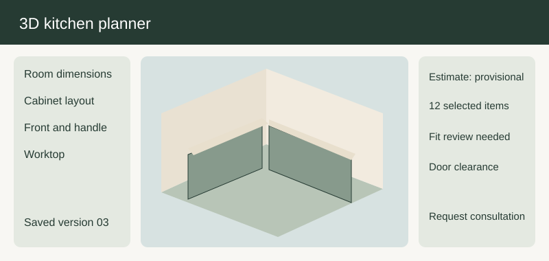

# Kitchen 3D planning

| ID | User story | Preliminary product solution | Implementation solution | Mockup and behavior |
| --- | --- | --- | --- | --- |
| KITCHEN3DPLANNING-01-1 | As a home shopper, I want the system to start a kitchen room model when comparing options for a first purchase, so that I can make a confident choice without a specialist present. | Preliminary product solution: The planning canvas asks for room shape, approximate measurements, and units before placing furniture. A starter room is offered for exploration, while customer measurements are marked as unverified until confirmed. The first-time journey uses short explanations, a visible summary, and a clear path back to the previous choice. The current room setup choice and its next action remain visible. The flow explains how this choice affects the summary and which review remains open. If a wall length is missing, the planner permits exploration but warns that fit cannot be confirmed. | Implementation solution: The design experience team owns the room setup journey and the survey team defines measurements requiring review. The customer-facing record keeps the chosen option and its stated uncertainty together. The handoff keeps the decision date, conditions, and open questions together. Acceptance checks that the starting model and its measurement confidence remain visible after reopening. Acceptance includes the home shopper path and the stated exception. |  Mockup note: the visual groups the main decision, a current-state summary, and the next action; the room setup controls update the summary immediately and expose any limitation next to the affected choice. |
| KITCHEN3DPLANNING-01-2 | As an interior designer, I want the system to start a kitchen room model when preparing a proposal for a client, so that I can explain the tradeoffs and preserve the client's decisions. | Preliminary product solution: The planning canvas asks for room shape, approximate measurements, and units before placing furniture. A starter room is offered for exploration, while customer measurements are marked as unverified until confirmed. The professional journey permits a concise comparison view and records the reason a proposed option was chosen. The current room setup choice and its next action remain visible. The flow explains how this choice affects the summary and which review remains open. If a wall length is missing, the planner permits exploration but warns that fit cannot be confirmed. | Implementation solution: The design experience team owns the room setup journey and the survey team defines measurements requiring review. The handoff distinguishes a designer suggestion from a customer-approved decision. The handoff keeps the decision date, conditions, and open questions together. Acceptance checks that the starting model and its measurement confidence remain visible after reopening. Acceptance includes the interior designer path and the stated exception. |  |
| KITCHEN3DPLANNING-01-3 | As a returning customer, I want the system to start a kitchen room model when revisiting a saved project after several weeks, so that I can see what changed before making a new commitment. | Preliminary product solution: The planning canvas asks for room shape, approximate measurements, and units before placing furniture. A starter room is offered for exploration, while customer measurements are marked as unverified until confirmed. The return journey identifies changed prices, assortment, or timing beside the previously saved choice. The current room setup choice and its next action remain visible. The flow explains how this choice affects the summary and which review remains open. If a wall length is missing, the planner permits exploration but warns that fit cannot be confirmed. | Implementation solution: The design experience team owns the room setup journey and the survey team defines measurements requiring review. The saved record preserves the prior version while asking the customer to accept material changes. The handoff keeps the decision date, conditions, and open questions together. Acceptance checks that the starting model and its measurement confidence remain visible after reopening. Acceptance includes the returning customer path and the stated exception. |  |
| KITCHEN3DPLANNING-02-1 | As a home shopper, I want the system to place doors and windows in my plan when comparing options for a first purchase, so that I can make a confident choice without a specialist present. | Preliminary product solution: The planner lets the customer position openings along a wall and record their approximate size and swing direction. Visible clearances update when an opening moves, and the plan summary calls out conflicts relevant to cabinet placement. The first-time journey uses short explanations, a visible summary, and a clear path back to the previous choice. The current wall openings choice and its next action remain visible. The flow explains how this choice affects the summary and which review remains open. A decorative window image is not treated as a measured opening until its dimensions are entered. | Implementation solution: Design specialists define opening conventions and the consultation team reviews borderline clearances. The customer-facing record keeps the chosen option and its stated uncertainty together. The handoff keeps the decision date, conditions, and open questions together. A review moves a door and confirms that the same conflict appears in the plan summary. Acceptance includes the home shopper path and the stated exception. |  |
| KITCHEN3DPLANNING-02-2 | As an interior designer, I want the system to place doors and windows in my plan when preparing a proposal for a client, so that I can explain the tradeoffs and preserve the client's decisions. | Preliminary product solution: The planner lets the customer position openings along a wall and record their approximate size and swing direction. Visible clearances update when an opening moves, and the plan summary calls out conflicts relevant to cabinet placement. The professional journey permits a concise comparison view and records the reason a proposed option was chosen. The current wall openings choice and its next action remain visible. The flow explains how this choice affects the summary and which review remains open. A decorative window image is not treated as a measured opening until its dimensions are entered. | Implementation solution: Design specialists define opening conventions and the consultation team reviews borderline clearances. The handoff distinguishes a designer suggestion from a customer-approved decision. The handoff keeps the decision date, conditions, and open questions together. A review moves a door and confirms that the same conflict appears in the plan summary. Acceptance includes the interior designer path and the stated exception. |  |
| KITCHEN3DPLANNING-02-3 | As a returning customer, I want the system to place doors and windows in my plan when revisiting a saved project after several weeks, so that I can see what changed before making a new commitment. | Preliminary product solution: The planner lets the customer position openings along a wall and record their approximate size and swing direction. Visible clearances update when an opening moves, and the plan summary calls out conflicts relevant to cabinet placement. The return journey identifies changed prices, assortment, or timing beside the previously saved choice. The current wall openings choice and its next action remain visible. The flow explains how this choice affects the summary and which review remains open. A decorative window image is not treated as a measured opening until its dimensions are entered. | Implementation solution: Design specialists define opening conventions and the consultation team reviews borderline clearances. The saved record preserves the prior version while asking the customer to accept material changes. The handoff keeps the decision date, conditions, and open questions together. A review moves a door and confirms that the same conflict appears in the plan summary. Acceptance includes the returning customer path and the stated exception. |  |
| KITCHEN3DPLANNING-03-1 | As a home shopper, I want the system to arrange cabinets on a kitchen wall when comparing options for a first purchase, so that I can make a confident choice without a specialist present. | Preliminary product solution: The customer can add, move, duplicate, and remove base and wall cabinets while seeing their current dimensions. The planner groups placements into a coherent run and makes gaps, overlaps, and unsupported combinations visible. The first-time journey uses short explanations, a visible summary, and a clear path back to the previous choice. The current cabinet placement choice and its next action remain visible. The flow explains how this choice affects the summary and which review remains open. A cabinet cannot be silently resized to make it fit a wall; any suggested substitution needs customer acceptance. | Implementation solution: Catalog operations supply orderable cabinet ranges and the design team owns placement guidance. The customer-facing record keeps the chosen option and its stated uncertainty together. The handoff keeps the decision date, conditions, and open questions together. Acceptance compares a saved layout with its item list and visible wall measurements. Acceptance includes the home shopper path and the stated exception. |  |
| KITCHEN3DPLANNING-03-2 | As an interior designer, I want the system to arrange cabinets on a kitchen wall when preparing a proposal for a client, so that I can explain the tradeoffs and preserve the client's decisions. | Preliminary product solution: The customer can add, move, duplicate, and remove base and wall cabinets while seeing their current dimensions. The planner groups placements into a coherent run and makes gaps, overlaps, and unsupported combinations visible. The professional journey permits a concise comparison view and records the reason a proposed option was chosen. The current cabinet placement choice and its next action remain visible. The flow explains how this choice affects the summary and which review remains open. A cabinet cannot be silently resized to make it fit a wall; any suggested substitution needs customer acceptance. | Implementation solution: Catalog operations supply orderable cabinet ranges and the design team owns placement guidance. The handoff distinguishes a designer suggestion from a customer-approved decision. The handoff keeps the decision date, conditions, and open questions together. Acceptance compares a saved layout with its item list and visible wall measurements. Acceptance includes the interior designer path and the stated exception. |  |
| KITCHEN3DPLANNING-03-3 | As a returning customer, I want the system to arrange cabinets on a kitchen wall when revisiting a saved project after several weeks, so that I can see what changed before making a new commitment. | Preliminary product solution: The customer can add, move, duplicate, and remove base and wall cabinets while seeing their current dimensions. The planner groups placements into a coherent run and makes gaps, overlaps, and unsupported combinations visible. The return journey identifies changed prices, assortment, or timing beside the previously saved choice. The current cabinet placement choice and its next action remain visible. The flow explains how this choice affects the summary and which review remains open. A cabinet cannot be silently resized to make it fit a wall; any suggested substitution needs customer acceptance. | Implementation solution: Catalog operations supply orderable cabinet ranges and the design team owns placement guidance. The saved record preserves the prior version while asking the customer to accept material changes. The handoff keeps the decision date, conditions, and open questions together. Acceptance compares a saved layout with its item list and visible wall measurements. Acceptance includes the returning customer path and the stated exception. |  |
| KITCHEN3DPLANNING-04-1 | As a home shopper, I want the system to explore a usable corner arrangement when comparing options for a first purchase, so that I can make a confident choice without a specialist present. | Preliminary product solution: The planner offers corner cabinet and filler options with a simple explanation of their access and storage tradeoffs. It shows the resulting door swing and working clearance in both plan and perspective views. The first-time journey uses short explanations, a visible summary, and a clear path back to the previous choice. The current corner layouts choice and its next action remain visible. The flow explains how this choice affects the summary and which review remains open. If the selected range lacks a matching corner unit, the design remains provisional rather than inventing one. | Implementation solution: Range managers approve compatible corner combinations and consultants handle unsupported layouts. The customer-facing record keeps the chosen option and its stated uncertainty together. The handoff keeps the decision date, conditions, and open questions together. A corner example is checked against the available range and a customer-readable limitation message. Acceptance includes the home shopper path and the stated exception. |  |
| KITCHEN3DPLANNING-04-2 | As an interior designer, I want the system to explore a usable corner arrangement when preparing a proposal for a client, so that I can explain the tradeoffs and preserve the client's decisions. | Preliminary product solution: The planner offers corner cabinet and filler options with a simple explanation of their access and storage tradeoffs. It shows the resulting door swing and working clearance in both plan and perspective views. The professional journey permits a concise comparison view and records the reason a proposed option was chosen. The current corner layouts choice and its next action remain visible. The flow explains how this choice affects the summary and which review remains open. If the selected range lacks a matching corner unit, the design remains provisional rather than inventing one. | Implementation solution: Range managers approve compatible corner combinations and consultants handle unsupported layouts. The handoff distinguishes a designer suggestion from a customer-approved decision. The handoff keeps the decision date, conditions, and open questions together. A corner example is checked against the available range and a customer-readable limitation message. Acceptance includes the interior designer path and the stated exception. |  |
| KITCHEN3DPLANNING-04-3 | As a returning customer, I want the system to explore a usable corner arrangement when revisiting a saved project after several weeks, so that I can see what changed before making a new commitment. | Preliminary product solution: The planner offers corner cabinet and filler options with a simple explanation of their access and storage tradeoffs. It shows the resulting door swing and working clearance in both plan and perspective views. The return journey identifies changed prices, assortment, or timing beside the previously saved choice. The current corner layouts choice and its next action remain visible. The flow explains how this choice affects the summary and which review remains open. If the selected range lacks a matching corner unit, the design remains provisional rather than inventing one. | Implementation solution: Range managers approve compatible corner combinations and consultants handle unsupported layouts. The saved record preserves the prior version while asking the customer to accept material changes. The handoff keeps the decision date, conditions, and open questions together. A corner example is checked against the available range and a customer-readable limitation message. Acceptance includes the returning customer path and the stated exception. |  |
| KITCHEN3DPLANNING-05-1 | As a home shopper, I want the system to position appliances within the kitchen when comparing options for a first purchase, so that I can make a confident choice without a specialist present. | Preliminary product solution: Customers can place common appliance envelopes and see the space each one reserves, even when the appliance will be bought elsewhere. The plan distinguishes a placeholder appliance from an item included in the retailer's quote. The first-time journey uses short explanations, a visible summary, and a clear path back to the previous choice. The current appliance positions choice and its next action remain visible. The flow explains how this choice affects the summary and which review remains open. A generic envelope does not certify final ventilation, power, or plumbing suitability. | Implementation solution: The planning team maintains appliance size categories and the installation team supplies referral rules. The customer-facing record keeps the chosen option and its stated uncertainty together. The handoff keeps the decision date, conditions, and open questions together. Acceptance verifies that third-party appliance placeholders remain excluded from price totals. Acceptance includes the home shopper path and the stated exception. |  Mockup note: the visual groups the main decision, a current-state summary, and the next action; the appliance positions controls update the summary immediately and expose any limitation next to the affected choice. |
| KITCHEN3DPLANNING-05-2 | As an interior designer, I want the system to position appliances within the kitchen when preparing a proposal for a client, so that I can explain the tradeoffs and preserve the client's decisions. | Preliminary product solution: Customers can place common appliance envelopes and see the space each one reserves, even when the appliance will be bought elsewhere. The plan distinguishes a placeholder appliance from an item included in the retailer's quote. The professional journey permits a concise comparison view and records the reason a proposed option was chosen. The current appliance positions choice and its next action remain visible. The flow explains how this choice affects the summary and which review remains open. A generic envelope does not certify final ventilation, power, or plumbing suitability. | Implementation solution: The planning team maintains appliance size categories and the installation team supplies referral rules. The handoff distinguishes a designer suggestion from a customer-approved decision. The handoff keeps the decision date, conditions, and open questions together. Acceptance verifies that third-party appliance placeholders remain excluded from price totals. Acceptance includes the interior designer path and the stated exception. |  |
| KITCHEN3DPLANNING-05-3 | As a returning customer, I want the system to position appliances within the kitchen when revisiting a saved project after several weeks, so that I can see what changed before making a new commitment. | Preliminary product solution: Customers can place common appliance envelopes and see the space each one reserves, even when the appliance will be bought elsewhere. The plan distinguishes a placeholder appliance from an item included in the retailer's quote. The return journey identifies changed prices, assortment, or timing beside the previously saved choice. The current appliance positions choice and its next action remain visible. The flow explains how this choice affects the summary and which review remains open. A generic envelope does not certify final ventilation, power, or plumbing suitability. | Implementation solution: The planning team maintains appliance size categories and the installation team supplies referral rules. The saved record preserves the prior version while asking the customer to accept material changes. The handoff keeps the decision date, conditions, and open questions together. Acceptance verifies that third-party appliance placeholders remain excluded from price totals. Acceptance includes the returning customer path and the stated exception. |  |
| KITCHEN3DPLANNING-06-1 | As a home shopper, I want the system to compare worktop materials in the 3D scene when comparing options for a first purchase, so that I can make a confident choice without a specialist present. | Preliminary product solution: Changing the worktop updates the scene, material note, price estimate, and any visible joint or overhang assumptions. A material card explains care, color variation, and where a final template measurement may be necessary. The first-time journey uses short explanations, a visible summary, and a clear path back to the previous choice. The current worktop choices choice and its next action remain visible. The flow explains how this choice affects the summary and which review remains open. A visual seam in the concept scene is not treated as a final fabrication drawing. | Implementation solution: Material owners manage approved samples and the fabrication partner confirms final measurement stages. The customer-facing record keeps the chosen option and its stated uncertainty together. The handoff keeps the decision date, conditions, and open questions together. A worktop change is checked for consistent scene, summary, and estimated price. Acceptance includes the home shopper path and the stated exception. |  |
| KITCHEN3DPLANNING-06-2 | As an interior designer, I want the system to compare worktop materials in the 3D scene when preparing a proposal for a client, so that I can explain the tradeoffs and preserve the client's decisions. | Preliminary product solution: Changing the worktop updates the scene, material note, price estimate, and any visible joint or overhang assumptions. A material card explains care, color variation, and where a final template measurement may be necessary. The professional journey permits a concise comparison view and records the reason a proposed option was chosen. The current worktop choices choice and its next action remain visible. The flow explains how this choice affects the summary and which review remains open. A visual seam in the concept scene is not treated as a final fabrication drawing. | Implementation solution: Material owners manage approved samples and the fabrication partner confirms final measurement stages. The handoff distinguishes a designer suggestion from a customer-approved decision. The handoff keeps the decision date, conditions, and open questions together. A worktop change is checked for consistent scene, summary, and estimated price. Acceptance includes the interior designer path and the stated exception. |  |
| KITCHEN3DPLANNING-06-3 | As a returning customer, I want the system to compare worktop materials in the 3D scene when revisiting a saved project after several weeks, so that I can see what changed before making a new commitment. | Preliminary product solution: Changing the worktop updates the scene, material note, price estimate, and any visible joint or overhang assumptions. A material card explains care, color variation, and where a final template measurement may be necessary. The return journey identifies changed prices, assortment, or timing beside the previously saved choice. The current worktop choices choice and its next action remain visible. The flow explains how this choice affects the summary and which review remains open. A visual seam in the concept scene is not treated as a final fabrication drawing. | Implementation solution: Material owners manage approved samples and the fabrication partner confirms final measurement stages. The saved record preserves the prior version while asking the customer to accept material changes. The handoff keeps the decision date, conditions, and open questions together. A worktop change is checked for consistent scene, summary, and estimated price. Acceptance includes the returning customer path and the stated exception. |  |
| KITCHEN3DPLANNING-07-1 | As a home shopper, I want the system to choose fronts and handles for my kitchen when comparing options for a first purchase, so that I can make a confident choice without a specialist present. | Preliminary product solution: A customer can apply a front family to the full kitchen and override selected units where the range permits. The interface shows which handles are compatible and which choice changes price or lead time. The first-time journey uses short explanations, a visible summary, and a clear path back to the previous choice. The current front and handle choice and its next action remain visible. The flow explains how this choice affects the summary and which review remains open. A photograph may suggest a combination that is not orderable; that state is labelled inspiration only. | Implementation solution: Range management maintains compatibility and procurement maintains lead-time impacts. The customer-facing record keeps the chosen option and its stated uncertainty together. The handoff keeps the decision date, conditions, and open questions together. Acceptance checks a compatible and an incompatible handle choice with clear customer feedback. Acceptance includes the home shopper path and the stated exception. |  |
| KITCHEN3DPLANNING-07-2 | As an interior designer, I want the system to choose fronts and handles for my kitchen when preparing a proposal for a client, so that I can explain the tradeoffs and preserve the client's decisions. | Preliminary product solution: A customer can apply a front family to the full kitchen and override selected units where the range permits. The interface shows which handles are compatible and which choice changes price or lead time. The professional journey permits a concise comparison view and records the reason a proposed option was chosen. The current front and handle choice and its next action remain visible. The flow explains how this choice affects the summary and which review remains open. A photograph may suggest a combination that is not orderable; that state is labelled inspiration only. | Implementation solution: Range management maintains compatibility and procurement maintains lead-time impacts. The handoff distinguishes a designer suggestion from a customer-approved decision. The handoff keeps the decision date, conditions, and open questions together. Acceptance checks a compatible and an incompatible handle choice with clear customer feedback. Acceptance includes the interior designer path and the stated exception. |  |
| KITCHEN3DPLANNING-07-3 | As a returning customer, I want the system to choose fronts and handles for my kitchen when revisiting a saved project after several weeks, so that I can see what changed before making a new commitment. | Preliminary product solution: A customer can apply a front family to the full kitchen and override selected units where the range permits. The interface shows which handles are compatible and which choice changes price or lead time. The return journey identifies changed prices, assortment, or timing beside the previously saved choice. The current front and handle choice and its next action remain visible. The flow explains how this choice affects the summary and which review remains open. A photograph may suggest a combination that is not orderable; that state is labelled inspiration only. | Implementation solution: Range management maintains compatibility and procurement maintains lead-time impacts. The saved record preserves the prior version while asking the customer to accept material changes. The handoff keeps the decision date, conditions, and open questions together. Acceptance checks a compatible and an incompatible handle choice with clear customer feedback. Acceptance includes the returning customer path and the stated exception. |  |
| KITCHEN3DPLANNING-08-1 | As a home shopper, I want the system to preview kitchen lighting options when comparing options for a first purchase, so that I can make a confident choice without a specialist present. | Preliminary product solution: The 3D scene illustrates daylight and selected task lighting so the shopper can evaluate the intended atmosphere. The plan summary separates lighting products included in the quote from visual preview controls. The first-time journey uses short explanations, a visible summary, and a clear path back to the previous choice. The current lighting preview choice and its next action remain visible. The flow explains how this choice affects the summary and which review remains open. A rendered brightness impression is not represented as a measured lighting design. | Implementation solution: The design team owns preview presets and service staff explain the boundary during consultation. The customer-facing record keeps the chosen option and its stated uncertainty together. The handoff keeps the decision date, conditions, and open questions together. A preview test verifies that toggling simulated light does not silently add a product. Acceptance includes the home shopper path and the stated exception. |  |
| KITCHEN3DPLANNING-08-2 | As an interior designer, I want the system to preview kitchen lighting options when preparing a proposal for a client, so that I can explain the tradeoffs and preserve the client's decisions. | Preliminary product solution: The 3D scene illustrates daylight and selected task lighting so the shopper can evaluate the intended atmosphere. The plan summary separates lighting products included in the quote from visual preview controls. The professional journey permits a concise comparison view and records the reason a proposed option was chosen. The current lighting preview choice and its next action remain visible. The flow explains how this choice affects the summary and which review remains open. A rendered brightness impression is not represented as a measured lighting design. | Implementation solution: The design team owns preview presets and service staff explain the boundary during consultation. The handoff distinguishes a designer suggestion from a customer-approved decision. The handoff keeps the decision date, conditions, and open questions together. A preview test verifies that toggling simulated light does not silently add a product. Acceptance includes the interior designer path and the stated exception. |  |
| KITCHEN3DPLANNING-08-3 | As a returning customer, I want the system to preview kitchen lighting options when revisiting a saved project after several weeks, so that I can see what changed before making a new commitment. | Preliminary product solution: The 3D scene illustrates daylight and selected task lighting so the shopper can evaluate the intended atmosphere. The plan summary separates lighting products included in the quote from visual preview controls. The return journey identifies changed prices, assortment, or timing beside the previously saved choice. The current lighting preview choice and its next action remain visible. The flow explains how this choice affects the summary and which review remains open. A rendered brightness impression is not represented as a measured lighting design. | Implementation solution: The design team owns preview presets and service staff explain the boundary during consultation. The saved record preserves the prior version while asking the customer to accept material changes. The handoff keeps the decision date, conditions, and open questions together. A preview test verifies that toggling simulated light does not silently add a product. Acceptance includes the returning customer path and the stated exception. |  |
| KITCHEN3DPLANNING-09-1 | As a home shopper, I want the system to inspect the kitchen from useful viewpoints when comparing options for a first purchase, so that I can make a confident choice without a specialist present. | Preliminary product solution: The planner provides perspective, overhead, and wall elevation views with clear controls to return to a known viewpoint. Selections remain highlighted across views so customers can identify the same cabinet or finish. The first-time journey uses short explanations, a visible summary, and a clear path back to the previous choice. The current camera navigation choice and its next action remain visible. The flow explains how this choice affects the summary and which review remains open. A temporarily hidden wall or object must be disclosed in the view controls and restored on exit. | Implementation solution: The experience team defines viewpoints and the accessibility team reviews nonvisual alternatives. The customer-facing record keeps the chosen option and its stated uncertainty together. The handoff keeps the decision date, conditions, and open questions together. Acceptance checks that a selected item stays identifiable when views change. Acceptance includes the home shopper path and the stated exception. |  |
| KITCHEN3DPLANNING-09-2 | As an interior designer, I want the system to inspect the kitchen from useful viewpoints when preparing a proposal for a client, so that I can explain the tradeoffs and preserve the client's decisions. | Preliminary product solution: The planner provides perspective, overhead, and wall elevation views with clear controls to return to a known viewpoint. Selections remain highlighted across views so customers can identify the same cabinet or finish. The professional journey permits a concise comparison view and records the reason a proposed option was chosen. The current camera navigation choice and its next action remain visible. The flow explains how this choice affects the summary and which review remains open. A temporarily hidden wall or object must be disclosed in the view controls and restored on exit. | Implementation solution: The experience team defines viewpoints and the accessibility team reviews nonvisual alternatives. The handoff distinguishes a designer suggestion from a customer-approved decision. The handoff keeps the decision date, conditions, and open questions together. Acceptance checks that a selected item stays identifiable when views change. Acceptance includes the interior designer path and the stated exception. |  |
| KITCHEN3DPLANNING-09-3 | As a returning customer, I want the system to inspect the kitchen from useful viewpoints when revisiting a saved project after several weeks, so that I can see what changed before making a new commitment. | Preliminary product solution: The planner provides perspective, overhead, and wall elevation views with clear controls to return to a known viewpoint. Selections remain highlighted across views so customers can identify the same cabinet or finish. The return journey identifies changed prices, assortment, or timing beside the previously saved choice. The current camera navigation choice and its next action remain visible. The flow explains how this choice affects the summary and which review remains open. A temporarily hidden wall or object must be disclosed in the view controls and restored on exit. | Implementation solution: The experience team defines viewpoints and the accessibility team reviews nonvisual alternatives. The saved record preserves the prior version while asking the customer to accept material changes. The handoff keeps the decision date, conditions, and open questions together. Acceptance checks that a selected item stays identifiable when views change. Acceptance includes the returning customer path and the stated exception. |  |
| KITCHEN3DPLANNING-10-1 | As a home shopper, I want the system to recover an earlier kitchen idea when comparing options for a first purchase, so that I can make a confident choice without a specialist present. | Preliminary product solution: The planner supports undo and named design versions with timestamps and short customer notes. A customer can compare the changed item list and estimate before restoring a prior version. The first-time journey uses short explanations, a visible summary, and a clear path back to the previous choice. The current undo and versions choice and its next action remain visible. The flow explains how this choice affects the summary and which review remains open. Restoring a version does not imply its old price or availability is still valid. | Implementation solution: Account operations define version retention and pricing operations recheck restored estimates. The customer-facing record keeps the chosen option and its stated uncertainty together. The handoff keeps the decision date, conditions, and open questions together. A version review confirms design restoration and a fresh commercial status. Acceptance includes the home shopper path and the stated exception. |  Mockup note: the visual groups the main decision, a current-state summary, and the next action; the undo and versions controls update the summary immediately and expose any limitation next to the affected choice. |
| KITCHEN3DPLANNING-10-2 | As an interior designer, I want the system to recover an earlier kitchen idea when preparing a proposal for a client, so that I can explain the tradeoffs and preserve the client's decisions. | Preliminary product solution: The planner supports undo and named design versions with timestamps and short customer notes. A customer can compare the changed item list and estimate before restoring a prior version. The professional journey permits a concise comparison view and records the reason a proposed option was chosen. The current undo and versions choice and its next action remain visible. The flow explains how this choice affects the summary and which review remains open. Restoring a version does not imply its old price or availability is still valid. | Implementation solution: Account operations define version retention and pricing operations recheck restored estimates. The handoff distinguishes a designer suggestion from a customer-approved decision. The handoff keeps the decision date, conditions, and open questions together. A version review confirms design restoration and a fresh commercial status. Acceptance includes the interior designer path and the stated exception. |  |
| KITCHEN3DPLANNING-10-3 | As a returning customer, I want the system to recover an earlier kitchen idea when revisiting a saved project after several weeks, so that I can see what changed before making a new commitment. | Preliminary product solution: The planner supports undo and named design versions with timestamps and short customer notes. A customer can compare the changed item list and estimate before restoring a prior version. The return journey identifies changed prices, assortment, or timing beside the previously saved choice. The current undo and versions choice and its next action remain visible. The flow explains how this choice affects the summary and which review remains open. Restoring a version does not imply its old price or availability is still valid. | Implementation solution: Account operations define version retention and pricing operations recheck restored estimates. The saved record preserves the prior version while asking the customer to accept material changes. The handoff keeps the decision date, conditions, and open questions together. A version review confirms design restoration and a fresh commercial status. Acceptance includes the returning customer path and the stated exception. |  |
| KITCHEN3DPLANNING-11-1 | As a home shopper, I want the system to understand placement conflicts when comparing options for a first purchase, so that I can make a confident choice without a specialist present. | Preliminary product solution: The planner flags overlapping cabinets, blocked openings, and insufficient clearance in plain language near the affected item. A warning offers the reason, the affected objects, and realistic next actions without auto-changing the plan. The first-time journey uses short explanations, a visible summary, and a clear path back to the previous choice. The current collision warnings choice and its next action remain visible. The flow explains how this choice affects the summary and which review remains open. An unresolved warning follows the design into consultation and cannot disappear from a purchase summary. | Implementation solution: Design specialists own warning rules and a reviewer checks exceptions for unusual room shapes. The customer-facing record keeps the chosen option and its stated uncertainty together. The handoff keeps the decision date, conditions, and open questions together. Acceptance moves an object into conflict and confirms the warning persists in saved output. Acceptance includes the home shopper path and the stated exception. |  |
| KITCHEN3DPLANNING-11-2 | As an interior designer, I want the system to understand placement conflicts when preparing a proposal for a client, so that I can explain the tradeoffs and preserve the client's decisions. | Preliminary product solution: The planner flags overlapping cabinets, blocked openings, and insufficient clearance in plain language near the affected item. A warning offers the reason, the affected objects, and realistic next actions without auto-changing the plan. The professional journey permits a concise comparison view and records the reason a proposed option was chosen. The current collision warnings choice and its next action remain visible. The flow explains how this choice affects the summary and which review remains open. An unresolved warning follows the design into consultation and cannot disappear from a purchase summary. | Implementation solution: Design specialists own warning rules and a reviewer checks exceptions for unusual room shapes. The handoff distinguishes a designer suggestion from a customer-approved decision. The handoff keeps the decision date, conditions, and open questions together. Acceptance moves an object into conflict and confirms the warning persists in saved output. Acceptance includes the interior designer path and the stated exception. |  |
| KITCHEN3DPLANNING-11-3 | As a returning customer, I want the system to understand placement conflicts when revisiting a saved project after several weeks, so that I can see what changed before making a new commitment. | Preliminary product solution: The planner flags overlapping cabinets, blocked openings, and insufficient clearance in plain language near the affected item. A warning offers the reason, the affected objects, and realistic next actions without auto-changing the plan. The return journey identifies changed prices, assortment, or timing beside the previously saved choice. The current collision warnings choice and its next action remain visible. The flow explains how this choice affects the summary and which review remains open. An unresolved warning follows the design into consultation and cannot disappear from a purchase summary. | Implementation solution: Design specialists own warning rules and a reviewer checks exceptions for unusual room shapes. The saved record preserves the prior version while asking the customer to accept material changes. The handoff keeps the decision date, conditions, and open questions together. Acceptance moves an object into conflict and confirms the warning persists in saved output. Acceptance includes the returning customer path and the stated exception. |  |
| KITCHEN3DPLANNING-12-1 | As a home shopper, I want the system to see which design details still need confirmation when comparing options for a first purchase, so that I can make a confident choice without a specialist present. | Preliminary product solution: A confidence summary groups customer measurements, catalog dimensions, appliance placeholders, and professional checks. The page distinguishes a concept that looks plausible from a plan approved for ordering. The first-time journey uses short explanations, a visible summary, and a clear path back to the previous choice. The current fit confidence choice and its next action remain visible. The flow explains how this choice affects the summary and which review remains open. A visually fitting 3D model cannot by itself certify installation feasibility. | Implementation solution: The survey team defines confirmation points and the customer team approves explanatory language. The customer-facing record keeps the chosen option and its stated uncertainty together. The handoff keeps the decision date, conditions, and open questions together. A review checks that provisional dimensions remain labelled through share, quote, and order handoff. Acceptance includes the home shopper path and the stated exception. |  |
| KITCHEN3DPLANNING-12-2 | As an interior designer, I want the system to see which design details still need confirmation when preparing a proposal for a client, so that I can explain the tradeoffs and preserve the client's decisions. | Preliminary product solution: A confidence summary groups customer measurements, catalog dimensions, appliance placeholders, and professional checks. The page distinguishes a concept that looks plausible from a plan approved for ordering. The professional journey permits a concise comparison view and records the reason a proposed option was chosen. The current fit confidence choice and its next action remain visible. The flow explains how this choice affects the summary and which review remains open. A visually fitting 3D model cannot by itself certify installation feasibility. | Implementation solution: The survey team defines confirmation points and the customer team approves explanatory language. The handoff distinguishes a designer suggestion from a customer-approved decision. The handoff keeps the decision date, conditions, and open questions together. A review checks that provisional dimensions remain labelled through share, quote, and order handoff. Acceptance includes the interior designer path and the stated exception. |  |
| KITCHEN3DPLANNING-12-3 | As a returning customer, I want the system to see which design details still need confirmation when revisiting a saved project after several weeks, so that I can see what changed before making a new commitment. | Preliminary product solution: A confidence summary groups customer measurements, catalog dimensions, appliance placeholders, and professional checks. The page distinguishes a concept that looks plausible from a plan approved for ordering. The return journey identifies changed prices, assortment, or timing beside the previously saved choice. The current fit confidence choice and its next action remain visible. The flow explains how this choice affects the summary and which review remains open. A visually fitting 3D model cannot by itself certify installation feasibility. | Implementation solution: The survey team defines confirmation points and the customer team approves explanatory language. The saved record preserves the prior version while asking the customer to accept material changes. The handoff keeps the decision date, conditions, and open questions together. A review checks that provisional dimensions remain labelled through share, quote, and order handoff. Acceptance includes the returning customer path and the stated exception. |  |
| KITCHEN3DPLANNING-13-1 | As a home shopper, I want the system to share a kitchen design with a consultant when comparing options for a first purchase, so that I can make a confident choice without a specialist present. | Preliminary product solution: The share view contains the current design, unanswered questions, and an itemized summary the consultant can annotate. The customer sees consultant suggestions as proposals and chooses whether to apply them. The first-time journey uses short explanations, a visible summary, and a clear path back to the previous choice. The current collaborative review choice and its next action remain visible. The flow explains how this choice affects the summary and which review remains open. A consultant edit never silently replaces the customer's saved version. | Implementation solution: Consultation operations assign ownership and define response expectations. The customer-facing record keeps the chosen option and its stated uncertainty together. The handoff keeps the decision date, conditions, and open questions together. A two-person review verifies separate proposal and accepted-design states. Acceptance includes the home shopper path and the stated exception. |  |
| KITCHEN3DPLANNING-13-2 | As an interior designer, I want the system to share a kitchen design with a consultant when preparing a proposal for a client, so that I can explain the tradeoffs and preserve the client's decisions. | Preliminary product solution: The share view contains the current design, unanswered questions, and an itemized summary the consultant can annotate. The customer sees consultant suggestions as proposals and chooses whether to apply them. The professional journey permits a concise comparison view and records the reason a proposed option was chosen. The current collaborative review choice and its next action remain visible. The flow explains how this choice affects the summary and which review remains open. A consultant edit never silently replaces the customer's saved version. | Implementation solution: Consultation operations assign ownership and define response expectations. The handoff distinguishes a designer suggestion from a customer-approved decision. The handoff keeps the decision date, conditions, and open questions together. A two-person review verifies separate proposal and accepted-design states. Acceptance includes the interior designer path and the stated exception. |  |
| KITCHEN3DPLANNING-13-3 | As a returning customer, I want the system to share a kitchen design with a consultant when revisiting a saved project after several weeks, so that I can see what changed before making a new commitment. | Preliminary product solution: The share view contains the current design, unanswered questions, and an itemized summary the consultant can annotate. The customer sees consultant suggestions as proposals and chooses whether to apply them. The return journey identifies changed prices, assortment, or timing beside the previously saved choice. The current collaborative review choice and its next action remain visible. The flow explains how this choice affects the summary and which review remains open. A consultant edit never silently replaces the customer's saved version. | Implementation solution: Consultation operations assign ownership and define response expectations. The saved record preserves the prior version while asking the customer to accept material changes. The handoff keeps the decision date, conditions, and open questions together. A two-person review verifies separate proposal and accepted-design states. Acceptance includes the returning customer path and the stated exception. |  |
| KITCHEN3DPLANNING-14-1 | As a home shopper, I want the system to watch the kitchen estimate while changing choices when comparing options for a first purchase, so that I can make a confident choice without a specialist present. | Preliminary product solution: An always-available estimate groups cabinetry, worktop, accessories, and optional services while the scene changes. Each price change identifies the selection that caused it and retains the previous comparison value. The first-time journey uses short explanations, a visible summary, and a clear path back to the previous choice. The current budget tracking choice and its next action remain visible. The flow explains how this choice affects the summary and which review remains open. Where a measured quote is required, the estimate remains provisional and avoids a false final total. | Implementation solution: Pricing operations maintain option rules and the consultation team owns manual quote exceptions. The customer-facing record keeps the chosen option and its stated uncertainty together. The handoff keeps the decision date, conditions, and open questions together. Acceptance changes three options and reconciles each visible delta to the item list. Acceptance includes the home shopper path and the stated exception. |  |
| KITCHEN3DPLANNING-14-2 | As an interior designer, I want the system to watch the kitchen estimate while changing choices when preparing a proposal for a client, so that I can explain the tradeoffs and preserve the client's decisions. | Preliminary product solution: An always-available estimate groups cabinetry, worktop, accessories, and optional services while the scene changes. Each price change identifies the selection that caused it and retains the previous comparison value. The professional journey permits a concise comparison view and records the reason a proposed option was chosen. The current budget tracking choice and its next action remain visible. The flow explains how this choice affects the summary and which review remains open. Where a measured quote is required, the estimate remains provisional and avoids a false final total. | Implementation solution: Pricing operations maintain option rules and the consultation team owns manual quote exceptions. The handoff distinguishes a designer suggestion from a customer-approved decision. The handoff keeps the decision date, conditions, and open questions together. Acceptance changes three options and reconciles each visible delta to the item list. Acceptance includes the interior designer path and the stated exception. |  |
| KITCHEN3DPLANNING-14-3 | As a returning customer, I want the system to watch the kitchen estimate while changing choices when revisiting a saved project after several weeks, so that I can see what changed before making a new commitment. | Preliminary product solution: An always-available estimate groups cabinetry, worktop, accessories, and optional services while the scene changes. Each price change identifies the selection that caused it and retains the previous comparison value. The return journey identifies changed prices, assortment, or timing beside the previously saved choice. The current budget tracking choice and its next action remain visible. The flow explains how this choice affects the summary and which review remains open. Where a measured quote is required, the estimate remains provisional and avoids a false final total. | Implementation solution: Pricing operations maintain option rules and the consultation team owns manual quote exceptions. The saved record preserves the prior version while asking the customer to accept material changes. The handoff keeps the decision date, conditions, and open questions together. Acceptance changes three options and reconciles each visible delta to the item list. Acceptance includes the returning customer path and the stated exception. |  |
| KITCHEN3DPLANNING-15-1 | As a home shopper, I want the system to start from a practical kitchen layout when comparing options for a first purchase, so that I can make a confident choice without a specialist present. | Preliminary product solution: Starter layouts describe the room assumptions, cabinet mix, and intended use case in customer language. Applying a template creates an editable design and labels the measurements that must be adapted. The first-time journey uses short explanations, a visible summary, and a clear path back to the previous choice. The current design templates choice and its next action remain visible. The flow explains how this choice affects the summary and which review remains open. A template for a larger room is not presented as a verified fit for a smaller one. | Implementation solution: Design editors own starter layouts and range managers check orderable components. The customer-facing record keeps the chosen option and its stated uncertainty together. The handoff keeps the decision date, conditions, and open questions together. A template review checks that its visible item list matches the starting 3D scene. Acceptance includes the home shopper path and the stated exception. |  Mockup note: the visual groups the main decision, a current-state summary, and the next action; the design templates controls update the summary immediately and expose any limitation next to the affected choice. |
| KITCHEN3DPLANNING-15-2 | As an interior designer, I want the system to start from a practical kitchen layout when preparing a proposal for a client, so that I can explain the tradeoffs and preserve the client's decisions. | Preliminary product solution: Starter layouts describe the room assumptions, cabinet mix, and intended use case in customer language. Applying a template creates an editable design and labels the measurements that must be adapted. The professional journey permits a concise comparison view and records the reason a proposed option was chosen. The current design templates choice and its next action remain visible. The flow explains how this choice affects the summary and which review remains open. A template for a larger room is not presented as a verified fit for a smaller one. | Implementation solution: Design editors own starter layouts and range managers check orderable components. The handoff distinguishes a designer suggestion from a customer-approved decision. The handoff keeps the decision date, conditions, and open questions together. A template review checks that its visible item list matches the starting 3D scene. Acceptance includes the interior designer path and the stated exception. |  |
| KITCHEN3DPLANNING-15-3 | As a returning customer, I want the system to start from a practical kitchen layout when revisiting a saved project after several weeks, so that I can see what changed before making a new commitment. | Preliminary product solution: Starter layouts describe the room assumptions, cabinet mix, and intended use case in customer language. Applying a template creates an editable design and labels the measurements that must be adapted. The return journey identifies changed prices, assortment, or timing beside the previously saved choice. The current design templates choice and its next action remain visible. The flow explains how this choice affects the summary and which review remains open. A template for a larger room is not presented as a verified fit for a smaller one. | Implementation solution: Design editors own starter layouts and range managers check orderable components. The saved record preserves the prior version while asking the customer to accept material changes. The handoff keeps the decision date, conditions, and open questions together. A template review checks that its visible item list matches the starting 3D scene. Acceptance includes the returning customer path and the stated exception. |  |
| KITCHEN3DPLANNING-16-1 | As a home shopper, I want the system to plan storage for everyday kitchen needs when comparing options for a first purchase, so that I can make a confident choice without a specialist present. | Preliminary product solution: The planner lets customers mark desired storage for cookware, pantry items, recycling, and small appliances. Suggested cabinet types explain the tradeoff between capacity, access, and available wall space. The first-time journey uses short explanations, a visible summary, and a clear path back to the previous choice. The current storage planning choice and its next action remain visible. The flow explains how this choice affects the summary and which review remains open. The suggestion is advice, not a guarantee that every household item will fit. | Implementation solution: Product design owns storage guidance and consultants review special needs. The customer-facing record keeps the chosen option and its stated uncertainty together. The handoff keeps the decision date, conditions, and open questions together. Acceptance checks that each suggestion points to a real selectable cabinet type. Acceptance includes the home shopper path and the stated exception. |  |
| KITCHEN3DPLANNING-16-2 | As an interior designer, I want the system to plan storage for everyday kitchen needs when preparing a proposal for a client, so that I can explain the tradeoffs and preserve the client's decisions. | Preliminary product solution: The planner lets customers mark desired storage for cookware, pantry items, recycling, and small appliances. Suggested cabinet types explain the tradeoff between capacity, access, and available wall space. The professional journey permits a concise comparison view and records the reason a proposed option was chosen. The current storage planning choice and its next action remain visible. The flow explains how this choice affects the summary and which review remains open. The suggestion is advice, not a guarantee that every household item will fit. | Implementation solution: Product design owns storage guidance and consultants review special needs. The handoff distinguishes a designer suggestion from a customer-approved decision. The handoff keeps the decision date, conditions, and open questions together. Acceptance checks that each suggestion points to a real selectable cabinet type. Acceptance includes the interior designer path and the stated exception. |  |
| KITCHEN3DPLANNING-16-3 | As a returning customer, I want the system to plan storage for everyday kitchen needs when revisiting a saved project after several weeks, so that I can see what changed before making a new commitment. | Preliminary product solution: The planner lets customers mark desired storage for cookware, pantry items, recycling, and small appliances. Suggested cabinet types explain the tradeoff between capacity, access, and available wall space. The return journey identifies changed prices, assortment, or timing beside the previously saved choice. The current storage planning choice and its next action remain visible. The flow explains how this choice affects the summary and which review remains open. The suggestion is advice, not a guarantee that every household item will fit. | Implementation solution: Product design owns storage guidance and consultants review special needs. The saved record preserves the prior version while asking the customer to accept material changes. The handoff keeps the decision date, conditions, and open questions together. Acceptance checks that each suggestion points to a real selectable cabinet type. Acceptance includes the returning customer path and the stated exception. |  |
| KITCHEN3DPLANNING-17-1 | As a home shopper, I want the system to explore accessible kitchen arrangements when comparing options for a first purchase, so that I can make a confident choice without a specialist present. | Preliminary product solution: The planner shows reach heights, circulation space, and selected opening directions as aids to discussion. Customers can identify a practical concern and include it in a consultant handoff. The first-time journey uses short explanations, a visible summary, and a clear path back to the previous choice. The current accessibility planning choice and its next action remain visible. The flow explains how this choice affects the summary and which review remains open. The visual guide does not replace a professional accessibility or site assessment. | Implementation solution: Accessibility specialists review guidance and the consultation team routes requests for assessment. The customer-facing record keeps the chosen option and its stated uncertainty together. The handoff keeps the decision date, conditions, and open questions together. A representative scenario verifies that concern notes stay attached to the design. Acceptance includes the home shopper path and the stated exception. |  |
| KITCHEN3DPLANNING-17-2 | As an interior designer, I want the system to explore accessible kitchen arrangements when preparing a proposal for a client, so that I can explain the tradeoffs and preserve the client's decisions. | Preliminary product solution: The planner shows reach heights, circulation space, and selected opening directions as aids to discussion. Customers can identify a practical concern and include it in a consultant handoff. The professional journey permits a concise comparison view and records the reason a proposed option was chosen. The current accessibility planning choice and its next action remain visible. The flow explains how this choice affects the summary and which review remains open. The visual guide does not replace a professional accessibility or site assessment. | Implementation solution: Accessibility specialists review guidance and the consultation team routes requests for assessment. The handoff distinguishes a designer suggestion from a customer-approved decision. The handoff keeps the decision date, conditions, and open questions together. A representative scenario verifies that concern notes stay attached to the design. Acceptance includes the interior designer path and the stated exception. |  |
| KITCHEN3DPLANNING-17-3 | As a returning customer, I want the system to explore accessible kitchen arrangements when revisiting a saved project after several weeks, so that I can see what changed before making a new commitment. | Preliminary product solution: The planner shows reach heights, circulation space, and selected opening directions as aids to discussion. Customers can identify a practical concern and include it in a consultant handoff. The return journey identifies changed prices, assortment, or timing beside the previously saved choice. The current accessibility planning choice and its next action remain visible. The flow explains how this choice affects the summary and which review remains open. The visual guide does not replace a professional accessibility or site assessment. | Implementation solution: Accessibility specialists review guidance and the consultation team routes requests for assessment. The saved record preserves the prior version while asking the customer to accept material changes. The handoff keeps the decision date, conditions, and open questions together. A representative scenario verifies that concern notes stay attached to the design. Acceptance includes the returning customer path and the stated exception. |  |
| KITCHEN3DPLANNING-18-1 | As a home shopper, I want the system to export a readable kitchen concept when comparing options for a first purchase, so that I can make a confident choice without a specialist present. | Preliminary product solution: The export includes annotated views, dimensions with confidence labels, selected materials, an item list, and unresolved warnings. It identifies the design version and time of the estimate so the customer can compare it with a later quote. The first-time journey uses short explanations, a visible summary, and a clear path back to the previous choice. The current plan export choice and its next action remain visible. The flow explains how this choice affects the summary and which review remains open. An exported concept must not be labelled as an installation drawing. | Implementation solution: The design and service teams jointly approve the export wording and layout. The customer-facing record keeps the chosen option and its stated uncertainty together. The handoff keeps the decision date, conditions, and open questions together. A sample export is checked against the on-screen plan and warnings. Acceptance includes the home shopper path and the stated exception. |  |
| KITCHEN3DPLANNING-18-2 | As an interior designer, I want the system to export a readable kitchen concept when preparing a proposal for a client, so that I can explain the tradeoffs and preserve the client's decisions. | Preliminary product solution: The export includes annotated views, dimensions with confidence labels, selected materials, an item list, and unresolved warnings. It identifies the design version and time of the estimate so the customer can compare it with a later quote. The professional journey permits a concise comparison view and records the reason a proposed option was chosen. The current plan export choice and its next action remain visible. The flow explains how this choice affects the summary and which review remains open. An exported concept must not be labelled as an installation drawing. | Implementation solution: The design and service teams jointly approve the export wording and layout. The handoff distinguishes a designer suggestion from a customer-approved decision. The handoff keeps the decision date, conditions, and open questions together. A sample export is checked against the on-screen plan and warnings. Acceptance includes the interior designer path and the stated exception. |  |
| KITCHEN3DPLANNING-18-3 | As a returning customer, I want the system to export a readable kitchen concept when revisiting a saved project after several weeks, so that I can see what changed before making a new commitment. | Preliminary product solution: The export includes annotated views, dimensions with confidence labels, selected materials, an item list, and unresolved warnings. It identifies the design version and time of the estimate so the customer can compare it with a later quote. The return journey identifies changed prices, assortment, or timing beside the previously saved choice. The current plan export choice and its next action remain visible. The flow explains how this choice affects the summary and which review remains open. An exported concept must not be labelled as an installation drawing. | Implementation solution: The design and service teams jointly approve the export wording and layout. The saved record preserves the prior version while asking the customer to accept material changes. The handoff keeps the decision date, conditions, and open questions together. A sample export is checked against the on-screen plan and warnings. Acceptance includes the returning customer path and the stated exception. |  |
| KITCHEN3DPLANNING-19-1 | As a home shopper, I want the system to record the reasons behind layout decisions when comparing options for a first purchase, so that I can make a confident choice without a specialist present. | Preliminary product solution: Customers can attach short notes to a room, cabinet, or material choice for future review. Notes appear in the consultant handoff and can be distinguished from confirmed measurements. The first-time journey uses short explanations, a visible summary, and a clear path back to the previous choice. The current design notes choice and its next action remain visible. The flow explains how this choice affects the summary and which review remains open. A note expressing a preference is not treated as a technical installation instruction. | Implementation solution: Consultation staff maintain a convention for acknowledging and resolving customer notes. The customer-facing record keeps the chosen option and its stated uncertainty together. The handoff keeps the decision date, conditions, and open questions together. Acceptance checks that notes follow the correct design version and selected object. Acceptance includes the home shopper path and the stated exception. |  |
| KITCHEN3DPLANNING-19-2 | As an interior designer, I want the system to record the reasons behind layout decisions when preparing a proposal for a client, so that I can explain the tradeoffs and preserve the client's decisions. | Preliminary product solution: Customers can attach short notes to a room, cabinet, or material choice for future review. Notes appear in the consultant handoff and can be distinguished from confirmed measurements. The professional journey permits a concise comparison view and records the reason a proposed option was chosen. The current design notes choice and its next action remain visible. The flow explains how this choice affects the summary and which review remains open. A note expressing a preference is not treated as a technical installation instruction. | Implementation solution: Consultation staff maintain a convention for acknowledging and resolving customer notes. The handoff distinguishes a designer suggestion from a customer-approved decision. The handoff keeps the decision date, conditions, and open questions together. Acceptance checks that notes follow the correct design version and selected object. Acceptance includes the interior designer path and the stated exception. |  |
| KITCHEN3DPLANNING-19-3 | As a returning customer, I want the system to record the reasons behind layout decisions when revisiting a saved project after several weeks, so that I can see what changed before making a new commitment. | Preliminary product solution: Customers can attach short notes to a room, cabinet, or material choice for future review. Notes appear in the consultant handoff and can be distinguished from confirmed measurements. The return journey identifies changed prices, assortment, or timing beside the previously saved choice. The current design notes choice and its next action remain visible. The flow explains how this choice affects the summary and which review remains open. A note expressing a preference is not treated as a technical installation instruction. | Implementation solution: Consultation staff maintain a convention for acknowledging and resolving customer notes. The saved record preserves the prior version while asking the customer to accept material changes. The handoff keeps the decision date, conditions, and open questions together. Acceptance checks that notes follow the correct design version and selected object. Acceptance includes the returning customer path and the stated exception. |  |
| KITCHEN3DPLANNING-20-1 | As a home shopper, I want the system to move an approved kitchen concept toward ordering when comparing options for a first purchase, so that I can make a confident choice without a specialist present. | Preliminary product solution: The handoff summarizes selected products, measurements, assumptions, price status, and required checks in one view. The customer can request a review or proceed only when the applicable commercial path is clear. The first-time journey uses short explanations, a visible summary, and a clear path back to the previous choice. The current design handoff choice and its next action remain visible. The flow explains how this choice affects the summary and which review remains open. A concept with unresolved critical fit warnings cannot be presented as fully order-ready. | Implementation solution: Sales and installation teams agree on review ownership and the response sequence. The customer-facing record keeps the chosen option and its stated uncertainty together. The handoff keeps the decision date, conditions, and open questions together. A handoff check verifies that no warning, uncertainty, or excluded item is lost. Acceptance includes the home shopper path and the stated exception. |  Mockup note: the visual groups the main decision, a current-state summary, and the next action; the design handoff controls update the summary immediately and expose any limitation next to the affected choice. |
| KITCHEN3DPLANNING-20-2 | As an interior designer, I want the system to move an approved kitchen concept toward ordering when preparing a proposal for a client, so that I can explain the tradeoffs and preserve the client's decisions. | Preliminary product solution: The handoff summarizes selected products, measurements, assumptions, price status, and required checks in one view. The customer can request a review or proceed only when the applicable commercial path is clear. The professional journey permits a concise comparison view and records the reason a proposed option was chosen. The current design handoff choice and its next action remain visible. The flow explains how this choice affects the summary and which review remains open. A concept with unresolved critical fit warnings cannot be presented as fully order-ready. | Implementation solution: Sales and installation teams agree on review ownership and the response sequence. The handoff distinguishes a designer suggestion from a customer-approved decision. The handoff keeps the decision date, conditions, and open questions together. A handoff check verifies that no warning, uncertainty, or excluded item is lost. Acceptance includes the interior designer path and the stated exception. |  |
| KITCHEN3DPLANNING-20-3 | As a returning customer, I want the system to move an approved kitchen concept toward ordering when revisiting a saved project after several weeks, so that I can see what changed before making a new commitment. | Preliminary product solution: The handoff summarizes selected products, measurements, assumptions, price status, and required checks in one view. The customer can request a review or proceed only when the applicable commercial path is clear. The return journey identifies changed prices, assortment, or timing beside the previously saved choice. The current design handoff choice and its next action remain visible. The flow explains how this choice affects the summary and which review remains open. A concept with unresolved critical fit warnings cannot be presented as fully order-ready. | Implementation solution: Sales and installation teams agree on review ownership and the response sequence. The saved record preserves the prior version while asking the customer to accept material changes. The handoff keeps the decision date, conditions, and open questions together. A handoff check verifies that no warning, uncertainty, or excluded item is lost. Acceptance includes the returning customer path and the stated exception. |  |
