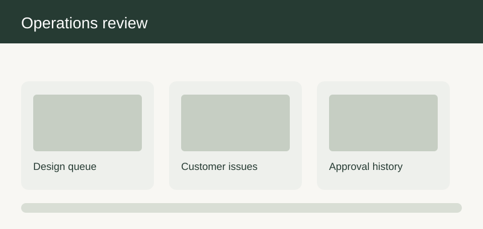

# Merchant and service operations

| ID | User story | Preliminary product solution | Implementation solution | Mockup and behavior |
| --- | --- | --- | --- | --- |
| MERCHANTANDSERVICEOPERATIONS-01-1 | As a home shopper, I want the system to publish an approved furniture assortment when comparing options for a first purchase, so that I can make a confident choice without a specialist present. | Preliminary product solution: A range proposal includes intended customer segment, available variants, regions, pricing status, and launch date. The publication view separates draft content from approved and live content. The first-time journey uses short explanations, a visible summary, and a clear path back to the previous choice. The current assortment approval choice and its next action remain visible. The flow explains how this choice affects the summary and which review remains open. An unapproved finish cannot appear in customer customization even if its sample image exists. | Implementation solution: Category management owns the proposal and commercial leadership approves launch readiness. The customer-facing record keeps the chosen option and its stated uncertainty together. The handoff keeps the decision date, conditions, and open questions together. A launch review checks the published assortment against the signed-off range list. Acceptance includes the home shopper path and the stated exception. |  Mockup note: the visual groups the main decision, a current-state summary, and the next action; the assortment approval controls update the summary immediately and expose any limitation next to the affected choice. |
| MERCHANTANDSERVICEOPERATIONS-01-2 | As an interior designer, I want the system to publish an approved furniture assortment when preparing a proposal for a client, so that I can explain the tradeoffs and preserve the client's decisions. | Preliminary product solution: A range proposal includes intended customer segment, available variants, regions, pricing status, and launch date. The publication view separates draft content from approved and live content. The professional journey permits a concise comparison view and records the reason a proposed option was chosen. The current assortment approval choice and its next action remain visible. The flow explains how this choice affects the summary and which review remains open. An unapproved finish cannot appear in customer customization even if its sample image exists. | Implementation solution: Category management owns the proposal and commercial leadership approves launch readiness. The handoff distinguishes a designer suggestion from a customer-approved decision. The handoff keeps the decision date, conditions, and open questions together. A launch review checks the published assortment against the signed-off range list. Acceptance includes the interior designer path and the stated exception. |  |
| MERCHANTANDSERVICEOPERATIONS-01-3 | As a returning customer, I want the system to publish an approved furniture assortment when revisiting a saved project after several weeks, so that I can see what changed before making a new commitment. | Preliminary product solution: A range proposal includes intended customer segment, available variants, regions, pricing status, and launch date. The publication view separates draft content from approved and live content. The return journey identifies changed prices, assortment, or timing beside the previously saved choice. The current assortment approval choice and its next action remain visible. The flow explains how this choice affects the summary and which review remains open. An unapproved finish cannot appear in customer customization even if its sample image exists. | Implementation solution: Category management owns the proposal and commercial leadership approves launch readiness. The saved record preserves the prior version while asking the customer to accept material changes. The handoff keeps the decision date, conditions, and open questions together. A launch review checks the published assortment against the signed-off range list. Acceptance includes the returning customer path and the stated exception. |  |
| MERCHANTANDSERVICEOPERATIONS-02-1 | As a home shopper, I want the system to maintain orderable customization choices when comparing options for a first purchase, so that I can make a confident choice without a specialist present. | Preliminary product solution: Option records explain which furniture families permit a dimension, material, finish, or handle choice. Changes have an effective date and an understandable customer-facing explanation when they affect an existing saved design. The first-time journey uses short explanations, a visible summary, and a clear path back to the previous choice. The current option governance choice and its next action remain visible. The flow explains how this choice affects the summary and which review remains open. Removing an option from new sales does not erase the option from an already accepted order. | Implementation solution: Catalog operations owns compatibility and order operations reviews impact on open orders. The customer-facing record keeps the chosen option and its stated uncertainty together. The handoff keeps the decision date, conditions, and open questions together. Acceptance checks new, saved, and placed-order states for the same retired option. Acceptance includes the home shopper path and the stated exception. |  |
| MERCHANTANDSERVICEOPERATIONS-02-2 | As an interior designer, I want the system to maintain orderable customization choices when preparing a proposal for a client, so that I can explain the tradeoffs and preserve the client's decisions. | Preliminary product solution: Option records explain which furniture families permit a dimension, material, finish, or handle choice. Changes have an effective date and an understandable customer-facing explanation when they affect an existing saved design. The professional journey permits a concise comparison view and records the reason a proposed option was chosen. The current option governance choice and its next action remain visible. The flow explains how this choice affects the summary and which review remains open. Removing an option from new sales does not erase the option from an already accepted order. | Implementation solution: Catalog operations owns compatibility and order operations reviews impact on open orders. The handoff distinguishes a designer suggestion from a customer-approved decision. The handoff keeps the decision date, conditions, and open questions together. Acceptance checks new, saved, and placed-order states for the same retired option. Acceptance includes the interior designer path and the stated exception. |  |
| MERCHANTANDSERVICEOPERATIONS-02-3 | As a returning customer, I want the system to maintain orderable customization choices when revisiting a saved project after several weeks, so that I can see what changed before making a new commitment. | Preliminary product solution: Option records explain which furniture families permit a dimension, material, finish, or handle choice. Changes have an effective date and an understandable customer-facing explanation when they affect an existing saved design. The return journey identifies changed prices, assortment, or timing beside the previously saved choice. The current option governance choice and its next action remain visible. The flow explains how this choice affects the summary and which review remains open. Removing an option from new sales does not erase the option from an already accepted order. | Implementation solution: Catalog operations owns compatibility and order operations reviews impact on open orders. The saved record preserves the prior version while asking the customer to accept material changes. The handoff keeps the decision date, conditions, and open questions together. Acceptance checks new, saved, and placed-order states for the same retired option. Acceptance includes the returning customer path and the stated exception. |  |
| MERCHANTANDSERVICEOPERATIONS-03-1 | As a home shopper, I want the system to update furniture prices responsibly when comparing options for a first purchase, so that I can make a confident choice without a specialist present. | Preliminary product solution: A price proposal shows old and new values, affected ranges, effective date, and the reason visible to internal reviewers. The customer estimate records the price book version used and refreshes when a saved design is reopened. The first-time journey uses short explanations, a visible summary, and a clear path back to the previous choice. The current price book choice and its next action remain visible. The flow explains how this choice affects the summary and which review remains open. An approved future price does not alter an already accepted order without the applicable agreement. | Implementation solution: Commercial operations prepares prices and finance approves publication. The customer-facing record keeps the chosen option and its stated uncertainty together. The handoff keeps the decision date, conditions, and open questions together. A review reconciles a newly configured item with the active approved price book. Acceptance includes the home shopper path and the stated exception. |  |
| MERCHANTANDSERVICEOPERATIONS-03-2 | As an interior designer, I want the system to update furniture prices responsibly when preparing a proposal for a client, so that I can explain the tradeoffs and preserve the client's decisions. | Preliminary product solution: A price proposal shows old and new values, affected ranges, effective date, and the reason visible to internal reviewers. The customer estimate records the price book version used and refreshes when a saved design is reopened. The professional journey permits a concise comparison view and records the reason a proposed option was chosen. The current price book choice and its next action remain visible. The flow explains how this choice affects the summary and which review remains open. An approved future price does not alter an already accepted order without the applicable agreement. | Implementation solution: Commercial operations prepares prices and finance approves publication. The handoff distinguishes a designer suggestion from a customer-approved decision. The handoff keeps the decision date, conditions, and open questions together. A review reconciles a newly configured item with the active approved price book. Acceptance includes the interior designer path and the stated exception. |  |
| MERCHANTANDSERVICEOPERATIONS-03-3 | As a returning customer, I want the system to update furniture prices responsibly when revisiting a saved project after several weeks, so that I can see what changed before making a new commitment. | Preliminary product solution: A price proposal shows old and new values, affected ranges, effective date, and the reason visible to internal reviewers. The customer estimate records the price book version used and refreshes when a saved design is reopened. The return journey identifies changed prices, assortment, or timing beside the previously saved choice. The current price book choice and its next action remain visible. The flow explains how this choice affects the summary and which review remains open. An approved future price does not alter an already accepted order without the applicable agreement. | Implementation solution: Commercial operations prepares prices and finance approves publication. The saved record preserves the prior version while asking the customer to accept material changes. The handoff keeps the decision date, conditions, and open questions together. A review reconciles a newly configured item with the active approved price book. Acceptance includes the returning customer path and the stated exception. |  |
| MERCHANTANDSERVICEOPERATIONS-04-1 | As a home shopper, I want the system to configure a clear promotion when comparing options for a first purchase, so that I can make a confident choice without a specialist present. | Preliminary product solution: Campaign setup records eligibility, dates, exclusions, customer wording, and interaction with other offers. A preview shows eligible and excluded sample baskets before the campaign goes live. The first-time journey uses short explanations, a visible summary, and a clear path back to the previous choice. The current promotion setup choice and its next action remain visible. The flow explains how this choice affects the summary and which review remains open. An excluded custom service cannot be discounted through an unrelated furniture offer. | Implementation solution: Campaign management proposes terms and pricing operations validates sample outcomes. The customer-facing record keeps the chosen option and its stated uncertainty together. The handoff keeps the decision date, conditions, and open questions together. Acceptance compares the public offer text with qualifying basket results. Acceptance includes the home shopper path and the stated exception. |  |
| MERCHANTANDSERVICEOPERATIONS-04-2 | As an interior designer, I want the system to configure a clear promotion when preparing a proposal for a client, so that I can explain the tradeoffs and preserve the client's decisions. | Preliminary product solution: Campaign setup records eligibility, dates, exclusions, customer wording, and interaction with other offers. A preview shows eligible and excluded sample baskets before the campaign goes live. The professional journey permits a concise comparison view and records the reason a proposed option was chosen. The current promotion setup choice and its next action remain visible. The flow explains how this choice affects the summary and which review remains open. An excluded custom service cannot be discounted through an unrelated furniture offer. | Implementation solution: Campaign management proposes terms and pricing operations validates sample outcomes. The handoff distinguishes a designer suggestion from a customer-approved decision. The handoff keeps the decision date, conditions, and open questions together. Acceptance compares the public offer text with qualifying basket results. Acceptance includes the interior designer path and the stated exception. |  |
| MERCHANTANDSERVICEOPERATIONS-04-3 | As a returning customer, I want the system to configure a clear promotion when revisiting a saved project after several weeks, so that I can see what changed before making a new commitment. | Preliminary product solution: Campaign setup records eligibility, dates, exclusions, customer wording, and interaction with other offers. A preview shows eligible and excluded sample baskets before the campaign goes live. The return journey identifies changed prices, assortment, or timing beside the previously saved choice. The current promotion setup choice and its next action remain visible. The flow explains how this choice affects the summary and which review remains open. An excluded custom service cannot be discounted through an unrelated furniture offer. | Implementation solution: Campaign management proposes terms and pricing operations validates sample outcomes. The saved record preserves the prior version while asking the customer to accept material changes. The handoff keeps the decision date, conditions, and open questions together. Acceptance compares the public offer text with qualifying basket results. Acceptance includes the returning customer path and the stated exception. |  |
| MERCHANTANDSERVICEOPERATIONS-05-1 | As a home shopper, I want the system to change product guidance without losing history when comparing options for a first purchase, so that I can make a confident choice without a specialist present. | Preliminary product solution: Editors can revise descriptions, care instructions, and design inspiration with a visible approval state. Prior published wording remains available to support staff when reviewing an older customer decision. The first-time journey uses short explanations, a visible summary, and a clear path back to the previous choice. The current content revision choice and its next action remain visible. The flow explains how this choice affects the summary and which review remains open. A new care note is not retroactively represented as text the customer saw at order time. | Implementation solution: Content leads own review and product specialists approve factual material claims. The customer-facing record keeps the chosen option and its stated uncertainty together. The handoff keeps the decision date, conditions, and open questions together. A support case confirms access to the correct historical content version. Acceptance includes the home shopper path and the stated exception. |  Mockup note: the visual groups the main decision, a current-state summary, and the next action; the content revision controls update the summary immediately and expose any limitation next to the affected choice. |
| MERCHANTANDSERVICEOPERATIONS-05-2 | As an interior designer, I want the system to change product guidance without losing history when preparing a proposal for a client, so that I can explain the tradeoffs and preserve the client's decisions. | Preliminary product solution: Editors can revise descriptions, care instructions, and design inspiration with a visible approval state. Prior published wording remains available to support staff when reviewing an older customer decision. The professional journey permits a concise comparison view and records the reason a proposed option was chosen. The current content revision choice and its next action remain visible. The flow explains how this choice affects the summary and which review remains open. A new care note is not retroactively represented as text the customer saw at order time. | Implementation solution: Content leads own review and product specialists approve factual material claims. The handoff distinguishes a designer suggestion from a customer-approved decision. The handoff keeps the decision date, conditions, and open questions together. A support case confirms access to the correct historical content version. Acceptance includes the interior designer path and the stated exception. |  |
| MERCHANTANDSERVICEOPERATIONS-05-3 | As a returning customer, I want the system to change product guidance without losing history when revisiting a saved project after several weeks, so that I can see what changed before making a new commitment. | Preliminary product solution: Editors can revise descriptions, care instructions, and design inspiration with a visible approval state. Prior published wording remains available to support staff when reviewing an older customer decision. The return journey identifies changed prices, assortment, or timing beside the previously saved choice. The current content revision choice and its next action remain visible. The flow explains how this choice affects the summary and which review remains open. A new care note is not retroactively represented as text the customer saw at order time. | Implementation solution: Content leads own review and product specialists approve factual material claims. The saved record preserves the prior version while asking the customer to accept material changes. The handoff keeps the decision date, conditions, and open questions together. A support case confirms access to the correct historical content version. Acceptance includes the returning customer path and the stated exception. |  |
| MERCHANTANDSERVICEOPERATIONS-06-1 | As a home shopper, I want the system to maintain credible lead-time guidance when comparing options for a first purchase, so that I can make a confident choice without a specialist present. | Preliminary product solution: A supplier update records the affected product group, expected period, confidence, and reason. Customer pages show an approved range appropriate to the current configuration and region. The first-time journey uses short explanations, a visible summary, and a clear path back to the previous choice. The current supplier lead times choice and its next action remain visible. The flow explains how this choice affects the summary and which review remains open. A low-confidence supplier update cannot become an exact promised date. | Implementation solution: Supply planning owns estimates and customer operations approves external wording. The customer-facing record keeps the chosen option and its stated uncertainty together. The handoff keeps the decision date, conditions, and open questions together. Acceptance checks one standard item and one custom finish after a lead-time change. Acceptance includes the home shopper path and the stated exception. |  |
| MERCHANTANDSERVICEOPERATIONS-06-2 | As an interior designer, I want the system to maintain credible lead-time guidance when preparing a proposal for a client, so that I can explain the tradeoffs and preserve the client's decisions. | Preliminary product solution: A supplier update records the affected product group, expected period, confidence, and reason. Customer pages show an approved range appropriate to the current configuration and region. The professional journey permits a concise comparison view and records the reason a proposed option was chosen. The current supplier lead times choice and its next action remain visible. The flow explains how this choice affects the summary and which review remains open. A low-confidence supplier update cannot become an exact promised date. | Implementation solution: Supply planning owns estimates and customer operations approves external wording. The handoff distinguishes a designer suggestion from a customer-approved decision. The handoff keeps the decision date, conditions, and open questions together. Acceptance checks one standard item and one custom finish after a lead-time change. Acceptance includes the interior designer path and the stated exception. |  |
| MERCHANTANDSERVICEOPERATIONS-06-3 | As a returning customer, I want the system to maintain credible lead-time guidance when revisiting a saved project after several weeks, so that I can see what changed before making a new commitment. | Preliminary product solution: A supplier update records the affected product group, expected period, confidence, and reason. Customer pages show an approved range appropriate to the current configuration and region. The return journey identifies changed prices, assortment, or timing beside the previously saved choice. The current supplier lead times choice and its next action remain visible. The flow explains how this choice affects the summary and which review remains open. A low-confidence supplier update cannot become an exact promised date. | Implementation solution: Supply planning owns estimates and customer operations approves external wording. The saved record preserves the prior version while asking the customer to accept material changes. The handoff keeps the decision date, conditions, and open questions together. Acceptance checks one standard item and one custom finish after a lead-time change. Acceptance includes the returning customer path and the stated exception. |  |
| MERCHANTANDSERVICEOPERATIONS-07-1 | As a home shopper, I want the system to handle a newly unavailable component when comparing options for a first purchase, so that I can make a confident choice without a specialist present. | Preliminary product solution: An exception view identifies affected catalog options, saved designs, baskets, and accepted orders separately. The response proposes alternatives or timing updates with explicit customer choice where needed. The first-time journey uses short explanations, a visible summary, and a clear path back to the previous choice. The current stock exception choice and its next action remain visible. The flow explains how this choice affects the summary and which review remains open. An accepted order is not silently switched to a substitute component. | Implementation solution: Supply and order teams coordinate mitigation; customer support owns direct communication. The customer-facing record keeps the chosen option and its stated uncertainty together. The handoff keeps the decision date, conditions, and open questions together. A sample shortage is traced through each affected customer state. Acceptance includes the home shopper path and the stated exception. |  |
| MERCHANTANDSERVICEOPERATIONS-07-2 | As an interior designer, I want the system to handle a newly unavailable component when preparing a proposal for a client, so that I can explain the tradeoffs and preserve the client's decisions. | Preliminary product solution: An exception view identifies affected catalog options, saved designs, baskets, and accepted orders separately. The response proposes alternatives or timing updates with explicit customer choice where needed. The professional journey permits a concise comparison view and records the reason a proposed option was chosen. The current stock exception choice and its next action remain visible. The flow explains how this choice affects the summary and which review remains open. An accepted order is not silently switched to a substitute component. | Implementation solution: Supply and order teams coordinate mitigation; customer support owns direct communication. The handoff distinguishes a designer suggestion from a customer-approved decision. The handoff keeps the decision date, conditions, and open questions together. A sample shortage is traced through each affected customer state. Acceptance includes the interior designer path and the stated exception. |  |
| MERCHANTANDSERVICEOPERATIONS-07-3 | As a returning customer, I want the system to handle a newly unavailable component when revisiting a saved project after several weeks, so that I can see what changed before making a new commitment. | Preliminary product solution: An exception view identifies affected catalog options, saved designs, baskets, and accepted orders separately. The response proposes alternatives or timing updates with explicit customer choice where needed. The return journey identifies changed prices, assortment, or timing beside the previously saved choice. The current stock exception choice and its next action remain visible. The flow explains how this choice affects the summary and which review remains open. An accepted order is not silently switched to a substitute component. | Implementation solution: Supply and order teams coordinate mitigation; customer support owns direct communication. The saved record preserves the prior version while asking the customer to accept material changes. The handoff keeps the decision date, conditions, and open questions together. A sample shortage is traced through each affected customer state. Acceptance includes the returning customer path and the stated exception. |  |
| MERCHANTANDSERVICEOPERATIONS-08-1 | As a home shopper, I want the system to review customer kitchen designs efficiently when comparing options for a first purchase, so that I can make a confident choice without a specialist present. | Preliminary product solution: A queue groups requested reviews by urgency, warning type, and customer appointment while retaining each design version. Reviewers see measurements, assumptions, item list, and questions in one context. The first-time journey uses short explanations, a visible summary, and a clear path back to the previous choice. The current design review queue choice and its next action remain visible. The flow explains how this choice affects the summary and which review remains open. A design with unaddressed fit warnings cannot be marked approved merely because a reviewer opened it. | Implementation solution: Consultation management assigns reviewers and defines approval criteria. The customer-facing record keeps the chosen option and its stated uncertainty together. The handoff keeps the decision date, conditions, and open questions together. Acceptance checks that a reviewed design has an attributable decision and rationale. Acceptance includes the home shopper path and the stated exception. |  |
| MERCHANTANDSERVICEOPERATIONS-08-2 | As an interior designer, I want the system to review customer kitchen designs efficiently when preparing a proposal for a client, so that I can explain the tradeoffs and preserve the client's decisions. | Preliminary product solution: A queue groups requested reviews by urgency, warning type, and customer appointment while retaining each design version. Reviewers see measurements, assumptions, item list, and questions in one context. The professional journey permits a concise comparison view and records the reason a proposed option was chosen. The current design review queue choice and its next action remain visible. The flow explains how this choice affects the summary and which review remains open. A design with unaddressed fit warnings cannot be marked approved merely because a reviewer opened it. | Implementation solution: Consultation management assigns reviewers and defines approval criteria. The handoff distinguishes a designer suggestion from a customer-approved decision. The handoff keeps the decision date, conditions, and open questions together. Acceptance checks that a reviewed design has an attributable decision and rationale. Acceptance includes the interior designer path and the stated exception. |  |
| MERCHANTANDSERVICEOPERATIONS-08-3 | As a returning customer, I want the system to review customer kitchen designs efficiently when revisiting a saved project after several weeks, so that I can see what changed before making a new commitment. | Preliminary product solution: A queue groups requested reviews by urgency, warning type, and customer appointment while retaining each design version. Reviewers see measurements, assumptions, item list, and questions in one context. The return journey identifies changed prices, assortment, or timing beside the previously saved choice. The current design review queue choice and its next action remain visible. The flow explains how this choice affects the summary and which review remains open. A design with unaddressed fit warnings cannot be marked approved merely because a reviewer opened it. | Implementation solution: Consultation management assigns reviewers and defines approval criteria. The saved record preserves the prior version while asking the customer to accept material changes. The handoff keeps the decision date, conditions, and open questions together. Acceptance checks that a reviewed design has an attributable decision and rationale. Acceptance includes the returning customer path and the stated exception. |  |
| MERCHANTANDSERVICEOPERATIONS-09-1 | As a home shopper, I want the system to record a professional room survey when comparing options for a first purchase, so that I can make a confident choice without a specialist present. | Preliminary product solution: A survey record distinguishes measured dimensions from customer estimates and notes obstacles, access, and unresolved checks. The resulting customer proposal highlights every material change from the initial 3D concept. The first-time journey uses short explanations, a visible summary, and a clear path back to the previous choice. The current measurement survey choice and its next action remain visible. The flow explains how this choice affects the summary and which review remains open. A survey cannot silently overwrite the customer's chosen layout without a visible proposal. | Implementation solution: Survey operations owns measurements and the designer owns revised layout discussion. The customer-facing record keeps the chosen option and its stated uncertainty together. The handoff keeps the decision date, conditions, and open questions together. A survey example verifies that changed dimensions and customer decisions remain traceable. Acceptance includes the home shopper path and the stated exception. |  |
| MERCHANTANDSERVICEOPERATIONS-09-2 | As an interior designer, I want the system to record a professional room survey when preparing a proposal for a client, so that I can explain the tradeoffs and preserve the client's decisions. | Preliminary product solution: A survey record distinguishes measured dimensions from customer estimates and notes obstacles, access, and unresolved checks. The resulting customer proposal highlights every material change from the initial 3D concept. The professional journey permits a concise comparison view and records the reason a proposed option was chosen. The current measurement survey choice and its next action remain visible. The flow explains how this choice affects the summary and which review remains open. A survey cannot silently overwrite the customer's chosen layout without a visible proposal. | Implementation solution: Survey operations owns measurements and the designer owns revised layout discussion. The handoff distinguishes a designer suggestion from a customer-approved decision. The handoff keeps the decision date, conditions, and open questions together. A survey example verifies that changed dimensions and customer decisions remain traceable. Acceptance includes the interior designer path and the stated exception. |  |
| MERCHANTANDSERVICEOPERATIONS-09-3 | As a returning customer, I want the system to record a professional room survey when revisiting a saved project after several weeks, so that I can see what changed before making a new commitment. | Preliminary product solution: A survey record distinguishes measured dimensions from customer estimates and notes obstacles, access, and unresolved checks. The resulting customer proposal highlights every material change from the initial 3D concept. The return journey identifies changed prices, assortment, or timing beside the previously saved choice. The current measurement survey choice and its next action remain visible. The flow explains how this choice affects the summary and which review remains open. A survey cannot silently overwrite the customer's chosen layout without a visible proposal. | Implementation solution: Survey operations owns measurements and the designer owns revised layout discussion. The saved record preserves the prior version while asking the customer to accept material changes. The handoff keeps the decision date, conditions, and open questions together. A survey example verifies that changed dimensions and customer decisions remain traceable. Acceptance includes the returning customer path and the stated exception. |  |
| MERCHANTANDSERVICEOPERATIONS-10-1 | As a home shopper, I want the system to prepare a clear quote for a custom kitchen when comparing options for a first purchase, so that I can make a confident choice without a specialist present. | Preliminary product solution: The quote groups furniture, worktop, accessories, delivery, installation, exclusions, and validity period. It identifies which design version and confirmed measurements underpin the offered price. The first-time journey uses short explanations, a visible summary, and a clear path back to the previous choice. The current quote review choice and its next action remain visible. The flow explains how this choice affects the summary and which review remains open. A provisional component is listed as unresolved rather than hidden inside a fixed total. | Implementation solution: Sales owns quote presentation, pricing owns values, and design signs off configuration completeness. The customer-facing record keeps the chosen option and its stated uncertainty together. The handoff keeps the decision date, conditions, and open questions together. A quote review checks every line against the approved design and current price rules. Acceptance includes the home shopper path and the stated exception. |  Mockup note: the visual groups the main decision, a current-state summary, and the next action; the quote review controls update the summary immediately and expose any limitation next to the affected choice. |
| MERCHANTANDSERVICEOPERATIONS-10-2 | As an interior designer, I want the system to prepare a clear quote for a custom kitchen when preparing a proposal for a client, so that I can explain the tradeoffs and preserve the client's decisions. | Preliminary product solution: The quote groups furniture, worktop, accessories, delivery, installation, exclusions, and validity period. It identifies which design version and confirmed measurements underpin the offered price. The professional journey permits a concise comparison view and records the reason a proposed option was chosen. The current quote review choice and its next action remain visible. The flow explains how this choice affects the summary and which review remains open. A provisional component is listed as unresolved rather than hidden inside a fixed total. | Implementation solution: Sales owns quote presentation, pricing owns values, and design signs off configuration completeness. The handoff distinguishes a designer suggestion from a customer-approved decision. The handoff keeps the decision date, conditions, and open questions together. A quote review checks every line against the approved design and current price rules. Acceptance includes the interior designer path and the stated exception. |  |
| MERCHANTANDSERVICEOPERATIONS-10-3 | As a returning customer, I want the system to prepare a clear quote for a custom kitchen when revisiting a saved project after several weeks, so that I can see what changed before making a new commitment. | Preliminary product solution: The quote groups furniture, worktop, accessories, delivery, installation, exclusions, and validity period. It identifies which design version and confirmed measurements underpin the offered price. The return journey identifies changed prices, assortment, or timing beside the previously saved choice. The current quote review choice and its next action remain visible. The flow explains how this choice affects the summary and which review remains open. A provisional component is listed as unresolved rather than hidden inside a fixed total. | Implementation solution: Sales owns quote presentation, pricing owns values, and design signs off configuration completeness. The saved record preserves the prior version while asking the customer to accept material changes. The handoff keeps the decision date, conditions, and open questions together. A quote review checks every line against the approved design and current price rules. Acceptance includes the returning customer path and the stated exception. |  |
| MERCHANTANDSERVICEOPERATIONS-11-1 | As a home shopper, I want the system to transfer an accepted order to fulfilment when comparing options for a first purchase, so that I can make a confident choice without a specialist present. | Preliminary product solution: The handoff includes confirmed specifications, design version, customer choices, promised timing, and outstanding supplier actions. Every recipient team sees the same authoritative order summary and a clear owner for the next action. The first-time journey uses short explanations, a visible summary, and a clear path back to the previous choice. The current order handoff choice and its next action remain visible. The flow explains how this choice affects the summary and which review remains open. A draft quote or customer note cannot be mistaken for a confirmed production instruction. | Implementation solution: Order operations owns the handoff and manufacturing coordination acknowledges acceptance. The customer-facing record keeps the chosen option and its stated uncertainty together. The handoff keeps the decision date, conditions, and open questions together. Acceptance checks that a production reviewer can identify the exact approved specification. Acceptance includes the home shopper path and the stated exception. |  |
| MERCHANTANDSERVICEOPERATIONS-11-2 | As an interior designer, I want the system to transfer an accepted order to fulfilment when preparing a proposal for a client, so that I can explain the tradeoffs and preserve the client's decisions. | Preliminary product solution: The handoff includes confirmed specifications, design version, customer choices, promised timing, and outstanding supplier actions. Every recipient team sees the same authoritative order summary and a clear owner for the next action. The professional journey permits a concise comparison view and records the reason a proposed option was chosen. The current order handoff choice and its next action remain visible. The flow explains how this choice affects the summary and which review remains open. A draft quote or customer note cannot be mistaken for a confirmed production instruction. | Implementation solution: Order operations owns the handoff and manufacturing coordination acknowledges acceptance. The handoff distinguishes a designer suggestion from a customer-approved decision. The handoff keeps the decision date, conditions, and open questions together. Acceptance checks that a production reviewer can identify the exact approved specification. Acceptance includes the interior designer path and the stated exception. |  |
| MERCHANTANDSERVICEOPERATIONS-11-3 | As a returning customer, I want the system to transfer an accepted order to fulfilment when revisiting a saved project after several weeks, so that I can see what changed before making a new commitment. | Preliminary product solution: The handoff includes confirmed specifications, design version, customer choices, promised timing, and outstanding supplier actions. Every recipient team sees the same authoritative order summary and a clear owner for the next action. The return journey identifies changed prices, assortment, or timing beside the previously saved choice. The current order handoff choice and its next action remain visible. The flow explains how this choice affects the summary and which review remains open. A draft quote or customer note cannot be mistaken for a confirmed production instruction. | Implementation solution: Order operations owns the handoff and manufacturing coordination acknowledges acceptance. The saved record preserves the prior version while asking the customer to accept material changes. The handoff keeps the decision date, conditions, and open questions together. Acceptance checks that a production reviewer can identify the exact approved specification. Acceptance includes the returning customer path and the stated exception. |  |
| MERCHANTANDSERVICEOPERATIONS-12-1 | As a home shopper, I want the system to check that a custom item matches its order when comparing options for a first purchase, so that I can make a confident choice without a specialist present. | Preliminary product solution: A quality view provides the approved options and any agreed amendments for comparison with the prepared item. Exceptions are recorded with affected parts, proposed remedy, and customer impact. The first-time journey uses short explanations, a visible summary, and a clear path back to the previous choice. The current quality review choice and its next action remain visible. The flow explains how this choice affects the summary and which review remains open. A quality pass cannot be inferred solely from the absence of a reported defect. | Implementation solution: Quality operations owns checks and service leadership handles customer-impacting decisions. The customer-facing record keeps the chosen option and its stated uncertainty together. The handoff keeps the decision date, conditions, and open questions together. A sample discrepancy shows a recorded decision before shipment. Acceptance includes the home shopper path and the stated exception. |  |
| MERCHANTANDSERVICEOPERATIONS-12-2 | As an interior designer, I want the system to check that a custom item matches its order when preparing a proposal for a client, so that I can explain the tradeoffs and preserve the client's decisions. | Preliminary product solution: A quality view provides the approved options and any agreed amendments for comparison with the prepared item. Exceptions are recorded with affected parts, proposed remedy, and customer impact. The professional journey permits a concise comparison view and records the reason a proposed option was chosen. The current quality review choice and its next action remain visible. The flow explains how this choice affects the summary and which review remains open. A quality pass cannot be inferred solely from the absence of a reported defect. | Implementation solution: Quality operations owns checks and service leadership handles customer-impacting decisions. The handoff distinguishes a designer suggestion from a customer-approved decision. The handoff keeps the decision date, conditions, and open questions together. A sample discrepancy shows a recorded decision before shipment. Acceptance includes the interior designer path and the stated exception. |  |
| MERCHANTANDSERVICEOPERATIONS-12-3 | As a returning customer, I want the system to check that a custom item matches its order when revisiting a saved project after several weeks, so that I can see what changed before making a new commitment. | Preliminary product solution: A quality view provides the approved options and any agreed amendments for comparison with the prepared item. Exceptions are recorded with affected parts, proposed remedy, and customer impact. The return journey identifies changed prices, assortment, or timing beside the previously saved choice. The current quality review choice and its next action remain visible. The flow explains how this choice affects the summary and which review remains open. A quality pass cannot be inferred solely from the absence of a reported defect. | Implementation solution: Quality operations owns checks and service leadership handles customer-impacting decisions. The saved record preserves the prior version while asking the customer to accept material changes. The handoff keeps the decision date, conditions, and open questions together. A sample discrepancy shows a recorded decision before shipment. Acceptance includes the returning customer path and the stated exception. |  |
| MERCHANTANDSERVICEOPERATIONS-13-1 | As a home shopper, I want the system to assign an installation with the right context when comparing options for a first purchase, so that I can make a confident choice without a specialist present. | Preliminary product solution: The service handoff includes item list, room access notes, booked scope, and any survey finding relevant to installation. The assigned team can flag a missing prerequisite before the visit. The first-time journey uses short explanations, a visible summary, and a clear path back to the previous choice. The current service assignment choice and its next action remain visible. The flow explains how this choice affects the summary and which review remains open. A general delivery note is not treated as permission for out-of-scope work. | Implementation solution: Service scheduling owns assignment and the installation partner confirms scope. The customer-facing record keeps the chosen option and its stated uncertainty together. The handoff keeps the decision date, conditions, and open questions together. Acceptance checks that the installer receives the current approved plan, not an older draft. Acceptance includes the home shopper path and the stated exception. |  |
| MERCHANTANDSERVICEOPERATIONS-13-2 | As an interior designer, I want the system to assign an installation with the right context when preparing a proposal for a client, so that I can explain the tradeoffs and preserve the client's decisions. | Preliminary product solution: The service handoff includes item list, room access notes, booked scope, and any survey finding relevant to installation. The assigned team can flag a missing prerequisite before the visit. The professional journey permits a concise comparison view and records the reason a proposed option was chosen. The current service assignment choice and its next action remain visible. The flow explains how this choice affects the summary and which review remains open. A general delivery note is not treated as permission for out-of-scope work. | Implementation solution: Service scheduling owns assignment and the installation partner confirms scope. The handoff distinguishes a designer suggestion from a customer-approved decision. The handoff keeps the decision date, conditions, and open questions together. Acceptance checks that the installer receives the current approved plan, not an older draft. Acceptance includes the interior designer path and the stated exception. |  |
| MERCHANTANDSERVICEOPERATIONS-13-3 | As a returning customer, I want the system to assign an installation with the right context when revisiting a saved project after several weeks, so that I can see what changed before making a new commitment. | Preliminary product solution: The service handoff includes item list, room access notes, booked scope, and any survey finding relevant to installation. The assigned team can flag a missing prerequisite before the visit. The return journey identifies changed prices, assortment, or timing beside the previously saved choice. The current service assignment choice and its next action remain visible. The flow explains how this choice affects the summary and which review remains open. A general delivery note is not treated as permission for out-of-scope work. | Implementation solution: Service scheduling owns assignment and the installation partner confirms scope. The saved record preserves the prior version while asking the customer to accept material changes. The handoff keeps the decision date, conditions, and open questions together. Acceptance checks that the installer receives the current approved plan, not an older draft. Acceptance includes the returning customer path and the stated exception. |  |
| MERCHANTANDSERVICEOPERATIONS-14-1 | As a home shopper, I want the system to resolve a customer issue consistently when comparing options for a first purchase, so that I can make a confident choice without a specialist present. | Preliminary product solution: The case view shows the order facts, customer request, prior decisions, applicable policy, and a proposed next step. Agents can explain the decision and record an exception with appropriate approval. The first-time journey uses short explanations, a visible summary, and a clear path back to the previous choice. The current customer exception choice and its next action remain visible. The flow explains how this choice affects the summary and which review remains open. A suggested resolution cannot be sent as a promise before required approval. | Implementation solution: Service management defines authority levels and the case owner communicates the final decision. The customer-facing record keeps the chosen option and its stated uncertainty together. The handoff keeps the decision date, conditions, and open questions together. An exception test checks approval, customer message, and audit history. Acceptance includes the home shopper path and the stated exception. |  |
| MERCHANTANDSERVICEOPERATIONS-14-2 | As an interior designer, I want the system to resolve a customer issue consistently when preparing a proposal for a client, so that I can explain the tradeoffs and preserve the client's decisions. | Preliminary product solution: The case view shows the order facts, customer request, prior decisions, applicable policy, and a proposed next step. Agents can explain the decision and record an exception with appropriate approval. The professional journey permits a concise comparison view and records the reason a proposed option was chosen. The current customer exception choice and its next action remain visible. The flow explains how this choice affects the summary and which review remains open. A suggested resolution cannot be sent as a promise before required approval. | Implementation solution: Service management defines authority levels and the case owner communicates the final decision. The handoff distinguishes a designer suggestion from a customer-approved decision. The handoff keeps the decision date, conditions, and open questions together. An exception test checks approval, customer message, and audit history. Acceptance includes the interior designer path and the stated exception. |  |
| MERCHANTANDSERVICEOPERATIONS-14-3 | As a returning customer, I want the system to resolve a customer issue consistently when revisiting a saved project after several weeks, so that I can see what changed before making a new commitment. | Preliminary product solution: The case view shows the order facts, customer request, prior decisions, applicable policy, and a proposed next step. Agents can explain the decision and record an exception with appropriate approval. The return journey identifies changed prices, assortment, or timing beside the previously saved choice. The current customer exception choice and its next action remain visible. The flow explains how this choice affects the summary and which review remains open. A suggested resolution cannot be sent as a promise before required approval. | Implementation solution: Service management defines authority levels and the case owner communicates the final decision. The saved record preserves the prior version while asking the customer to accept material changes. The handoff keeps the decision date, conditions, and open questions together. An exception test checks approval, customer message, and audit history. Acceptance includes the returning customer path and the stated exception. |  |
| MERCHANTANDSERVICEOPERATIONS-15-1 | As a home shopper, I want the system to review a refund request with the right context when comparing options for a first purchase, so that I can make a confident choice without a specialist present. | Preliminary product solution: The review displays purchased items, payment status, delivery state, applicable terms, and the customer's stated reason. A decision record distinguishes approved refund, partial remedy, and request for more information. The first-time journey uses short explanations, a visible summary, and a clear path back to the previous choice. The current refund decision choice and its next action remain visible. The flow explains how this choice affects the summary and which review remains open. An automated suggestion does not substitute for required policy or legal assessment. | Implementation solution: Finance executes approved payments and support explains the outcome. The customer-facing record keeps the chosen option and its stated uncertainty together. The handoff keeps the decision date, conditions, and open questions together. Acceptance checks that a refund cannot be marked paid before execution is confirmed. Acceptance includes the home shopper path and the stated exception. |  Mockup note: the visual groups the main decision, a current-state summary, and the next action; the refund decision controls update the summary immediately and expose any limitation next to the affected choice. |
| MERCHANTANDSERVICEOPERATIONS-15-2 | As an interior designer, I want the system to review a refund request with the right context when preparing a proposal for a client, so that I can explain the tradeoffs and preserve the client's decisions. | Preliminary product solution: The review displays purchased items, payment status, delivery state, applicable terms, and the customer's stated reason. A decision record distinguishes approved refund, partial remedy, and request for more information. The professional journey permits a concise comparison view and records the reason a proposed option was chosen. The current refund decision choice and its next action remain visible. The flow explains how this choice affects the summary and which review remains open. An automated suggestion does not substitute for required policy or legal assessment. | Implementation solution: Finance executes approved payments and support explains the outcome. The handoff distinguishes a designer suggestion from a customer-approved decision. The handoff keeps the decision date, conditions, and open questions together. Acceptance checks that a refund cannot be marked paid before execution is confirmed. Acceptance includes the interior designer path and the stated exception. |  |
| MERCHANTANDSERVICEOPERATIONS-15-3 | As a returning customer, I want the system to review a refund request with the right context when revisiting a saved project after several weeks, so that I can see what changed before making a new commitment. | Preliminary product solution: The review displays purchased items, payment status, delivery state, applicable terms, and the customer's stated reason. A decision record distinguishes approved refund, partial remedy, and request for more information. The return journey identifies changed prices, assortment, or timing beside the previously saved choice. The current refund decision choice and its next action remain visible. The flow explains how this choice affects the summary and which review remains open. An automated suggestion does not substitute for required policy or legal assessment. | Implementation solution: Finance executes approved payments and support explains the outcome. The saved record preserves the prior version while asking the customer to accept material changes. The handoff keeps the decision date, conditions, and open questions together. Acceptance checks that a refund cannot be marked paid before execution is confirmed. Acceptance includes the returning customer path and the stated exception. |  |
| MERCHANTANDSERVICEOPERATIONS-16-1 | As a home shopper, I want the system to raise a supplier claim for a defective component when comparing options for a first purchase, so that I can make a confident choice without a specialist present. | Preliminary product solution: A supplier claim links the affected component to the order, defect evidence, replacement need, and customer promise. The team can track acknowledgement and expected remedy without hiding customer-facing delay. The first-time journey uses short explanations, a visible summary, and a clear path back to the previous choice. The current supplier claim choice and its next action remain visible. The flow explains how this choice affects the summary and which review remains open. A supplier acknowledgement does not itself resolve the customer case. | Implementation solution: Procurement owns supplier contact and customer service owns customer updates. The customer-facing record keeps the chosen option and its stated uncertainty together. The handoff keeps the decision date, conditions, and open questions together. A claim review traces replacement status through the original order. Acceptance includes the home shopper path and the stated exception. |  |
| MERCHANTANDSERVICEOPERATIONS-16-2 | As an interior designer, I want the system to raise a supplier claim for a defective component when preparing a proposal for a client, so that I can explain the tradeoffs and preserve the client's decisions. | Preliminary product solution: A supplier claim links the affected component to the order, defect evidence, replacement need, and customer promise. The team can track acknowledgement and expected remedy without hiding customer-facing delay. The professional journey permits a concise comparison view and records the reason a proposed option was chosen. The current supplier claim choice and its next action remain visible. The flow explains how this choice affects the summary and which review remains open. A supplier acknowledgement does not itself resolve the customer case. | Implementation solution: Procurement owns supplier contact and customer service owns customer updates. The handoff distinguishes a designer suggestion from a customer-approved decision. The handoff keeps the decision date, conditions, and open questions together. A claim review traces replacement status through the original order. Acceptance includes the interior designer path and the stated exception. |  |
| MERCHANTANDSERVICEOPERATIONS-16-3 | As a returning customer, I want the system to raise a supplier claim for a defective component when revisiting a saved project after several weeks, so that I can see what changed before making a new commitment. | Preliminary product solution: A supplier claim links the affected component to the order, defect evidence, replacement need, and customer promise. The team can track acknowledgement and expected remedy without hiding customer-facing delay. The return journey identifies changed prices, assortment, or timing beside the previously saved choice. The current supplier claim choice and its next action remain visible. The flow explains how this choice affects the summary and which review remains open. A supplier acknowledgement does not itself resolve the customer case. | Implementation solution: Procurement owns supplier contact and customer service owns customer updates. The saved record preserves the prior version while asking the customer to accept material changes. The handoff keeps the decision date, conditions, and open questions together. A claim review traces replacement status through the original order. Acceptance includes the returning customer path and the stated exception. |  |
| MERCHANTANDSERVICEOPERATIONS-17-1 | As a home shopper, I want the system to spot business problems that need action when comparing options for a first purchase, so that I can make a confident choice without a specialist present. | Preliminary product solution: The dashboard groups order delays, unresolved design reviews, damaged items, and customer contacts by owner and urgency. Each metric links to underlying cases and states its time window and definition. The first-time journey uses short explanations, a visible summary, and a clear path back to the previous choice. The current operations dashboard choice and its next action remain visible. The flow explains how this choice affects the summary and which review remains open. A total with incomplete source data is labelled incomplete instead of shown as an exact business measure. | Implementation solution: Operations leadership owns metric definitions and teams maintain event quality. The customer-facing record keeps the chosen option and its stated uncertainty together. The handoff keeps the decision date, conditions, and open questions together. A dashboard check reconciles one displayed count with its underlying case list. Acceptance includes the home shopper path and the stated exception. |  |
| MERCHANTANDSERVICEOPERATIONS-17-2 | As an interior designer, I want the system to spot business problems that need action when preparing a proposal for a client, so that I can explain the tradeoffs and preserve the client's decisions. | Preliminary product solution: The dashboard groups order delays, unresolved design reviews, damaged items, and customer contacts by owner and urgency. Each metric links to underlying cases and states its time window and definition. The professional journey permits a concise comparison view and records the reason a proposed option was chosen. The current operations dashboard choice and its next action remain visible. The flow explains how this choice affects the summary and which review remains open. A total with incomplete source data is labelled incomplete instead of shown as an exact business measure. | Implementation solution: Operations leadership owns metric definitions and teams maintain event quality. The handoff distinguishes a designer suggestion from a customer-approved decision. The handoff keeps the decision date, conditions, and open questions together. A dashboard check reconciles one displayed count with its underlying case list. Acceptance includes the interior designer path and the stated exception. |  |
| MERCHANTANDSERVICEOPERATIONS-17-3 | As a returning customer, I want the system to spot business problems that need action when revisiting a saved project after several weeks, so that I can see what changed before making a new commitment. | Preliminary product solution: The dashboard groups order delays, unresolved design reviews, damaged items, and customer contacts by owner and urgency. Each metric links to underlying cases and states its time window and definition. The return journey identifies changed prices, assortment, or timing beside the previously saved choice. The current operations dashboard choice and its next action remain visible. The flow explains how this choice affects the summary and which review remains open. A total with incomplete source data is labelled incomplete instead of shown as an exact business measure. | Implementation solution: Operations leadership owns metric definitions and teams maintain event quality. The saved record preserves the prior version while asking the customer to accept material changes. The handoff keeps the decision date, conditions, and open questions together. A dashboard check reconciles one displayed count with its underlying case list. Acceptance includes the returning customer path and the stated exception. |  |
| MERCHANTANDSERVICEOPERATIONS-18-1 | As a home shopper, I want the system to explain who changed a customer-critical record when comparing options for a first purchase, so that I can make a confident choice without a specialist present. | Preliminary product solution: The record history shows the actor, time, prior value, new value, and reason for material changes. It includes approvals for pricing, order amendments, and design sign-off where applicable. The first-time journey uses short explanations, a visible summary, and a clear path back to the previous choice. The current audit trail choice and its next action remain visible. The flow explains how this choice affects the summary and which review remains open. The audit view does not expose customer data to staff without a business need. | Implementation solution: Governance owners define retention and access; each operational team records its decisions. The customer-facing record keeps the chosen option and its stated uncertainty together. The handoff keeps the decision date, conditions, and open questions together. Acceptance follows one price change and one design approval through their histories. Acceptance includes the home shopper path and the stated exception. |  |
| MERCHANTANDSERVICEOPERATIONS-18-2 | As an interior designer, I want the system to explain who changed a customer-critical record when preparing a proposal for a client, so that I can explain the tradeoffs and preserve the client's decisions. | Preliminary product solution: The record history shows the actor, time, prior value, new value, and reason for material changes. It includes approvals for pricing, order amendments, and design sign-off where applicable. The professional journey permits a concise comparison view and records the reason a proposed option was chosen. The current audit trail choice and its next action remain visible. The flow explains how this choice affects the summary and which review remains open. The audit view does not expose customer data to staff without a business need. | Implementation solution: Governance owners define retention and access; each operational team records its decisions. The handoff distinguishes a designer suggestion from a customer-approved decision. The handoff keeps the decision date, conditions, and open questions together. Acceptance follows one price change and one design approval through their histories. Acceptance includes the interior designer path and the stated exception. |  |
| MERCHANTANDSERVICEOPERATIONS-18-3 | As a returning customer, I want the system to explain who changed a customer-critical record when revisiting a saved project after several weeks, so that I can see what changed before making a new commitment. | Preliminary product solution: The record history shows the actor, time, prior value, new value, and reason for material changes. It includes approvals for pricing, order amendments, and design sign-off where applicable. The return journey identifies changed prices, assortment, or timing beside the previously saved choice. The current audit trail choice and its next action remain visible. The flow explains how this choice affects the summary and which review remains open. The audit view does not expose customer data to staff without a business need. | Implementation solution: Governance owners define retention and access; each operational team records its decisions. The saved record preserves the prior version while asking the customer to accept material changes. The handoff keeps the decision date, conditions, and open questions together. Acceptance follows one price change and one design approval through their histories. Acceptance includes the returning customer path and the stated exception. |  |
| MERCHANTANDSERVICEOPERATIONS-19-1 | As a home shopper, I want the system to give staff access appropriate to their responsibilities when comparing options for a first purchase, so that I can make a confident choice without a specialist present. | Preliminary product solution: Staff roles separate editing, approval, customer support, finance execution, and read-only review. The interface explains when an action requires another person's approval. The first-time journey uses short explanations, a visible summary, and a clear path back to the previous choice. The current access roles choice and its next action remain visible. The flow explains how this choice affects the summary and which review remains open. A user who can draft a discount is not thereby authorized to approve it. | Implementation solution: Business owners assign roles and periodic access reviews check continued need. The customer-facing record keeps the chosen option and its stated uncertainty together. The handoff keeps the decision date, conditions, and open questions together. Acceptance tries a draft, approval, and refund action under representative roles. Acceptance includes the home shopper path and the stated exception. |  |
| MERCHANTANDSERVICEOPERATIONS-19-2 | As an interior designer, I want the system to give staff access appropriate to their responsibilities when preparing a proposal for a client, so that I can explain the tradeoffs and preserve the client's decisions. | Preliminary product solution: Staff roles separate editing, approval, customer support, finance execution, and read-only review. The interface explains when an action requires another person's approval. The professional journey permits a concise comparison view and records the reason a proposed option was chosen. The current access roles choice and its next action remain visible. The flow explains how this choice affects the summary and which review remains open. A user who can draft a discount is not thereby authorized to approve it. | Implementation solution: Business owners assign roles and periodic access reviews check continued need. The handoff distinguishes a designer suggestion from a customer-approved decision. The handoff keeps the decision date, conditions, and open questions together. Acceptance tries a draft, approval, and refund action under representative roles. Acceptance includes the interior designer path and the stated exception. |  |
| MERCHANTANDSERVICEOPERATIONS-19-3 | As a returning customer, I want the system to give staff access appropriate to their responsibilities when revisiting a saved project after several weeks, so that I can see what changed before making a new commitment. | Preliminary product solution: Staff roles separate editing, approval, customer support, finance execution, and read-only review. The interface explains when an action requires another person's approval. The return journey identifies changed prices, assortment, or timing beside the previously saved choice. The current access roles choice and its next action remain visible. The flow explains how this choice affects the summary and which review remains open. A user who can draft a discount is not thereby authorized to approve it. | Implementation solution: Business owners assign roles and periodic access reviews check continued need. The saved record preserves the prior version while asking the customer to accept material changes. The handoff keeps the decision date, conditions, and open questions together. Acceptance tries a draft, approval, and refund action under representative roles. Acceptance includes the returning customer path and the stated exception. |  |
| MERCHANTANDSERVICEOPERATIONS-20-1 | As a home shopper, I want the system to improve guidance from repeated customer questions when comparing options for a first purchase, so that I can make a confident choice without a specialist present. | Preliminary product solution: Support can flag confusing product text, planner warnings, and missing after-sales guidance with linked examples. Content owners see the customer effect and proposed correction before publication. The first-time journey uses short explanations, a visible summary, and a clear path back to the previous choice. The current knowledge feedback choice and its next action remain visible. The flow explains how this choice affects the summary and which review remains open. A support suggestion is not published as product fact without specialist review. | Implementation solution: Service quality triages feedback and content/product owners approve updates. The customer-facing record keeps the chosen option and its stated uncertainty together. The handoff keeps the decision date, conditions, and open questions together. A sample feedback item is traced from report to reviewed customer-facing change. Acceptance includes the home shopper path and the stated exception. |  Mockup note: the visual groups the main decision, a current-state summary, and the next action; the knowledge feedback controls update the summary immediately and expose any limitation next to the affected choice. |
| MERCHANTANDSERVICEOPERATIONS-20-2 | As an interior designer, I want the system to improve guidance from repeated customer questions when preparing a proposal for a client, so that I can explain the tradeoffs and preserve the client's decisions. | Preliminary product solution: Support can flag confusing product text, planner warnings, and missing after-sales guidance with linked examples. Content owners see the customer effect and proposed correction before publication. The professional journey permits a concise comparison view and records the reason a proposed option was chosen. The current knowledge feedback choice and its next action remain visible. The flow explains how this choice affects the summary and which review remains open. A support suggestion is not published as product fact without specialist review. | Implementation solution: Service quality triages feedback and content/product owners approve updates. The handoff distinguishes a designer suggestion from a customer-approved decision. The handoff keeps the decision date, conditions, and open questions together. A sample feedback item is traced from report to reviewed customer-facing change. Acceptance includes the interior designer path and the stated exception. |  |
| MERCHANTANDSERVICEOPERATIONS-20-3 | As a returning customer, I want the system to improve guidance from repeated customer questions when revisiting a saved project after several weeks, so that I can see what changed before making a new commitment. | Preliminary product solution: Support can flag confusing product text, planner warnings, and missing after-sales guidance with linked examples. Content owners see the customer effect and proposed correction before publication. The return journey identifies changed prices, assortment, or timing beside the previously saved choice. The current knowledge feedback choice and its next action remain visible. The flow explains how this choice affects the summary and which review remains open. A support suggestion is not published as product fact without specialist review. | Implementation solution: Service quality triages feedback and content/product owners approve updates. The saved record preserves the prior version while asking the customer to accept material changes. The handoff keeps the decision date, conditions, and open questions together. A sample feedback item is traced from report to reviewed customer-facing change. Acceptance includes the returning customer path and the stated exception. |  |
