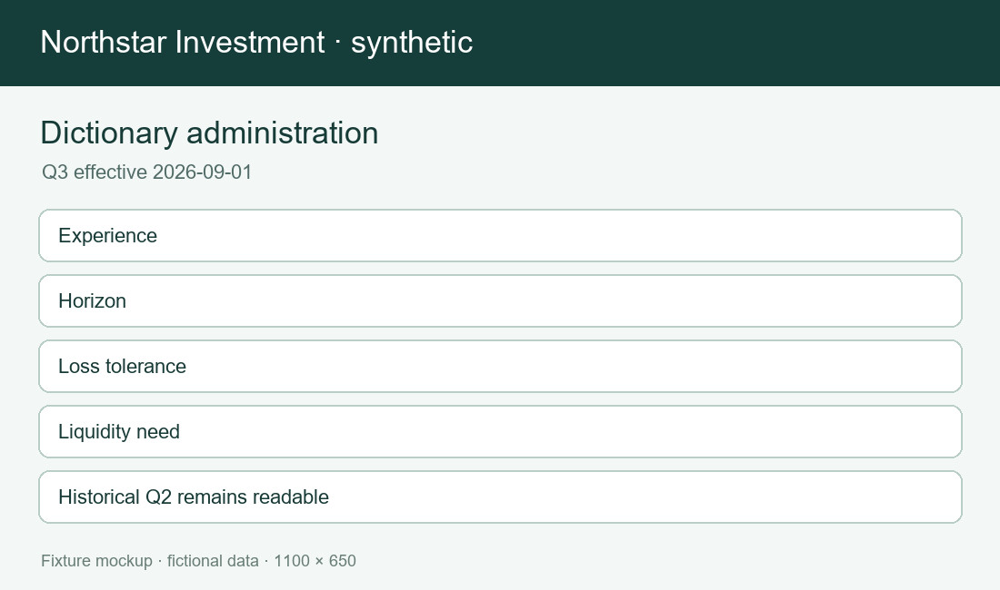
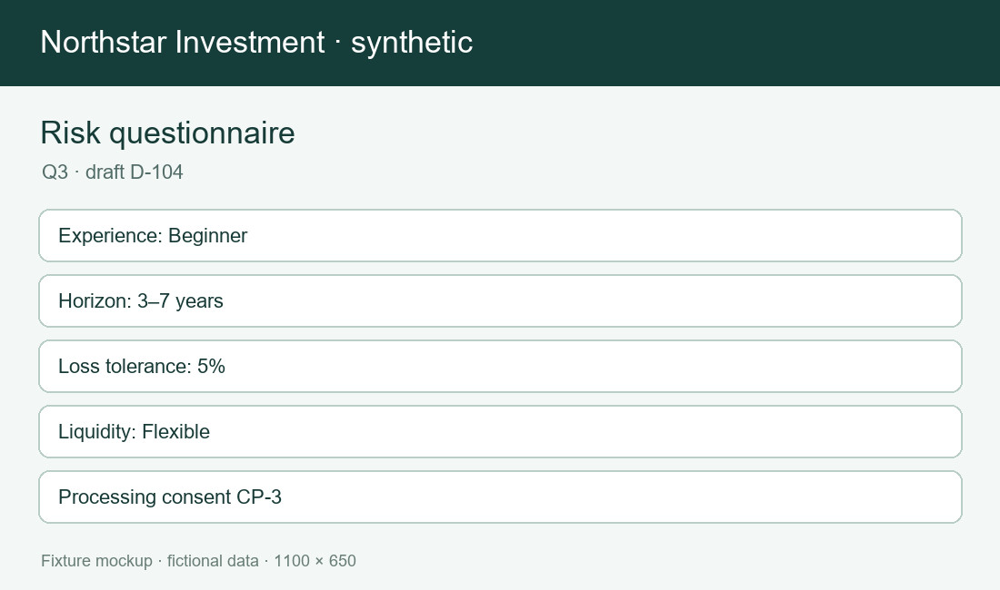

# Shared dictionaries and versions

Versioned platform dictionaries distinguish investor risk, instrument risk and operational severity. Q1 and Q2 definitions are historical; Q3 is current; Q4 remains planned.

| ID | Code and label | Business meaning | Owner and version | Invalid case and consumer | Scope and provenance |
| --- | --- | --- | --- | --- | --- |
| DICT-INVESTOR-STATUS-01 | Investor status: ACTIVE — Active | May create and submit a profile The stable code is ACTIVE; the display label is for readers and may be localized. A consumer must persist the code and the dictionary revision, never infer a code from a translated label. | Owner: investor_registry. Effective: 2026-09-01 in revision D-2026-09. Applicability: Platform-wide. Allowed next values: PENDING,CLOSED. An unlisted transition requires an explicit versioned change rather than a silent update. | An account closure does not erase a submitted assessment; a new draft is blocked until an authorized status change. Risk profiling reads this status before starting and again before accepting a submission. A boundary or invalid input must yield a field-level rejection without modifying an accepted profile. | TICKET-1001 supplies the feature context. This record is distinct from the similarly named investor, instrument, and operational classifications. A historical value remains readable with its original version but cannot be assumed current. |
| DICT-INVESTOR-STATUS-02 | Investor status: PENDING — Pending verification | May save a draft but cannot submit The stable code is PENDING; the display label is for readers and may be localized. A consumer must persist the code and the dictionary revision, never infer a code from a translated label. | Owner: investor_registry. Effective: 2026-09-01 in revision D-2026-09. Applicability: Platform-wide. Allowed next values: ACTIVE,CLOSED. An unlisted transition requires an explicit versioned change rather than a silent update. | An account closure does not erase a submitted assessment; a new draft is blocked until an authorized status change. Risk profiling reads this status before starting and again before accepting a submission. A boundary or invalid input must yield a field-level rejection without modifying an accepted profile. | TICKET-1001 supplies the feature context. This record is distinct from the similarly named investor, instrument, and operational classifications. A historical value remains readable with its original version but cannot be assumed current. |
| DICT-INVESTOR-STATUS-03 | Investor status: SUSPENDED — Suspended | May read history but cannot submit The stable code is SUSPENDED; the display label is for readers and may be localized. A consumer must persist the code and the dictionary revision, never infer a code from a translated label. | Owner: investor_registry. Effective: 2026-09-01 in revision D-2026-09. Applicability: Platform-wide. Allowed next values: ACTIVE,CLOSED. An unlisted transition requires an explicit versioned change rather than a silent update. | An account closure does not erase a submitted assessment; a new draft is blocked until an authorized status change. Risk profiling reads this status before starting and again before accepting a submission. A boundary or invalid input must yield a field-level rejection without modifying an accepted profile. | TICKET-1001 supplies the feature context. This record is distinct from the similarly named investor, instrument, and operational classifications. A historical value remains readable with its original version but cannot be assumed current. |
| DICT-INVESTOR-STATUS-04 | Investor status: CLOSED — Closed | Historical profiles remain readable to authorized staff The stable code is CLOSED; the display label is for readers and may be localized. A consumer must persist the code and the dictionary revision, never infer a code from a translated label. | Owner: investor_registry. Effective: 2026-09-01 in revision D-2026-09. Applicability: Platform-wide. Allowed next values: none. An unlisted transition requires an explicit versioned change rather than a silent update. | An account closure does not erase a submitted assessment; a new draft is blocked until an authorized status change. Risk profiling reads this status before starting and again before accepting a submission. A boundary or invalid input must yield a field-level rejection without modifying an accepted profile. | TICKET-1001 supplies the feature context. This record is distinct from the similarly named investor, instrument, and operational classifications. A historical value remains readable with its original version but cannot be assumed current. |
| DICT-ACCOUNT-STATUS-01 | Account status: OPEN — Open | Trading and profile read are available The stable code is OPEN; the display label is for readers and may be localized. A consumer must persist the code and the dictionary revision, never infer a code from a translated label. | Owner: account_registry. Effective: 2026-09-01 in revision D-2026-09. Applicability: Platform-wide. Allowed next values: RESTRICTED,CLOSED. An unlisted transition requires an explicit versioned change rather than a silent update. | Account status is distinct from investor status; a restricted trading account does not by itself invalidate a profile. The order service checks account status; the profile service checks investor status. A boundary or invalid input must yield a field-level rejection without modifying an accepted profile. | TICKET-1002 supplies the feature context. This record is distinct from the similarly named investor, instrument, and operational classifications. A historical value remains readable with its original version but cannot be assumed current. |
| DICT-ACCOUNT-STATUS-02 | Account status: RESTRICTED — Restricted | No new orders; existing profile remains visible The stable code is RESTRICTED; the display label is for readers and may be localized. A consumer must persist the code and the dictionary revision, never infer a code from a translated label. | Owner: account_registry. Effective: 2026-09-01 in revision D-2026-09. Applicability: Platform-wide. Allowed next values: OPEN,CLOSED. An unlisted transition requires an explicit versioned change rather than a silent update. | Account status is distinct from investor status; a restricted trading account does not by itself invalidate a profile. The order service checks account status; the profile service checks investor status. A boundary or invalid input must yield a field-level rejection without modifying an accepted profile. | TICKET-1002 supplies the feature context. This record is distinct from the similarly named investor, instrument, and operational classifications. A historical value remains readable with its original version but cannot be assumed current. |
| DICT-ACCOUNT-STATUS-03 | Account status: CLOSED — Closed | No order or profile initiation The stable code is CLOSED; the display label is for readers and may be localized. A consumer must persist the code and the dictionary revision, never infer a code from a translated label. | Owner: account_registry. Effective: 2026-09-01 in revision D-2026-09. Applicability: Platform-wide. Allowed next values: none. An unlisted transition requires an explicit versioned change rather than a silent update. | Account status is distinct from investor status; a restricted trading account does not by itself invalidate a profile. The order service checks account status; the profile service checks investor status. A boundary or invalid input must yield a field-level rejection without modifying an accepted profile. | TICKET-1002 supplies the feature context. This record is distinct from the similarly named investor, instrument, and operational classifications. A historical value remains readable with its original version but cannot be assumed current. |
| DICT-ACCOUNT-STATUS-04 | Account status: PENDING — Pending | No trading; a verified investor may prepare a profile draft The stable code is PENDING; the display label is for readers and may be localized. A consumer must persist the code and the dictionary revision, never infer a code from a translated label. | Owner: account_registry. Effective: 2026-09-01 in revision D-2026-09. Applicability: Platform-wide. Allowed next values: OPEN,CLOSED. An unlisted transition requires an explicit versioned change rather than a silent update. | Account status is distinct from investor status; a restricted trading account does not by itself invalidate a profile. The order service checks account status; the profile service checks investor status. A boundary or invalid input must yield a field-level rejection without modifying an accepted profile. | TICKET-1002 supplies the feature context. This record is distinct from the similarly named investor, instrument, and operational classifications. A historical value remains readable with its original version but cannot be assumed current. |
| DICT-EXPERIENCE-LEVEL-01 | Experience level: NONE — No experience | Zero completed self-directed investment decisions The stable code is NONE; the display label is for readers and may be localized. A consumer must persist the code and the dictionary revision, never infer a code from a translated label. | Owner: risk_dictionary. Effective: 2026-09-01 in revision D-2026-09. Applicability: Current Q3. Allowed next values: BEGINNER. An unlisted transition requires an explicit versioned change rather than a silent update. | The answer describes reported experience, not a licence to trade a particular instrument. Questionnaire v3 requires exactly one current code; UNKNOWN and EXPERT are retired legacy inputs. A boundary or invalid input must yield a field-level rejection without modifying an accepted profile. | TICKET-2003 supplies the feature context. This record is distinct from the similarly named investor, instrument, and operational classifications. A historical value remains readable with its original version but cannot be assumed current. |
| DICT-EXPERIENCE-LEVEL-02 | Experience level: BEGINNER — Beginner | Some guided decisions with limited product variety The stable code is BEGINNER; the display label is for readers and may be localized. A consumer must persist the code and the dictionary revision, never infer a code from a translated label. | Owner: risk_dictionary. Effective: 2026-09-01 in revision D-2026-09. Applicability: Current Q3. Allowed next values: INTERMEDIATE. An unlisted transition requires an explicit versioned change rather than a silent update. | The answer describes reported experience, not a licence to trade a particular instrument. Questionnaire v3 requires exactly one current code; UNKNOWN and EXPERT are retired legacy inputs. A boundary or invalid input must yield a field-level rejection without modifying an accepted profile. | TICKET-2003 supplies the feature context. This record is distinct from the similarly named investor, instrument, and operational classifications. A historical value remains readable with its original version but cannot be assumed current. |
| DICT-EXPERIENCE-LEVEL-03 | Experience level: INTERMEDIATE — Intermediate | Repeated decisions across more than one product category The stable code is INTERMEDIATE; the display label is for readers and may be localized. A consumer must persist the code and the dictionary revision, never infer a code from a translated label. | Owner: risk_dictionary. Effective: 2026-09-01 in revision D-2026-09. Applicability: Current Q3. Allowed next values: ADVANCED. An unlisted transition requires an explicit versioned change rather than a silent update. | The answer describes reported experience, not a licence to trade a particular instrument. Questionnaire v3 requires exactly one current code; UNKNOWN and EXPERT are retired legacy inputs. A boundary or invalid input must yield a field-level rejection without modifying an accepted profile. | TICKET-2003 supplies the feature context. This record is distinct from the similarly named investor, instrument, and operational classifications. A historical value remains readable with its original version but cannot be assumed current. |
| DICT-EXPERIENCE-LEVEL-04 | Experience level: ADVANCED — Advanced | Regular independent decisions and familiarity with loss The stable code is ADVANCED; the display label is for readers and may be localized. A consumer must persist the code and the dictionary revision, never infer a code from a translated label. | Owner: risk_dictionary. Effective: 2026-09-01 in revision D-2026-09. Applicability: Current Q3. Allowed next values: INTERMEDIATE. An unlisted transition requires an explicit versioned change rather than a silent update. | The answer describes reported experience, not a licence to trade a particular instrument. Questionnaire v3 requires exactly one current code; UNKNOWN and EXPERT are retired legacy inputs. A boundary or invalid input must yield a field-level rejection without modifying an accepted profile. | TICKET-2003 supplies the feature context. This record is distinct from the similarly named investor, instrument, and operational classifications. A historical value remains readable with its original version but cannot be assumed current. |
| DICT-INVESTMENT-HORIZON-01 | Investment horizon: H0 — Under one year | Funds may be needed in fewer than 12 months The stable code is H0; the display label is for readers and may be localized. A consumer must persist the code and the dictionary revision, never infer a code from a translated label. | Owner: risk_dictionary. Effective: 2026-09-01 in revision D-2026-09. Applicability: Current Q3. Allowed next values: H1. An unlisted transition requires an explicit versioned change rather than a silent update. | Boundary months belong to the lower code until its upper bound has passed: month 12 starts H1 and month 36 starts H3. The horizon is an investor answer and never inherits an instrument maturity date. A boundary or invalid input must yield a field-level rejection without modifying an accepted profile. | TICKET-2003 supplies the feature context. This record is distinct from the similarly named investor, instrument, and operational classifications. A historical value remains readable with its original version but cannot be assumed current. |
| DICT-INVESTMENT-HORIZON-02 | Investment horizon: H1 — One to three years | Funds may be needed between 12 and 35 months The stable code is H1; the display label is for readers and may be localized. A consumer must persist the code and the dictionary revision, never infer a code from a translated label. | Owner: risk_dictionary. Effective: 2026-09-01 in revision D-2026-09. Applicability: Current Q3. Allowed next values: H3. An unlisted transition requires an explicit versioned change rather than a silent update. | Boundary months belong to the lower code until its upper bound has passed: month 12 starts H1 and month 36 starts H3. The horizon is an investor answer and never inherits an instrument maturity date. A boundary or invalid input must yield a field-level rejection without modifying an accepted profile. | TICKET-2003 supplies the feature context. This record is distinct from the similarly named investor, instrument, and operational classifications. A historical value remains readable with its original version but cannot be assumed current. |
| DICT-INVESTMENT-HORIZON-03 | Investment horizon: H3 — Three to seven years | Funds may be needed between 36 and 83 months The stable code is H3; the display label is for readers and may be localized. A consumer must persist the code and the dictionary revision, never infer a code from a translated label. | Owner: risk_dictionary. Effective: 2026-09-01 in revision D-2026-09. Applicability: Current Q3. Allowed next values: H7. An unlisted transition requires an explicit versioned change rather than a silent update. | Boundary months belong to the lower code until its upper bound has passed: month 12 starts H1 and month 36 starts H3. The horizon is an investor answer and never inherits an instrument maturity date. A boundary or invalid input must yield a field-level rejection without modifying an accepted profile. | TICKET-2003 supplies the feature context. This record is distinct from the similarly named investor, instrument, and operational classifications. A historical value remains readable with its original version but cannot be assumed current. |
| DICT-INVESTMENT-HORIZON-04 | Investment horizon: H7 — Seven years or more | Funds may remain invested at least 84 months The stable code is H7; the display label is for readers and may be localized. A consumer must persist the code and the dictionary revision, never infer a code from a translated label. | Owner: risk_dictionary. Effective: 2026-09-01 in revision D-2026-09. Applicability: Current Q3. Allowed next values: H3. An unlisted transition requires an explicit versioned change rather than a silent update. | Boundary months belong to the lower code until its upper bound has passed: month 12 starts H1 and month 36 starts H3. The horizon is an investor answer and never inherits an instrument maturity date. A boundary or invalid input must yield a field-level rejection without modifying an accepted profile. | TICKET-2003 supplies the feature context. This record is distinct from the similarly named investor, instrument, and operational classifications. A historical value remains readable with its original version but cannot be assumed current. |
| DICT-LOSS-TOLERANCE-01 | Loss tolerance: L0 — No loss accepted | A hypothetical loss of 0% is the stated limit The stable code is L0; the display label is for readers and may be localized. A consumer must persist the code and the dictionary revision, never infer a code from a translated label. | Owner: risk_dictionary. Effective: 2026-09-01 in revision D-2026-09. Applicability: Current Q3. Allowed next values: L5. An unlisted transition requires an explicit versioned change rather than a silent update. | The boundary is inclusive at 5% and 10%; a free-text 5.1% answer is invalid rather than rounded upward. A tolerance answer constrains the accepted investor band; it is not a return forecast. A boundary or invalid input must yield a field-level rejection without modifying an accepted profile. | TICKET-2004 supplies the feature context. This record is distinct from the similarly named investor, instrument, and operational classifications. A historical value remains readable with its original version but cannot be assumed current. |
| DICT-LOSS-TOLERANCE-02 | Loss tolerance: L5 — Up to five percent | A loss from 1% through 5% is tolerable The stable code is L5; the display label is for readers and may be localized. A consumer must persist the code and the dictionary revision, never infer a code from a translated label. | Owner: risk_dictionary. Effective: 2026-09-01 in revision D-2026-09. Applicability: Current Q3. Allowed next values: L10. An unlisted transition requires an explicit versioned change rather than a silent update. | The boundary is inclusive at 5% and 10%; a free-text 5.1% answer is invalid rather than rounded upward. A tolerance answer constrains the accepted investor band; it is not a return forecast. A boundary or invalid input must yield a field-level rejection without modifying an accepted profile. | TICKET-2004 supplies the feature context. This record is distinct from the similarly named investor, instrument, and operational classifications. A historical value remains readable with its original version but cannot be assumed current. |
| DICT-LOSS-TOLERANCE-03 | Loss tolerance: L10 — Up to ten percent | A loss from 6% through 10% is tolerable The stable code is L10; the display label is for readers and may be localized. A consumer must persist the code and the dictionary revision, never infer a code from a translated label. | Owner: risk_dictionary. Effective: 2026-09-01 in revision D-2026-09. Applicability: Current Q3. Allowed next values: L20. An unlisted transition requires an explicit versioned change rather than a silent update. | The boundary is inclusive at 5% and 10%; a free-text 5.1% answer is invalid rather than rounded upward. A tolerance answer constrains the accepted investor band; it is not a return forecast. A boundary or invalid input must yield a field-level rejection without modifying an accepted profile. | TICKET-2004 supplies the feature context. This record is distinct from the similarly named investor, instrument, and operational classifications. A historical value remains readable with its original version but cannot be assumed current. |
| DICT-LOSS-TOLERANCE-04 | Loss tolerance: L20 — Above ten percent | A loss above 10% is tolerable in the example The stable code is L20; the display label is for readers and may be localized. A consumer must persist the code and the dictionary revision, never infer a code from a translated label. | Owner: risk_dictionary. Effective: 2026-09-01 in revision D-2026-09. Applicability: Current Q3. Allowed next values: L10. An unlisted transition requires an explicit versioned change rather than a silent update. | The boundary is inclusive at 5% and 10%; a free-text 5.1% answer is invalid rather than rounded upward. A tolerance answer constrains the accepted investor band; it is not a return forecast. A boundary or invalid input must yield a field-level rejection without modifying an accepted profile. | TICKET-2004 supplies the feature context. This record is distinct from the similarly named investor, instrument, and operational classifications. A historical value remains readable with its original version but cannot be assumed current. |
| DICT-LIQUIDITY-NEED-01 | Liquidity need: IMMEDIATE — Immediate | Most funds may be needed within a month The stable code is IMMEDIATE; the display label is for readers and may be localized. A consumer must persist the code and the dictionary revision, never infer a code from a translated label. | Owner: risk_dictionary. Effective: 2026-09-01 in revision D-2026-09. Applicability: Current Q3. Allowed next values: SOON. An unlisted transition requires an explicit versioned change rather than a silent update. | A change to IMMEDIATE requires reassessment before the prior active profile can support a new decision. This answer concerns the investor's funds, not MarketPulse market-session liquidity. A boundary or invalid input must yield a field-level rejection without modifying an accepted profile. | TICKET-2004 supplies the feature context. This record is distinct from the similarly named investor, instrument, and operational classifications. A historical value remains readable with its original version but cannot be assumed current. |
| DICT-LIQUIDITY-NEED-02 | Liquidity need: SOON — Soon | Material funds may be needed within one year The stable code is SOON; the display label is for readers and may be localized. A consumer must persist the code and the dictionary revision, never infer a code from a translated label. | Owner: risk_dictionary. Effective: 2026-09-01 in revision D-2026-09. Applicability: Current Q3. Allowed next values: FLEXIBLE. An unlisted transition requires an explicit versioned change rather than a silent update. | A change to IMMEDIATE requires reassessment before the prior active profile can support a new decision. This answer concerns the investor's funds, not MarketPulse market-session liquidity. A boundary or invalid input must yield a field-level rejection without modifying an accepted profile. | TICKET-2004 supplies the feature context. This record is distinct from the similarly named investor, instrument, and operational classifications. A historical value remains readable with its original version but cannot be assumed current. |
| DICT-LIQUIDITY-NEED-03 | Liquidity need: FLEXIBLE — Flexible | Some funds may be needed within three years The stable code is FLEXIBLE; the display label is for readers and may be localized. A consumer must persist the code and the dictionary revision, never infer a code from a translated label. | Owner: risk_dictionary. Effective: 2026-09-01 in revision D-2026-09. Applicability: Current Q3. Allowed next values: LONG_TERM. An unlisted transition requires an explicit versioned change rather than a silent update. | A change to IMMEDIATE requires reassessment before the prior active profile can support a new decision. This answer concerns the investor's funds, not MarketPulse market-session liquidity. A boundary or invalid input must yield a field-level rejection without modifying an accepted profile. | TICKET-2004 supplies the feature context. This record is distinct from the similarly named investor, instrument, and operational classifications. A historical value remains readable with its original version but cannot be assumed current. |
| DICT-LIQUIDITY-NEED-04 | Liquidity need: LONG_TERM — Long term | No expected near-term withdrawal need The stable code is LONG_TERM; the display label is for readers and may be localized. A consumer must persist the code and the dictionary revision, never infer a code from a translated label. | Owner: risk_dictionary. Effective: 2026-09-01 in revision D-2026-09. Applicability: Current Q3. Allowed next values: FLEXIBLE. An unlisted transition requires an explicit versioned change rather than a silent update. | A change to IMMEDIATE requires reassessment before the prior active profile can support a new decision. This answer concerns the investor's funds, not MarketPulse market-session liquidity. A boundary or invalid input must yield a field-level rejection without modifying an accepted profile. | TICKET-2004 supplies the feature context. This record is distinct from the similarly named investor, instrument, and operational classifications. A historical value remains readable with its original version but cannot be assumed current. |
| DICT-RISK-BAND-01 | Investor risk band: R1 — Cautious | Lowest synthetic investor risk band The stable code is R1; the display label is for readers and may be localized. A consumer must persist the code and the dictionary revision, never infer a code from a translated label. | Owner: risk_dictionary. Effective: 2026-09-01 in revision D-2026-09. Applicability: Current Q3. Allowed next values: R2. An unlisted transition requires an explicit versioned change rather than a silent update. | RiskSignal proposes a band; the platform accepts it only with complete versioned reasons and a valid questionnaire. R1 through R4 describe an investor assessment, not instrument volatility or operational incident severity. A boundary or invalid input must yield a field-level rejection without modifying an accepted profile. | TICKET-2008 supplies the feature context. This record is distinct from the similarly named investor, instrument, and operational classifications. A historical value remains readable with its original version but cannot be assumed current. |
| DICT-RISK-BAND-02 | Investor risk band: R2 — Measured | Moderate synthetic investor risk band The stable code is R2; the display label is for readers and may be localized. A consumer must persist the code and the dictionary revision, never infer a code from a translated label. | Owner: risk_dictionary. Effective: 2026-09-01 in revision D-2026-09. Applicability: Current Q3. Allowed next values: R1,R3. An unlisted transition requires an explicit versioned change rather than a silent update. | RiskSignal proposes a band; the platform accepts it only with complete versioned reasons and a valid questionnaire. R1 through R4 describe an investor assessment, not instrument volatility or operational incident severity. A boundary or invalid input must yield a field-level rejection without modifying an accepted profile. | TICKET-2008 supplies the feature context. This record is distinct from the similarly named investor, instrument, and operational classifications. A historical value remains readable with its original version but cannot be assumed current. |
| DICT-RISK-BAND-03 | Investor risk band: R3 — Growth | Higher synthetic investor risk band The stable code is R3; the display label is for readers and may be localized. A consumer must persist the code and the dictionary revision, never infer a code from a translated label. | Owner: risk_dictionary. Effective: 2026-09-01 in revision D-2026-09. Applicability: Current Q3. Allowed next values: R2,R4. An unlisted transition requires an explicit versioned change rather than a silent update. | RiskSignal proposes a band; the platform accepts it only with complete versioned reasons and a valid questionnaire. R1 through R4 describe an investor assessment, not instrument volatility or operational incident severity. A boundary or invalid input must yield a field-level rejection without modifying an accepted profile. | TICKET-2008 supplies the feature context. This record is distinct from the similarly named investor, instrument, and operational classifications. A historical value remains readable with its original version but cannot be assumed current. |
| DICT-RISK-BAND-04 | Investor risk band: R4 — Adventurous | Highest synthetic investor risk band The stable code is R4; the display label is for readers and may be localized. A consumer must persist the code and the dictionary revision, never infer a code from a translated label. | Owner: risk_dictionary. Effective: 2026-09-01 in revision D-2026-09. Applicability: Current Q3. Allowed next values: R3. An unlisted transition requires an explicit versioned change rather than a silent update. | RiskSignal proposes a band; the platform accepts it only with complete versioned reasons and a valid questionnaire. R1 through R4 describe an investor assessment, not instrument volatility or operational incident severity. A boundary or invalid input must yield a field-level rejection without modifying an accepted profile. | TICKET-2008 supplies the feature context. This record is distinct from the similarly named investor, instrument, and operational classifications. A historical value remains readable with its original version but cannot be assumed current. |
| DICT-ASSESSMENT-STATUS-01 | Assessment status: DRAFT — Draft | Editable answers are not a risk assessment The stable code is DRAFT; the display label is for readers and may be localized. A consumer must persist the code and the dictionary revision, never infer a code from a translated label. | Owner: profile_summary. Effective: 2026-09-01 in revision D-2026-09. Applicability: Platform-wide. Allowed next values: SUBMITTING. An unlisted transition requires an explicit versioned change rather than a silent update. | A failed new assessment never replaces a prior ACTIVE profile. The current active profile is the newest accepted non-expired summary; prior versions remain in history. A boundary or invalid input must yield a field-level rejection without modifying an accepted profile. | TICKET-2009 supplies the feature context. This record is distinct from the similarly named investor, instrument, and operational classifications. A historical value remains readable with its original version but cannot be assumed current. |
| DICT-ASSESSMENT-STATUS-02 | Assessment status: SUBMITTING — Submitting | An idempotency key owns one provider attempt The stable code is SUBMITTING; the display label is for readers and may be localized. A consumer must persist the code and the dictionary revision, never infer a code from a translated label. | Owner: profile_summary. Effective: 2026-09-01 in revision D-2026-09. Applicability: Platform-wide. Allowed next values: ACTIVE,FAILED. An unlisted transition requires an explicit versioned change rather than a silent update. | A failed new assessment never replaces a prior ACTIVE profile. The current active profile is the newest accepted non-expired summary; prior versions remain in history. A boundary or invalid input must yield a field-level rejection without modifying an accepted profile. | TICKET-2009 supplies the feature context. This record is distinct from the similarly named investor, instrument, and operational classifications. A historical value remains readable with its original version but cannot be assumed current. |
| DICT-ASSESSMENT-STATUS-03 | Assessment status: ACTIVE — Active | Accepted profile with provider provenance The stable code is ACTIVE; the display label is for readers and may be localized. A consumer must persist the code and the dictionary revision, never infer a code from a translated label. | Owner: profile_summary. Effective: 2026-09-01 in revision D-2026-09. Applicability: Platform-wide. Allowed next values: EXPIRED,SUPERSEDED. An unlisted transition requires an explicit versioned change rather than a silent update. | A failed new assessment never replaces a prior ACTIVE profile. The current active profile is the newest accepted non-expired summary; prior versions remain in history. A boundary or invalid input must yield a field-level rejection without modifying an accepted profile. | TICKET-2009 supplies the feature context. This record is distinct from the similarly named investor, instrument, and operational classifications. A historical value remains readable with its original version but cannot be assumed current. |
| DICT-ASSESSMENT-STATUS-04 | Assessment status: FAILED — Failed | No accepted profile was produced The stable code is FAILED; the display label is for readers and may be localized. A consumer must persist the code and the dictionary revision, never infer a code from a translated label. | Owner: profile_summary. Effective: 2026-09-01 in revision D-2026-09. Applicability: Platform-wide. Allowed next values: DRAFT. An unlisted transition requires an explicit versioned change rather than a silent update. | A failed new assessment never replaces a prior ACTIVE profile. The current active profile is the newest accepted non-expired summary; prior versions remain in history. A boundary or invalid input must yield a field-level rejection without modifying an accepted profile. | TICKET-2009 supplies the feature context. This record is distinct from the similarly named investor, instrument, and operational classifications. A historical value remains readable with its original version but cannot be assumed current. |
| DICT-PROFILE-STATUS-01 | Profile status: ACTIVE — Active | Can be displayed as current The stable code is ACTIVE; the display label is for readers and may be localized. A consumer must persist the code and the dictionary revision, never infer a code from a translated label. | Owner: profile_summary. Effective: 2026-09-01 in revision D-2026-09. Applicability: Platform-wide. Allowed next values: EXPIRED,SUPERSEDED. An unlisted transition requires an explicit versioned change rather than a silent update. | The current build does not automatically promote PENDING_REVIEW; it is a planned follow-up. Expiry is 365 days after acceptance for this synthetic fixture and is checked on reads. A boundary or invalid input must yield a field-level rejection without modifying an accepted profile. | TICKET-2013 supplies the feature context. This record is distinct from the similarly named investor, instrument, and operational classifications. A historical value remains readable with its original version but cannot be assumed current. |
| DICT-PROFILE-STATUS-02 | Profile status: EXPIRED — Expired | Must be reassessed before current use The stable code is EXPIRED; the display label is for readers and may be localized. A consumer must persist the code and the dictionary revision, never infer a code from a translated label. | Owner: profile_summary. Effective: 2026-09-01 in revision D-2026-09. Applicability: Platform-wide. Allowed next values: SUPERSEDED. An unlisted transition requires an explicit versioned change rather than a silent update. | The current build does not automatically promote PENDING_REVIEW; it is a planned follow-up. Expiry is 365 days after acceptance for this synthetic fixture and is checked on reads. A boundary or invalid input must yield a field-level rejection without modifying an accepted profile. | TICKET-2013 supplies the feature context. This record is distinct from the similarly named investor, instrument, and operational classifications. A historical value remains readable with its original version but cannot be assumed current. |
| DICT-PROFILE-STATUS-03 | Profile status: SUPERSEDED — Superseded | Remains immutable in history The stable code is SUPERSEDED; the display label is for readers and may be localized. A consumer must persist the code and the dictionary revision, never infer a code from a translated label. | Owner: profile_summary. Effective: 2026-09-01 in revision D-2026-09. Applicability: Platform-wide. Allowed next values: none. An unlisted transition requires an explicit versioned change rather than a silent update. | The current build does not automatically promote PENDING_REVIEW; it is a planned follow-up. Expiry is 365 days after acceptance for this synthetic fixture and is checked on reads. A boundary or invalid input must yield a field-level rejection without modifying an accepted profile. | TICKET-2013 supplies the feature context. This record is distinct from the similarly named investor, instrument, and operational classifications. A historical value remains readable with its original version but cannot be assumed current. |
| DICT-PROFILE-STATUS-04 | Profile status: PENDING_REVIEW — Pending review | A planned manual decision state with no current writer The stable code is PENDING_REVIEW; the display label is for readers and may be localized. A consumer must persist the code and the dictionary revision, never infer a code from a translated label. | Owner: profile_summary. Effective: 2026-09-01 in revision D-2026-09. Applicability: Platform-wide. Allowed next values: ACTIVE,EXPIRED. An unlisted transition requires an explicit versioned change rather than a silent update. | The current build does not automatically promote PENDING_REVIEW; it is a planned follow-up. Expiry is 365 days after acceptance for this synthetic fixture and is checked on reads. A boundary or invalid input must yield a field-level rejection without modifying an accepted profile. | TICKET-2013 supplies the feature context. This record is distinct from the similarly named investor, instrument, and operational classifications. A historical value remains readable with its original version but cannot be assumed current. |
| DICT-QUESTIONNAIRE-VERSION-01 | Questionnaire version: Q1 — Historical v1 | Retired answer set retained for history The stable code is Q1; the display label is for readers and may be localized. A consumer must persist the code and the dictionary revision, never infer a code from a translated label. | Owner: questionnaire_version. Effective: 2026-09-01 in revision D-2026-09. Applicability: Historical. Allowed next values: Q2. An unlisted transition requires an explicit versioned change rather than a silent update. | A saved Q2 draft is rejected at submit with OUTDATED_QUESTIONNAIRE, not silently upgraded. Q3 became effective 2026-09-01; Q1 and Q2 are historical and not offered for new drafts. A boundary or invalid input must yield a field-level rejection without modifying an accepted profile. | TICKET-2002 supplies the feature context. This record is distinct from the similarly named investor, instrument, and operational classifications. A historical value remains readable with its original version but cannot be assumed current. |
| DICT-QUESTIONNAIRE-VERSION-02 | Questionnaire version: Q2 — Historical v2 | Retired when liquidity need became required The stable code is Q2; the display label is for readers and may be localized. A consumer must persist the code and the dictionary revision, never infer a code from a translated label. | Owner: questionnaire_version. Effective: 2026-09-01 in revision D-2026-09. Applicability: Historical. Allowed next values: Q3. An unlisted transition requires an explicit versioned change rather than a silent update. | A saved Q2 draft is rejected at submit with OUTDATED_QUESTIONNAIRE, not silently upgraded. Q3 became effective 2026-09-01; Q1 and Q2 are historical and not offered for new drafts. A boundary or invalid input must yield a field-level rejection without modifying an accepted profile. | TICKET-2002 supplies the feature context. This record is distinct from the similarly named investor, instrument, and operational classifications. A historical value remains readable with its original version but cannot be assumed current. |
| DICT-QUESTIONNAIRE-VERSION-03 | Questionnaire version: Q3 — Current v3 | Experience, horizon, loss tolerance, liquidity, and consent required The stable code is Q3; the display label is for readers and may be localized. A consumer must persist the code and the dictionary revision, never infer a code from a translated label. | Owner: questionnaire_version. Effective: 2026-09-01 in revision D-2026-09. Applicability: Current Q3. Allowed next values: Q4. An unlisted transition requires an explicit versioned change rather than a silent update. | A saved Q2 draft is rejected at submit with OUTDATED_QUESTIONNAIRE, not silently upgraded. Q3 became effective 2026-09-01; Q1 and Q2 are historical and not offered for new drafts. A boundary or invalid input must yield a field-level rejection without modifying an accepted profile. | TICKET-2002 supplies the feature context. This record is distinct from the similarly named investor, instrument, and operational classifications. A historical value remains readable with its original version but cannot be assumed current. |
| DICT-QUESTIONNAIRE-VERSION-04 | Questionnaire version: Q4 — Planned v4 | Unreleased draft definition The stable code is Q4; the display label is for readers and may be localized. A consumer must persist the code and the dictionary revision, never infer a code from a translated label. | Owner: questionnaire_version. Effective: 2026-09-01 in revision D-2026-09. Applicability: Planned. Allowed next values: none. An unlisted transition requires an explicit versioned change rather than a silent update. | A saved Q2 draft is rejected at submit with OUTDATED_QUESTIONNAIRE, not silently upgraded. Q3 became effective 2026-09-01; Q1 and Q2 are historical and not offered for new drafts. A boundary or invalid input must yield a field-level rejection without modifying an accepted profile. | TICKET-2002 supplies the feature context. This record is distinct from the similarly named investor, instrument, and operational classifications. A historical value remains readable with its original version but cannot be assumed current. |
| DICT-CONSENT-TYPE-01 | Consent type: PROFILE_PROCESSING — Profile processing | Required before submission The stable code is PROFILE_PROCESSING; the display label is for readers and may be localized. A consumer must persist the code and the dictionary revision, never infer a code from a translated label. | Owner: consent_record. Effective: 2026-09-01 in revision D-2026-09. Applicability: Current Q3. Allowed next values: WITHDRAWN. An unlisted transition requires an explicit versioned change rather than a silent update. | A checked marketing box does not substitute for PROFILE_PROCESSING consent. The submitted consent records a UTC timestamp and the displayed text revision. A boundary or invalid input must yield a field-level rejection without modifying an accepted profile. | TICKET-2005 supplies the feature context. This record is distinct from the similarly named investor, instrument, and operational classifications. A historical value remains readable with its original version but cannot be assumed current. |
| DICT-CONSENT-TYPE-02 | Consent type: MARKETING — Marketing | Optional and never influences band The stable code is MARKETING; the display label is for readers and may be localized. A consumer must persist the code and the dictionary revision, never infer a code from a translated label. | Owner: consent_record. Effective: 2026-09-01 in revision D-2026-09. Applicability: Current Q3. Allowed next values: WITHDRAWN. An unlisted transition requires an explicit versioned change rather than a silent update. | A checked marketing box does not substitute for PROFILE_PROCESSING consent. The submitted consent records a UTC timestamp and the displayed text revision. A boundary or invalid input must yield a field-level rejection without modifying an accepted profile. | TICKET-2005 supplies the feature context. This record is distinct from the similarly named investor, instrument, and operational classifications. A historical value remains readable with its original version but cannot be assumed current. |
| DICT-CONSENT-TYPE-03 | Consent type: WITHDRAWN — Withdrawn | Blocks a new submission until renewed The stable code is WITHDRAWN; the display label is for readers and may be localized. A consumer must persist the code and the dictionary revision, never infer a code from a translated label. | Owner: consent_record. Effective: 2026-09-01 in revision D-2026-09. Applicability: Current Q3. Allowed next values: PROFILE_PROCESSING. An unlisted transition requires an explicit versioned change rather than a silent update. | A checked marketing box does not substitute for PROFILE_PROCESSING consent. The submitted consent records a UTC timestamp and the displayed text revision. A boundary or invalid input must yield a field-level rejection without modifying an accepted profile. | TICKET-2005 supplies the feature context. This record is distinct from the similarly named investor, instrument, and operational classifications. A historical value remains readable with its original version but cannot be assumed current. |
| DICT-CONSENT-TYPE-04 | Consent type: HISTORICAL_NOTICE — Historical notice | Retained only with earlier assessments The stable code is HISTORICAL_NOTICE; the display label is for readers and may be localized. A consumer must persist the code and the dictionary revision, never infer a code from a translated label. | Owner: consent_record. Effective: 2026-09-01 in revision D-2026-09. Applicability: Historical. Allowed next values: none. An unlisted transition requires an explicit versioned change rather than a silent update. | A checked marketing box does not substitute for PROFILE_PROCESSING consent. The submitted consent records a UTC timestamp and the displayed text revision. A boundary or invalid input must yield a field-level rejection without modifying an accepted profile. | TICKET-2005 supplies the feature context. This record is distinct from the similarly named investor, instrument, and operational classifications. A historical value remains readable with its original version but cannot be assumed current. |
| DICT-CURRENCY-01 | Currency: PLN — Polish złoty | Display and cash-balance currency The stable code is PLN; the display label is for readers and may be localized. A consumer must persist the code and the dictionary revision, never infer a code from a translated label. | Owner: instrument_reference. Effective: 2026-09-01 in revision D-2026-09. Applicability: Platform-wide. Allowed next values: EUR,USD. An unlisted transition requires an explicit versioned change rather than a silent update. | Currency codes describe amounts; they are not investor risk answers. Risk profiling does not call MarketPulse for an exchange rate. A boundary or invalid input must yield a field-level rejection without modifying an accepted profile. | TICKET-3001 supplies the feature context. This record is distinct from the similarly named investor, instrument, and operational classifications. A historical value remains readable with its original version but cannot be assumed current. |
| DICT-CURRENCY-02 | Currency: EUR — Euro | Display and cash-balance currency The stable code is EUR; the display label is for readers and may be localized. A consumer must persist the code and the dictionary revision, never infer a code from a translated label. | Owner: instrument_reference. Effective: 2026-09-01 in revision D-2026-09. Applicability: Platform-wide. Allowed next values: PLN,USD. An unlisted transition requires an explicit versioned change rather than a silent update. | Currency codes describe amounts; they are not investor risk answers. Risk profiling does not call MarketPulse for an exchange rate. A boundary or invalid input must yield a field-level rejection without modifying an accepted profile. | TICKET-3001 supplies the feature context. This record is distinct from the similarly named investor, instrument, and operational classifications. A historical value remains readable with its original version but cannot be assumed current. |
| DICT-CURRENCY-03 | Currency: USD — US dollar | Display and cash-balance currency The stable code is USD; the display label is for readers and may be localized. A consumer must persist the code and the dictionary revision, never infer a code from a translated label. | Owner: instrument_reference. Effective: 2026-09-01 in revision D-2026-09. Applicability: Platform-wide. Allowed next values: PLN,EUR. An unlisted transition requires an explicit versioned change rather than a silent update. | Currency codes describe amounts; they are not investor risk answers. Risk profiling does not call MarketPulse for an exchange rate. A boundary or invalid input must yield a field-level rejection without modifying an accepted profile. | TICKET-3001 supplies the feature context. This record is distinct from the similarly named investor, instrument, and operational classifications. A historical value remains readable with its original version but cannot be assumed current. |
| DICT-CURRENCY-04 | Currency: GBP — Pound sterling | Reference-only in this fixture The stable code is GBP; the display label is for readers and may be localized. A consumer must persist the code and the dictionary revision, never infer a code from a translated label. | Owner: instrument_reference. Effective: 2026-09-01 in revision D-2026-09. Applicability: Platform-wide. Allowed next values: PLN. An unlisted transition requires an explicit versioned change rather than a silent update. | Currency codes describe amounts; they are not investor risk answers. Risk profiling does not call MarketPulse for an exchange rate. A boundary or invalid input must yield a field-level rejection without modifying an accepted profile. | TICKET-3001 supplies the feature context. This record is distinct from the similarly named investor, instrument, and operational classifications. A historical value remains readable with its original version but cannot be assumed current. |
| DICT-INSTRUMENT-CATEGORY-01 | Instrument category: EQUITY — Equity | Listed share reference category The stable code is EQUITY; the display label is for readers and may be localized. A consumer must persist the code and the dictionary revision, never infer a code from a translated label. | Owner: instrument_reference. Effective: 2026-09-01 in revision D-2026-09. Applicability: Platform-wide. Allowed next values: ETF. An unlisted transition requires an explicit versioned change rather than a silent update. | An instrument risk label belongs to an instrument record and must not be copied into investor risk_band. MarketPulse owns instrument reference data; the profile service has no MarketPulse dependency. A boundary or invalid input must yield a field-level rejection without modifying an accepted profile. | TICKET-3002 supplies the feature context. This record is distinct from the similarly named investor, instrument, and operational classifications. A historical value remains readable with its original version but cannot be assumed current. |
| DICT-INSTRUMENT-CATEGORY-02 | Instrument category: ETF — Exchange-traded fund | Basket instrument reference category The stable code is ETF; the display label is for readers and may be localized. A consumer must persist the code and the dictionary revision, never infer a code from a translated label. | Owner: instrument_reference. Effective: 2026-09-01 in revision D-2026-09. Applicability: Platform-wide. Allowed next values: EQUITY,BOND. An unlisted transition requires an explicit versioned change rather than a silent update. | An instrument risk label belongs to an instrument record and must not be copied into investor risk_band. MarketPulse owns instrument reference data; the profile service has no MarketPulse dependency. A boundary or invalid input must yield a field-level rejection without modifying an accepted profile. | TICKET-3002 supplies the feature context. This record is distinct from the similarly named investor, instrument, and operational classifications. A historical value remains readable with its original version but cannot be assumed current. |
| DICT-INSTRUMENT-CATEGORY-03 | Instrument category: BOND — Bond | Debt instrument reference category The stable code is BOND; the display label is for readers and may be localized. A consumer must persist the code and the dictionary revision, never infer a code from a translated label. | Owner: instrument_reference. Effective: 2026-09-01 in revision D-2026-09. Applicability: Platform-wide. Allowed next values: ETF. An unlisted transition requires an explicit versioned change rather than a silent update. | An instrument risk label belongs to an instrument record and must not be copied into investor risk_band. MarketPulse owns instrument reference data; the profile service has no MarketPulse dependency. A boundary or invalid input must yield a field-level rejection without modifying an accepted profile. | TICKET-3002 supplies the feature context. This record is distinct from the similarly named investor, instrument, and operational classifications. A historical value remains readable with its original version but cannot be assumed current. |
| DICT-INSTRUMENT-CATEGORY-04 | Instrument category: CASH — Cash equivalent | Reference category for cash-like holdings The stable code is CASH; the display label is for readers and may be localized. A consumer must persist the code and the dictionary revision, never infer a code from a translated label. | Owner: instrument_reference. Effective: 2026-09-01 in revision D-2026-09. Applicability: Platform-wide. Allowed next values: BOND. An unlisted transition requires an explicit versioned change rather than a silent update. | An instrument risk label belongs to an instrument record and must not be copied into investor risk_band. MarketPulse owns instrument reference data; the profile service has no MarketPulse dependency. A boundary or invalid input must yield a field-level rejection without modifying an accepted profile. | TICKET-3002 supplies the feature context. This record is distinct from the similarly named investor, instrument, and operational classifications. A historical value remains readable with its original version but cannot be assumed current. |
| DICT-ORDER-STATE-01 | Order state: NEW — New | Validated request before custody check The stable code is NEW; the display label is for readers and may be localized. A consumer must persist the code and the dictionary revision, never infer a code from a translated label. | Owner: order_record. Effective: 2026-09-01 in revision D-2026-09. Applicability: Platform-wide. Allowed next values: RESERVED,REJECTED. An unlisted transition requires an explicit versioned change rather than a silent update. | A profile assessment cannot create an order or reserve funds. Trading checks order state separately from the investor profile lifecycle. A boundary or invalid input must yield a field-level rejection without modifying an accepted profile. | TICKET-3003 supplies the feature context. This record is distinct from the similarly named investor, instrument, and operational classifications. A historical value remains readable with its original version but cannot be assumed current. |
| DICT-ORDER-STATE-02 | Order state: RESERVED — Reserved | CustodyBridge confirmed cash reservation The stable code is RESERVED; the display label is for readers and may be localized. A consumer must persist the code and the dictionary revision, never infer a code from a translated label. | Owner: order_record. Effective: 2026-09-01 in revision D-2026-09. Applicability: Platform-wide. Allowed next values: PLACED,REJECTED. An unlisted transition requires an explicit versioned change rather than a silent update. | A profile assessment cannot create an order or reserve funds. Trading checks order state separately from the investor profile lifecycle. A boundary or invalid input must yield a field-level rejection without modifying an accepted profile. | TICKET-3003 supplies the feature context. This record is distinct from the similarly named investor, instrument, and operational classifications. A historical value remains readable with its original version but cannot be assumed current. |
| DICT-ORDER-STATE-03 | Order state: PLACED — Placed | Order acknowledged for execution The stable code is PLACED; the display label is for readers and may be localized. A consumer must persist the code and the dictionary revision, never infer a code from a translated label. | Owner: order_record. Effective: 2026-09-01 in revision D-2026-09. Applicability: Platform-wide. Allowed next values: SETTLED,FAILED. An unlisted transition requires an explicit versioned change rather than a silent update. | A profile assessment cannot create an order or reserve funds. Trading checks order state separately from the investor profile lifecycle. A boundary or invalid input must yield a field-level rejection without modifying an accepted profile. | TICKET-3003 supplies the feature context. This record is distinct from the similarly named investor, instrument, and operational classifications. A historical value remains readable with its original version but cannot be assumed current. |
| DICT-ORDER-STATE-04 | Order state: SETTLED — Settled | CustodyBridge confirmed settlement The stable code is SETTLED; the display label is for readers and may be localized. A consumer must persist the code and the dictionary revision, never infer a code from a translated label. | Owner: order_record. Effective: 2026-09-01 in revision D-2026-09. Applicability: Platform-wide. Allowed next values: none. An unlisted transition requires an explicit versioned change rather than a silent update. | A profile assessment cannot create an order or reserve funds. Trading checks order state separately from the investor profile lifecycle. A boundary or invalid input must yield a field-level rejection without modifying an accepted profile. | TICKET-3003 supplies the feature context. This record is distinct from the similarly named investor, instrument, and operational classifications. A historical value remains readable with its original version but cannot be assumed current. |
| DICT-OPERATIONAL-SEVERITY-01 | Operational severity: S1 — Critical | Core service unavailable The stable code is S1; the display label is for readers and may be localized. A consumer must persist the code and the dictionary revision, never infer a code from a translated label. | Owner: service_incident. Effective: 2026-09-01 in revision D-2026-09. Applicability: Platform-wide. Allowed next values: S2. An unlisted transition requires an explicit versioned change rather than a silent update. | Operational severity is an incident classification and never changes an investor risk band. The integration status view may show S2 without changing a profile result. A boundary or invalid input must yield a field-level rejection without modifying an accepted profile. | TICKET-1003 supplies the feature context. This record is distinct from the similarly named investor, instrument, and operational classifications. A historical value remains readable with its original version but cannot be assumed current. |
| DICT-OPERATIONAL-SEVERITY-02 | Operational severity: S2 — High | Material feature degraded The stable code is S2; the display label is for readers and may be localized. A consumer must persist the code and the dictionary revision, never infer a code from a translated label. | Owner: service_incident. Effective: 2026-09-01 in revision D-2026-09. Applicability: Platform-wide. Allowed next values: S1,S3. An unlisted transition requires an explicit versioned change rather than a silent update. | Operational severity is an incident classification and never changes an investor risk band. The integration status view may show S2 without changing a profile result. A boundary or invalid input must yield a field-level rejection without modifying an accepted profile. | TICKET-1003 supplies the feature context. This record is distinct from the similarly named investor, instrument, and operational classifications. A historical value remains readable with its original version but cannot be assumed current. |
| DICT-OPERATIONAL-SEVERITY-03 | Operational severity: S3 — Medium | Recoverable partial degradation The stable code is S3; the display label is for readers and may be localized. A consumer must persist the code and the dictionary revision, never infer a code from a translated label. | Owner: service_incident. Effective: 2026-09-01 in revision D-2026-09. Applicability: Platform-wide. Allowed next values: S2,S4. An unlisted transition requires an explicit versioned change rather than a silent update. | Operational severity is an incident classification and never changes an investor risk band. The integration status view may show S2 without changing a profile result. A boundary or invalid input must yield a field-level rejection without modifying an accepted profile. | TICKET-1003 supplies the feature context. This record is distinct from the similarly named investor, instrument, and operational classifications. A historical value remains readable with its original version but cannot be assumed current. |
| DICT-OPERATIONAL-SEVERITY-04 | Operational severity: S4 — Low | No customer-blocking effect The stable code is S4; the display label is for readers and may be localized. A consumer must persist the code and the dictionary revision, never infer a code from a translated label. | Owner: service_incident. Effective: 2026-09-01 in revision D-2026-09. Applicability: Platform-wide. Allowed next values: S3. An unlisted transition requires an explicit versioned change rather than a silent update. | Operational severity is an incident classification and never changes an investor risk band. The integration status view may show S2 without changing a profile result. A boundary or invalid input must yield a field-level rejection without modifying an accepted profile. | TICKET-1003 supplies the feature context. This record is distinct from the similarly named investor, instrument, and operational classifications. A historical value remains readable with its original version but cannot be assumed current. |

## Visual references

Caption: Dictionary administration displays effective Q3 codes beside the retained Q2 revision.

![questionnaire reference][questionnaire-image]
[questionnaire-image]: assets/questionnaire.jpg
Caption: The questionnaire consumes current experience, horizon, tolerance and liquidity codes.

The image-only block below is navigation artwork and does not assert a business rule.

## Operational cases and boundaries

### rule-investor-status: Investor status

Investor status is owned by investor_registry in D-2026-09. The current entry ACTIVE means may create and submit a profile The contrasting entry CLOSED means historical profiles remain readable to authorized staff A writer records the code and revision together so a later label change cannot rewrite a historical assessment. An account closure does not erase a submitted assessment; a new draft is blocked until an authorized status change. Risk profiling reads this status before starting and again before accepting a submission. The transition set in the table applies only to this dictionary; it never authorizes a transition in another dictionary with a similar label. TICKET-1001 owns the relevant behavior, while Q1 and Q2 history remains inspectable under its original effective definition. A value outside the listed set is rejected before an accepted profile changes.

### rule-account-status: Account status

Account status is owned by account_registry in D-2026-09. The current entry OPEN means trading and profile read are available The contrasting entry PENDING means no trading; a verified investor may prepare a profile draft A writer records the code and revision together so a later label change cannot rewrite a historical assessment. Account status is distinct from investor status; a restricted trading account does not by itself invalidate a profile. The order service checks account status; the profile service checks investor status. The transition set in the table applies only to this dictionary; it never authorizes a transition in another dictionary with a similar label. TICKET-1002 owns the relevant behavior, while Q1 and Q2 history remains inspectable under its original effective definition. A value outside the listed set is rejected before an accepted profile changes.

### rule-experience-level: Experience level

Experience level is owned by risk_dictionary in D-2026-09. The current entry NONE means zero completed self-directed investment decisions The contrasting entry ADVANCED means regular independent decisions and familiarity with loss A writer records the code and revision together so a later label change cannot rewrite a historical assessment. The answer describes reported experience, not a licence to trade a particular instrument. Questionnaire v3 requires exactly one current code; UNKNOWN and EXPERT are retired legacy inputs. The transition set in the table applies only to this dictionary; it never authorizes a transition in another dictionary with a similar label. TICKET-2003 owns the relevant behavior, while Q1 and Q2 history remains inspectable under its original effective definition. A value outside the listed set is rejected before an accepted profile changes.

### rule-investment-horizon: Investment horizon

Investment horizon is owned by risk_dictionary in D-2026-09. The current entry H0 means funds may be needed in fewer than 12 months The contrasting entry H7 means funds may remain invested at least 84 months A writer records the code and revision together so a later label change cannot rewrite a historical assessment. Boundary months belong to the lower code until its upper bound has passed: month 12 starts H1 and month 36 starts H3. The horizon is an investor answer and never inherits an instrument maturity date. The transition set in the table applies only to this dictionary; it never authorizes a transition in another dictionary with a similar label. TICKET-2003 owns the relevant behavior, while Q1 and Q2 history remains inspectable under its original effective definition. A value outside the listed set is rejected before an accepted profile changes.

### rule-loss-tolerance: Loss tolerance

Loss tolerance is owned by risk_dictionary in D-2026-09. The current entry L0 means a hypothetical loss of 0% is the stated limit The contrasting entry L20 means a loss above 10% is tolerable in the example A writer records the code and revision together so a later label change cannot rewrite a historical assessment. The boundary is inclusive at 5% and 10%; a free-text 5.1% answer is invalid rather than rounded upward. A tolerance answer constrains the accepted investor band; it is not a return forecast. The transition set in the table applies only to this dictionary; it never authorizes a transition in another dictionary with a similar label. TICKET-2004 owns the relevant behavior, while Q1 and Q2 history remains inspectable under its original effective definition. A value outside the listed set is rejected before an accepted profile changes.

### rule-liquidity-need: Liquidity need

Liquidity need is owned by risk_dictionary in D-2026-09. The current entry IMMEDIATE means most funds may be needed within a month The contrasting entry LONG_TERM means no expected near-term withdrawal need A writer records the code and revision together so a later label change cannot rewrite a historical assessment. A change to IMMEDIATE requires reassessment before the prior active profile can support a new decision. This answer concerns the investor's funds, not MarketPulse market-session liquidity. The transition set in the table applies only to this dictionary; it never authorizes a transition in another dictionary with a similar label. TICKET-2004 owns the relevant behavior, while Q1 and Q2 history remains inspectable under its original effective definition. A value outside the listed set is rejected before an accepted profile changes.

### rule-risk-band: Investor risk band

Investor risk band is owned by risk_dictionary in D-2026-09. The current entry R1 means lowest synthetic investor risk band The contrasting entry R4 means highest synthetic investor risk band A writer records the code and revision together so a later label change cannot rewrite a historical assessment. RiskSignal proposes a band; the platform accepts it only with complete versioned reasons and a valid questionnaire. R1 through R4 describe an investor assessment, not instrument volatility or operational incident severity. The transition set in the table applies only to this dictionary; it never authorizes a transition in another dictionary with a similar label. TICKET-2008 owns the relevant behavior, while Q1 and Q2 history remains inspectable under its original effective definition. A value outside the listed set is rejected before an accepted profile changes.

### rule-assessment-status: Assessment status

Assessment status is owned by profile_summary in D-2026-09. The current entry DRAFT means editable answers are not a risk assessment The contrasting entry FAILED means no accepted profile was produced A writer records the code and revision together so a later label change cannot rewrite a historical assessment. A failed new assessment never replaces a prior ACTIVE profile. The current active profile is the newest accepted non-expired summary; prior versions remain in history. The transition set in the table applies only to this dictionary; it never authorizes a transition in another dictionary with a similar label. TICKET-2009 owns the relevant behavior, while Q1 and Q2 history remains inspectable under its original effective definition. A value outside the listed set is rejected before an accepted profile changes.

### rule-profile-status: Profile status

Profile status is owned by profile_summary in D-2026-09. The current entry ACTIVE means can be displayed as current The contrasting entry PENDING_REVIEW means a planned manual decision state with no current writer A writer records the code and revision together so a later label change cannot rewrite a historical assessment. The current build does not automatically promote PENDING_REVIEW; it is a planned follow-up. Expiry is 365 days after acceptance for this synthetic fixture and is checked on reads. The transition set in the table applies only to this dictionary; it never authorizes a transition in another dictionary with a similar label. TICKET-2013 owns the relevant behavior, while Q1 and Q2 history remains inspectable under its original effective definition. A value outside the listed set is rejected before an accepted profile changes.

### rule-questionnaire-version: Questionnaire version

Questionnaire version is owned by questionnaire_version in D-2026-09. The current entry Q1 means retired answer set retained for history The contrasting entry Q4 means unreleased draft definition A writer records the code and revision together so a later label change cannot rewrite a historical assessment. A saved Q2 draft is rejected at submit with OUTDATED_QUESTIONNAIRE, not silently upgraded. Q3 became effective 2026-09-01; Q1 and Q2 are historical and not offered for new drafts. The transition set in the table applies only to this dictionary; it never authorizes a transition in another dictionary with a similar label. TICKET-2002 owns the relevant behavior, while Q1 and Q2 history remains inspectable under its original effective definition. A value outside the listed set is rejected before an accepted profile changes.

### rule-consent-type: Consent type

Consent type is owned by consent_record in D-2026-09. The current entry PROFILE_PROCESSING means required before submission The contrasting entry HISTORICAL_NOTICE means retained only with earlier assessments A writer records the code and revision together so a later label change cannot rewrite a historical assessment. A checked marketing box does not substitute for PROFILE_PROCESSING consent. The submitted consent records a UTC timestamp and the displayed text revision. The transition set in the table applies only to this dictionary; it never authorizes a transition in another dictionary with a similar label. TICKET-2005 owns the relevant behavior, while Q1 and Q2 history remains inspectable under its original effective definition. A value outside the listed set is rejected before an accepted profile changes.

### rule-currency: Currency

Currency is owned by instrument_reference in D-2026-09. The current entry PLN means display and cash-balance currency The contrasting entry GBP means reference-only in this fixture A writer records the code and revision together so a later label change cannot rewrite a historical assessment. Currency codes describe amounts; they are not investor risk answers. Risk profiling does not call MarketPulse for an exchange rate. The transition set in the table applies only to this dictionary; it never authorizes a transition in another dictionary with a similar label. TICKET-3001 owns the relevant behavior, while Q1 and Q2 history remains inspectable under its original effective definition. A value outside the listed set is rejected before an accepted profile changes.

### rule-instrument-category: Instrument category

Instrument category is owned by instrument_reference in D-2026-09. The current entry EQUITY means listed share reference category The contrasting entry CASH means reference category for cash-like holdings A writer records the code and revision together so a later label change cannot rewrite a historical assessment. An instrument risk label belongs to an instrument record and must not be copied into investor risk_band. MarketPulse owns instrument reference data; the profile service has no MarketPulse dependency. The transition set in the table applies only to this dictionary; it never authorizes a transition in another dictionary with a similar label. TICKET-3002 owns the relevant behavior, while Q1 and Q2 history remains inspectable under its original effective definition. A value outside the listed set is rejected before an accepted profile changes.

### rule-order-state: Order state

Order state is owned by order_record in D-2026-09. The current entry NEW means validated request before custody check The contrasting entry SETTLED means custodybridge confirmed settlement A writer records the code and revision together so a later label change cannot rewrite a historical assessment. A profile assessment cannot create an order or reserve funds. Trading checks order state separately from the investor profile lifecycle. The transition set in the table applies only to this dictionary; it never authorizes a transition in another dictionary with a similar label. TICKET-3003 owns the relevant behavior, while Q1 and Q2 history remains inspectable under its original effective definition. A value outside the listed set is rejected before an accepted profile changes.

### rule-operational-severity: Operational severity

Operational severity is owned by service_incident in D-2026-09. The current entry S1 means core service unavailable The contrasting entry S4 means no customer-blocking effect A writer records the code and revision together so a later label change cannot rewrite a historical assessment. Operational severity is an incident classification and never changes an investor risk band. The integration status view may show S2 without changing a profile result. The transition set in the table applies only to this dictionary; it never authorizes a transition in another dictionary with a similar label. TICKET-1003 owns the relevant behavior, while Q1 and Q2 history remains inspectable under its original effective definition. A value outside the listed set is rejected before an accepted profile changes.
