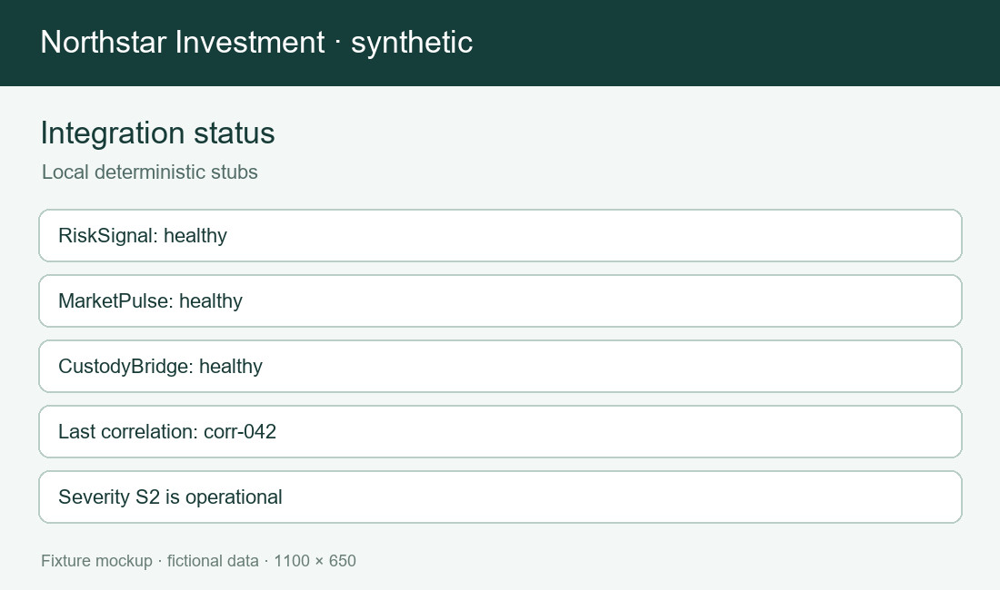
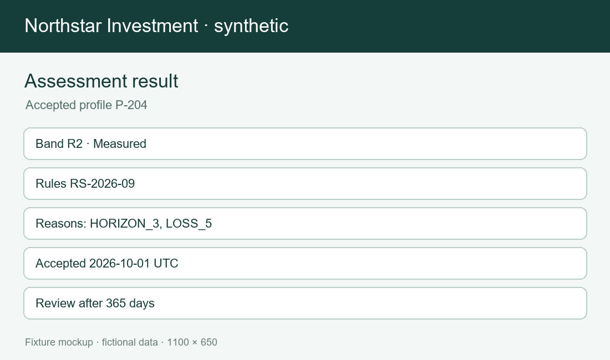

# External service catalog

Exactly three fictional business services exist: RiskSignal, MarketPulse and CustodyBridge. Risk profiling calls RiskSignal only. Local PostgreSQL and MongoDB are internal stores, not external business services. Dependency table: risk profiling to RiskSignal; quote browsing to MarketPulse; order reservation and settlement to CustodyBridge. No other provider edge is implied by a shared account reference or similar risk term.

| ID | Service | Field and operation | Constraint and failure | Timeout and local setup | Ownership and scope |
| --- | --- | --- | --- | --- | --- |
| SVC-RISKSIGNAL-01 | RiskSignal | investorRef: opaque synthetic investor reference; never a name. This field belongs to POST /assessments and is interpreted by RiskAssessmentService for proposes an investor risk band from a complete Q3 questionnaire. | Constraint and failure: missing reference returns 400. Correlation ID is propagated through the local request, response and audit. A validation failure is owned by risk integration team and must not be converted to a successful result. | Timeout: 2 seconds. Retry: one retry on connect failure with the same idempotency key. The deterministic local base is http://risk-signal:8080. Its endpoint and status are fixed fixture contracts, not public production services. | Risk dependency: risk profiling only. TICKET-2007 owns this contract area. A provider response is only input to platform validation; persistence and customer presentation remain platform decisions. |
| SVC-RISKSIGNAL-02 | RiskSignal | questionnaireVersion: Q3 for current requests. This field belongs to POST /assessments and is interpreted by RiskAssessmentService for proposes an investor risk band from a complete Q3 questionnaire. | Constraint and failure: Q2 returns 409 OUTDATED_RULESET. Correlation ID is propagated through the local request, response and audit. A validation failure is owned by risk integration team and must not be converted to a successful result. | Timeout: 2 seconds. Retry: one retry on connect failure with the same idempotency key. The deterministic local base is http://risk-signal:8080. Its endpoint and status are fixed fixture contracts, not public production services. | Risk dependency: risk profiling only. TICKET-2007 owns this contract area. A provider response is only input to platform validation; persistence and customer presentation remain platform decisions. |
| SVC-RISKSIGNAL-03 | RiskSignal | rulesVersion: RS-2026-09. This field belongs to POST /assessments and is interpreted by RiskAssessmentService for proposes an investor risk band from a complete Q3 questionnaire. | Constraint and failure: unknown version returns 409. Correlation ID is propagated through the local request, response and audit. A validation failure is owned by risk integration team and must not be converted to a successful result. | Timeout: 2 seconds. Retry: one retry on connect failure with the same idempotency key. The deterministic local base is http://risk-signal:8080. Its endpoint and status are fixed fixture contracts, not public production services. | Risk dependency: risk profiling only. TICKET-2007 owns this contract area. A provider response is only input to platform validation; persistence and customer presentation remain platform decisions. |
| SVC-RISKSIGNAL-04 | RiskSignal | experience: NONE, BEGINNER, INTERMEDIATE or ADVANCED. This field belongs to POST /assessments and is interpreted by RiskAssessmentService for proposes an investor risk band from a complete Q3 questionnaire. | Constraint and failure: retired EXPERT returns 422. Correlation ID is propagated through the local request, response and audit. A validation failure is owned by risk integration team and must not be converted to a successful result. | Timeout: 2 seconds. Retry: one retry on connect failure with the same idempotency key. The deterministic local base is http://risk-signal:8080. Its endpoint and status are fixed fixture contracts, not public production services. | Risk dependency: risk profiling only. TICKET-2007 owns this contract area. A provider response is only input to platform validation; persistence and customer presentation remain platform decisions. |
| SVC-RISKSIGNAL-05 | RiskSignal | horizon: H0, H1, H3 or H7. This field belongs to POST /assessments and is interpreted by RiskAssessmentService for proposes an investor risk band from a complete Q3 questionnaire. | Constraint and failure: blank horizon returns 422. Correlation ID is propagated through the local request, response and audit. A validation failure is owned by risk integration team and must not be converted to a successful result. | Timeout: 2 seconds. Retry: one retry on connect failure with the same idempotency key. The deterministic local base is http://risk-signal:8080. Its endpoint and status are fixed fixture contracts, not public production services. | Risk dependency: risk profiling only. TICKET-2007 owns this contract area. A provider response is only input to platform validation; persistence and customer presentation remain platform decisions. |
| SVC-RISKSIGNAL-06 | RiskSignal | lossTolerance: L0, L5, L10 or L20. This field belongs to POST /assessments and is interpreted by RiskAssessmentService for proposes an investor risk band from a complete Q3 questionnaire. | Constraint and failure: decimal percentage input returns 422. Correlation ID is propagated through the local request, response and audit. A validation failure is owned by risk integration team and must not be converted to a successful result. | Timeout: 2 seconds. Retry: one retry on connect failure with the same idempotency key. The deterministic local base is http://risk-signal:8080. Its endpoint and status are fixed fixture contracts, not public production services. | Risk dependency: risk profiling only. TICKET-2007 owns this contract area. A provider response is only input to platform validation; persistence and customer presentation remain platform decisions. |
| SVC-RISKSIGNAL-07 | RiskSignal | liquidityNeed: IMMEDIATE, SOON, FLEXIBLE or LONG_TERM. This field belongs to POST /assessments and is interpreted by RiskAssessmentService for proposes an investor risk band from a complete Q3 questionnaire. | Constraint and failure: missing liquidity returns 422. Correlation ID is propagated through the local request, response and audit. A validation failure is owned by risk integration team and must not be converted to a successful result. | Timeout: 2 seconds. Retry: one retry on connect failure with the same idempotency key. The deterministic local base is http://risk-signal:8080. Its endpoint and status are fixed fixture contracts, not public production services. | Risk dependency: risk profiling only. TICKET-2007 owns this contract area. A provider response is only input to platform validation; persistence and customer presentation remain platform decisions. |
| SVC-RISKSIGNAL-08 | RiskSignal | consentRevision: CP-3 text revision. This field belongs to POST /assessments and is interpreted by RiskAssessmentService for proposes an investor risk band from a complete Q3 questionnaire. | Constraint and failure: missing consent returns 422. Correlation ID is propagated through the local request, response and audit. A validation failure is owned by risk integration team and must not be converted to a successful result. | Timeout: 2 seconds. Retry: one retry on connect failure with the same idempotency key. The deterministic local base is http://risk-signal:8080. Its endpoint and status are fixed fixture contracts, not public production services. | Risk dependency: risk profiling only. TICKET-2007 owns this contract area. A provider response is only input to platform validation; persistence and customer presentation remain platform decisions. |
| SVC-RISKSIGNAL-09 | RiskSignal | idempotencyKey: client-generated UUID fixed across retries. This field belongs to POST /assessments and is interpreted by RiskAssessmentService for proposes an investor risk band from a complete Q3 questionnaire. | Constraint and failure: same key with changed body returns 409. Correlation ID is propagated through the local request, response and audit. A validation failure is owned by risk integration team and must not be converted to a successful result. | Timeout: 2 seconds. Retry: one retry on connect failure with the same idempotency key. The deterministic local base is http://risk-signal:8080. Its endpoint and status are fixed fixture contracts, not public production services. | Risk dependency: risk profiling only. TICKET-2007 owns this contract area. A provider response is only input to platform validation; persistence and customer presentation remain platform decisions. |
| SVC-RISKSIGNAL-10 | RiskSignal | correlationId: propagated request trace identifier. This field belongs to POST /assessments and is interpreted by RiskAssessmentService for proposes an investor risk band from a complete Q3 questionnaire. | Constraint and failure: missing value is rejected locally. Correlation ID is propagated through the local request, response and audit. A validation failure is owned by risk integration team and must not be converted to a successful result. | Timeout: 2 seconds. Retry: one retry on connect failure with the same idempotency key. The deterministic local base is http://risk-signal:8080. Its endpoint and status are fixed fixture contracts, not public production services. | Risk dependency: risk profiling only. TICKET-2007 owns this contract area. A provider response is only input to platform validation; persistence and customer presentation remain platform decisions. |
| SVC-RISKSIGNAL-11 | RiskSignal | proposedBand: R1 through R4 in response. This field belongs to POST /assessments and is interpreted by RiskAssessmentService for proposes an investor risk band from a complete Q3 questionnaire. | Constraint and failure: unknown band makes response incomplete. Correlation ID is propagated through the local request, response and audit. A validation failure is owned by risk integration team and must not be converted to a successful result. | Timeout: 2 seconds. Retry: one retry on connect failure with the same idempotency key. The deterministic local base is http://risk-signal:8080. Its endpoint and status are fixed fixture contracts, not public production services. | Risk dependency: risk profiling only. TICKET-2007 owns this contract area. A provider response is only input to platform validation; persistence and customer presentation remain platform decisions. |
| SVC-RISKSIGNAL-12 | RiskSignal | reasonCodes: nonempty list of versioned reason codes. This field belongs to POST /assessments and is interpreted by RiskAssessmentService for proposes an investor risk band from a complete Q3 questionnaire. | Constraint and failure: empty list makes response incomplete. Correlation ID is propagated through the local request, response and audit. A validation failure is owned by risk integration team and must not be converted to a successful result. | Timeout: 2 seconds. Retry: one retry on connect failure with the same idempotency key. The deterministic local base is http://risk-signal:8080. Its endpoint and status are fixed fixture contracts, not public production services. | Risk dependency: risk profiling only. TICKET-2007 owns this contract area. A provider response is only input to platform validation; persistence and customer presentation remain platform decisions. |
| SVC-RISKSIGNAL-13 | RiskSignal | providerAssessmentId: opaque stable provider result identifier. This field belongs to POST /assessments and is interpreted by RiskAssessmentService for proposes an investor risk band from a complete Q3 questionnaire. | Constraint and failure: missing ID prevents persistence. Correlation ID is propagated through the local request, response and audit. A validation failure is owned by risk integration team and must not be converted to a successful result. | Timeout: 2 seconds. Retry: one retry on connect failure with the same idempotency key. The deterministic local base is http://risk-signal:8080. Its endpoint and status are fixed fixture contracts, not public production services. | Risk dependency: risk profiling only. TICKET-2007 owns this contract area. A provider response is only input to platform validation; persistence and customer presentation remain platform decisions. |
| SVC-RISKSIGNAL-14 | RiskSignal | evaluatedAt: UTC response timestamp. This field belongs to POST /assessments and is interpreted by RiskAssessmentService for proposes an investor risk band from a complete Q3 questionnaire. | Constraint and failure: missing timestamp prevents persistence. Correlation ID is propagated through the local request, response and audit. A validation failure is owned by risk integration team and must not be converted to a successful result. | Timeout: 2 seconds. Retry: one retry on connect failure with the same idempotency key. The deterministic local base is http://risk-signal:8080. Its endpoint and status are fixed fixture contracts, not public production services. | Risk dependency: risk profiling only. TICKET-2007 owns this contract area. A provider response is only input to platform validation; persistence and customer presentation remain platform decisions. |
| SVC-RISKSIGNAL-15 | RiskSignal | responseRulesVersion: echo of RS-2026-09. This field belongs to POST /assessments and is interpreted by RiskAssessmentService for proposes an investor risk band from a complete Q3 questionnaire. | Constraint and failure: mismatched version prevents persistence. Correlation ID is propagated through the local request, response and audit. A validation failure is owned by risk integration team and must not be converted to a successful result. | Timeout: 2 seconds. Retry: one retry on connect failure with the same idempotency key. The deterministic local base is http://risk-signal:8080. Its endpoint and status are fixed fixture contracts, not public production services. | Risk dependency: risk profiling only. TICKET-2007 owns this contract area. A provider response is only input to platform validation; persistence and customer presentation remain platform decisions. |
| SVC-RISKSIGNAL-16 | RiskSignal | connectTimeout: failure before request receipt. This field belongs to POST /assessments and is interpreted by RiskAssessmentService for proposes an investor risk band from a complete Q3 questionnaire. | Constraint and failure: same-key retry may be attempted once. Correlation ID is propagated through the local request, response and audit. A validation failure is owned by risk integration team and must not be converted to a successful result. | Timeout: 2 seconds. Retry: one retry on connect failure with the same idempotency key. The deterministic local base is http://risk-signal:8080. Its endpoint and status are fixed fixture contracts, not public production services. | Risk dependency: risk profiling only. TICKET-2007 owns this contract area. A provider response is only input to platform validation; persistence and customer presentation remain platform decisions. |
| SVC-RISKSIGNAL-17 | RiskSignal | readTimeout: unknown provider outcome after 2 seconds. This field belongs to POST /assessments and is interpreted by RiskAssessmentService for proposes an investor risk band from a complete Q3 questionnaire. | Constraint and failure: same-key retry must not create a second accepted profile. Correlation ID is propagated through the local request, response and audit. A validation failure is owned by risk integration team and must not be converted to a successful result. | Timeout: 2 seconds. Retry: one retry on connect failure with the same idempotency key. The deterministic local base is http://risk-signal:8080. Its endpoint and status are fixed fixture contracts, not public production services. | Risk dependency: risk profiling only. TICKET-2007 owns this contract area. A provider response is only input to platform validation; persistence and customer presentation remain platform decisions. |
| SVC-RISKSIGNAL-18 | RiskSignal | unavailable: HTTP 503 provider outage. This field belongs to POST /assessments and is interpreted by RiskAssessmentService for proposes an investor risk band from a complete Q3 questionnaire. | Constraint and failure: existing active profile remains unchanged. Correlation ID is propagated through the local request, response and audit. A validation failure is owned by risk integration team and must not be converted to a successful result. | Timeout: 2 seconds. Retry: one retry on connect failure with the same idempotency key. The deterministic local base is http://risk-signal:8080. Its endpoint and status are fixed fixture contracts, not public production services. | Risk dependency: risk profiling only. TICKET-2007 owns this contract area. A provider response is only input to platform validation; persistence and customer presentation remain platform decisions. |
| SVC-RISKSIGNAL-19 | RiskSignal | malformedResponse: parseable HTTP 200 with missing required field. This field belongs to POST /assessments and is interpreted by RiskAssessmentService for proposes an investor risk band from a complete Q3 questionnaire. | Constraint and failure: mark attempt failed and retain raw audit. Correlation ID is propagated through the local request, response and audit. A validation failure is owned by risk integration team and must not be converted to a successful result. | Timeout: 2 seconds. Retry: one retry on connect failure with the same idempotency key. The deterministic local base is http://risk-signal:8080. Its endpoint and status are fixed fixture contracts, not public production services. | Risk dependency: risk profiling only. TICKET-2007 owns this contract area. A provider response is only input to platform validation; persistence and customer presentation remain platform decisions. |
| SVC-RISKSIGNAL-20 | RiskSignal | conflict: HTTP 409 for changed idempotency body. This field belongs to POST /assessments and is interpreted by RiskAssessmentService for proposes an investor risk band from a complete Q3 questionnaire. | Constraint and failure: surface conflict without accepting profile. Correlation ID is propagated through the local request, response and audit. A validation failure is owned by risk integration team and must not be converted to a successful result. | Timeout: 2 seconds. Retry: one retry on connect failure with the same idempotency key. The deterministic local base is http://risk-signal:8080. Its endpoint and status are fixed fixture contracts, not public production services. | Risk dependency: risk profiling only. TICKET-2007 owns this contract area. A provider response is only input to platform validation; persistence and customer presentation remain platform decisions. |
| SVC-MARKETPULSE-01 | MarketPulse | instrumentId: synthetic ISIN-like identifier. This field belongs to GET /quotes/{instrumentId} and is interpreted by QuoteService for quotes, instrument reference data and market-session status for trading. | Constraint and failure: unknown identifier returns 404. Correlation ID is propagated through the local request, response and audit. A validation failure is owned by market data team and must not be converted to a successful result. | Timeout: 800 milliseconds. Retry: one read retry for a transient 503. The deterministic local base is http://market-pulse:8080. Its endpoint and status are fixed fixture contracts, not public production services. | Risk dependency: none for risk profiling. TICKET-3001 owns this contract area. A provider response is only input to platform validation; persistence and customer presentation remain platform decisions. |
| SVC-MARKETPULSE-02 | MarketPulse | quoteCurrency: ISO currency code for displayed amount. This field belongs to GET /quotes/{instrumentId} and is interpreted by QuoteService for quotes, instrument reference data and market-session status for trading. | Constraint and failure: unsupported code blocks quote display. Correlation ID is propagated through the local request, response and audit. A validation failure is owned by market data team and must not be converted to a successful result. | Timeout: 800 milliseconds. Retry: one read retry for a transient 503. The deterministic local base is http://market-pulse:8080. Its endpoint and status are fixed fixture contracts, not public production services. | Risk dependency: none for risk profiling. TICKET-3001 owns this contract area. A provider response is only input to platform validation; persistence and customer presentation remain platform decisions. |
| SVC-MARKETPULSE-03 | MarketPulse | bid: nonnegative decimal price. This field belongs to GET /quotes/{instrumentId} and is interpreted by QuoteService for quotes, instrument reference data and market-session status for trading. | Constraint and failure: negative value is rejected. Correlation ID is propagated through the local request, response and audit. A validation failure is owned by market data team and must not be converted to a successful result. | Timeout: 800 milliseconds. Retry: one read retry for a transient 503. The deterministic local base is http://market-pulse:8080. Its endpoint and status are fixed fixture contracts, not public production services. | Risk dependency: none for risk profiling. TICKET-3001 owns this contract area. A provider response is only input to platform validation; persistence and customer presentation remain platform decisions. |
| SVC-MARKETPULSE-04 | MarketPulse | ask: nonnegative decimal price. This field belongs to GET /quotes/{instrumentId} and is interpreted by QuoteService for quotes, instrument reference data and market-session status for trading. | Constraint and failure: ask below bid is rejected. Correlation ID is propagated through the local request, response and audit. A validation failure is owned by market data team and must not be converted to a successful result. | Timeout: 800 milliseconds. Retry: one read retry for a transient 503. The deterministic local base is http://market-pulse:8080. Its endpoint and status are fixed fixture contracts, not public production services. | Risk dependency: none for risk profiling. TICKET-3001 owns this contract area. A provider response is only input to platform validation; persistence and customer presentation remain platform decisions. |
| SVC-MARKETPULSE-05 | MarketPulse | asOf: UTC quote time. This field belongs to GET /quotes/{instrumentId} and is interpreted by QuoteService for quotes, instrument reference data and market-session status for trading. | Constraint and failure: stale quote is labelled stale. Correlation ID is propagated through the local request, response and audit. A validation failure is owned by market data team and must not be converted to a successful result. | Timeout: 800 milliseconds. Retry: one read retry for a transient 503. The deterministic local base is http://market-pulse:8080. Its endpoint and status are fixed fixture contracts, not public production services. | Risk dependency: none for risk profiling. TICKET-3001 owns this contract area. A provider response is only input to platform validation; persistence and customer presentation remain platform decisions. |
| SVC-MARKETPULSE-06 | MarketPulse | session: OPEN, CLOSED or HALTED. This field belongs to GET /quotes/{instrumentId} and is interpreted by QuoteService for quotes, instrument reference data and market-session status for trading. | Constraint and failure: HALTED blocks order submission. Correlation ID is propagated through the local request, response and audit. A validation failure is owned by market data team and must not be converted to a successful result. | Timeout: 800 milliseconds. Retry: one read retry for a transient 503. The deterministic local base is http://market-pulse:8080. Its endpoint and status are fixed fixture contracts, not public production services. | Risk dependency: none for risk profiling. TICKET-3001 owns this contract area. A provider response is only input to platform validation; persistence and customer presentation remain platform decisions. |
| SVC-MARKETPULSE-07 | MarketPulse | category: EQUITY, ETF, BOND or CASH. This field belongs to GET /quotes/{instrumentId} and is interpreted by QuoteService for quotes, instrument reference data and market-session status for trading. | Constraint and failure: unknown category is not mapped. Correlation ID is propagated through the local request, response and audit. A validation failure is owned by market data team and must not be converted to a successful result. | Timeout: 800 milliseconds. Retry: one read retry for a transient 503. The deterministic local base is http://market-pulse:8080. Its endpoint and status are fixed fixture contracts, not public production services. | Risk dependency: none for risk profiling. TICKET-3001 owns this contract area. A provider response is only input to platform validation; persistence and customer presentation remain platform decisions. |
| SVC-MARKETPULSE-08 | MarketPulse | instrumentRisk: issuer-owned volatility descriptor. This field belongs to GET /quotes/{instrumentId} and is interpreted by QuoteService for quotes, instrument reference data and market-session status for trading. | Constraint and failure: must not be treated as investor risk_band. Correlation ID is propagated through the local request, response and audit. A validation failure is owned by market data team and must not be converted to a successful result. | Timeout: 800 milliseconds. Retry: one read retry for a transient 503. The deterministic local base is http://market-pulse:8080. Its endpoint and status are fixed fixture contracts, not public production services. | Risk dependency: none for risk profiling. TICKET-3001 owns this contract area. A provider response is only input to platform validation; persistence and customer presentation remain platform decisions. |
| SVC-MARKETPULSE-09 | MarketPulse | exchange: fictional market venue. This field belongs to GET /quotes/{instrumentId} and is interpreted by QuoteService for quotes, instrument reference data and market-session status for trading. | Constraint and failure: unlisted venue is shown as unknown. Correlation ID is propagated through the local request, response and audit. A validation failure is owned by market data team and must not be converted to a successful result. | Timeout: 800 milliseconds. Retry: one read retry for a transient 503. The deterministic local base is http://market-pulse:8080. Its endpoint and status are fixed fixture contracts, not public production services. | Risk dependency: none for risk profiling. TICKET-3001 owns this contract area. A provider response is only input to platform validation; persistence and customer presentation remain platform decisions. |
| SVC-MARKETPULSE-10 | MarketPulse | lotSize: positive trade quantity increment. This field belongs to GET /quotes/{instrumentId} and is interpreted by QuoteService for quotes, instrument reference data and market-session status for trading. | Constraint and failure: zero blocks an order. Correlation ID is propagated through the local request, response and audit. A validation failure is owned by market data team and must not be converted to a successful result. | Timeout: 800 milliseconds. Retry: one read retry for a transient 503. The deterministic local base is http://market-pulse:8080. Its endpoint and status are fixed fixture contracts, not public production services. | Risk dependency: none for risk profiling. TICKET-3001 owns this contract area. A provider response is only input to platform validation; persistence and customer presentation remain platform decisions. |
| SVC-MARKETPULSE-11 | MarketPulse | tradingCurrency: settlement amount currency. This field belongs to GET /quotes/{instrumentId} and is interpreted by QuoteService for quotes, instrument reference data and market-session status for trading. | Constraint and failure: missing currency blocks order. Correlation ID is propagated through the local request, response and audit. A validation failure is owned by market data team and must not be converted to a successful result. | Timeout: 800 milliseconds. Retry: one read retry for a transient 503. The deterministic local base is http://market-pulse:8080. Its endpoint and status are fixed fixture contracts, not public production services. | Risk dependency: none for risk profiling. TICKET-3001 owns this contract area. A provider response is only input to platform validation; persistence and customer presentation remain platform decisions. |
| SVC-MARKETPULSE-12 | MarketPulse | quoteId: opaque quote snapshot identifier. This field belongs to GET /quotes/{instrumentId} and is interpreted by QuoteService for quotes, instrument reference data and market-session status for trading. | Constraint and failure: missing ID blocks price confirmation. Correlation ID is propagated through the local request, response and audit. A validation failure is owned by market data team and must not be converted to a successful result. | Timeout: 800 milliseconds. Retry: one read retry for a transient 503. The deterministic local base is http://market-pulse:8080. Its endpoint and status are fixed fixture contracts, not public production services. | Risk dependency: none for risk profiling. TICKET-3001 owns this contract area. A provider response is only input to platform validation; persistence and customer presentation remain platform decisions. |
| SVC-MARKETPULSE-13 | MarketPulse | marketStatus: current venue status. This field belongs to GET /quotes/{instrumentId} and is interpreted by QuoteService for quotes, instrument reference data and market-session status for trading. | Constraint and failure: maintenance means no live quote. Correlation ID is propagated through the local request, response and audit. A validation failure is owned by market data team and must not be converted to a successful result. | Timeout: 800 milliseconds. Retry: one read retry for a transient 503. The deterministic local base is http://market-pulse:8080. Its endpoint and status are fixed fixture contracts, not public production services. | Risk dependency: none for risk profiling. TICKET-3001 owns this contract area. A provider response is only input to platform validation; persistence and customer presentation remain platform decisions. |
| SVC-MARKETPULSE-14 | MarketPulse | sessionStart: UTC opening instant. This field belongs to GET /quotes/{instrumentId} and is interpreted by QuoteService for quotes, instrument reference data and market-session status for trading. | Constraint and failure: missing schedule is labelled unknown. Correlation ID is propagated through the local request, response and audit. A validation failure is owned by market data team and must not be converted to a successful result. | Timeout: 800 milliseconds. Retry: one read retry for a transient 503. The deterministic local base is http://market-pulse:8080. Its endpoint and status are fixed fixture contracts, not public production services. | Risk dependency: none for risk profiling. TICKET-3001 owns this contract area. A provider response is only input to platform validation; persistence and customer presentation remain platform decisions. |
| SVC-MARKETPULSE-15 | MarketPulse | sessionEnd: UTC closing instant. This field belongs to GET /quotes/{instrumentId} and is interpreted by QuoteService for quotes, instrument reference data and market-session status for trading. | Constraint and failure: end before start is invalid. Correlation ID is propagated through the local request, response and audit. A validation failure is owned by market data team and must not be converted to a successful result. | Timeout: 800 milliseconds. Retry: one read retry for a transient 503. The deterministic local base is http://market-pulse:8080. Its endpoint and status are fixed fixture contracts, not public production services. | Risk dependency: none for risk profiling. TICKET-3001 owns this contract area. A provider response is only input to platform validation; persistence and customer presentation remain platform decisions. |
| SVC-MARKETPULSE-16 | MarketPulse | rateLimit: HTTP 429 with retry-after. This field belongs to GET /quotes/{instrumentId} and is interpreted by QuoteService for quotes, instrument reference data and market-session status for trading. | Constraint and failure: quote view shows throttling. Correlation ID is propagated through the local request, response and audit. A validation failure is owned by market data team and must not be converted to a successful result. | Timeout: 800 milliseconds. Retry: one read retry for a transient 503. The deterministic local base is http://market-pulse:8080. Its endpoint and status are fixed fixture contracts, not public production services. | Risk dependency: none for risk profiling. TICKET-3001 owns this contract area. A provider response is only input to platform validation; persistence and customer presentation remain platform decisions. |
| SVC-MARKETPULSE-17 | MarketPulse | notFound: HTTP 404 for delisted reference. This field belongs to GET /quotes/{instrumentId} and is interpreted by QuoteService for quotes, instrument reference data and market-session status for trading. | Constraint and failure: existing saved watchlist remains readable. Correlation ID is propagated through the local request, response and audit. A validation failure is owned by market data team and must not be converted to a successful result. | Timeout: 800 milliseconds. Retry: one read retry for a transient 503. The deterministic local base is http://market-pulse:8080. Its endpoint and status are fixed fixture contracts, not public production services. | Risk dependency: none for risk profiling. TICKET-3001 owns this contract area. A provider response is only input to platform validation; persistence and customer presentation remain platform decisions. |
| SVC-MARKETPULSE-18 | MarketPulse | unavailable: HTTP 503 for provider outage. This field belongs to GET /quotes/{instrumentId} and is interpreted by QuoteService for quotes, instrument reference data and market-session status for trading. | Constraint and failure: no cached value is labelled live. Correlation ID is propagated through the local request, response and audit. A validation failure is owned by market data team and must not be converted to a successful result. | Timeout: 800 milliseconds. Retry: one read retry for a transient 503. The deterministic local base is http://market-pulse:8080. Its endpoint and status are fixed fixture contracts, not public production services. | Risk dependency: none for risk profiling. TICKET-3001 owns this contract area. A provider response is only input to platform validation; persistence and customer presentation remain platform decisions. |
| SVC-MARKETPULSE-19 | MarketPulse | correlationId: propagated browsing trace. This field belongs to GET /quotes/{instrumentId} and is interpreted by QuoteService for quotes, instrument reference data and market-session status for trading. | Constraint and failure: missing trace is reported to operations. Correlation ID is propagated through the local request, response and audit. A validation failure is owned by market data team and must not be converted to a successful result. | Timeout: 800 milliseconds. Retry: one read retry for a transient 503. The deterministic local base is http://market-pulse:8080. Its endpoint and status are fixed fixture contracts, not public production services. | Risk dependency: none for risk profiling. TICKET-3001 owns this contract area. A provider response is only input to platform validation; persistence and customer presentation remain platform decisions. |
| SVC-MARKETPULSE-20 | MarketPulse | etag: reference-cache revision token. This field belongs to GET /quotes/{instrumentId} and is interpreted by QuoteService for quotes, instrument reference data and market-session status for trading. | Constraint and failure: cache miss obtains a new document. Correlation ID is propagated through the local request, response and audit. A validation failure is owned by market data team and must not be converted to a successful result. | Timeout: 800 milliseconds. Retry: one read retry for a transient 503. The deterministic local base is http://market-pulse:8080. Its endpoint and status are fixed fixture contracts, not public production services. | Risk dependency: none for risk profiling. TICKET-3001 owns this contract area. A provider response is only input to platform validation; persistence and customer presentation remain platform decisions. |
| SVC-CUSTODYBRIDGE-01 | CustodyBridge | accountRef: opaque synthetic account reference. This field belongs to POST /reservations and is interpreted by OrderService for cash balance, order settlement and custody status. | Constraint and failure: missing account returns 400. Correlation ID is propagated through the local request, response and audit. A validation failure is owned by custody integration team and must not be converted to a successful result. | Timeout: 3 seconds. Retry: same-key reservation lookup is planned; current adapter surfaces timeout. The deterministic local base is http://custody-bridge:8080. Its endpoint and status are fixed fixture contracts, not public production services. | Risk dependency: none for risk profiling. TICKET-3004 owns this contract area. A provider response is only input to platform validation; persistence and customer presentation remain platform decisions. |
| SVC-CUSTODYBRIDGE-02 | CustodyBridge | availableCash: decimal balance in account currency. This field belongs to POST /reservations and is interpreted by OrderService for cash balance, order settlement and custody status. | Constraint and failure: negative balance blocks reservation. Correlation ID is propagated through the local request, response and audit. A validation failure is owned by custody integration team and must not be converted to a successful result. | Timeout: 3 seconds. Retry: same-key reservation lookup is planned; current adapter surfaces timeout. The deterministic local base is http://custody-bridge:8080. Its endpoint and status are fixed fixture contracts, not public production services. | Risk dependency: none for risk profiling. TICKET-3004 owns this contract area. A provider response is only input to platform validation; persistence and customer presentation remain platform decisions. |
| SVC-CUSTODYBRIDGE-03 | CustodyBridge | currency: PLN, EUR or USD. This field belongs to POST /reservations and is interpreted by OrderService for cash balance, order settlement and custody status. | Constraint and failure: different order currency requires conversion outside this slice. Correlation ID is propagated through the local request, response and audit. A validation failure is owned by custody integration team and must not be converted to a successful result. | Timeout: 3 seconds. Retry: same-key reservation lookup is planned; current adapter surfaces timeout. The deterministic local base is http://custody-bridge:8080. Its endpoint and status are fixed fixture contracts, not public production services. | Risk dependency: none for risk profiling. TICKET-3004 owns this contract area. A provider response is only input to platform validation; persistence and customer presentation remain platform decisions. |
| SVC-CUSTODYBRIDGE-04 | CustodyBridge | orderRef: platform order identifier. This field belongs to POST /reservations and is interpreted by OrderService for cash balance, order settlement and custody status. | Constraint and failure: unknown order returns 404. Correlation ID is propagated through the local request, response and audit. A validation failure is owned by custody integration team and must not be converted to a successful result. | Timeout: 3 seconds. Retry: same-key reservation lookup is planned; current adapter surfaces timeout. The deterministic local base is http://custody-bridge:8080. Its endpoint and status are fixed fixture contracts, not public production services. | Risk dependency: none for risk profiling. TICKET-3004 owns this contract area. A provider response is only input to platform validation; persistence and customer presentation remain platform decisions. |
| SVC-CUSTODYBRIDGE-05 | CustodyBridge | reservationKey: stable order idempotency key. This field belongs to POST /reservations and is interpreted by OrderService for cash balance, order settlement and custody status. | Constraint and failure: changed amount with same key returns 409. Correlation ID is propagated through the local request, response and audit. A validation failure is owned by custody integration team and must not be converted to a successful result. | Timeout: 3 seconds. Retry: same-key reservation lookup is planned; current adapter surfaces timeout. The deterministic local base is http://custody-bridge:8080. Its endpoint and status are fixed fixture contracts, not public production services. | Risk dependency: none for risk profiling. TICKET-3004 owns this contract area. A provider response is only input to platform validation; persistence and customer presentation remain platform decisions. |
| SVC-CUSTODYBRIDGE-06 | CustodyBridge | amount: positive reserved cash amount. This field belongs to POST /reservations and is interpreted by OrderService for cash balance, order settlement and custody status. | Constraint and failure: zero amount returns 422. Correlation ID is propagated through the local request, response and audit. A validation failure is owned by custody integration team and must not be converted to a successful result. | Timeout: 3 seconds. Retry: same-key reservation lookup is planned; current adapter surfaces timeout. The deterministic local base is http://custody-bridge:8080. Its endpoint and status are fixed fixture contracts, not public production services. | Risk dependency: none for risk profiling. TICKET-3004 owns this contract area. A provider response is only input to platform validation; persistence and customer presentation remain platform decisions. |
| SVC-CUSTODYBRIDGE-07 | CustodyBridge | reservationId: opaque custody reservation identifier. This field belongs to POST /reservations and is interpreted by OrderService for cash balance, order settlement and custody status. | Constraint and failure: missing ID keeps order NEW. Correlation ID is propagated through the local request, response and audit. A validation failure is owned by custody integration team and must not be converted to a successful result. | Timeout: 3 seconds. Retry: same-key reservation lookup is planned; current adapter surfaces timeout. The deterministic local base is http://custody-bridge:8080. Its endpoint and status are fixed fixture contracts, not public production services. | Risk dependency: none for risk profiling. TICKET-3004 owns this contract area. A provider response is only input to platform validation; persistence and customer presentation remain platform decisions. |
| SVC-CUSTODYBRIDGE-08 | CustodyBridge | reservationStatus: RESERVED or REJECTED. This field belongs to POST /reservations and is interpreted by OrderService for cash balance, order settlement and custody status. | Constraint and failure: rejected reservation keeps order unplaced. Correlation ID is propagated through the local request, response and audit. A validation failure is owned by custody integration team and must not be converted to a successful result. | Timeout: 3 seconds. Retry: same-key reservation lookup is planned; current adapter surfaces timeout. The deterministic local base is http://custody-bridge:8080. Its endpoint and status are fixed fixture contracts, not public production services. | Risk dependency: none for risk profiling. TICKET-3004 owns this contract area. A provider response is only input to platform validation; persistence and customer presentation remain platform decisions. |
| SVC-CUSTODYBRIDGE-09 | CustodyBridge | settlementId: opaque settlement event identifier. This field belongs to POST /reservations and is interpreted by OrderService for cash balance, order settlement and custody status. | Constraint and failure: duplicate event is ignored by ID. Correlation ID is propagated through the local request, response and audit. A validation failure is owned by custody integration team and must not be converted to a successful result. | Timeout: 3 seconds. Retry: same-key reservation lookup is planned; current adapter surfaces timeout. The deterministic local base is http://custody-bridge:8080. Its endpoint and status are fixed fixture contracts, not public production services. | Risk dependency: none for risk profiling. TICKET-3004 owns this contract area. A provider response is only input to platform validation; persistence and customer presentation remain platform decisions. |
| SVC-CUSTODYBRIDGE-10 | CustodyBridge | settledAt: UTC settlement timestamp. This field belongs to POST /reservations and is interpreted by OrderService for cash balance, order settlement and custody status. | Constraint and failure: missing timestamp keeps order PLACED. Correlation ID is propagated through the local request, response and audit. A validation failure is owned by custody integration team and must not be converted to a successful result. | Timeout: 3 seconds. Retry: same-key reservation lookup is planned; current adapter surfaces timeout. The deterministic local base is http://custody-bridge:8080. Its endpoint and status are fixed fixture contracts, not public production services. | Risk dependency: none for risk profiling. TICKET-3004 owns this contract area. A provider response is only input to platform validation; persistence and customer presentation remain platform decisions. |
| SVC-CUSTODYBRIDGE-11 | CustodyBridge | custodyStatus: OPEN, BLOCKED or CLOSED. This field belongs to POST /reservations and is interpreted by OrderService for cash balance, order settlement and custody status. | Constraint and failure: BLOCKED prevents new reservation. Correlation ID is propagated through the local request, response and audit. A validation failure is owned by custody integration team and must not be converted to a successful result. | Timeout: 3 seconds. Retry: same-key reservation lookup is planned; current adapter surfaces timeout. The deterministic local base is http://custody-bridge:8080. Its endpoint and status are fixed fixture contracts, not public production services. | Risk dependency: none for risk profiling. TICKET-3004 owns this contract area. A provider response is only input to platform validation; persistence and customer presentation remain platform decisions. |
| SVC-CUSTODYBRIDGE-12 | CustodyBridge | balanceAsOf: UTC balance snapshot time. This field belongs to POST /reservations and is interpreted by OrderService for cash balance, order settlement and custody status. | Constraint and failure: stale balance is labelled stale. Correlation ID is propagated through the local request, response and audit. A validation failure is owned by custody integration team and must not be converted to a successful result. | Timeout: 3 seconds. Retry: same-key reservation lookup is planned; current adapter surfaces timeout. The deterministic local base is http://custody-bridge:8080. Its endpoint and status are fixed fixture contracts, not public production services. | Risk dependency: none for risk profiling. TICKET-3004 owns this contract area. A provider response is only input to platform validation; persistence and customer presentation remain platform decisions. |
| SVC-CUSTODYBRIDGE-13 | CustodyBridge | correlationId: order trace identifier. This field belongs to POST /reservations and is interpreted by OrderService for cash balance, order settlement and custody status. | Constraint and failure: missing trace is rejected locally. Correlation ID is propagated through the local request, response and audit. A validation failure is owned by custody integration team and must not be converted to a successful result. | Timeout: 3 seconds. Retry: same-key reservation lookup is planned; current adapter surfaces timeout. The deterministic local base is http://custody-bridge:8080. Its endpoint and status are fixed fixture contracts, not public production services. | Risk dependency: none for risk profiling. TICKET-3004 owns this contract area. A provider response is only input to platform validation; persistence and customer presentation remain platform decisions. |
| SVC-CUSTODYBRIDGE-14 | CustodyBridge | insufficientFunds: HTTP 409 business rejection. This field belongs to POST /reservations and is interpreted by OrderService for cash balance, order settlement and custody status. | Constraint and failure: not retried as infrastructure failure. Correlation ID is propagated through the local request, response and audit. A validation failure is owned by custody integration team and must not be converted to a successful result. | Timeout: 3 seconds. Retry: same-key reservation lookup is planned; current adapter surfaces timeout. The deterministic local base is http://custody-bridge:8080. Its endpoint and status are fixed fixture contracts, not public production services. | Risk dependency: none for risk profiling. TICKET-3004 owns this contract area. A provider response is only input to platform validation; persistence and customer presentation remain platform decisions. |
| SVC-CUSTODYBRIDGE-15 | CustodyBridge | timeout: unknown reservation outcome after 3 seconds. This field belongs to POST /reservations and is interpreted by OrderService for cash balance, order settlement and custody status. | Constraint and failure: planned lookup would use the same key. Correlation ID is propagated through the local request, response and audit. A validation failure is owned by custody integration team and must not be converted to a successful result. | Timeout: 3 seconds. Retry: same-key reservation lookup is planned; current adapter surfaces timeout. The deterministic local base is http://custody-bridge:8080. Its endpoint and status are fixed fixture contracts, not public production services. | Risk dependency: none for risk profiling. TICKET-3004 owns this contract area. A provider response is only input to platform validation; persistence and customer presentation remain platform decisions. |
| SVC-CUSTODYBRIDGE-16 | CustodyBridge | unavailable: HTTP 503 outage. This field belongs to POST /reservations and is interpreted by OrderService for cash balance, order settlement and custody status. | Constraint and failure: order stays NEW. Correlation ID is propagated through the local request, response and audit. A validation failure is owned by custody integration team and must not be converted to a successful result. | Timeout: 3 seconds. Retry: same-key reservation lookup is planned; current adapter surfaces timeout. The deterministic local base is http://custody-bridge:8080. Its endpoint and status are fixed fixture contracts, not public production services. | Risk dependency: none for risk profiling. TICKET-3004 owns this contract area. A provider response is only input to platform validation; persistence and customer presentation remain platform decisions. |
| SVC-CUSTODYBRIDGE-17 | CustodyBridge | duplicateEvent: same settlementId delivered twice. This field belongs to POST /reservations and is interpreted by OrderService for cash balance, order settlement and custody status. | Constraint and failure: state transition remains single. Correlation ID is propagated through the local request, response and audit. A validation failure is owned by custody integration team and must not be converted to a successful result. | Timeout: 3 seconds. Retry: same-key reservation lookup is planned; current adapter surfaces timeout. The deterministic local base is http://custody-bridge:8080. Its endpoint and status are fixed fixture contracts, not public production services. | Risk dependency: none for risk profiling. TICKET-3004 owns this contract area. A provider response is only input to platform validation; persistence and customer presentation remain platform decisions. |
| SVC-CUSTODYBRIDGE-18 | CustodyBridge | reversal: reservation cancellation response. This field belongs to POST /reservations and is interpreted by OrderService for cash balance, order settlement and custody status. | Constraint and failure: cancel only before PLACED. Correlation ID is propagated through the local request, response and audit. A validation failure is owned by custody integration team and must not be converted to a successful result. | Timeout: 3 seconds. Retry: same-key reservation lookup is planned; current adapter surfaces timeout. The deterministic local base is http://custody-bridge:8080. Its endpoint and status are fixed fixture contracts, not public production services. | Risk dependency: none for risk profiling. TICKET-3004 owns this contract area. A provider response is only input to platform validation; persistence and customer presentation remain platform decisions. |
| SVC-CUSTODYBRIDGE-19 | CustodyBridge | statusLookup: planned GET /reservations/{reservationKey}. This field belongs to POST /reservations and is interpreted by OrderService for cash balance, order settlement and custody status. | Constraint and failure: not implemented in current stub. Correlation ID is propagated through the local request, response and audit. A validation failure is owned by custody integration team and must not be converted to a successful result. | Timeout: 3 seconds. Retry: same-key reservation lookup is planned; current adapter surfaces timeout. The deterministic local base is http://custody-bridge:8080. Its endpoint and status are fixed fixture contracts, not public production services. | Risk dependency: none for risk profiling. TICKET-3004 owns this contract area. A provider response is only input to platform validation; persistence and customer presentation remain platform decisions. |
| SVC-CUSTODYBRIDGE-20 | CustodyBridge | auditRef: external event audit reference. This field belongs to POST /reservations and is interpreted by OrderService for cash balance, order settlement and custody status. | Constraint and failure: missing reference is flagged for review. Correlation ID is propagated through the local request, response and audit. A validation failure is owned by custody integration team and must not be converted to a successful result. | Timeout: 3 seconds. Retry: same-key reservation lookup is planned; current adapter surfaces timeout. The deterministic local base is http://custody-bridge:8080. Its endpoint and status are fixed fixture contracts, not public production services. | Risk dependency: none for risk profiling. TICKET-3004 owns this contract area. A provider response is only input to platform validation; persistence and customer presentation remain platform decisions. |

## Visual references

Caption: Integration status names three independent providers and keeps operational severity separate from investor risk.

![assessment-result reference][assessment-result-image]
[assessment-result-image]: assets/assessment-result.jpg
Caption: A proposed RiskSignal band becomes an accepted profile only after platform validation and persistence.

## Operational cases and boundaries

### contract-01: RiskSignal: Accepted proposal

The backend sends Q3 answers, CP-3 consent, RS-2026-09 and one idempotency key to POST /assessments. A complete response contains a provider assessment ID, proposed band R1–R4, nonempty reason codes, matching rules version and evaluation timestamp. The platform validates every field, writes answer and provider audit documents in MongoDB, then accepts the PostgreSQL profile summary. The proposed band is not displayed as an accepted result before both writes needed for acceptance finish.

### contract-02: RiskSignal: Duplicate submission

The same draft and answer body with the same idempotency key returns the previously accepted result. A second key can be used only for a new submission attempt after the workflow permits it. Reusing the key for a changed body is a conflict. The local stub records calls so a test can check whether a retry reused the original key and whether duplicate application submission avoided a second provider request.

### contract-03: RiskSignal: Unavailable provider

A connection error or 503 can be retried once with the same request and key. A 422 validation rejection is not retried. After the retry is exhausted, the draft remains recoverable and a previous unexpired accepted profile remains current. A timeout can leave the provider outcome unknown; the fixture never maps that uncertainty to a low band or to a successful assessment.

### contract-04: RiskSignal: Incomplete response

An HTTP 200 response lacking a provider ID, reason code, timestamp, known band or matching rules version is incomplete. The platform records a failed audit when possible and does not insert an accepted profile. The support team can use correlationId to compare the local attempt with the stub call log. A manual provider proposal cannot be pasted into a result without a versioned acceptance record.

### contract-05: RiskSignal: Cross-store failure

MongoDB retains answer and request/response snapshots while PostgreSQL owns accepted profile status. Failure to store the Mongo evidence blocks acceptance. If the Mongo write succeeds and the later PostgreSQL transaction fails, an orphan audit may remain. Automatic repair of that orphan is planned under TICKET-2020; current customer history excludes it. This is not a distributed transaction.

### contract-06: MarketPulse: Quote retrieval

QuoteService retrieves a synthetic instrument quote by instrumentId and displays bid, ask, quote currency and asOf together. An ask below bid or a negative value is invalid. A stale asOf is labelled stale; a cached price is never called live without a fresh provider timestamp. The instrumentRisk field characterizes the instrument reference, never the investor's accepted risk band.

### contract-07: MarketPulse: Trading session

The browse view receives OPEN, CLOSED or HALTED market-session status. CLOSED permits historical quote display but not order placement; HALTED explains why a previously visible instrument cannot be traded. The session times are in UTC and must form a valid window. None of these market states changes a Q3 answer, a RiskSignal request or a prior profile summary.

### contract-08: MarketPulse: Reference correction

When category or lotSize changes in the provider's instrument reference, the order view refreshes its own validation. A missing lotSize prevents order quantity confirmation. Saved watchlist references remain readable when an instrument becomes unavailable. The correction belongs to the market-data team and does not cause an investor reassessment by itself.

### contract-09: MarketPulse: Quote outage

The quote view may retry one transient 503 read, then reports the quote as unavailable. It never reuses a stale price as if it were a new fill quote. The local stub exposes a separate call counter. During a risk-profile-only scenario that counter must remain zero, including when RiskSignal retries after a timeout.

### contract-10: MarketPulse: Currency separation

A quote currency labels the quoted instrument amount. It is not the account settlement currency and not an investor answer. If the order currency differs from cash balance currency, this reference slice requires an explicit separate conversion decision instead of assuming parity. A profile assessment neither requests an exchange rate nor infers risk from the displayed currency.

### contract-11: CustodyBridge: Cash reservation

OrderService sends accountRef, orderRef, amount, currency, reservationKey and correlationId to POST /reservations. A successful response includes reservationId and RESERVED status. The order may advance from NEW only after that custody response. Risk profiling does not reserve cash, create an order or call this endpoint during a profile submission.

### contract-12: CustodyBridge: Insufficient funds

A 409 insufficient-funds business response is not an infrastructure outage and is not retried as one. The order remains NEW or becomes REJECTED according to order policy; it never acquires a fake custody reservation. The current risk profile remains unaffected because assessment and cash reservation are separate platform workflows.

### contract-13: CustodyBridge: Unknown reservation outcome

After a three-second timeout, the platform cannot assume whether CustodyBridge created a reservation. A same-key lookup before repeated mutation is planned and is not implemented in this fixture slice. The current adapter surfaces the timeout without marking the order RESERVED. Reusing the same key with a different amount would be a conflict. Local tests should inspect both the order record and stub calls before claiming a single reservation.

### contract-14: CustodyBridge: Settlement event

A custody settlement event carries settlementId and settledAt. Duplicate delivery of the same settlementId must not create a second transition. A PLACED order becomes SETTLED only when the referenced reservation and order match. A settlement timestamp does not update a risk-assessment effective time or provider rules version.

### contract-15: CustodyBridge: Blocked custody

A BLOCKED custodyStatus prevents a new reservation even when the quote view still displays a valid instrument and the investor has an active profile. The UI should identify custody as the blocking owner. RiskSignal is not queried to repair a cash or custody problem, and a risk-profile retry should leave the custody stub call count at zero.

### contract-16: RiskSignal: Request example

For the seeded investor INV-100 the current request carries questionnaireVersion Q3, rulesVersion RS-2026-09, experience BEGINNER, horizon H3, lossTolerance L5, liquidityNeed FLEXIBLE, consentRevision CP-3 and a single idempotencyKey. The transport also carries a correlationId. The provider does not receive a marketing-consent flag, customer name, trading account balance or an instrument-risk label. The request is rejected locally if any required Q3 answer is absent, so an incomplete draft cannot be made complete by provider defaults. A support reader can compare the request fields with the versioned dictionary page without inferring a label from an opaque code.

### contract-17: RiskSignal: Response example

The deterministic stub can return proposedBand R2, reasonCodes HORIZON_3 and LOSS_5, responseRulesVersion RS-2026-09, evaluatedAt 2026-10-01T12:00:00Z and an opaque providerAssessmentId. Those fields describe a proposal. The platform records its own assessmentId after successful evidence and summary writes. The UI shows the accepted assessment ID and provider provenance together. If a valid HTTP response instead says responseRulesVersion RS-2026-01, the platform rejects it even if the proposedBand happens to be R2; a matching label does not repair a mismatched rule version.

### contract-18: RiskSignal: Historical timeout definition

Revision RS-2026-01 treated a read timeout as a terminal failure after one request. This historical definition is retained for discrepancy testing and must never be read as the current retry policy. RS-2026-09 permits one same-key retry after a connection failure or provider 503. The operational boundary is still two seconds per attempt; a second failure leaves the draft recoverable. The local audit identifies the attempted rules version and correlation ID so the historical and current policies are not conflated. A customer-facing result never invents a band when the final provider outcome remains unknown.

### contract-19: RiskSignal: Version ownership

Questionnaire version Q3 is selected by the platform before any external call. RiskSignal applies the named RS-2026-09 scoring rules and echoes that rules version in its response. D-2026-09 dictionary labels are platform-owned and need not match provider display wording. A rules version change is an explicit provider contract change; it cannot silently reinterpret an already accepted historical profile. An old Q2 result remains readable with its original questionnaire and rules references, while a new Q2 submission is rejected as outdated. The risk integration team owns mapping and validation, and product owners approve displayed explanations.

### contract-20: RiskSignal: Failure ownership

A malformed request is a platform validation defect, a 503 is provider availability, a missing response field is a provider contract defect, and a failed PostgreSQL acceptance is a platform persistence defect. Each case has a different recovery path and audit status. Operations uses correlationId to locate the attempt, idempotencyKey to avoid duplicate acceptance, and providerAssessmentId only when a provider result exists. None of these IDs doubles as a customer identifier. The platform retains the prior unexpired ACTIVE summary during reassessment failure and exposes a clear retry action rather than a fabricated accepted result.

### contract-21: MarketPulse: Quote contract example

GET /quotes/XS0000000001 can return bid 101.25, ask 101.40, quoteCurrency PLN, session OPEN, instrumentRisk MEDIUM and asOf 2026-10-01T12:00:00Z. The UI presents both prices and the timestamp because a quote without time context can mislead a trading decision. MEDIUM is a volatility descriptor for the instrument reference; it cannot be mapped to investor band R2 by matching English words. The provider owns quote value and instrument metadata; the platform owns display, staleness warnings and order eligibility. A malformed negative bid is refused even if the session remains OPEN.

### contract-22: MarketPulse: Delisted instrument

A 404 for an instrument reference prevents a new quote or order for that identifier, but a saved watchlist entry can remain as historical context. The browse view identifies the missing instrument rather than presenting the last cached quote as current. A changed instrument category is versioned reference information and cannot retroactively change a previously accepted investor profile. Market-data operations investigate the provider response. No RiskSignal call is made merely because a quote disappeared, and the risk submission integration test must observe zero MarketPulse calls.

### contract-23: MarketPulse: Rate limit and retry

A 429 response with retry-after is not the same as a 503 transient outage. The quote view should show throttling and avoid an immediate retry storm. A single 503 read retry is allowed because GET /quotes is read-only; the same assumption is not transferable to a reservation POST. The local stub records each quote call independently from risk requests. A quote retry may preserve correlationId for troubleshooting, but it does not reuse the profile idempotency key or create an assessment audit. Operators should compare service-specific counters before attributing a load spike to risk profiling.

### contract-24: MarketPulse: Market status separation

MarketPulse provides a venue session and an instrument-risk descriptor, while the platform maintains investor status, questionnaire answers and accepted profile status. A HALTED venue is an order precondition, not an investor assessment status. An operational incident with severity S2 can make quote browsing unavailable without turning a customer's risk band into R2 or expiring a valid profile. The integration status mockup places these labels near one another specifically to test source selection. A downstream document should cite the correct service and dictionary cell for each meaning.

### contract-25: CustodyBridge: Reservation example

A synthetic order O-901 on account ACC-100 may request amount 101.40 PLN using reservationKey reserve-O-901 and a separate correlationId. CustodyBridge returns reservationId cb-reserve-O-901 with RESERVED status. The platform must match the returned reservation to the pending order before advancing its state; an unrelated reservation cannot satisfy a different order. Repeating the exact request with the same reservationKey is safe only under the provider's idempotency contract. A changed amount with the same key is a conflict. Profile submission has no accountRef, orderRef or reservationKey and never touches this contract.

### contract-26: CustodyBridge: Balance snapshot

Available cash is reported in account currency with balanceAsOf. A stale balance is labelled stale and should prompt a new check before reservation. A positive availableCash amount does not guarantee an order will settle, because the later reservation may be rejected or the custody account may become BLOCKED. The account balance belongs to the trading lifecycle and does not stand in for loss tolerance or liquidity need in a Q3 questionnaire. The investor supplies those answers directly. RiskSignal never receives a cash balance from the fixture's risk-profile request.

### contract-27: CustodyBridge: Settlement replay

A settlement event for O-901 includes settlementId set-901 and settledAt in UTC. The order adapter must record settlementId before reporting SETTLED, so a repeated callback can be detected. A second event with the same settlementId and different orderRef is a conflict requiring operations review, not another successful order. The accepted risk profile remains immutable; neither settlement nor reversal changes the providerAssessmentId of a prior assessment. This separation lets later ticket selection distinguish a trading event fix from the risk-profile history story even when both use shared account references.

### contract-28: CustodyBridge: Outage ownership

When CustodyBridge is unavailable, new reservation attempts stop and the order view identifies the custody integration as owner. A previously accepted profile may still be displayed in the profile history view. The backend's risk workflow is wired only to RiskSignalClient, so a CustodyBridge outage cannot become an assessment error unless shared infrastructure itself fails. The local stub's call log supplies a direct negative control for this claim. An integration test should inspect the custody counter after both a successful risk submission and a RiskSignal failure, expecting zero in each case.
