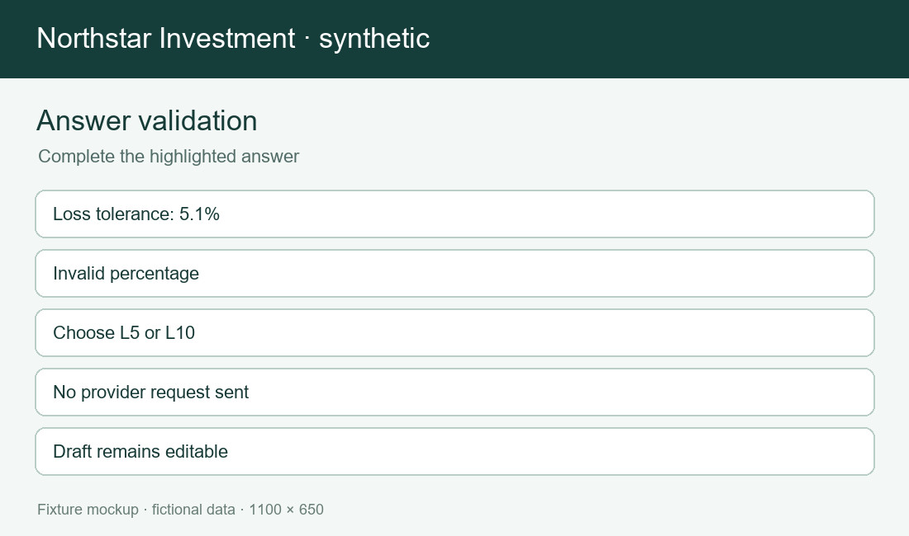
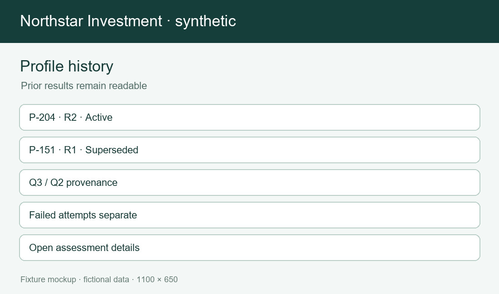

# TICKET-2000 risk profiling epic

TICKET-2000 covers a recoverable Q3 draft, validated consent, idempotent RiskSignal submission, accepted profile history and expiry. Trading and custody are out of scope. A failed reassessment leaves the prior unexpired profile active.

| ID | User story | Product solution | Implementation solution | Acceptance and exception | Ticket and status |
| --- | --- | --- | --- | --- | --- |
| STORY-2001-1 | As an investor or operations reviewer, I want to start a draft so that I can understand the outcome. The phrase 'review the current profile' also occurs in trading context and does not prove this rule. | Product behavior: A verified active investor can start a Q3 draft without an accepted risk band. Start from the current Q3 screen; show the owner, saved version and next action together. The screen cites the applicable dictionary code and distinguishes a saved draft from an accepted profile. | Implementation behavior: Create one editable draft in PostgreSQL and return its opaque draft ID. Use stable draft/profile IDs, a Q3 answer snapshot and RS-2026-09 provider provenance. A second start reopens the existing draft instead of creating a duplicate. | Acceptance: The acceptance path uses seeded investor INV-100 and checks persisted state after a fresh request. A PENDING investor may save but cannot submit; CLOSED is rejected at start. A second start reopens the existing draft instead of creating a duplicate. A failed case never fabricates a provider proposal or silently replaces a prior assessment. | TICKET-2001; status implemented; Q3 / RS-2026-09. The relevant dictionary entries and RiskSignal contract define codes and request fields. Screen references: questionnaire, answer-validation, assessment-result and profile-history. |
| STORY-2001-2 | As an investor or operations reviewer, I want to start a draft so that I can understand the outcome. The phrase 'review the current profile' also occurs in trading context and does not prove this rule. | Product behavior: A verified active investor can start a Q3 draft without an accepted risk band. Reopen the same journey after a browser reload and show any changed version before action. The screen cites the applicable dictionary code and distinguishes a saved draft from an accepted profile. | Implementation behavior: Create one editable draft in PostgreSQL and return its opaque draft ID. Use stable draft/profile IDs, a Q3 answer snapshot and RS-2026-09 provider provenance. A second start reopens the existing draft instead of creating a duplicate. | Acceptance: Acceptance repeats the request with the same identity and confirms that no second accepted result appears. A PENDING investor may save but cannot submit; CLOSED is rejected at start. A second start reopens the existing draft instead of creating a duplicate. A failed case never fabricates a provider proposal or silently replaces a prior assessment. | TICKET-2001; status implemented; Q3 / RS-2026-09. The relevant dictionary entries and RiskSignal contract define codes and request fields. Screen references: questionnaire, answer-validation, assessment-result and profile-history. |
| STORY-2001-3 | As an investor or operations reviewer, I want to start a draft so that I can understand the outcome. The phrase 'review the current profile' also occurs in trading context and does not prove this rule. | Product behavior: A verified active investor can start a Q3 draft without an accepted risk band. Show the exception beside the affected action and retain a recovery route to the draft. The screen cites the applicable dictionary code and distinguishes a saved draft from an accepted profile. | Implementation behavior: Create one editable draft in PostgreSQL and return its opaque draft ID. Use stable draft/profile IDs, a Q3 answer snapshot and RS-2026-09 provider provenance. A second start reopens the existing draft instead of creating a duplicate. | Acceptance: Acceptance asserts the stated failure without a call to unrelated providers or a false active profile. A PENDING investor may save but cannot submit; CLOSED is rejected at start. A second start reopens the existing draft instead of creating a duplicate. A failed case never fabricates a provider proposal or silently replaces a prior assessment. | TICKET-2001; status implemented; Q3 / RS-2026-09. The relevant dictionary entries and RiskSignal contract define codes and request fields. Screen references: questionnaire, answer-validation, assessment-result and profile-history. |
| STORY-2002-1 | As an investor or operations reviewer, I want to choose version so that I can understand the outcome. The phrase 'review the current profile' also occurs in trading context and does not prove this rule. | Product behavior: Show Q3 as the current questionnaire and retain Q1 and Q2 on historical results. Start from the current Q3 screen; show the owner, saved version and next action together. The screen cites the applicable dictionary code and distinguishes a saved draft from an accepted profile. | Implementation behavior: Persist questionnaire_version on the draft and read its effective window. Use stable draft/profile IDs, a Q3 answer snapshot and RS-2026-09 provider provenance. Do not silently map Q2 liquidity answers to Q3. | Acceptance: The acceptance path uses seeded investor INV-100 and checks persisted state after a fresh request. A Q2 draft submitted after 2026-09-01 returns OUTDATED_QUESTIONNAIRE. Do not silently map Q2 liquidity answers to Q3. A failed case never fabricates a provider proposal or silently replaces a prior assessment. | TICKET-2002; status implemented; Q3 / RS-2026-09. The relevant dictionary entries and RiskSignal contract define codes and request fields. Screen references: questionnaire, answer-validation, assessment-result and profile-history. |
| STORY-2002-2 | As an investor or operations reviewer, I want to choose version so that I can understand the outcome. The phrase 'review the current profile' also occurs in trading context and does not prove this rule. | Product behavior: Show Q3 as the current questionnaire and retain Q1 and Q2 on historical results. Reopen the same journey after a browser reload and show any changed version before action. The screen cites the applicable dictionary code and distinguishes a saved draft from an accepted profile. | Implementation behavior: Persist questionnaire_version on the draft and read its effective window. Use stable draft/profile IDs, a Q3 answer snapshot and RS-2026-09 provider provenance. Do not silently map Q2 liquidity answers to Q3. | Acceptance: Acceptance repeats the request with the same identity and confirms that no second accepted result appears. A Q2 draft submitted after 2026-09-01 returns OUTDATED_QUESTIONNAIRE. Do not silently map Q2 liquidity answers to Q3. A failed case never fabricates a provider proposal or silently replaces a prior assessment. | TICKET-2002; status implemented; Q3 / RS-2026-09. The relevant dictionary entries and RiskSignal contract define codes and request fields. Screen references: questionnaire, answer-validation, assessment-result and profile-history. |
| STORY-2002-3 | As an investor or operations reviewer, I want to choose version so that I can understand the outcome. The phrase 'review the current profile' also occurs in trading context and does not prove this rule. | Product behavior: Show Q3 as the current questionnaire and retain Q1 and Q2 on historical results. Show the exception beside the affected action and retain a recovery route to the draft. The screen cites the applicable dictionary code and distinguishes a saved draft from an accepted profile. | Implementation behavior: Persist questionnaire_version on the draft and read its effective window. Use stable draft/profile IDs, a Q3 answer snapshot and RS-2026-09 provider provenance. Do not silently map Q2 liquidity answers to Q3. | Acceptance: Acceptance asserts the stated failure without a call to unrelated providers or a false active profile. A Q2 draft submitted after 2026-09-01 returns OUTDATED_QUESTIONNAIRE. Do not silently map Q2 liquidity answers to Q3. A failed case never fabricates a provider proposal or silently replaces a prior assessment. | TICKET-2002; status implemented; Q3 / RS-2026-09. The relevant dictionary entries and RiskSignal contract define codes and request fields. Screen references: questionnaire, answer-validation, assessment-result and profile-history. |
| STORY-2003-1 | As an investor or operations reviewer, I want to collect answers so that I can understand the outcome. The phrase 'review the current profile' also occurs in trading context and does not prove this rule. | Product behavior: Collect experience and horizon as stable dictionary codes with readable labels. Start from the current Q3 screen; show the owner, saved version and next action together. The screen cites the applicable dictionary code and distinguishes a saved draft from an accepted profile. | Implementation behavior: Validate membership against Q3 dictionary version before saving answers. Use stable draft/profile IDs, a Q3 answer snapshot and RS-2026-09 provider provenance. Month 36 starts H3; the UI shows boundary help beside horizon. | Acceptance: The acceptance path uses seeded investor INV-100 and checks persisted state after a fresh request. Unknown EXPERT and month 35 mapped to H3 are rejected. Month 36 starts H3; the UI shows boundary help beside horizon. A failed case never fabricates a provider proposal or silently replaces a prior assessment. | TICKET-2003; status implemented; Q3 / RS-2026-09. The relevant dictionary entries and RiskSignal contract define codes and request fields. Screen references: questionnaire, answer-validation, assessment-result and profile-history. |
| STORY-2003-2 | As an investor or operations reviewer, I want to collect answers so that I can understand the outcome. The phrase 'review the current profile' also occurs in trading context and does not prove this rule. | Product behavior: Collect experience and horizon as stable dictionary codes with readable labels. Reopen the same journey after a browser reload and show any changed version before action. The screen cites the applicable dictionary code and distinguishes a saved draft from an accepted profile. | Implementation behavior: Validate membership against Q3 dictionary version before saving answers. Use stable draft/profile IDs, a Q3 answer snapshot and RS-2026-09 provider provenance. Month 36 starts H3; the UI shows boundary help beside horizon. | Acceptance: Acceptance repeats the request with the same identity and confirms that no second accepted result appears. Unknown EXPERT and month 35 mapped to H3 are rejected. Month 36 starts H3; the UI shows boundary help beside horizon. A failed case never fabricates a provider proposal or silently replaces a prior assessment. | TICKET-2003; status implemented; Q3 / RS-2026-09. The relevant dictionary entries and RiskSignal contract define codes and request fields. Screen references: questionnaire, answer-validation, assessment-result and profile-history. |
| STORY-2003-3 | As an investor or operations reviewer, I want to collect answers so that I can understand the outcome. The phrase 'review the current profile' also occurs in trading context and does not prove this rule. | Product behavior: Collect experience and horizon as stable dictionary codes with readable labels. Show the exception beside the affected action and retain a recovery route to the draft. The screen cites the applicable dictionary code and distinguishes a saved draft from an accepted profile. | Implementation behavior: Validate membership against Q3 dictionary version before saving answers. Use stable draft/profile IDs, a Q3 answer snapshot and RS-2026-09 provider provenance. Month 36 starts H3; the UI shows boundary help beside horizon. | Acceptance: Acceptance asserts the stated failure without a call to unrelated providers or a false active profile. Unknown EXPERT and month 35 mapped to H3 are rejected. Month 36 starts H3; the UI shows boundary help beside horizon. A failed case never fabricates a provider proposal or silently replaces a prior assessment. | TICKET-2003; status implemented; Q3 / RS-2026-09. The relevant dictionary entries and RiskSignal contract define codes and request fields. Screen references: questionnaire, answer-validation, assessment-result and profile-history. |
| STORY-2004-1 | As an investor or operations reviewer, I want to check capacity so that I can understand the outcome. The phrase 'review the current profile' also occurs in trading context and does not prove this rule. | Product behavior: Collect loss tolerance and liquidity need before assessment. Start from the current Q3 screen; show the owner, saved version and next action together. The screen cites the applicable dictionary code and distinguishes a saved draft from an accepted profile. | Implementation behavior: Require one current loss-tolerance code and one liquidity code. Use stable draft/profile IDs, a Q3 answer snapshot and RS-2026-09 provider provenance. The provider request uses codes rather than labels. | Acceptance: The acceptance path uses seeded investor INV-100 and checks persisted state after a fresh request. A 5.1 percent free-text tolerance is invalid; IMMEDIATE needs explicit confirmation. The provider request uses codes rather than labels. A failed case never fabricates a provider proposal or silently replaces a prior assessment. | TICKET-2004; status implemented; Q3 / RS-2026-09. The relevant dictionary entries and RiskSignal contract define codes and request fields. Screen references: questionnaire, answer-validation, assessment-result and profile-history. |
| STORY-2004-2 | As an investor or operations reviewer, I want to check capacity so that I can understand the outcome. The phrase 'review the current profile' also occurs in trading context and does not prove this rule. | Product behavior: Collect loss tolerance and liquidity need before assessment. Reopen the same journey after a browser reload and show any changed version before action. The screen cites the applicable dictionary code and distinguishes a saved draft from an accepted profile. | Implementation behavior: Require one current loss-tolerance code and one liquidity code. Use stable draft/profile IDs, a Q3 answer snapshot and RS-2026-09 provider provenance. The provider request uses codes rather than labels. | Acceptance: Acceptance repeats the request with the same identity and confirms that no second accepted result appears. A 5.1 percent free-text tolerance is invalid; IMMEDIATE needs explicit confirmation. The provider request uses codes rather than labels. A failed case never fabricates a provider proposal or silently replaces a prior assessment. | TICKET-2004; status implemented; Q3 / RS-2026-09. The relevant dictionary entries and RiskSignal contract define codes and request fields. Screen references: questionnaire, answer-validation, assessment-result and profile-history. |
| STORY-2004-3 | As an investor or operations reviewer, I want to check capacity so that I can understand the outcome. The phrase 'review the current profile' also occurs in trading context and does not prove this rule. | Product behavior: Collect loss tolerance and liquidity need before assessment. Show the exception beside the affected action and retain a recovery route to the draft. The screen cites the applicable dictionary code and distinguishes a saved draft from an accepted profile. | Implementation behavior: Require one current loss-tolerance code and one liquidity code. Use stable draft/profile IDs, a Q3 answer snapshot and RS-2026-09 provider provenance. The provider request uses codes rather than labels. | Acceptance: Acceptance asserts the stated failure without a call to unrelated providers or a false active profile. A 5.1 percent free-text tolerance is invalid; IMMEDIATE needs explicit confirmation. The provider request uses codes rather than labels. A failed case never fabricates a provider proposal or silently replaces a prior assessment. | TICKET-2004; status implemented; Q3 / RS-2026-09. The relevant dictionary entries and RiskSignal contract define codes and request fields. Screen references: questionnaire, answer-validation, assessment-result and profile-history. |
| STORY-2005-1 | As an investor or operations reviewer, I want to record consent so that I can understand the outcome. The phrase 'review the current profile' also occurs in trading context and does not prove this rule. | Product behavior: Show CP-3 processing text and optional marketing consent separately. Start from the current Q3 screen; show the owner, saved version and next action together. The screen cites the applicable dictionary code and distinguishes a saved draft from an accepted profile. | Implementation behavior: Persist required consent revision and UTC acceptance time with the draft. Use stable draft/profile IDs, a Q3 answer snapshot and RS-2026-09 provider provenance. Withdrawal blocks a new submission but retains prior audit. | Acceptance: The acceptance path uses seeded investor INV-100 and checks persisted state after a fresh request. Marketing consent alone cannot enable Submit. Withdrawal blocks a new submission but retains prior audit. A failed case never fabricates a provider proposal or silently replaces a prior assessment. | TICKET-2005; status implemented; Q3 / RS-2026-09. The relevant dictionary entries and RiskSignal contract define codes and request fields. Screen references: questionnaire, answer-validation, assessment-result and profile-history. |
| STORY-2005-2 | As an investor or operations reviewer, I want to record consent so that I can understand the outcome. The phrase 'review the current profile' also occurs in trading context and does not prove this rule. | Product behavior: Show CP-3 processing text and optional marketing consent separately. Reopen the same journey after a browser reload and show any changed version before action. The screen cites the applicable dictionary code and distinguishes a saved draft from an accepted profile. | Implementation behavior: Persist required consent revision and UTC acceptance time with the draft. Use stable draft/profile IDs, a Q3 answer snapshot and RS-2026-09 provider provenance. Withdrawal blocks a new submission but retains prior audit. | Acceptance: Acceptance repeats the request with the same identity and confirms that no second accepted result appears. Marketing consent alone cannot enable Submit. Withdrawal blocks a new submission but retains prior audit. A failed case never fabricates a provider proposal or silently replaces a prior assessment. | TICKET-2005; status implemented; Q3 / RS-2026-09. The relevant dictionary entries and RiskSignal contract define codes and request fields. Screen references: questionnaire, answer-validation, assessment-result and profile-history. |
| STORY-2005-3 | As an investor or operations reviewer, I want to record consent so that I can understand the outcome. The phrase 'review the current profile' also occurs in trading context and does not prove this rule. | Product behavior: Show CP-3 processing text and optional marketing consent separately. Show the exception beside the affected action and retain a recovery route to the draft. The screen cites the applicable dictionary code and distinguishes a saved draft from an accepted profile. | Implementation behavior: Persist required consent revision and UTC acceptance time with the draft. Use stable draft/profile IDs, a Q3 answer snapshot and RS-2026-09 provider provenance. Withdrawal blocks a new submission but retains prior audit. | Acceptance: Acceptance asserts the stated failure without a call to unrelated providers or a false active profile. Marketing consent alone cannot enable Submit. Withdrawal blocks a new submission but retains prior audit. A failed case never fabricates a provider proposal or silently replaces a prior assessment. | TICKET-2005; status implemented; Q3 / RS-2026-09. The relevant dictionary entries and RiskSignal contract define codes and request fields. Screen references: questionnaire, answer-validation, assessment-result and profile-history. |
| STORY-2006-1 | As an investor or operations reviewer, I want to save and reopen so that I can understand the outcome. The phrase 'review the current profile' also occurs in trading context and does not prove this rule. | Product behavior: A returning investor can reopen the last unfinished questionnaire. Start from the current Q3 screen; show the owner, saved version and next action together. The screen cites the applicable dictionary code and distinguishes a saved draft from an accepted profile. | Implementation behavior: Persist a draft revision and compare it on update to avoid silent overwrite. Use stable draft/profile IDs, a Q3 answer snapshot and RS-2026-09 provider provenance. Saving does not call RiskSignal or change the current active profile. | Acceptance: The acceptance path uses seeded investor INV-100 and checks persisted state after a fresh request. An older browser tab receives a conflict and a fresh summary. Saving does not call RiskSignal or change the current active profile. A failed case never fabricates a provider proposal or silently replaces a prior assessment. | TICKET-2006; status implemented; Q3 / RS-2026-09. The relevant dictionary entries and RiskSignal contract define codes and request fields. Screen references: questionnaire, answer-validation, assessment-result and profile-history. |
| STORY-2006-2 | As an investor or operations reviewer, I want to save and reopen so that I can understand the outcome. The phrase 'review the current profile' also occurs in trading context and does not prove this rule. | Product behavior: A returning investor can reopen the last unfinished questionnaire. Reopen the same journey after a browser reload and show any changed version before action. The screen cites the applicable dictionary code and distinguishes a saved draft from an accepted profile. | Implementation behavior: Persist a draft revision and compare it on update to avoid silent overwrite. Use stable draft/profile IDs, a Q3 answer snapshot and RS-2026-09 provider provenance. Saving does not call RiskSignal or change the current active profile. | Acceptance: Acceptance repeats the request with the same identity and confirms that no second accepted result appears. An older browser tab receives a conflict and a fresh summary. Saving does not call RiskSignal or change the current active profile. A failed case never fabricates a provider proposal or silently replaces a prior assessment. | TICKET-2006; status implemented; Q3 / RS-2026-09. The relevant dictionary entries and RiskSignal contract define codes and request fields. Screen references: questionnaire, answer-validation, assessment-result and profile-history. |
| STORY-2006-3 | As an investor or operations reviewer, I want to save and reopen so that I can understand the outcome. The phrase 'review the current profile' also occurs in trading context and does not prove this rule. | Product behavior: A returning investor can reopen the last unfinished questionnaire. Show the exception beside the affected action and retain a recovery route to the draft. The screen cites the applicable dictionary code and distinguishes a saved draft from an accepted profile. | Implementation behavior: Persist a draft revision and compare it on update to avoid silent overwrite. Use stable draft/profile IDs, a Q3 answer snapshot and RS-2026-09 provider provenance. Saving does not call RiskSignal or change the current active profile. | Acceptance: Acceptance asserts the stated failure without a call to unrelated providers or a false active profile. An older browser tab receives a conflict and a fresh summary. Saving does not call RiskSignal or change the current active profile. A failed case never fabricates a provider proposal or silently replaces a prior assessment. | TICKET-2006; status implemented; Q3 / RS-2026-09. The relevant dictionary entries and RiskSignal contract define codes and request fields. Screen references: questionnaire, answer-validation, assessment-result and profile-history. |
| STORY-2007-1 | As an investor or operations reviewer, I want to submit once so that I can understand the outcome. The phrase 'review the current profile' also occurs in trading context and does not prove this rule. | Product behavior: Submit the complete questionnaire with a stable idempotency key. Start from the current Q3 screen; show the owner, saved version and next action together. The screen cites the applicable dictionary code and distinguishes a saved draft from an accepted profile. | Implementation behavior: Lock the draft and reuse the same key for provider retry and accepted result lookup. Use stable draft/profile IDs, a Q3 answer snapshot and RS-2026-09 provider provenance. Duplicate matching submission returns the stored assessment. | Acceptance: The acceptance path uses seeded investor INV-100 and checks persisted state after a fresh request. Changed answers with a reused key return conflict. Duplicate matching submission returns the stored assessment. A failed case never fabricates a provider proposal or silently replaces a prior assessment. | TICKET-2007; status implemented; Q3 / RS-2026-09. The relevant dictionary entries and RiskSignal contract define codes and request fields. Screen references: questionnaire, answer-validation, assessment-result and profile-history. |
| STORY-2007-2 | As an investor or operations reviewer, I want to submit once so that I can understand the outcome. The phrase 'review the current profile' also occurs in trading context and does not prove this rule. | Product behavior: Submit the complete questionnaire with a stable idempotency key. Reopen the same journey after a browser reload and show any changed version before action. The screen cites the applicable dictionary code and distinguishes a saved draft from an accepted profile. | Implementation behavior: Lock the draft and reuse the same key for provider retry and accepted result lookup. Use stable draft/profile IDs, a Q3 answer snapshot and RS-2026-09 provider provenance. Duplicate matching submission returns the stored assessment. | Acceptance: Acceptance repeats the request with the same identity and confirms that no second accepted result appears. Changed answers with a reused key return conflict. Duplicate matching submission returns the stored assessment. A failed case never fabricates a provider proposal or silently replaces a prior assessment. | TICKET-2007; status implemented; Q3 / RS-2026-09. The relevant dictionary entries and RiskSignal contract define codes and request fields. Screen references: questionnaire, answer-validation, assessment-result and profile-history. |
| STORY-2007-3 | As an investor or operations reviewer, I want to submit once so that I can understand the outcome. The phrase 'review the current profile' also occurs in trading context and does not prove this rule. | Product behavior: Submit the complete questionnaire with a stable idempotency key. Show the exception beside the affected action and retain a recovery route to the draft. The screen cites the applicable dictionary code and distinguishes a saved draft from an accepted profile. | Implementation behavior: Lock the draft and reuse the same key for provider retry and accepted result lookup. Use stable draft/profile IDs, a Q3 answer snapshot and RS-2026-09 provider provenance. Duplicate matching submission returns the stored assessment. | Acceptance: Acceptance asserts the stated failure without a call to unrelated providers or a false active profile. Changed answers with a reused key return conflict. Duplicate matching submission returns the stored assessment. A failed case never fabricates a provider proposal or silently replaces a prior assessment. | TICKET-2007; status implemented; Q3 / RS-2026-09. The relevant dictionary entries and RiskSignal contract define codes and request fields. Screen references: questionnaire, answer-validation, assessment-result and profile-history. |
| STORY-2008-1 | As an investor or operations reviewer, I want to obtain proposal so that I can understand the outcome. The phrase 'review the current profile' also occurs in trading context and does not prove this rule. | Product behavior: Explain that RiskSignal proposes R1 to R4 using RS-2026-09 rules. Start from the current Q3 screen; show the owner, saved version and next action together. The screen cites the applicable dictionary code and distinguishes a saved draft from an accepted profile. | Implementation behavior: Call only RiskSignal and validate its ID, band, reasons, timestamp and version. Use stable draft/profile IDs, a Q3 answer snapshot and RS-2026-09 provider provenance. MarketPulse and CustodyBridge receive no risk calls. | Acceptance: The acceptance path uses seeded investor INV-100 and checks persisted state after a fresh request. A missing reason code makes the response incomplete. MarketPulse and CustodyBridge receive no risk calls. A failed case never fabricates a provider proposal or silently replaces a prior assessment. | TICKET-2008; status implemented; Q3 / RS-2026-09. The relevant dictionary entries and RiskSignal contract define codes and request fields. Screen references: questionnaire, answer-validation, assessment-result and profile-history. |
| STORY-2008-2 | As an investor or operations reviewer, I want to obtain proposal so that I can understand the outcome. The phrase 'review the current profile' also occurs in trading context and does not prove this rule. | Product behavior: Explain that RiskSignal proposes R1 to R4 using RS-2026-09 rules. Reopen the same journey after a browser reload and show any changed version before action. The screen cites the applicable dictionary code and distinguishes a saved draft from an accepted profile. | Implementation behavior: Call only RiskSignal and validate its ID, band, reasons, timestamp and version. Use stable draft/profile IDs, a Q3 answer snapshot and RS-2026-09 provider provenance. MarketPulse and CustodyBridge receive no risk calls. | Acceptance: Acceptance repeats the request with the same identity and confirms that no second accepted result appears. A missing reason code makes the response incomplete. MarketPulse and CustodyBridge receive no risk calls. A failed case never fabricates a provider proposal or silently replaces a prior assessment. | TICKET-2008; status implemented; Q3 / RS-2026-09. The relevant dictionary entries and RiskSignal contract define codes and request fields. Screen references: questionnaire, answer-validation, assessment-result and profile-history. |
| STORY-2008-3 | As an investor or operations reviewer, I want to obtain proposal so that I can understand the outcome. The phrase 'review the current profile' also occurs in trading context and does not prove this rule. | Product behavior: Explain that RiskSignal proposes R1 to R4 using RS-2026-09 rules. Show the exception beside the affected action and retain a recovery route to the draft. The screen cites the applicable dictionary code and distinguishes a saved draft from an accepted profile. | Implementation behavior: Call only RiskSignal and validate its ID, band, reasons, timestamp and version. Use stable draft/profile IDs, a Q3 answer snapshot and RS-2026-09 provider provenance. MarketPulse and CustodyBridge receive no risk calls. | Acceptance: Acceptance asserts the stated failure without a call to unrelated providers or a false active profile. A missing reason code makes the response incomplete. MarketPulse and CustodyBridge receive no risk calls. A failed case never fabricates a provider proposal or silently replaces a prior assessment. | TICKET-2008; status implemented; Q3 / RS-2026-09. The relevant dictionary entries and RiskSignal contract define codes and request fields. Screen references: questionnaire, answer-validation, assessment-result and profile-history. |
| STORY-2009-1 | As an investor or operations reviewer, I want to accept result so that I can understand the outcome. The phrase 'review the current profile' also occurs in trading context and does not prove this rule. | Product behavior: Display a proposed band only after the platform persists an accepted assessment. Start from the current Q3 screen; show the owner, saved version and next action together. The screen cites the applicable dictionary code and distinguishes a saved draft from an accepted profile. | Implementation behavior: Write Mongo audit and answer snapshot before PostgreSQL accepted summary. Use stable draft/profile IDs, a Q3 answer snapshot and RS-2026-09 provider provenance. If the later PostgreSQL write fails, an orphan Mongo audit needs planned reconciliation. | Acceptance: The acceptance path uses seeded investor INV-100 and checks persisted state after a fresh request. If Mongo write fails, no new profile is accepted. If the later PostgreSQL write fails, an orphan Mongo audit needs planned reconciliation. A failed case never fabricates a provider proposal or silently replaces a prior assessment. | TICKET-2009; status implemented; Q3 / RS-2026-09. The relevant dictionary entries and RiskSignal contract define codes and request fields. Screen references: questionnaire, answer-validation, assessment-result and profile-history. |
| STORY-2009-2 | As an investor or operations reviewer, I want to accept result so that I can understand the outcome. The phrase 'review the current profile' also occurs in trading context and does not prove this rule. | Product behavior: Display a proposed band only after the platform persists an accepted assessment. Reopen the same journey after a browser reload and show any changed version before action. The screen cites the applicable dictionary code and distinguishes a saved draft from an accepted profile. | Implementation behavior: Write Mongo audit and answer snapshot before PostgreSQL accepted summary. Use stable draft/profile IDs, a Q3 answer snapshot and RS-2026-09 provider provenance. If the later PostgreSQL write fails, an orphan Mongo audit needs planned reconciliation. | Acceptance: Acceptance repeats the request with the same identity and confirms that no second accepted result appears. If Mongo write fails, no new profile is accepted. If the later PostgreSQL write fails, an orphan Mongo audit needs planned reconciliation. A failed case never fabricates a provider proposal or silently replaces a prior assessment. | TICKET-2009; status implemented; Q3 / RS-2026-09. The relevant dictionary entries and RiskSignal contract define codes and request fields. Screen references: questionnaire, answer-validation, assessment-result and profile-history. |
| STORY-2009-3 | As an investor or operations reviewer, I want to accept result so that I can understand the outcome. The phrase 'review the current profile' also occurs in trading context and does not prove this rule. | Product behavior: Display a proposed band only after the platform persists an accepted assessment. Show the exception beside the affected action and retain a recovery route to the draft. The screen cites the applicable dictionary code and distinguishes a saved draft from an accepted profile. | Implementation behavior: Write Mongo audit and answer snapshot before PostgreSQL accepted summary. Use stable draft/profile IDs, a Q3 answer snapshot and RS-2026-09 provider provenance. If the later PostgreSQL write fails, an orphan Mongo audit needs planned reconciliation. | Acceptance: Acceptance asserts the stated failure without a call to unrelated providers or a false active profile. If Mongo write fails, no new profile is accepted. If the later PostgreSQL write fails, an orphan Mongo audit needs planned reconciliation. A failed case never fabricates a provider proposal or silently replaces a prior assessment. | TICKET-2009; status implemented; Q3 / RS-2026-09. The relevant dictionary entries and RiskSignal contract define codes and request fields. Screen references: questionnaire, answer-validation, assessment-result and profile-history. |
| STORY-2010-1 | As an investor or operations reviewer, I want to explain result so that I can understand the outcome. The phrase 'review the current profile' also occurs in trading context and does not prove this rule. | Product behavior: Show the accepted band, reason codes, effective time and rules version. Start from the current Q3 screen; show the owner, saved version and next action together. The screen cites the applicable dictionary code and distinguishes a saved draft from an accepted profile. | Implementation behavior: Return provider provenance with the profile API response. Use stable draft/profile IDs, a Q3 answer snapshot and RS-2026-09 provider provenance. The UI labels synthetic guidance and does not claim investment suitability. | Acceptance: The acceptance path uses seeded investor INV-100 and checks persisted state after a fresh request. A provider proposal is never presented as an accepted profile before persistence. The UI labels synthetic guidance and does not claim investment suitability. A failed case never fabricates a provider proposal or silently replaces a prior assessment. | TICKET-2010; status implemented; Q3 / RS-2026-09. The relevant dictionary entries and RiskSignal contract define codes and request fields. Screen references: questionnaire, answer-validation, assessment-result and profile-history. |
| STORY-2010-2 | As an investor or operations reviewer, I want to explain result so that I can understand the outcome. The phrase 'review the current profile' also occurs in trading context and does not prove this rule. | Product behavior: Show the accepted band, reason codes, effective time and rules version. Reopen the same journey after a browser reload and show any changed version before action. The screen cites the applicable dictionary code and distinguishes a saved draft from an accepted profile. | Implementation behavior: Return provider provenance with the profile API response. Use stable draft/profile IDs, a Q3 answer snapshot and RS-2026-09 provider provenance. The UI labels synthetic guidance and does not claim investment suitability. | Acceptance: Acceptance repeats the request with the same identity and confirms that no second accepted result appears. A provider proposal is never presented as an accepted profile before persistence. The UI labels synthetic guidance and does not claim investment suitability. A failed case never fabricates a provider proposal or silently replaces a prior assessment. | TICKET-2010; status implemented; Q3 / RS-2026-09. The relevant dictionary entries and RiskSignal contract define codes and request fields. Screen references: questionnaire, answer-validation, assessment-result and profile-history. |
| STORY-2010-3 | As an investor or operations reviewer, I want to explain result so that I can understand the outcome. The phrase 'review the current profile' also occurs in trading context and does not prove this rule. | Product behavior: Show the accepted band, reason codes, effective time and rules version. Show the exception beside the affected action and retain a recovery route to the draft. The screen cites the applicable dictionary code and distinguishes a saved draft from an accepted profile. | Implementation behavior: Return provider provenance with the profile API response. Use stable draft/profile IDs, a Q3 answer snapshot and RS-2026-09 provider provenance. The UI labels synthetic guidance and does not claim investment suitability. | Acceptance: Acceptance asserts the stated failure without a call to unrelated providers or a false active profile. A provider proposal is never presented as an accepted profile before persistence. The UI labels synthetic guidance and does not claim investment suitability. A failed case never fabricates a provider proposal or silently replaces a prior assessment. | TICKET-2010; status implemented; Q3 / RS-2026-09. The relevant dictionary entries and RiskSignal contract define codes and request fields. Screen references: questionnaire, answer-validation, assessment-result and profile-history. |
| STORY-2011-1 | As an investor or operations reviewer, I want to show history so that I can understand the outcome. The phrase 'review the current profile' also occurs in trading context and does not prove this rule. | Product behavior: Keep previous accepted profiles accessible with their versions. Start from the current Q3 screen; show the owner, saved version and next action together. The screen cites the applicable dictionary code and distinguishes a saved draft from an accepted profile. | Implementation behavior: Query immutable profile summaries in descending accepted-at order. Use stable draft/profile IDs, a Q3 answer snapshot and RS-2026-09 provider provenance. Historical Q2 rows retain their original questionnaire version. | Acceptance: The acceptance path uses seeded investor INV-100 and checks persisted state after a fresh request. A failed attempt is shown in attempt history, not as an active profile. Historical Q2 rows retain their original questionnaire version. A failed case never fabricates a provider proposal or silently replaces a prior assessment. | TICKET-2011; status implemented; Q3 / RS-2026-09. The relevant dictionary entries and RiskSignal contract define codes and request fields. Screen references: questionnaire, answer-validation, assessment-result and profile-history. |
| STORY-2011-2 | As an investor or operations reviewer, I want to show history so that I can understand the outcome. The phrase 'review the current profile' also occurs in trading context and does not prove this rule. | Product behavior: Keep previous accepted profiles accessible with their versions. Reopen the same journey after a browser reload and show any changed version before action. The screen cites the applicable dictionary code and distinguishes a saved draft from an accepted profile. | Implementation behavior: Query immutable profile summaries in descending accepted-at order. Use stable draft/profile IDs, a Q3 answer snapshot and RS-2026-09 provider provenance. Historical Q2 rows retain their original questionnaire version. | Acceptance: Acceptance repeats the request with the same identity and confirms that no second accepted result appears. A failed attempt is shown in attempt history, not as an active profile. Historical Q2 rows retain their original questionnaire version. A failed case never fabricates a provider proposal or silently replaces a prior assessment. | TICKET-2011; status implemented; Q3 / RS-2026-09. The relevant dictionary entries and RiskSignal contract define codes and request fields. Screen references: questionnaire, answer-validation, assessment-result and profile-history. |
| STORY-2011-3 | As an investor or operations reviewer, I want to show history so that I can understand the outcome. The phrase 'review the current profile' also occurs in trading context and does not prove this rule. | Product behavior: Keep previous accepted profiles accessible with their versions. Show the exception beside the affected action and retain a recovery route to the draft. The screen cites the applicable dictionary code and distinguishes a saved draft from an accepted profile. | Implementation behavior: Query immutable profile summaries in descending accepted-at order. Use stable draft/profile IDs, a Q3 answer snapshot and RS-2026-09 provider provenance. Historical Q2 rows retain their original questionnaire version. | Acceptance: Acceptance asserts the stated failure without a call to unrelated providers or a false active profile. A failed attempt is shown in attempt history, not as an active profile. Historical Q2 rows retain their original questionnaire version. A failed case never fabricates a provider proposal or silently replaces a prior assessment. | TICKET-2011; status implemented; Q3 / RS-2026-09. The relevant dictionary entries and RiskSignal contract define codes and request fields. Screen references: questionnaire, answer-validation, assessment-result and profile-history. |
| STORY-2012-1 | As an investor or operations reviewer, I want to recover from timeout so that I can understand the outcome. The phrase 'review the current profile' also occurs in trading context and does not prove this rule. | Product behavior: A timeout offers retry without changing the investor's current result. Start from the current Q3 screen; show the owner, saved version and next action together. The screen cites the applicable dictionary code and distinguishes a saved draft from an accepted profile. | Implementation behavior: Reuse idempotency key and correlation ID for one provider retry. Use stable draft/profile IDs, a Q3 answer snapshot and RS-2026-09 provider provenance. After exhaustion the draft is recoverable and the prior profile stays active. | Acceptance: The acceptance path uses seeded investor INV-100 and checks persisted state after a fresh request. Unknown provider outcome is not treated as a negative band. After exhaustion the draft is recoverable and the prior profile stays active. A failed case never fabricates a provider proposal or silently replaces a prior assessment. | TICKET-2012; status implemented; Q3 / RS-2026-09. The relevant dictionary entries and RiskSignal contract define codes and request fields. Screen references: questionnaire, answer-validation, assessment-result and profile-history. |
| STORY-2012-2 | As an investor or operations reviewer, I want to recover from timeout so that I can understand the outcome. The phrase 'review the current profile' also occurs in trading context and does not prove this rule. | Product behavior: A timeout offers retry without changing the investor's current result. Reopen the same journey after a browser reload and show any changed version before action. The screen cites the applicable dictionary code and distinguishes a saved draft from an accepted profile. | Implementation behavior: Reuse idempotency key and correlation ID for one provider retry. Use stable draft/profile IDs, a Q3 answer snapshot and RS-2026-09 provider provenance. After exhaustion the draft is recoverable and the prior profile stays active. | Acceptance: Acceptance repeats the request with the same identity and confirms that no second accepted result appears. Unknown provider outcome is not treated as a negative band. After exhaustion the draft is recoverable and the prior profile stays active. A failed case never fabricates a provider proposal or silently replaces a prior assessment. | TICKET-2012; status implemented; Q3 / RS-2026-09. The relevant dictionary entries and RiskSignal contract define codes and request fields. Screen references: questionnaire, answer-validation, assessment-result and profile-history. |
| STORY-2012-3 | As an investor or operations reviewer, I want to recover from timeout so that I can understand the outcome. The phrase 'review the current profile' also occurs in trading context and does not prove this rule. | Product behavior: A timeout offers retry without changing the investor's current result. Show the exception beside the affected action and retain a recovery route to the draft. The screen cites the applicable dictionary code and distinguishes a saved draft from an accepted profile. | Implementation behavior: Reuse idempotency key and correlation ID for one provider retry. Use stable draft/profile IDs, a Q3 answer snapshot and RS-2026-09 provider provenance. After exhaustion the draft is recoverable and the prior profile stays active. | Acceptance: Acceptance asserts the stated failure without a call to unrelated providers or a false active profile. Unknown provider outcome is not treated as a negative band. After exhaustion the draft is recoverable and the prior profile stays active. A failed case never fabricates a provider proposal or silently replaces a prior assessment. | TICKET-2012; status implemented; Q3 / RS-2026-09. The relevant dictionary entries and RiskSignal contract define codes and request fields. Screen references: questionnaire, answer-validation, assessment-result and profile-history. |
| STORY-2013-1 | As an investor or operations reviewer, I want to expire profile so that I can understand the outcome. The phrase 'review the current profile' also occurs in trading context and does not prove this rule. | Product behavior: Mark accepted profiles expired 365 days after acceptance. Start from the current Q3 screen; show the owner, saved version and next action together. The screen cites the applicable dictionary code and distinguishes a saved draft from an accepted profile. | Implementation behavior: Compute expiry on reads; a durable EXPIRED transition through reconciliation is planned, not implemented. Use stable draft/profile IDs, a Q3 answer snapshot and RS-2026-09 provider provenance. An expired profile remains in history but is not current. | Acceptance: The acceptance path uses seeded investor INV-100 and checks persisted state after a fresh request. Day 365 at the same UTC instant is expired. An expired profile remains in history but is not current. A failed case never fabricates a provider proposal or silently replaces a prior assessment. | TICKET-2013; status partial; Q3 / RS-2026-09. The relevant dictionary entries and RiskSignal contract define codes and request fields. Screen references: questionnaire, answer-validation, assessment-result and profile-history. |
| STORY-2013-2 | As an investor or operations reviewer, I want to expire profile so that I can understand the outcome. The phrase 'review the current profile' also occurs in trading context and does not prove this rule. | Product behavior: Mark accepted profiles expired 365 days after acceptance. Reopen the same journey after a browser reload and show any changed version before action. The screen cites the applicable dictionary code and distinguishes a saved draft from an accepted profile. | Implementation behavior: Compute expiry on reads; a durable EXPIRED transition through reconciliation is planned, not implemented. Use stable draft/profile IDs, a Q3 answer snapshot and RS-2026-09 provider provenance. An expired profile remains in history but is not current. | Acceptance: Acceptance repeats the request with the same identity and confirms that no second accepted result appears. Day 365 at the same UTC instant is expired. An expired profile remains in history but is not current. A failed case never fabricates a provider proposal or silently replaces a prior assessment. | TICKET-2013; status partial; Q3 / RS-2026-09. The relevant dictionary entries and RiskSignal contract define codes and request fields. Screen references: questionnaire, answer-validation, assessment-result and profile-history. |
| STORY-2013-3 | As an investor or operations reviewer, I want to expire profile so that I can understand the outcome. The phrase 'review the current profile' also occurs in trading context and does not prove this rule. | Product behavior: Mark accepted profiles expired 365 days after acceptance. Show the exception beside the affected action and retain a recovery route to the draft. The screen cites the applicable dictionary code and distinguishes a saved draft from an accepted profile. | Implementation behavior: Compute expiry on reads; a durable EXPIRED transition through reconciliation is planned, not implemented. Use stable draft/profile IDs, a Q3 answer snapshot and RS-2026-09 provider provenance. An expired profile remains in history but is not current. | Acceptance: Acceptance asserts the stated failure without a call to unrelated providers or a false active profile. Day 365 at the same UTC instant is expired. An expired profile remains in history but is not current. A failed case never fabricates a provider proposal or silently replaces a prior assessment. | TICKET-2013; status partial; Q3 / RS-2026-09. The relevant dictionary entries and RiskSignal contract define codes and request fields. Screen references: questionnaire, answer-validation, assessment-result and profile-history. |
| STORY-2014-1 | As an investor or operations reviewer, I want to reassess so that I can understand the outcome. The phrase 'review the current profile' also occurs in trading context and does not prove this rule. | Product behavior: Start a new draft without deleting the previous accepted assessment. Start from the current Q3 screen; show the owner, saved version and next action together. The screen cites the applicable dictionary code and distinguishes a saved draft from an accepted profile. | Implementation behavior: Supersede the prior active summary only after a new result is accepted. Use stable draft/profile IDs, a Q3 answer snapshot and RS-2026-09 provider provenance. A new result refers to its own answers and rules version. | Acceptance: The acceptance path uses seeded investor INV-100 and checks persisted state after a fresh request. Failed reassessment leaves the previous unexpired profile active. A new result refers to its own answers and rules version. A failed case never fabricates a provider proposal or silently replaces a prior assessment. | TICKET-2014; status implemented; Q3 / RS-2026-09. The relevant dictionary entries and RiskSignal contract define codes and request fields. Screen references: questionnaire, answer-validation, assessment-result and profile-history. |
| STORY-2014-2 | As an investor or operations reviewer, I want to reassess so that I can understand the outcome. The phrase 'review the current profile' also occurs in trading context and does not prove this rule. | Product behavior: Start a new draft without deleting the previous accepted assessment. Reopen the same journey after a browser reload and show any changed version before action. The screen cites the applicable dictionary code and distinguishes a saved draft from an accepted profile. | Implementation behavior: Supersede the prior active summary only after a new result is accepted. Use stable draft/profile IDs, a Q3 answer snapshot and RS-2026-09 provider provenance. A new result refers to its own answers and rules version. | Acceptance: Acceptance repeats the request with the same identity and confirms that no second accepted result appears. Failed reassessment leaves the previous unexpired profile active. A new result refers to its own answers and rules version. A failed case never fabricates a provider proposal or silently replaces a prior assessment. | TICKET-2014; status implemented; Q3 / RS-2026-09. The relevant dictionary entries and RiskSignal contract define codes and request fields. Screen references: questionnaire, answer-validation, assessment-result and profile-history. |
| STORY-2014-3 | As an investor or operations reviewer, I want to reassess so that I can understand the outcome. The phrase 'review the current profile' also occurs in trading context and does not prove this rule. | Product behavior: Start a new draft without deleting the previous accepted assessment. Show the exception beside the affected action and retain a recovery route to the draft. The screen cites the applicable dictionary code and distinguishes a saved draft from an accepted profile. | Implementation behavior: Supersede the prior active summary only after a new result is accepted. Use stable draft/profile IDs, a Q3 answer snapshot and RS-2026-09 provider provenance. A new result refers to its own answers and rules version. | Acceptance: Acceptance asserts the stated failure without a call to unrelated providers or a false active profile. Failed reassessment leaves the previous unexpired profile active. A new result refers to its own answers and rules version. A failed case never fabricates a provider proposal or silently replaces a prior assessment. | TICKET-2014; status implemented; Q3 / RS-2026-09. The relevant dictionary entries and RiskSignal contract define codes and request fields. Screen references: questionnaire, answer-validation, assessment-result and profile-history. |
| STORY-2015-1 | As an investor or operations reviewer, I want to reject incomplete input so that I can understand the outcome. The phrase 'review the current profile' also occurs in trading context and does not prove this rule. | Product behavior: Mark missing fields beside the exact questionnaire question. Start from the current Q3 screen; show the owner, saved version and next action together. The screen cites the applicable dictionary code and distinguishes a saved draft from an accepted profile. | Implementation behavior: Return structured field errors before provider dispatch. Use stable draft/profile IDs, a Q3 answer snapshot and RS-2026-09 provider provenance. The draft remains editable after validation failure. | Acceptance: The acceptance path uses seeded investor INV-100 and checks persisted state after a fresh request. No provider call occurs for missing liquidity or absent processing consent. The draft remains editable after validation failure. A failed case never fabricates a provider proposal or silently replaces a prior assessment. | TICKET-2015; status implemented; Q3 / RS-2026-09. The relevant dictionary entries and RiskSignal contract define codes and request fields. Screen references: questionnaire, answer-validation, assessment-result and profile-history. |
| STORY-2015-2 | As an investor or operations reviewer, I want to reject incomplete input so that I can understand the outcome. The phrase 'review the current profile' also occurs in trading context and does not prove this rule. | Product behavior: Mark missing fields beside the exact questionnaire question. Reopen the same journey after a browser reload and show any changed version before action. The screen cites the applicable dictionary code and distinguishes a saved draft from an accepted profile. | Implementation behavior: Return structured field errors before provider dispatch. Use stable draft/profile IDs, a Q3 answer snapshot and RS-2026-09 provider provenance. The draft remains editable after validation failure. | Acceptance: Acceptance repeats the request with the same identity and confirms that no second accepted result appears. No provider call occurs for missing liquidity or absent processing consent. The draft remains editable after validation failure. A failed case never fabricates a provider proposal or silently replaces a prior assessment. | TICKET-2015; status implemented; Q3 / RS-2026-09. The relevant dictionary entries and RiskSignal contract define codes and request fields. Screen references: questionnaire, answer-validation, assessment-result and profile-history. |
| STORY-2015-3 | As an investor or operations reviewer, I want to reject incomplete input so that I can understand the outcome. The phrase 'review the current profile' also occurs in trading context and does not prove this rule. | Product behavior: Mark missing fields beside the exact questionnaire question. Show the exception beside the affected action and retain a recovery route to the draft. The screen cites the applicable dictionary code and distinguishes a saved draft from an accepted profile. | Implementation behavior: Return structured field errors before provider dispatch. Use stable draft/profile IDs, a Q3 answer snapshot and RS-2026-09 provider provenance. The draft remains editable after validation failure. | Acceptance: Acceptance asserts the stated failure without a call to unrelated providers or a false active profile. No provider call occurs for missing liquidity or absent processing consent. The draft remains editable after validation failure. A failed case never fabricates a provider proposal or silently replaces a prior assessment. | TICKET-2015; status implemented; Q3 / RS-2026-09. The relevant dictionary entries and RiskSignal contract define codes and request fields. Screen references: questionnaire, answer-validation, assessment-result and profile-history. |
| STORY-2016-1 | As an investor or operations reviewer, I want to reject stale version so that I can understand the outcome. The phrase 'review the current profile' also occurs in trading context and does not prove this rule. | Product behavior: A retired questionnaire requires the investor to review current questions. Start from the current Q3 screen; show the owner, saved version and next action together. The screen cites the applicable dictionary code and distinguishes a saved draft from an accepted profile. | Implementation behavior: Compare the draft version with current Q3 at submission. Use stable draft/profile IDs, a Q3 answer snapshot and RS-2026-09 provider provenance. No automatic upgrade carries inferred answers forward. | Acceptance: The acceptance path uses seeded investor INV-100 and checks persisted state after a fresh request. The old draft stays readable but cannot be submitted unchanged. No automatic upgrade carries inferred answers forward. A failed case never fabricates a provider proposal or silently replaces a prior assessment. | TICKET-2016; status implemented; Q3 / RS-2026-09. The relevant dictionary entries and RiskSignal contract define codes and request fields. Screen references: questionnaire, answer-validation, assessment-result and profile-history. |
| STORY-2016-2 | As an investor or operations reviewer, I want to reject stale version so that I can understand the outcome. The phrase 'review the current profile' also occurs in trading context and does not prove this rule. | Product behavior: A retired questionnaire requires the investor to review current questions. Reopen the same journey after a browser reload and show any changed version before action. The screen cites the applicable dictionary code and distinguishes a saved draft from an accepted profile. | Implementation behavior: Compare the draft version with current Q3 at submission. Use stable draft/profile IDs, a Q3 answer snapshot and RS-2026-09 provider provenance. No automatic upgrade carries inferred answers forward. | Acceptance: Acceptance repeats the request with the same identity and confirms that no second accepted result appears. The old draft stays readable but cannot be submitted unchanged. No automatic upgrade carries inferred answers forward. A failed case never fabricates a provider proposal or silently replaces a prior assessment. | TICKET-2016; status implemented; Q3 / RS-2026-09. The relevant dictionary entries and RiskSignal contract define codes and request fields. Screen references: questionnaire, answer-validation, assessment-result and profile-history. |
| STORY-2016-3 | As an investor or operations reviewer, I want to reject stale version so that I can understand the outcome. The phrase 'review the current profile' also occurs in trading context and does not prove this rule. | Product behavior: A retired questionnaire requires the investor to review current questions. Show the exception beside the affected action and retain a recovery route to the draft. The screen cites the applicable dictionary code and distinguishes a saved draft from an accepted profile. | Implementation behavior: Compare the draft version with current Q3 at submission. Use stable draft/profile IDs, a Q3 answer snapshot and RS-2026-09 provider provenance. No automatic upgrade carries inferred answers forward. | Acceptance: Acceptance asserts the stated failure without a call to unrelated providers or a false active profile. The old draft stays readable but cannot be submitted unchanged. No automatic upgrade carries inferred answers forward. A failed case never fabricates a provider proposal or silently replaces a prior assessment. | TICKET-2016; status implemented; Q3 / RS-2026-09. The relevant dictionary entries and RiskSignal contract define codes and request fields. Screen references: questionnaire, answer-validation, assessment-result and profile-history. |
| STORY-2017-1 | As an investor or operations reviewer, I want to handle provider outage so that I can understand the outcome. The phrase 'review the current profile' also occurs in trading context and does not prove this rule. | Product behavior: Show a recoverable error without an invented profile. Start from the current Q3 screen; show the owner, saved version and next action together. The screen cites the applicable dictionary code and distinguishes a saved draft from an accepted profile. | Implementation behavior: Record failed attempt status and retain an audit reference when available. Use stable draft/profile IDs, a Q3 answer snapshot and RS-2026-09 provider provenance. Retry uses the original submission key. | Acceptance: The acceptance path uses seeded investor INV-100 and checks persisted state after a fresh request. HTTP 503 never supersedes an existing ACTIVE profile. Retry uses the original submission key. A failed case never fabricates a provider proposal or silently replaces a prior assessment. | TICKET-2017; status implemented; Q3 / RS-2026-09. The relevant dictionary entries and RiskSignal contract define codes and request fields. Screen references: questionnaire, answer-validation, assessment-result and profile-history. |
| STORY-2017-2 | As an investor or operations reviewer, I want to handle provider outage so that I can understand the outcome. The phrase 'review the current profile' also occurs in trading context and does not prove this rule. | Product behavior: Show a recoverable error without an invented profile. Reopen the same journey after a browser reload and show any changed version before action. The screen cites the applicable dictionary code and distinguishes a saved draft from an accepted profile. | Implementation behavior: Record failed attempt status and retain an audit reference when available. Use stable draft/profile IDs, a Q3 answer snapshot and RS-2026-09 provider provenance. Retry uses the original submission key. | Acceptance: Acceptance repeats the request with the same identity and confirms that no second accepted result appears. HTTP 503 never supersedes an existing ACTIVE profile. Retry uses the original submission key. A failed case never fabricates a provider proposal or silently replaces a prior assessment. | TICKET-2017; status implemented; Q3 / RS-2026-09. The relevant dictionary entries and RiskSignal contract define codes and request fields. Screen references: questionnaire, answer-validation, assessment-result and profile-history. |
| STORY-2017-3 | As an investor or operations reviewer, I want to handle provider outage so that I can understand the outcome. The phrase 'review the current profile' also occurs in trading context and does not prove this rule. | Product behavior: Show a recoverable error without an invented profile. Show the exception beside the affected action and retain a recovery route to the draft. The screen cites the applicable dictionary code and distinguishes a saved draft from an accepted profile. | Implementation behavior: Record failed attempt status and retain an audit reference when available. Use stable draft/profile IDs, a Q3 answer snapshot and RS-2026-09 provider provenance. Retry uses the original submission key. | Acceptance: Acceptance asserts the stated failure without a call to unrelated providers or a false active profile. HTTP 503 never supersedes an existing ACTIVE profile. Retry uses the original submission key. A failed case never fabricates a provider proposal or silently replaces a prior assessment. | TICKET-2017; status implemented; Q3 / RS-2026-09. The relevant dictionary entries and RiskSignal contract define codes and request fields. Screen references: questionnaire, answer-validation, assessment-result and profile-history. |
| STORY-2018-1 | As an investor or operations reviewer, I want to expose integration status so that I can understand the outcome. The phrase 'review the current profile' also occurs in trading context and does not prove this rule. | Product behavior: Operations will see local stub health and last error in a planned status view. Start from the current Q3 screen; show the owner, saved version and next action together. The screen cites the applicable dictionary code and distinguishes a saved draft from an accepted profile. | Implementation behavior: The mockup keeps provider status separate from investor profile data; the live UI is planned. Use stable draft/profile IDs, a Q3 answer snapshot and RS-2026-09 provider provenance. Quote and custody status belong to separate integrations. | Acceptance: The acceptance path uses seeded investor INV-100 and checks persisted state after a fresh request. An S2 operational incident does not imply an R2 investor band. Quote and custody status belong to separate integrations. A failed case never fabricates a provider proposal or silently replaces a prior assessment. | TICKET-2018; status planned; Q3 / RS-2026-09. The relevant dictionary entries and RiskSignal contract define codes and request fields. Screen references: questionnaire, answer-validation, assessment-result and profile-history. |
| STORY-2018-2 | As an investor or operations reviewer, I want to expose integration status so that I can understand the outcome. The phrase 'review the current profile' also occurs in trading context and does not prove this rule. | Product behavior: Operations will see local stub health and last error in a planned status view. Reopen the same journey after a browser reload and show any changed version before action. The screen cites the applicable dictionary code and distinguishes a saved draft from an accepted profile. | Implementation behavior: The mockup keeps provider status separate from investor profile data; the live UI is planned. Use stable draft/profile IDs, a Q3 answer snapshot and RS-2026-09 provider provenance. Quote and custody status belong to separate integrations. | Acceptance: Acceptance repeats the request with the same identity and confirms that no second accepted result appears. An S2 operational incident does not imply an R2 investor band. Quote and custody status belong to separate integrations. A failed case never fabricates a provider proposal or silently replaces a prior assessment. | TICKET-2018; status planned; Q3 / RS-2026-09. The relevant dictionary entries and RiskSignal contract define codes and request fields. Screen references: questionnaire, answer-validation, assessment-result and profile-history. |
| STORY-2018-3 | As an investor or operations reviewer, I want to expose integration status so that I can understand the outcome. The phrase 'review the current profile' also occurs in trading context and does not prove this rule. | Product behavior: Operations will see local stub health and last error in a planned status view. Show the exception beside the affected action and retain a recovery route to the draft. The screen cites the applicable dictionary code and distinguishes a saved draft from an accepted profile. | Implementation behavior: The mockup keeps provider status separate from investor profile data; the live UI is planned. Use stable draft/profile IDs, a Q3 answer snapshot and RS-2026-09 provider provenance. Quote and custody status belong to separate integrations. | Acceptance: Acceptance asserts the stated failure without a call to unrelated providers or a false active profile. An S2 operational incident does not imply an R2 investor band. Quote and custody status belong to separate integrations. A failed case never fabricates a provider proposal or silently replaces a prior assessment. | TICKET-2018; status planned; Q3 / RS-2026-09. The relevant dictionary entries and RiskSignal contract define codes and request fields. Screen references: questionnaire, answer-validation, assessment-result and profile-history. |
| STORY-2019-1 | As an investor or operations reviewer, I want to clarify threshold so that I can understand the outcome. The phrase 'review the current profile' also occurs in trading context and does not prove this rule. | Product behavior: Show that an exact 5 percent answer maps to L5. Start from the current Q3 screen; show the owner, saved version and next action together. The screen cites the applicable dictionary code and distinguishes a saved draft from an accepted profile. | Implementation behavior: Use current dictionary-code validation for the L5 and L10 boundaries. Use stable draft/profile IDs, a Q3 answer snapshot and RS-2026-09 provider provenance. Boundary acceptance covers L5, invalid 5.1 and L10. | Acceptance: The acceptance path uses seeded investor INV-100 and checks persisted state after a fresh request. Historical revision before this fix accepted free-text 5.1 as a tolerance input; current behavior rejects it. Boundary acceptance covers L5, invalid 5.1 and L10. A failed case never fabricates a provider proposal or silently replaces a prior assessment. | TICKET-2019; status implemented; Q3 / RS-2026-09. The relevant dictionary entries and RiskSignal contract define codes and request fields. Screen references: questionnaire, answer-validation, assessment-result and profile-history. |
| STORY-2019-2 | As an investor or operations reviewer, I want to clarify threshold so that I can understand the outcome. The phrase 'review the current profile' also occurs in trading context and does not prove this rule. | Product behavior: Show that an exact 5 percent answer maps to L5. Reopen the same journey after a browser reload and show any changed version before action. The screen cites the applicable dictionary code and distinguishes a saved draft from an accepted profile. | Implementation behavior: Use current dictionary-code validation for the L5 and L10 boundaries. Use stable draft/profile IDs, a Q3 answer snapshot and RS-2026-09 provider provenance. Boundary acceptance covers L5, invalid 5.1 and L10. | Acceptance: Acceptance repeats the request with the same identity and confirms that no second accepted result appears. Historical revision before this fix accepted free-text 5.1 as a tolerance input; current behavior rejects it. Boundary acceptance covers L5, invalid 5.1 and L10. A failed case never fabricates a provider proposal or silently replaces a prior assessment. | TICKET-2019; status historical discrepancy; Q3 / RS-2026-09. The relevant dictionary entries and RiskSignal contract define codes and request fields. Screen references: questionnaire, answer-validation, assessment-result and profile-history. |
| STORY-2019-3 | As an investor or operations reviewer, I want to clarify threshold so that I can understand the outcome. The phrase 'review the current profile' also occurs in trading context and does not prove this rule. | Product behavior: Show that an exact 5 percent answer maps to L5. Show the exception beside the affected action and retain a recovery route to the draft. The screen cites the applicable dictionary code and distinguishes a saved draft from an accepted profile. | Implementation behavior: Use current dictionary-code validation for the L5 and L10 boundaries. Use stable draft/profile IDs, a Q3 answer snapshot and RS-2026-09 provider provenance. Boundary acceptance covers L5, invalid 5.1 and L10. | Acceptance: Acceptance asserts the stated failure without a call to unrelated providers or a false active profile. Historical revision before this fix accepted free-text 5.1 as a tolerance input; current behavior rejects it. Boundary acceptance covers L5, invalid 5.1 and L10. A failed case never fabricates a provider proposal or silently replaces a prior assessment. | TICKET-2019; status implemented; Q3 / RS-2026-09. The relevant dictionary entries and RiskSignal contract define codes and request fields. Screen references: questionnaire, answer-validation, assessment-result and profile-history. |
| STORY-2020-1 | As an investor or operations reviewer, I want to track orphan audits so that I can understand the outcome. The phrase 'review the current profile' also occurs in trading context and does not prove this rule. | Product behavior: Operations can identify a Mongo audit without a PostgreSQL result. Start from the current Q3 screen; show the owner, saved version and next action together. The screen cites the applicable dictionary code and distinguishes a saved draft from an accepted profile. | Implementation behavior: Planned reconciliation would match providerAssessmentId and draft ID. Use stable draft/profile IDs, a Q3 answer snapshot and RS-2026-09 provider provenance. Such an orphan must not be displayed as an accepted profile. | Acceptance: The acceptance path uses seeded investor INV-100 and checks persisted state after a fresh request. No automatic repair is implemented in this fixture revision. Such an orphan must not be displayed as an accepted profile. A failed case never fabricates a provider proposal or silently replaces a prior assessment. | TICKET-2020; status planned; Q3 / RS-2026-09. The relevant dictionary entries and RiskSignal contract define codes and request fields. Screen references: questionnaire, answer-validation, assessment-result and profile-history. |
| STORY-2020-2 | As an investor or operations reviewer, I want to track orphan audits so that I can understand the outcome. The phrase 'review the current profile' also occurs in trading context and does not prove this rule. | Product behavior: Operations can identify a Mongo audit without a PostgreSQL result. Reopen the same journey after a browser reload and show any changed version before action. The screen cites the applicable dictionary code and distinguishes a saved draft from an accepted profile. | Implementation behavior: Planned reconciliation would match providerAssessmentId and draft ID. Use stable draft/profile IDs, a Q3 answer snapshot and RS-2026-09 provider provenance. Such an orphan must not be displayed as an accepted profile. | Acceptance: Acceptance repeats the request with the same identity and confirms that no second accepted result appears. No automatic repair is implemented in this fixture revision. Such an orphan must not be displayed as an accepted profile. A failed case never fabricates a provider proposal or silently replaces a prior assessment. | TICKET-2020; status planned; Q3 / RS-2026-09. The relevant dictionary entries and RiskSignal contract define codes and request fields. Screen references: questionnaire, answer-validation, assessment-result and profile-history. |
| STORY-2020-3 | As an investor or operations reviewer, I want to track orphan audits so that I can understand the outcome. The phrase 'review the current profile' also occurs in trading context and does not prove this rule. | Product behavior: Operations can identify a Mongo audit without a PostgreSQL result. Show the exception beside the affected action and retain a recovery route to the draft. The screen cites the applicable dictionary code and distinguishes a saved draft from an accepted profile. | Implementation behavior: Planned reconciliation would match providerAssessmentId and draft ID. Use stable draft/profile IDs, a Q3 answer snapshot and RS-2026-09 provider provenance. Such an orphan must not be displayed as an accepted profile. | Acceptance: Acceptance asserts the stated failure without a call to unrelated providers or a false active profile. No automatic repair is implemented in this fixture revision. Such an orphan must not be displayed as an accepted profile. A failed case never fabricates a provider proposal or silently replaces a prior assessment. | TICKET-2020; status planned; Q3 / RS-2026-09. The relevant dictionary entries and RiskSignal contract define codes and request fields. Screen references: questionnaire, answer-validation, assessment-result and profile-history. |

## Visual references

Caption: The current Q3 questionnaire exposes required answers and CP-3 consent.

![answer-validation reference][answer-validation-image]
[answer-validation-image]: assets/answer-validation.jpg
Caption: An invalid 5.1 percent answer is rejected before any provider call.

Caption: The accepted result displays R2 with reasons and RS-2026-09 provenance.

Caption: Historical results remain readable with their original questionnaire and rules versions.

Current correction: exactly 5 percent maps to L5; historical pre-fix behavior accepted free-text 5.1 as a tolerance input and is not current.

Review pending for orphan audit.

Unresolved product ambiguity: whether an expired profile may be displayed on the trading confirmation screen needs a recorded product decision; this fixture excludes that claim.
