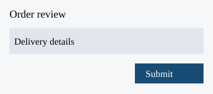

# Order Review

Shoppers and merchants can submit an order for review only while their account is active.

For shoppers in Poland, the self-service order limit is PLN 500 per order. Orders above PLN 500 require a specialist's manual approval.

For merchants in Ireland, the self-service order limit is EUR 500 per order. Orders above EUR 500 require a specialist's manual approval.

Both roles can save a draft for 30 days. Drafts under a legal hold remain available beyond 30 days; the deletion date after the hold ends is not specified.

On submission, the Review service validates whether required delivery details are complete. Complete submissions move from Submitted to Validated. Incomplete submissions move from Submitted to Needs correction and return to the submitting role.

After the submitting role supplies the missing delivery details, resubmission moves Needs correction to Submitted and repeats validation.

When the order is Validated and within the applicable self-service limit, the Review service moves it to Approved. Above that limit, it moves to Manual review; only a specialist can then approve it. A manual-review rejection path is not documented.

Once an order is Approved, the Review service hands the approved order identifier to the Fulfilment service. Fulfilment then records the order as Queued. No delivery-time guarantee is stated.

The Review service records the submitting role, decision and time for every approval. Specialists can inspect this approval history; the sources do not specify a retention period for that history.

The review panel supports checking delivery details before submission. The image is an illustrative layout and does not establish extra product behavior.

The same illustrative panel applies to merchant submissions.

